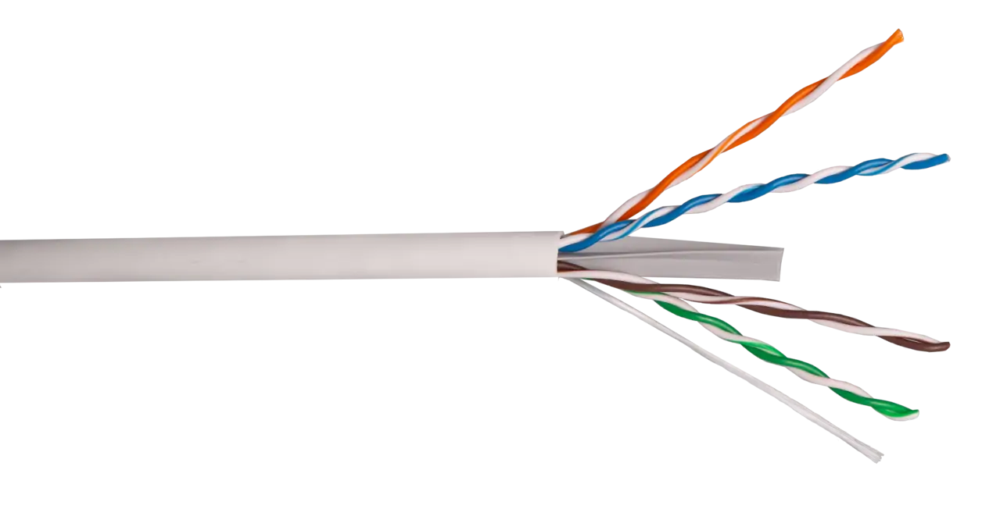
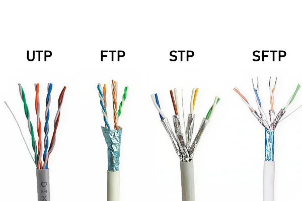
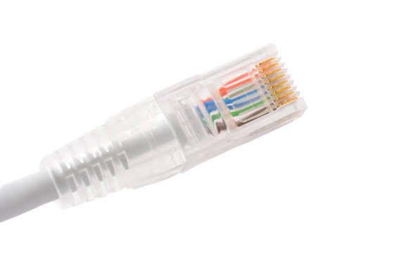
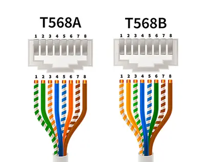
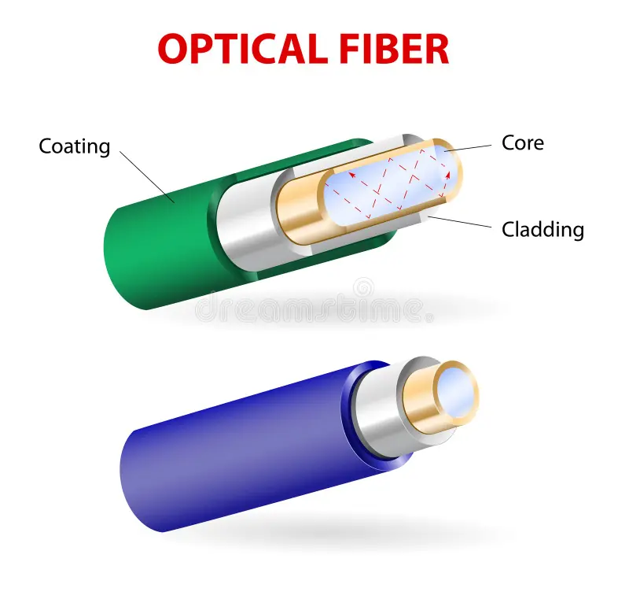
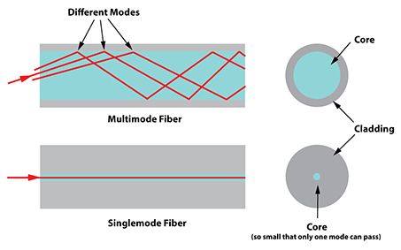
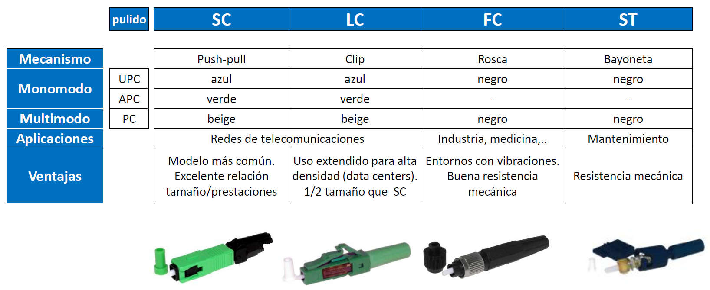
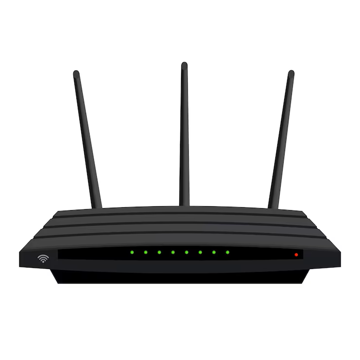

Para que dos dispositivos puedan comunicarse en red necesitan un **medio de transmisión**: el canal físico por el que viajan los datos de un punto a otro. Podemos hacer una analogía con las carreteras: igual que los vehículos necesitan una carretera para desplazarse, los datos necesitan un medio de transmisión para viajar entre dispositivos.

Los medios de transmisión se dividen en dos grandes categorías:

- **Medios guiados** (o cableados): los datos viajan por un soporte físico concreto — un cable. La señal está "guiada" y confinada dentro del cable.
- **Medios no guiados** (o inalámbricos): los datos viajan a través del aire (o el vacío) en forma de ondas electromagnéticas. No hay ningún soporte físico que los guíe.

Cada categoría tiene sus propias tecnologías, velocidades, ventajas e inconvenientes, y la elección entre una y otra depende del contexto: distancia, entorno, coste, velocidad requerida y necesidad de movilidad.

## Medios guiados: el cable

### Cable de par trenzado (UTP/STP)

El **cable de par trenzado** es el medio de transmisión más usado en redes LAN. Está compuesto por pares de hilos de cobre trenzados entre sí. El trenzado no es decorativo: tiene una función técnica importante — reduce las interferencias electromagnéticas entre pares (*crosstalk*) y las interferencias externas.

<!-- IMG: fotografía de cable UTP Cat6 con el recubrimiento pelado mostrando los 4 pares de colores -->
<figure markdown="span" align="center">
  { width="65%" }
  <figcaption>Cable UTP Cat6 con sus 4 pares trenzados de colores. El trenzado reduce las interferencias electromagnéticas</figcaption>
</figure>

Existen dos variantes según si tienen blindaje adicional:

- **UTP** (*Unshielded Twisted Pair*): sin blindaje adicional. Es el más común en instalaciones de oficina y hogar por su bajo coste y facilidad de instalación.
- **STP** (*Shielded Twisted Pair*): con una malla metálica que rodea los pares para mayor protección frente a interferencias. Se usa en entornos industriales o con alta presencia de interferencias electromagnéticas (motores, maquinaria).
- **FTP** (*Foiled Twisted Pair*): con una lámina de aluminio alrededor de todos los pares (sin blindaje individual). Punto intermedio entre UTP y STP.

<!-- IMG: comparativa sección transversal UTP vs FTP vs STP mostrando las capas de blindaje -->
<figure markdown="span" align="center">
  { width="70%" }
  <figcaption>Sección transversal comparativa: UTP (sin blindaje), FTP (lámina) y STP (malla individual por par)</figcaption>
</figure>

### Categorías de cable

Los cables de par trenzado se clasifican en **categorías** (Cat) que determinan su ancho de banda y la velocidad máxima que pueden soportar. A mayor categoría, mayor rendimiento:

| Categoría | Ancho de banda | Velocidad máxima | Distancia máxima | Uso típico |
|-----------|---------------|-----------------|-----------------|-----------|
| Cat5 | 100 MHz | 100 Mbps | 100 m | Obsoleto |
| Cat5e | 100 MHz | 1 Gbps | 100 m | Instalaciones antiguas, aún funcional |
| Cat6 | 250 MHz | 1 Gbps / 10 Gbps* | 100 m / 55 m* | **Estándar actual en oficinas** |
| Cat6A | 500 MHz | 10 Gbps | 100 m | Instalaciones de alto rendimiento |
| Cat7 | 600 MHz | 10 Gbps | 100 m | Centros de datos, uso profesional |
| Cat8 | 2000 MHz | 25-40 Gbps | 30 m | Centros de datos, rack a rack |

*Cat6 soporta 10 Gbps pero solo hasta 55 metros de distancia.

!!! info "¿Qué categoría necesito?"
    Para una instalación nueva en una oficina o aula, **Cat6** es la elección correcta en 2025: soporta Gigabit Ethernet a 100 metros sin problemas y tiene margen para 10 Gbps en distancias cortas. Cat5e es suficiente si la instalación ya existe y no hay presupuesto para renovarla. Cat6A solo se justifica si necesitas 10 Gbps garantizados a distancias superiores a 55 metros.

### El conector RJ-45 y los estándares de crimpado

El cable de par trenzado se termina con un conector **RJ-45** en cada extremo. El RJ-45 tiene 8 pines, uno por cada hilo del cable (4 pares × 2 hilos = 8 hilos).

<!-- IMG: fotografía conector RJ-45 macho con los 8 pines visibles y los colores de los hilos -->
<figure markdown="span" align="center">
  { width="55%" }
  <figcaption>Conector RJ-45: 8 pines para los 8 hilos del cable. El orden de los colores determina el estándar</figcaption>
</figure>

El orden en que se insertan los hilos en el conector sigue un estándar. Existen dos estándares principales, definidos por la norma **TIA/EIA-568**:

- **T568A**: verde-blanco, verde, naranja-blanco, azul, azul-blanco, naranja, marrón-blanco, marrón
- **T568B**: naranja-blanco, naranja, verde-blanco, azul, azul-blanco, verde, marrón-blanco, marrón

<!-- IMG: diagrama comparativo orden de pines T568A vs T568B con los colores de cada hilo -->
<figure markdown="span" align="center">
  { width="70%" }
  <figcaption>Estándares de crimpado T568A y T568B: el orden de los hilos determina el tipo de cable</figcaption>
</figure>

Dependiendo de cómo se crimpa cada extremo del cable, obtenemos diferentes tipos de cable:

| Tipo de cable | Extremo A | Extremo B | Uso |
|--------------|-----------|-----------|-----|
| **Directo** (*straight-through*) | T568B | T568B | Equipo → Switch, PC → Router |
| **Cruzado** (*crossover*) | T568A | T568B | PC → PC, Switch → Switch (sin uplink) |
| **Rollover** (*consola*) | T568B | Invertido | Consola de administración de routers Cisco |

!!! info "¿Necesito cable cruzado hoy en día?"
    Los switches y tarjetas de red modernas implementan **Auto-MDIX**: detectan automáticamente el tipo de cable conectado y se adaptan. Esto significa que con un cable directo puedes conectar dos PCs directamente sin necesidad de cable cruzado. Sin embargo, sigue siendo importante conocer la diferencia para trabajar con equipos más antiguos.

### Fibra óptica

La **fibra óptica** transmite datos mediante **pulsos de luz** en lugar de señales eléctricas. El núcleo del cable es un filamento de vidrio o plástico extremadamente puro por el que viaja la luz, rodeado de una cubierta que la refleja hacia el interior (*revestimiento*) y varias capas de protección exterior.

<!-- IMG: diagrama sección transversal de una fibra óptica mostrando núcleo, revestimiento y cubierta protectora -->
<figure markdown="span" align="center">
  { width="65%" }
  <figcaption>Sección transversal de una fibra óptica: núcleo de vidrio, revestimiento reflectante y capas de protección</figcaption>
</figure>

Las ventajas de la fibra óptica sobre el cable de cobre son significativas:

- **Velocidad**: puede transmitir a velocidades de **Tbps** en instalaciones de operador.
- **Distancia**: sin repetidores puede llegar a decenas o incluso cientos de kilómetros, frente a los 100 metros del UTP.
- **Inmunidad a interferencias electromagnéticas**: al usar luz en lugar de electricidad, no le afectan los campos electromagnéticos.
- **Seguridad**: es muy difícil interceptar la señal sin que se note físicamente.
- **Sin problemas de tierra eléctrica**: ideal para conectar edificios separados donde el diferencial de potencial eléctrico podría dañar equipos.

Existen dos tipos principales de fibra óptica:

| Tipo | Diámetro núcleo | Transmisión | Distancia | Uso típico |
|------|----------------|-------------|-----------|-----------|
| **Monomodo** (SMF) | 8-10 µm | Un solo rayo de luz | Hasta cientos de km | Redes de operador, enlaces entre edificios |
| **Multimodo** (MMF) | 50-62,5 µm | Múltiples rayos | Hasta 2 km | Centros de datos, backbone de campus |

<!-- IMG: comparativa sección núcleo monomodo vs multimodo con los rayos de luz representados -->
<figure markdown="span" align="center">
  { width="70%" }
  <figcaption>Fibra monomodo (izquierda): un solo rayo, largas distancias. Multimodo (derecha): múltiples rayos, distancias medias</figcaption>
</figure>

Los conectores más habituales en fibra óptica son **SC**, **LC** y **ST**. En instalaciones modernas de centros de datos predomina el **LC** por su tamaño compacto.

<!-- IMG: fotografía conectores de fibra SC, LC y ST comparados -->
<figure markdown="span" align="center">
  { width="65%" }
  <figcaption>Conectores de fibra óptica: SC, LC, FC y ST (derecha)</figcaption>
</figure>

**¿Cuándo usar fibra óptica en lugar de UTP?**

- Cuando la distancia supera los 100 metros
- Para conectar edificios entre sí
- En el backbone (troncal) de redes corporativas que necesitan alta velocidad
- En entornos con alta interferencia electromagnética
- Cuando la seguridad física de la transmisión es crítica

### Cable coaxial

El **cable coaxial** fue el estándar en redes Ethernet durante los años 80 y 90. Hoy está prácticamente desaparecido de las redes LAN, aunque todavía se usa en:

- Televisión por cable y antena
- Algunas instalaciones de telecomunicaciones

No lo estudiaremos en detalle por su irrelevancia en instalaciones modernas.

---

## Medios no guiados: comunicaciones inalámbricas

Los medios inalámbricos transmiten datos mediante **ondas electromagnéticas** que se propagan por el aire. No necesitan ningún cable físico, lo que permite la movilidad de los dispositivos. La contrapartida es que la señal puede verse afectada por obstáculos, interferencias y la distancia.

### Wi-Fi (IEEE 802.11)

**Wi-Fi** es el estándar de comunicación inalámbrica para redes LAN. Usa el estándar **IEEE 802.11** y opera principalmente en las bandas de frecuencia de **2,4 GHz** y **5 GHz** (y también 6 GHz en las versiones más recientes).

<!-- IMG: fotografía de un router Wi-Fi doméstico con sus antenas -->
<figure markdown="span" align="center">
  { width="55%" }
  <figcaption>Router Wi-Fi doméstico. Las antenas transmiten en las bandas de 2,4 GHz y 5 GHz simultáneamente (dual band)</figcaption>
</figure>

La evolución de Wi-Fi a lo largo de los años ha sido notable. Cada nueva generación (identificada por un número de generación desde Wi-Fi 4) mejora la velocidad, la eficiencia y la capacidad para gestionar múltiples dispositivos:

| Estándar | Generación | Año | Banda | Velocidad máx. teórica | Característica clave |
|---------|-----------|-----|-------|----------------------|---------------------|
| 802.11b | — | 1999 | 2,4 GHz | 11 Mbps | Primera Wi-Fi masiva |
| 802.11g | — | 2003 | 2,4 GHz | 54 Mbps | Mejora de velocidad |
| 802.11n | **Wi-Fi 4** | 2009 | 2,4 / 5 GHz | 600 Mbps | MIMO, dual band |
| 802.11ac | **Wi-Fi 5** | 2013 | 5 GHz | 3,5 Gbps | MU-MIMO, beamforming |
| 802.11ax | **Wi-Fi 6** | 2019 | 2,4 / 5 GHz | 9,6 Gbps | OFDMA, eficiencia en entornos densos |
| 802.11ax | **Wi-Fi 6E** | 2021 | 2,4 / 5 / 6 GHz | 9,6 Gbps | Banda de 6 GHz, menos congestión |
| 802.11be | **Wi-Fi 7** | 2024 | 2,4 / 5 / 6 GHz | 46 Gbps | Multi-Link Operation, latencia mínima |

### Diferencias entre las bandas de frecuencia

Una de las decisiones más importantes en Wi-Fi es a qué banda conectarse:

| Característica | 2,4 GHz | 5 GHz | 6 GHz |
|---------------|---------|-------|-------|
| **Cobertura** | Mayor (llega más lejos y atraviesa mejor los obstáculos) | Menor | Menor |
| **Velocidad** | Menor | Mayor | Mayor |
| **Congestión** | Alta (comparte con Bluetooth, microondas, zigbee...) | Media | Baja (banda nueva, pocos dispositivos) |
| **Penetración en paredes** | Buena | Media | Baja |
| **Uso recomendado** | Dispositivos lejanos, IoT | Dispositivos cercanos que necesitan velocidad | Dispositivos muy cercanos, alta densidad |

!!! tip "¿A cuál de las dos bandas me conecto?"
    Si estás cerca del router y necesitas velocidad (streaming, videollamadas, trabajo), conéctate a **5 GHz**. Si estás lejos o hay muchas paredes de por medio, **2,4 GHz** te dará más alcance aunque menos velocidad. Los routers modernos (*dual band* o *tri band*) emiten en ambas bandas simultáneamente y algunos tienen función de *band steering* que conecta automáticamente el dispositivo a la banda más conveniente.

### Bluetooth

**Bluetooth** es la tecnología inalámbrica de corto alcance más universal para redes PAN. Opera en la banda de **2,4 GHz** y está presente en prácticamente cualquier dispositivo electrónico moderno.

| Versión | Año | Velocidad máx. | Alcance | Mejora principal |
|---------|-----|---------------|---------|-----------------|
| Bluetooth 4.0 | 2010 | 24 Mbps | 50 m | BLE (Bluetooth Low Energy) |
| Bluetooth 4.2 | 2014 | 24 Mbps | 50 m | Mayor seguridad, IPv6 |
| Bluetooth 5.0 | 2016 | 48 Mbps | 240 m | Doble velocidad, cuádruple alcance |
| Bluetooth 5.2 | 2020 | 48 Mbps | 240 m | LE Audio, audio multistream |
| Bluetooth 5.4 | 2023 | 48 Mbps | 240 m | Broadcast sin emparejamiento |

**BLE** (*Bluetooth Low Energy*), introducido en Bluetooth 4.0, es una variante de muy bajo consumo energético diseñada para dispositivos IoT, sensores y wearables que necesitan durar meses o años con una sola batería.

### Otras tecnologías inalámbricas

Además de Wi-Fi y Bluetooth existen otras tecnologías inalámbricas relevantes:

**Zigbee y Z-Wave**: tecnologías de muy bajo consumo para redes de domótica e IoT. Permiten crear mallas de sensores y actuadores (luces, termostatos, sensores de movimiento) con baterías que duran años.

**NFC** (*Near Field Communication*): comunicación a distancias de menos de 20 cm. Pagos contactless, intercambio de datos entre móviles, etiquetas inteligentes.

**5G**: la quinta generación de redes móviles. Aunque es una tecnología de red celular (no Wi-Fi), cada vez más se usa como alternativa a la fibra en hogares y empresas mediante módems 5G.

**Comunicaciones por satélite**: para zonas sin cobertura de fibra o cable. **Starlink** (SpaceX) ha democratizado el acceso satelital de baja latencia con su constelación de satélites en órbita baja (LEO).

---

## Comparativa de medios de transmisión

| Medio | Velocidad | Distancia | Interferencias | Movilidad | Coste instalación |
|-------|-----------|-----------|---------------|-----------|------------------|
| UTP Cat6 | 1-10 Gbps | 100 m | Moderada | No | Bajo |
| UTP Cat6A | 10 Gbps | 100 m | Baja (blindado) | No | Medio |
| Fibra monomodo | Tbps | Cientos km | Ninguna | No | Alto |
| Fibra multimodo | 100 Gbps | 2 km | Ninguna | No | Medio-alto |
| Wi-Fi 6 | hasta 9,6 Gbps* | ~50-100 m | Alta (2,4 GHz) | **Sí** | Bajo |
| Wi-Fi 7 | hasta 46 Gbps* | ~50-100 m | Media | **Sí** | Medio |
| Bluetooth 5.0 | 48 Mbps | 240 m | Media | **Sí** | Muy bajo |

*Velocidades teóricas máximas en condiciones ideales. En la práctica, la velocidad real de Wi-Fi es significativamente menor.

---

## Actividad en clase

### 🖥️ Actividad conjunta: identificamos los medios de transmisión del aula

**Duración:** 10 minutos
**Dinámica:** observación directa + debate

**Desarrollo:**

1. Oobservar el aula y responder:
    - ¿Qué medios de transmisión guiados ves? ¿Puedes identificar la categoría del cable?
    - ¿Hay medios inalámbricos activos en este momento? ¿Cuáles?
    - ¿Los equipos del aula usan cable o Wi-Fi para conectarse a la red?

2. Debate: ¿por qué creéis que los equipos del aula usan cable en lugar de Wi-Fi? ¿Qué ventajas tiene el cable en este contexto?

