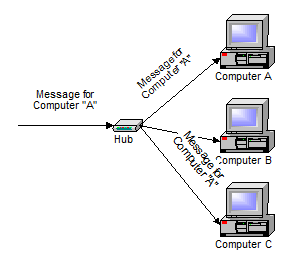
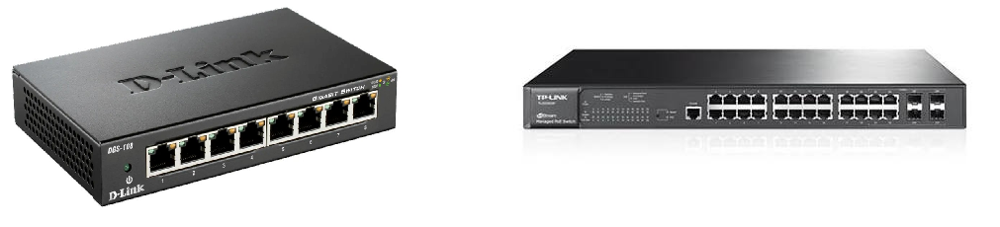
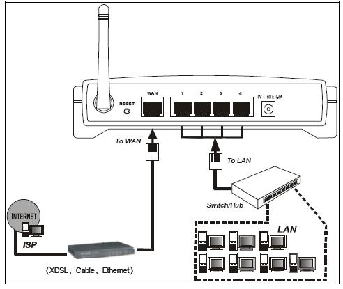
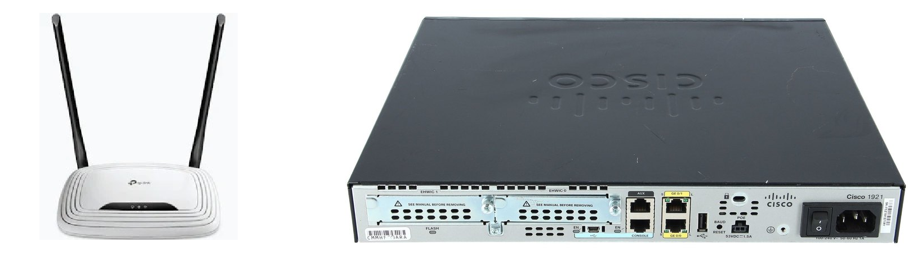
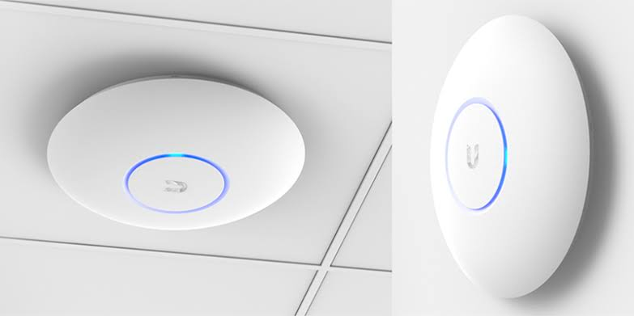
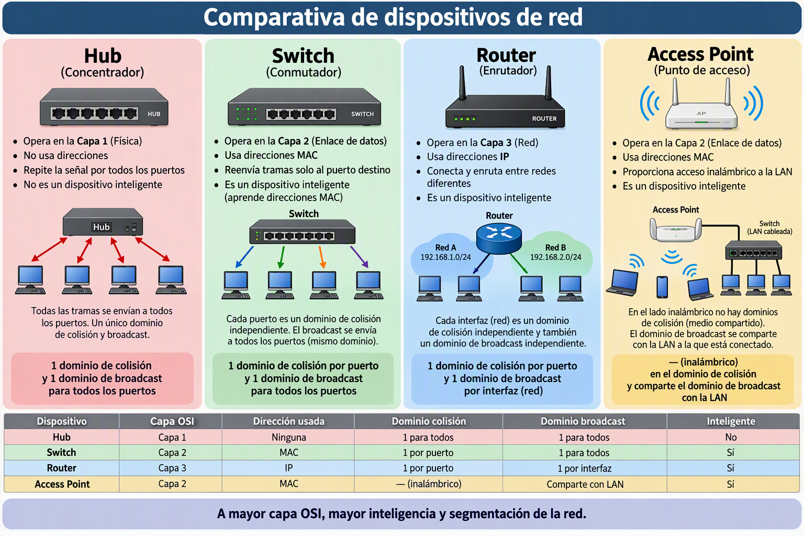

Hasta ahora hemos visto los medios físicos por los que viajan los datos y los tipos de red según su extensión. Pero para que una red funcione no basta con conectar cables: necesitamos dispositivos especializados que gestionen el tráfico, dirijan los datos hacia su destino y conecten unas redes con otras. Estos dispositivos son los **elementos activos** de la red — a diferencia de los cables, que son elementos pasivos.

Entender qué hace cada dispositivo y en qué se diferencia de los demás es fundamental para poder diseñar, montar y diagnosticar redes, que es exactamente lo que haremos en las siguientes unidades con Packet Tracer y con el proyecto de la empresa.

## El hub (concentrador)

El **hub** es el dispositivo de interconexión más sencillo y también el más antiguo de los que veremos. Permite conectar varios equipos en una red de estrella física, pero su funcionamiento interno es muy primitivo: cuando recibe un paquete de datos por uno de sus puertos, lo **reenvía por todos los demás puertos simultáneamente**, sin importar a quién va dirigido.

<!-- IMG: fotografía de un hub de red de 8 puertos, preferiblemente antiguo -->
<figure markdown="span" align="center">
  { width="55%" }
  <figcaption>Hub de red: reenvía los datos recibidos por todos sus puertos simultáneamente</figcaption>
</figure>

Esto tiene una consecuencia importante: todos los equipos conectados a un hub comparten el mismo **dominio de colisión**. Si dos equipos intentan enviar datos al mismo tiempo, los paquetes chocan y se corrompen (colisión), y ambos equipos tienen que esperar un tiempo aleatorio antes de reintentar. Con pocos equipos y tráfico bajo esto es tolerable, pero el rendimiento cae drásticamente a medida que se añaden más dispositivos.

**Características del hub:**
- Opera en la **capa 1** (capa física) del modelo OSI — no entiende de direcciones, solo amplifica y redistribuye señales eléctricas.
- No tiene inteligencia: no sabe qué equipo está conectado en cada puerto.
- Crea un único dominio de colisión para todos los puertos.
- Velocidades típicas: 10 Mbps o 100 Mbps (nunca Gigabit).

**Estado actual:** Los hubs están completamente **obsoletos** y han desaparecido del mercado. Se sustituyeron por los switches en los años 90. Hoy solo se encuentran en museos, laboratorios de telecomunicaciones y en el almacén de algún instituto que no ha renovado el equipamiento en 25 años. Los mencionamos aquí porque aparecen en la teoría de redes y es importante entender por qué el switch los superó.

!!! info "¿Por qué el hub fue reemplazado?"
    Con un hub, si tienes 10 equipos conectados a 100 Mbps, todos comparten esos 100 Mbps. Si dos equipos transmiten a la vez, hay colisión y ambos tienen que repetir. Con un switch, cada par de equipos tiene su propio canal de 100 Mbps dedicado y no hay colisiones. La diferencia de rendimiento es enorme.

## El switch (conmutador)

El **switch** es el dispositivo central de cualquier red LAN moderna. A diferencia del hub, el switch es **inteligente**: aprende qué dispositivo está conectado en cada puerto leyendo las **direcciones MAC** de los paquetes que recibe, y usa esa información para enviar cada paquete únicamente al puerto donde está el destinatario.

<!-- IMG: fotografía de un switch gestionable de 24 puertos en rack, y un switch doméstico de 8 puertos -->
<figure markdown="span" align="center">
  { width="70%" }
  <figcaption>Switch doméstico de 8 puertos (izquierda) y switch gestionable de 24 puertos para rack (derecha)</figcaption>
</figure>

### ¿Cómo funciona el switch?

Cuando el switch arranca, su **tabla MAC** (también llamada tabla CAM) está vacía. A medida que los equipos van enviando datos, el switch aprende:

1. El equipo A envía un paquete al equipo B. El switch ve que el paquete viene del puerto 1 y que la dirección MAC de origen es la de A → anota: "la MAC de A está en el puerto 1".
2. El switch no sabe aún dónde está B → reenvía el paquete por todos los puertos excepto el 1 (esto se llama **flooding**).
3. B responde. El switch ve que la respuesta viene del puerto 3 → anota: "la MAC de B está en el puerto 3".
4. A partir de ahora, cualquier paquete de A para B va directamente al puerto 3 sin molestar a los demás.

Este proceso de aprendizaje es automático y muy rápido. En segundos, el switch tiene mapeada toda la red.

**Características del switch:**
- Opera en la **capa 2** (capa de enlace de datos) del modelo OSI.
- Usa direcciones **MAC** para tomar decisiones de reenvío.
- Cada par de puertos tiene su propio **dominio de colisión** → prácticamente no hay colisiones.
- Soporta comunicación **full-duplex**: puede enviar y recibir simultáneamente en cada puerto.
- Velocidades típicas: 100 Mbps, **1 Gbps** (estándar actual), 2,5 Gbps, 10 Gbps.

### Tipos de switch

| Tipo | Características | Uso típico |
|------|----------------|-----------|
| **No gestionable** (*unmanaged*) | Plug & play, sin configuración, económico | Doméstico, pequeñas oficinas |
| **Gestionable** (*managed*) | Configurable por web/CLI, soporta VLANs, QoS, monitorización | Empresas, centros de datos |
| **PoE** (*Power over Ethernet*) | Alimenta dispositivos por el cable de red (cámaras, APs, teléfonos IP) | Instalaciones con cámaras o APs |

!!! example "El switch en el proyecto del curso"
    En el proyecto de la empresa que montaremos, el switch es el corazón de la red LAN. Todos los equipos (servidor Windows, clientes, impresoras) se conectarán al switch. Cuando en Packet Tracer diseñemos la red, el switch central será el primer dispositivo que colocaremos.

## El router (enrutador)

El **router** es el dispositivo que conecta redes diferentes entre sí. Mientras el switch conecta equipos dentro de la misma red, el router conecta la red local (LAN) con otras redes: otra LAN, una WAN o internet.

El router toma decisiones de reenvío basándose en **direcciones IP** (no en direcciones MAC como el switch). Para cada paquete que llega, consulta su **tabla de enrutamiento** y decide por qué interfaz reenviarlo para que llegue a su destino.

<!-- IMG: diagrama de un router conectando la LAN de una empresa con internet (WAN) -->
<figure markdown="span" align="center">
  { width="70%" }
  <figcaption>El router conecta la red local (LAN) con internet (WAN) y gestiona el tráfico entre ambas</figcaption>
</figure>

### Funciones principales del router

**Enrutamiento**: decide el mejor camino para que cada paquete llegue a su destino, aunque haya que pasar por varios routers intermedios.

**NAT** (*Network Address Translation*): traduce las direcciones IP privadas de los equipos de la LAN a la dirección IP pública que tiene el router en internet. Esto es lo que permite que todos los equipos de una casa u oficina compartan una sola IP pública.

**DHCP**: la mayoría de routers domésticos incluyen un servidor DHCP que asigna automáticamente direcciones IP a los equipos que se conectan.

**Firewall básico**: filtran el tráfico entrante y saliente, bloqueando conexiones no solicitadas desde internet.

**Características del router:**

- Opera en la **capa 3** (capa de red) del modelo OSI.
- Usa direcciones **IP** para tomar decisiones de reenvío.
- Separa dominios de **broadcast**: los paquetes de broadcast de la LAN no salen por el router hacia internet.
- Puede conectar redes con tecnologías diferentes (Ethernet, Wi-Fi, fibra, 4G...).

### Routers domésticos vs routers profesionales

Un router doméstico (el que pone el operador en casa) es en realidad un dispositivo multifunción que integra router + switch + punto de acceso Wi-Fi + servidor DHCP + firewall básico en un solo aparato.

Un router profesional (Cisco, MikroTik, Juniper) es un dispositivo dedicado únicamente al enrutamiento, configurable completamente por línea de comandos, capaz de gestionar tablas de enrutamiento con millones de entradas y manejar decenas de Gbps de tráfico.

<!-- IMG: fotografía comparativa router doméstico (TP-Link, ASUS) vs router profesional Cisco o MikroTik -->
<figure markdown="span" align="center">
  { width="75%" }
  <figcaption>Router doméstico (izquierda): todo en uno. Router profesional Cisco (derecha): solo enrutamiento, máximo rendimiento</figcaption>
</figure>

## El punto de acceso Wi-Fi (Access Point)

Un **punto de acceso** (*Access Point* o AP) es el dispositivo que permite a los equipos inalámbricos conectarse a la red cableada. Actúa como puente entre el mundo Wi-Fi y el mundo Ethernet.

Un AP se conecta mediante cable Ethernet al switch de la red y emite una o varias redes Wi-Fi (SSIDs) a las que se pueden conectar los dispositivos inalámbricos. Desde el punto de vista de la red, un equipo conectado por Wi-Fi al AP es equivalente a uno conectado por cable al switch.

<!-- IMG: fotografía de un AP de techo tipo Ubiquiti UniFi o TP-Link EAP instalado en el techo -->
<figure markdown="span" align="center">
  { width="55%" }
  <figcaption>Punto de acceso Wi-Fi de techo (Ubiquiti UniFi). Se alimenta por PoE desde el switch sin necesidad de cable de corriente</figcaption>
</figure>

### Router Wi-Fi doméstico vs Access Point

Es importante distinguir entre el router Wi-Fi que pone el operador en casa y un AP puro:

| | Router Wi-Fi doméstico | Access Point puro |
|--|----------------------|------------------|
| **Función** | Router + switch + AP + DHCP + firewall | Solo AP (punto de acceso inalámbrico) |
| **Conexión** | Se conecta a la línea del operador | Se conecta al switch de la red existente |
| **Configura DHCP** | Sí | No (lo gestiona el router) |
| **Uso típico** | Hogares, pequeñas oficinas | Empresas con múltiples APs, campus |

En una empresa mediana o grande, lo habitual es tener un router profesional, un switch central y varios APs repartidos por el edificio para dar cobertura Wi-Fi en todas las zonas, todos gestionados de forma centralizada.

### Características de un AP

- **SSID**: el nombre de la red Wi-Fi que emite.
- **Bandas**: 2,4 GHz, 5 GHz, 6 GHz (según el estándar Wi-Fi que soporte).
- **Número de clientes simultáneos**: un AP doméstico soporta ~30-50 clientes; uno profesional puede gestionar 200+.
- **PoE**: los APs profesionales se alimentan por el cable de red (Power over Ethernet) sin necesidad de enchufe.
- **Roaming**: en instalaciones con varios APs, los dispositivos pueden moverse por el edificio y cambiar automáticamente al AP con mejor señal sin perder la conexión.

## Otros dispositivos de red relevantes

### Módem

El **módem** (*modulator-demodulator*) convierte la señal digital de la red local en la señal analógica o digital que usa la línea del operador (ADSL, fibra, cable coaxial, 4G...) y viceversa. En instalaciones domésticas modernas, el módem y el router suelen estar integrados en el mismo dispositivo (el "router" que instala el técnico del operador).

### Repetidor Wi-Fi

Un **repetidor** o **extensor Wi-Fi** recibe la señal Wi-Fi de un router y la reemite amplificada, extendiendo la cobertura. Es una solución económica pero con inconvenientes: reduce el ancho de banda a la mitad (parte de la señal se usa para comunicarse con el router) y crea una segunda red con SSID diferente o el mismo pero con mala gestión del roaming.

Para instalaciones donde la cobertura es crítica, es preferible un sistema de APs cableados o un sistema Wi-Fi Mesh.

### Switch L3 (capa 3)

Un **switch de capa 3** combina las funciones de switch y router: puede enrutar tráfico entre VLANs sin necesidad de un router externo. Se usa en redes corporativas medianas y grandes donde hay múltiples VLANs y se necesita enrutamiento de alto rendimiento entre ellas.

---

## Comparativa resumen de dispositivos

<!-- IMG: diagrama comparativo mostrando hub, switch y router con sus capas OSI y dominios -->
<figure markdown="span" align="center">
  { width="85%" }
  <figcaption>Comparativa de dispositivos: capa OSI donde operan, qué dirección usan y qué dominios crean</figcaption>
</figure>

| Dispositivo | Capa OSI | Dirección usada | Dominio colisión | Dominio broadcast | Inteligente |
|-------------|---------|----------------|-----------------|------------------|-------------|
| **Hub** | Capa 1 | Ninguna | 1 para todos | 1 para todos | No |
| **Switch** | Capa 2 | MAC | 1 por puerto | 1 para todos | Sí |
| **Router** | Capa 3 | IP | 1 por puerto | 1 por interfaz | Sí |
| **Access Point** | Capa 2 | MAC | — (inalámbrico) | Comparte con LAN | Sí |

---

## Actividad en clase y actividad para entregar

### 🖥️ Actividad conjunta: identificamos los dispositivos del aula

1. El profesor muestra físicamente (o en fotografía si no son accesibles) los dispositivos de red del aula: switch del armario de red, router del centro, APs del techo o pared.

2. los dispositivos de red del aula:
    - ¿Cuántos switches ves o sabes que hay en el aula/planta?
    - ¿Dónde está el router del centro? ¿Qué conecta?
    - ¿Hay APs en el aula o en el pasillo? ¿De qué marca son?
    - Si el switch del aula se estropea, ¿qué deja de funcionar? ¿Y si es el router?

3. Ddibuja en la pizarra el esquema completo hub→switch→router→internet con los dispositivos reales del centro.

---

### 📄 Actividad para entregar: inventario de red de nuestra empresa

**Formato:** Documento Word/PDF
**Entrega:** Fecha indicada por el profesor

Esta actividad cierra los puntos 1 al 5 de la UD02. Vamos a hacer un inventario completo de la red de la empresa ficticia **TechSolutions S.L.** que usaremos en el proyecto del curso, eligiendo los dispositivos reales que compraríamos.

**Contexto de la empresa:**

TechSolutions S.L. tiene una oficina con las siguientes características:

- 3 departamentos: Desarrollo (8 puestos), Administración (4 puestos) y Dirección (2 puestos)
- 1 sala de servidores con 2 servidores
- Necesita cobertura Wi-Fi en toda la oficina
- Tiene conexión a internet de fibra óptica de 1 Gbps

**Parte 1 — Análisis de necesidades**

Responde a las siguientes preguntas antes de elegir los dispositivos:

1. ¿Cuántos equipos necesitan conectividad de red en total (incluyendo servidores)?
2. ¿Qué tipo de red es esta según su extensión geográfica?
3. ¿Qué topología física usarías para conectar los equipos? ¿Por qué?
4. ¿Necesitas un solo switch o varios? Razona tu respuesta.
5. ¿Qué categoría de cable UTP usarías para el cableado? ¿Por qué?

**Parte 2 — Elección de dispositivos**

Busca en PCComponentes o Amazon los siguientes dispositivos reales para la empresa. Para cada uno indica: marca y modelo, precio, características principales (puertos, velocidad, estándar Wi-Fi si aplica) y URL del producto.

| Dispositivo | Función en la empresa |
|-------------|----------------------|
| Switch principal | Conectar todos los equipos de la oficina |
| Switch secundario (opcional) | Si decides segmentar por departamento |
| Router | Conectar la LAN con internet |
| Access Point (×2) | Cobertura Wi-Fi en la oficina |

**Parte 3 — Esquema de red**

Dibuja a mano o con cualquier herramienta (draw.io, PowerPoint, papel escaneado) el esquema físico de la red de TechSolutions S.L. El esquema debe incluir:

- Los equipos de cada departamento
- Los switches y cómo se conectan entre sí
- El router y su conexión con internet
- Los APs y su posición aproximada en la oficina
- El tipo de medio de transmisión en cada tramo (cable UTP, fibra, Wi-Fi)

**Parte 4 — Presupuesto total**

Elabora una tabla con el coste total de los dispositivos de red elegidos (sin incluir el cableado ni los equipos de usuario).

!!! info "Criterios de evaluación"
    - Parte 1: coherencia del análisis de necesidades (2 puntos)
    - Parte 2: elección justificada de dispositivos reales con URLs (4 puntos)
    - Parte 3: esquema completo, claro e identificado (3 puntos)
    - Parte 4: presupuesto correcto (1 punto)
