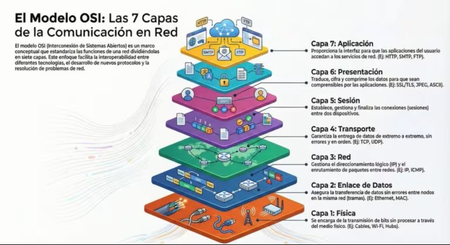
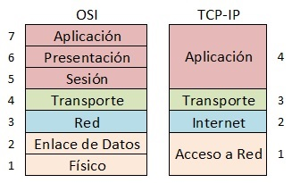
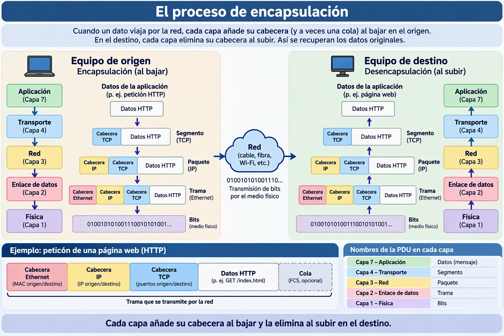
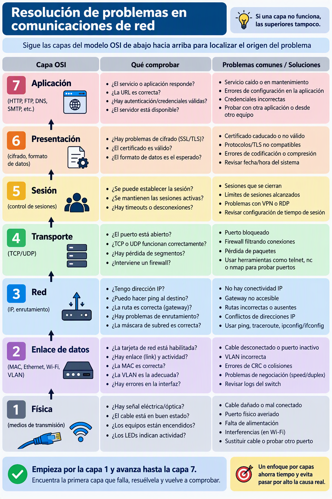

Cuando dos ordenadores se comunican a través de una red, el proceso es mucho más complejo de lo que parece. Un mensaje no viaja directamente de un programa a otro: pasa por múltiples etapas de transformación, empaquetado y transmisión antes de llegar al destino, donde el proceso se deshace en orden inverso. Para que todo esto funcione de forma ordenada y que dispositivos de fabricantes distintos puedan entenderse, existe un **modelo de referencia** que define cómo debe organizarse ese proceso.

No estudiaremos estos modelos en profundidad — eso corresponde a módulos de redes más avanzados. Lo que nos interesa aquí es entender la **lógica general** de por qué existen, qué problema resuelven y cómo se relacionan con los dispositivos y protocolos que ya conocemos.

## ¿Por qué necesitamos un modelo en capas?

Imagina que quieres enviar un correo electrónico. Para que ese correo llegue a su destino tienen que ocurrir muchas cosas a la vez:

- Tu programa de correo tiene que formatear el mensaje
- El sistema operativo tiene que gestionarlo como datos para transmitir
- Esos datos tienen que trocearse en paquetes manejables
- Los paquetes tienen que llevar la dirección del destino
- Los datos tienen que convertirse en señales eléctricas u ópticas
- Esas señales tienen que viajar por el cable hasta el router
- El router tiene que decidir hacia dónde enviarlos
- ... y todo esto en orden inverso en el destino

Si no hubiera un modelo que organizara todo esto, cada fabricante lo haría a su manera y sería imposible que un ordenador Apple hablara con uno Dell, o que un router Cisco enviara paquetes a un switch TP-Link.

La solución es dividir el proceso en **capas independientes**, donde cada capa tiene una responsabilidad concreta y se comunica con las capas adyacentes mediante interfaces bien definidas. Cambiar la implementación de una capa no afecta a las demás — igual que cambiar el motor de un coche no obliga a rediseñar la carrocería.

## El modelo OSI

El modelo **OSI** (*Open Systems Interconnection*) fue desarrollado por la ISO en 1984 como modelo de referencia universal. Divide el proceso de comunicación en **7 capas**, cada una con una función específica:

<!-- IMG: diagrama vertical del modelo OSI con las 7 capas, sus nombres y función resumida -->
<figure markdown="span" align="center">
  { width="65%" }
  <figcaption>Modelo OSI: 7 capas que organizan el proceso de comunicación de red de extremo a extremo</figcaption>
</figure>

| Capa | Nombre | Función principal | Ejemplos |
|------|--------|------------------|---------|
| 7 | **Aplicación** | Interfaz con el usuario y las aplicaciones | HTTP, FTP, SMTP, DNS |
| 6 | **Presentación** | Formato, cifrado y compresión de datos | SSL/TLS, JPEG, ASCII |
| 5 | **Sesión** | Gestión de sesiones de comunicación | NetBIOS, RPC |
| 4 | **Transporte** | Segmentación, control de flujo y fiabilidad | TCP, UDP |
| 3 | **Red** | Direccionamiento lógico y enrutamiento | IP, ICMP, routers |
| 2 | **Enlace de datos** | Direccionamiento físico y acceso al medio | Ethernet, Wi-Fi, switches, MAC |
| 1 | **Física** | Transmisión de bits por el medio físico | Cables, hubs, señales eléctricas |

Un truco clásico para recordar las capas de arriba a abajo: **"All People Seem To Need Data Processing"** (Aplicación, Presentación, Sesión, Transporte, Red, Enlace, Física).

### ¿Qué hace cada capa en la práctica?

Más que memorizar las 7 capas, lo importante es entender la lógica:

**Las capas bajas (1-2)** se ocupan de la transmisión física de bits: cómo se convierte un 0 o un 1 en una señal eléctrica, óptica o de radio, y cómo se identifica cada dispositivo físicamente mediante su dirección MAC. Aquí operan los hubs, switches y los cables.

**Las capas medias (3-4)** se ocupan del transporte de datos de extremo a extremo: cómo se dirigen los paquetes a través de múltiples redes usando direcciones IP (capa 3) y cómo se garantiza que lleguen completos y en orden usando TCP o de forma rápida sin garantías usando UDP (capa 4). Aquí operan los routers.

**Las capas altas (5-7)** se ocupan de la comunicación entre aplicaciones: cómo se formatea el mensaje, cómo se cifra, cómo se gestiona la sesión entre dos programas. Aquí operan los protocolos de aplicación como HTTP, SMTP o FTP.

!!! tip "Recuerda esto para el resto del curso"
    Cuando veamos que el switch opera en "capa 2" y el router en "capa 3", nos estamos refiriendo exactamente a estas capas del modelo OSI. El switch usa direcciones MAC (capa 2 = enlace de datos) y el router usa direcciones IP (capa 3 = red). Esto explica perfectamente por qué el switch no puede conectar redes diferentes y el router sí.

## El modelo TCP/IP

El modelo **TCP/IP** (también llamado modelo de Internet) es el modelo que se usa realmente en internet y en la mayoría de redes modernas. A diferencia del OSI, que es un modelo teórico de referencia, TCP/IP es el modelo práctico sobre el que funciona toda la comunicación en internet.

Tiene **4 capas** que agrupan las 7 del OSI de forma más pragmática:

<!-- IMG: diagrama comparativo OSI (7 capas) vs TCP/IP (4 capas) con las equivalencias marcadas -->
<figure markdown="span" align="center">
  { width="70%" }
  <figcaption>Comparativa entre el modelo OSI (7 capas) y el modelo TCP/IP (4 capas)</figcaption>
</figure>

| Capa TCP/IP | Equivalente OSI | Protocolos principales |
|-------------|----------------|----------------------|
| **Aplicación** | Capas 5, 6 y 7 | HTTP, HTTPS, FTP, SMTP, DNS, SSH |
| **Transporte** | Capa 4 | TCP, UDP |
| **Internet** | Capa 3 | IP (IPv4, IPv6), ICMP |
| **Acceso a red** | Capas 1 y 2 | Ethernet, Wi-Fi, ARP |

### TCP vs UDP: los dos protocolos de transporte

Los dos protocolos de la capa de transporte tienen características muy diferentes y se usan para cosas distintas:

**TCP** (*Transmission Control Protocol*) establece una conexión antes de enviar datos, garantiza que todos los paquetes lleguen y en orden, y retransmite los que se pierdan. Es más lento pero fiable.

**UDP** (*User Datagram Protocol*) envía los datos sin establecer conexión previa, sin garantizar que lleguen ni en qué orden. Es más rápido pero sin garantías.

| Característica | TCP | UDP |
|---------------|-----|-----|
| Conexión previa | Sí (handshake) | No |
| Garantía de entrega | Sí | No |
| Orden de llegada | Garantizado | No garantizado |
| Velocidad | Más lento | Más rápido |
| Uso típico | Web, email, descargas | Streaming, videojuegos, DNS, VoIP |

!!! example "¿Por qué el streaming usa UDP y no TCP?"
    Cuando ves un vídeo en streaming, si se pierde un paquete con un fotograma, no tiene sentido pedirlo de nuevo — para cuando llegara, el vídeo ya habría avanzado varios segundos. Es mejor mostrar un pequeño artefacto visual y continuar que parar y esperar la retransmisión. Por eso el streaming usa UDP: prioriza la velocidad sobre la fiabilidad perfecta.

    En cambio, cuando descargas un fichero, necesitas que llegue exactamente igual que el original, sin un solo byte cambiado. Por eso las descargas usan TCP.

## El proceso de encapsulación

Cuando un dato viaja por la red, en cada capa se le añade información adicional de control (cabeceras) al principio del paquete — y a veces al final (colas). Este proceso se llama **encapsulación**.

<!-- IMG: diagrama de encapsulación mostrando cómo se van añadiendo cabeceras en cada capa bajando y se eliminan subiendo -->
<figure markdown="span" align="center">
  { width="80%" }
  <figcaption>Encapsulación: cada capa añade su cabecera al bajar y la elimina al subir en el destino</figcaption>
</figure>

Por ejemplo, cuando envías una petición HTTP (una página web):

1. La capa de aplicación genera los datos HTTP
2. La capa de transporte (TCP) añade su cabecera con el puerto de origen y destino → se llama **segmento**
3. La capa de red (IP) añade su cabecera con la IP de origen y destino → se llama **paquete**
4. La capa de enlace (Ethernet) añade su cabecera con la MAC de origen y destino → se llama **trama**
5. La capa física convierte la trama en bits y los transmite por el cable

En el destino, el proceso se invierte: cada capa elimina su cabecera y pasa los datos a la capa superior.

!!! info "¿Por qué nos importa esto en DAM?"
    Como desarrolladores, trabajaréis principalmente en la capa de aplicación: HTTP, REST APIs, WebSockets, bases de datos... Pero cuando algo falla — "la aplicación no se conecta al servidor", "las peticiones llegan pero la respuesta tarda mucho", "funciona en local pero no en producción" — tenéis que saber bajar capas para diagnosticar el problema. ¿Es un problema de la aplicación (capa 7)? ¿De configuración de puertos TCP (capa 4)? ¿De enrutamiento (capa 3)? ¿Del switch o del cable (capas 1-2)?

---

## Actividad en clase

### 🖥️ Actividad conjunta: ¿en qué capa está el problema?

Se presentan los siguientes escenarios. Identificar en qué capa del modelo OSI/TCP-IP está probablemente el problema:

---

!!! tip "Ayuda"
   
    <figure markdown="span" align="center">
      { width="95%" }
      <figcaption>Grafico para identificar dóndo están los problemas de red</figcaption>
    </figure>

---

??? Question "Caso 1: Un equipo está conectado al switch con el cable bien enchufado, pero el LED del puerto del switch no se enciende. *(Pista: ¿el problema es eléctrico/físico o de configuración?)* "

    *Un equipo está conectado al switch con el cable bien enchufado, pero el LED del puerto del switch no se enciende.*

    * **Capa del Modelo OSI:** **Capa 1 – Capa Física**
    * **Capa del Modelo TCP/IP:** **Capa de Acceso a la Red** *(o Capa Física/Enlace)*
    * **Justificación:** Los LEDs de enlace del switch indican la detección de una señal eléctrica, óptica o electromagnética en el medio. Si el LED no se enciende, significa que no hay transmisión ni detección de señal física a través del cable. El problema se debe probablemente a un cable defectuoso, un puerto del switch/tarjeta de red averiado o una falta de alimentación eléctrica.

??? Question "Caso 2: Dos equipos están en la misma red y el ping entre ellos funciona, pero uno no puede acceder a carpetas compartidas del otro. *(Pista: el ping usa ICMP en capa 3. Las carpetas compartidas usan protocolos de capa más alta.)*"

    *Dos equipos están en la misma red y el ping entre ellos funciona, pero uno no puede acceder a carpetas compartidas del otro.*

    * **Capa del Modelo OSI:** **Capa 7 – Capa de Aplicación** *(o Capa 5 – Sesión / Capa 6 – Presentación, dependiendo del protocolo de red)*
    * **Capa del Modelo TCP/IP:** **Capa de Aplicación**
    * **Justificación:** Dado que el comando `ping` (protocolo ICMP en la Capa 3 de OSI / Capa de Red o Internet) responde correctamente, queda demostrado que existe conectividad IP y física funcional entre ambos equipos. El fallo al compartir archivos se debe a protocolos de nivel superior como **SMB** (Server Message Block) o **NFS**, a permisos de usuario/carpetas no configurados, o a un bloqueo específico en el firewall del sistema operativo para ese servicio.

??? Question "*Caso 3: Un equipo puede navegar por internet pero no puede enviar correos electrónicos. *(Pista: ¿el problema es de conectividad general o de un protocolo específico?)*"

    *Un equipo puede navegar por internet pero no puede enviar correos electrónicos.*

    * **Capa del Modelo OSI:** **Capa 7 – Capa de Aplicación**
    * **Capa del Modelo TCP/IP:** **Capa de Aplicación**
    * **Justificación:** La navegación web funcional demuestra que las capas inferiores (Física, Enlace, Red y Transporte) están operativas y existe resolución DNS. El problema reside exclusivamente en el servicio de correo saliente, afectando al protocolo específico de envío (**SMTP**, puerto 25, 465 o 587) o a la configuración de autenticación del cliente de correo.

??? Question "Caso 4: Al acceder a una web, el navegador muestra "ERR_SSL_PROTOCOL_ERROR". *(Pista: SSL/TLS está en la capa de presentación del modelo OSI.)*"

    *Al acceder a una web, el navegador muestra "ERR_SSL_PROTOCOL_ERROR".*

    * **Capa del Modelo OSI:** **Capa 6 – Capa de Presentación**
    * **Capa del Modelo TCP/IP:** **Capa de Aplicación**
    * **Justificación:** El error está directamente relacionado con **TLS/SSL**, que en el modelo OSI opera tradicionalmente en la **Capa de Presentación** al encargarse del cifrado, descifrado, formato de datos y negociación de certificados de seguridad. La conexión TCP subyacente funciona, pero falla el protocolo de cifrado para entregar el contenido HTTP al usuario.    

---

