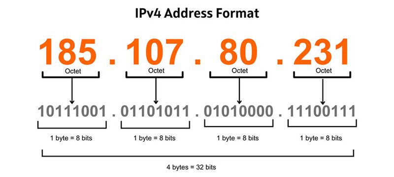
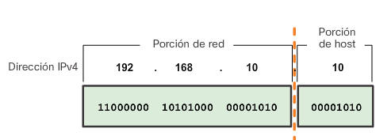
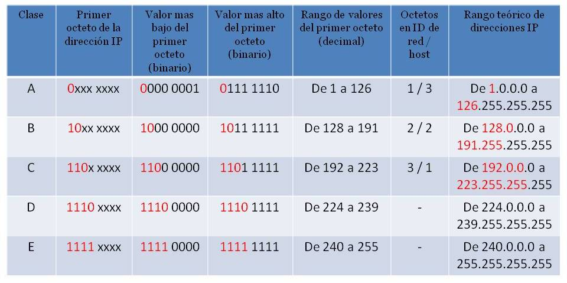

Cuando enviamos una carta necesitamos poner la dirección del destinatario en el sobre. Sin esa dirección, el cartero no sabe a quién entregarla. En una red informática ocurre exactamente lo mismo: cada dispositivo necesita una dirección única que lo identifique para que los datos puedan llegar a él y solo a él. Esa dirección es la **dirección IP** (*Internet Protocol address*).

La dirección IP es el mecanismo de direccionamiento de la **capa 3** (capa de red) del modelo OSI. Mientras la dirección MAC identifica físicamente una tarjeta de red (y no cambia), la dirección IP es una dirección **lógica** que se asigna al dispositivo y puede cambiar según la red a la que esté conectado. Un portátil que en casa tiene la IP `192.168.1.50` tendrá una IP completamente diferente cuando se conecte a la red del instituto.

## Estructura de una dirección IPv4

La versión más extendida del protocolo IP es **IPv4**, que usa direcciones de **32 bits**. Para hacerlas legibles, esos 32 bits se dividen en 4 grupos de 8 bits (llamados **octetos**), separados por puntos y representados en decimal:

<!-- IMG: diagrama de una dirección IP mostrando los 32 bits divididos en 4 octetos con su valor decimal -->
<figure markdown="span" align="center">
  { width="75%" }
  <figcaption>Estructura de una dirección IPv4: 32 bits divididos en 4 octetos de 8 bits cada uno</figcaption>
</figure>

Por ejemplo, la dirección `192.168.1.100` en binario es:

```
11000000 . 10101000 . 00000001 . 01100100
   192   .   168   .    1    .   100
```

Cada octeto puede tomar valores del **0 al 255** (2⁸ = 256 posibles valores). Esto da un total de 2³² = **4.294.967.296** direcciones IPv4 posibles, que parecen muchas pero resultaron insuficientes para el número de dispositivos conectados a internet hoy en día (razón por la que existe IPv6, que veremos al final de la unidad).

!!! info "Un octeto siempre vale entre 0 y 255"
    Una dirección como `192.168.300.1` no es válida: el tercer octeto (300) supera el máximo de 255. Si ves una dirección con algún octeto mayor de 255, es un error.

## Partes de una dirección IP: red y host

Una dirección IPv4 no es simplemente un número de 32 bits: está dividida en dos partes con significados distintos:

- **Parte de red** (*network*): identifica la red a la que pertenece el dispositivo. Todos los dispositivos de la misma red comparten la misma parte de red.
- **Parte de host**: identifica el dispositivo concreto dentro de esa red. Debe ser único dentro de la red.

<!-- IMG: diagrama mostrando una dirección IP dividida en parte de red (azul) y parte de host (naranja) -->
<figure markdown="span" align="center">
  { width="90%" }
  <figcaption>Una dirección IPv4 tiene dos partes: identificador de red (compartido) e identificador de host (único)</figcaption>
</figure>

¿Cuántos bits corresponden a la red y cuántos al host? Eso lo determina la **máscara de subred**, que veremos en el siguiente punto. Primero necesitamos entender las clases de red, que fueron la primera forma de definir esta división.

## Clases de red

En los primeros años de internet se definieron las **clases de red** como forma de estructurar el espacio de direcciones IPv4. Cada clase asigna un número fijo de bits a la parte de red y el resto al host.

<!-- IMG: diagrama de las 5 clases de red con sus rangos, bits de red/host y número de redes y hosts -->
<figure markdown="span" align="center">
  { width="85%" }
  <figcaption>Clases de red IPv4: A, B, C, D y E con sus rangos y características</figcaption>
</figure>

### Clase A

Las redes de **clase A** usan el **primer octeto** para identificar la red y los tres restantes para los hosts. El primer bit siempre es `0`, lo que limita el primer octeto al rango **1-126**.

- **Rango**: `1.0.0.0` – `126.255.255.255`
- **Bits de red / host**: 8 / 24
- **Número de redes posibles**: 126 redes (2⁷ - 2)
- **Hosts por red**: 16.777.214 (2²⁴ - 2)
- **Máscara por defecto**: `255.0.0.0` (/8)

Una red de clase A puede albergar más de 16 millones de dispositivos. Fueron asignadas a grandes organizaciones e ISPs en los primeros tiempos de internet. Actualmente están casi todas asignadas.

!!! info "¿Por qué se resta 2 a los hosts?"
    En cualquier red siempre se reservan dos direcciones que no se pueden asignar a dispositivos:

    - La **dirección de red** (todos los bits de host a 0): identifica la red en sí. Ej: `10.0.0.0`
    - La **dirección de broadcast** (todos los bits de host a 1): se usa para enviar un mensaje a todos los dispositivos de la red. Ej: `10.255.255.255`
    
    Por eso el número de hosts utilizables siempre es el total menos 2.

### Clase B

Las redes de **clase B** usan los **dos primeros octetos** para la red y los dos últimos para los hosts. Los dos primeros bits son siempre `10`.

- **Rango**: `128.0.0.0` – `191.255.255.255`
- **Bits de red / host**: 16 / 16
- **Número de redes posibles**: 16.384 (2¹⁴)
- **Hosts por red**: 65.534 (2¹⁶ - 2)
- **Máscara por defecto**: `255.255.0.0` (/16)

Las redes de clase B fueron asignadas a universidades, empresas medianas y administraciones públicas.

### Clase C

Las redes de **clase C** usan los **tres primeros octetos** para la red y solo el último para los hosts. Los tres primeros bits son siempre `110`.

- **Rango**: `192.0.0.0` – `223.255.255.255`
- **Bits de red / host**: 24 / 8
- **Número de redes posibles**: 2.097.152 (2²¹)
- **Hosts por red**: 254 (2⁸ - 2)
- **Máscara por defecto**: `255.255.255.0` (/24)

Es la clase más común en redes locales pequeñas y medianas. Con 254 hosts por red es suficiente para la mayoría de oficinas y hogares.

### Clase D y Clase E

**Clase D** (`224.0.0.0` – `239.255.255.255`): reservada para **multicast** — comunicaciones de uno a muchos donde un paquete se envía a un grupo de receptores simultáneamente. No se usa para direccionar hosts individuales.

**Clase E** (`240.0.0.0` – `255.255.255.255`): reservada para uso experimental e investigación. No se usa en redes de producción.

### Resumen de clases

| Clase | Primer octeto | Máscara por defecto | Hosts por red | Uso |
|-------|--------------|--------------------|--------------|----|
| **A** | 1 – 126 | 255.0.0.0 (/8) | 16.777.214 | Grandes redes, ISPs |
| **B** | 128 – 191 | 255.255.0.0 (/16) | 65.534 | Universidades, empresas medianas |
| **C** | 192 – 223 | 255.255.255.0 (/24) | 254 | Redes pequeñas y medianas |
| **D** | 224 – 239 | — | — | Multicast |
| **E** | 240 – 255 | — | — | Experimental |

!!! warning "La dirección 127.x.x.x: el loopback"
    El rango `127.0.0.0` – `127.255.255.255` está reservado para el **loopback** — comunicación interna del propio equipo consigo mismo. La dirección `127.0.0.1` es especialmente conocida: cuando haces `ping 127.0.0.1`, estás comprobando que la pila TCP/IP del propio equipo funciona correctamente, sin enviar nada a la red. En desarrollo web, el servidor local suele estar en `http://127.0.0.1` o su alias `http://localhost`.

## El problema del desperdicio de direcciones

El sistema de clases tuvo un problema fundamental desde el principio: el **desperdicio masivo de direcciones**. Si una empresa necesitaba 500 hosts, no le bastaba una red de clase C (254 hosts) pero una red de clase B (65.534 hosts) era enormemente grande para sus necesidades reales — los 65.034 hosts sobrantes quedaban inutilizados.

Este problema llevó al desarrollo del **subnetting** (división de redes en subredes) y del **CIDR** (*Classless Inter-Domain Routing*), que permiten usar máscaras de cualquier longitud en lugar de estar limitados a /8, /16 o /24. Lo veremos en el punto 3.

!!! example "Ejemplo del desperdicio de clases"
    Una empresa tiene 300 equipos. Sus opciones con el sistema de clases son:

    - Clase C (/24): 254 hosts → **no alcanza**
    - Clase B (/16): 65.534 hosts → alcanza, pero **65.234 direcciones desperdiciadas**

    Con CIDR y subnetting, podría usar una red /23 que da exactamente 510 hosts utilizables — justo lo que necesita con algo de margen. Veremos cómo calcular esto en el punto 4.

---

## Actividad en clase

### 🖥️ Actividad conjunta: identifica la clase de estas IPs

Para cada dirección IP, indica: la clase a la que pertenece, si podría ser una dirección de host válida, y la máscara de red por defecto.

| Dirección IP | ¿Clase? | ¿Host válido? | Máscara por defecto |
|-------------|---------|--------------|---------------------|
| `10.0.0.1` | | | |
| `172.16.5.200` | | | |
| `192.168.1.1` | | | |
| `127.0.0.1` | | | |
| `224.0.0.5` | | | |
| `8.8.8.8` | | | |
| `200.100.50.25` | | | |
| `255.255.255.0` | | | |

??? "Solución"

    | Dirección IP | Clase | Host válido | Máscara |
    |-------------|-------|------------|---------|
    | `10.0.0.1` | A | ✅ Sí | 255.0.0.0 /8 |
    | `172.16.5.200` | B | ✅ Sí | 255.255.0.0 /16 |
    | `192.168.1.1` | C | ✅ Sí | 255.255.255.0 /24 |
    | `127.0.0.1` | A* | ❌ No (loopback) | — |
    | `224.0.0.5` | D | ❌ No (multicast) | — |
    | `8.8.8.8` | A | ✅ Sí (IP pública Google DNS) | 255.0.0.0 /8 |
    | `200.100.50.25` | C | ✅ Sí | 255.255.255.0 /24 |
    | `255.255.255.0` | E* | ❌ No (es una máscara, no una IP de host) | — |

    *127.x.x.x técnicamente es clase A pero está reservado. 255.x.x.x es clase E pero 255.255.255.0 es una máscara, no una dirección de host.
