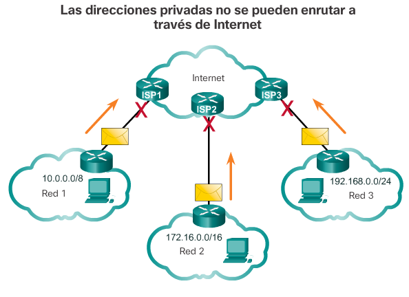
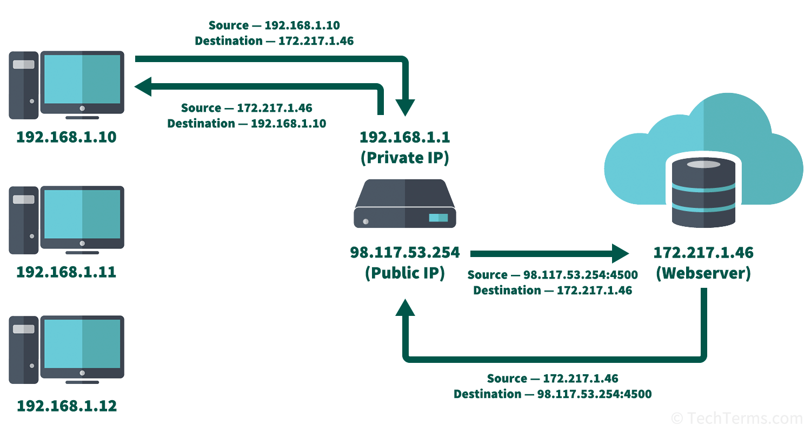
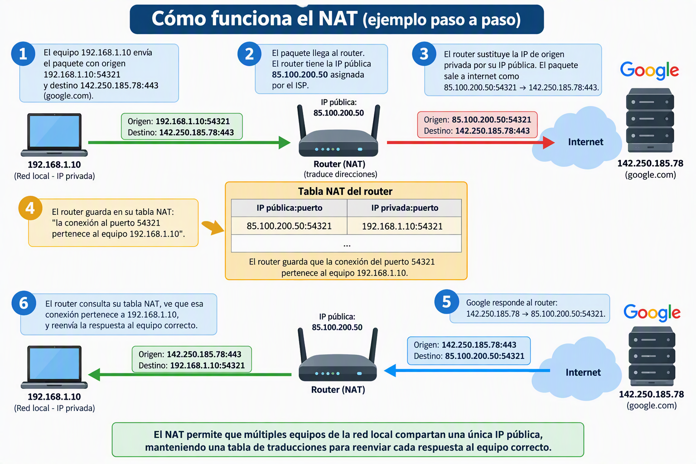

En el punto anterior vimos que IPv4 tiene un total de 4.294.967.296 direcciones posibles. Podría parecer suficiente, pero en los años 90 quedó claro que no lo sería: el crecimiento exponencial de internet y la proliferación de dispositivos conectados agotaría el espacio de direcciones mucho antes de lo previsto. En 1994 ya se preveía que las direcciones IPv4 se acabarían en pocos años.

La solución que se adoptó para ganar tiempo mientras se desarrollaba IPv6 fue una idea brillante en su sencillez: **no todos los dispositivos del mundo necesitan una dirección IP única en internet**. Los equipos de una red local solo necesitan identificarse entre sí dentro de esa red — para comunicarse con internet, basta con que la red en conjunto tenga una sola dirección pública. Así nacieron las **direcciones IP privadas** y la tecnología **NAT**.

## Direcciones IP públicas

Una **dirección IP pública** es una dirección **única a nivel mundial** que identifica un dispositivo (o una red) en internet. Están gestionadas por la organización **IANA** (*Internet Assigned Numbers Authority*) a nivel global, y distribuidas regionalmente por los **RIR** (*Regional Internet Registries*): RIPE NCC para Europa, ARIN para Norteamérica, LACNIC para Latinoamérica, etc.

Las IPs públicas son accesibles desde cualquier punto de internet. Cuando escribes `google.com` en el navegador, se resuelve a una IP pública de los servidores de Google. Cuando alguien desde Japón quiere acceder a tu servidor web, necesita conocer su IP pública.

Las IPs públicas son un **recurso escaso y de pago**: las empresas pagan a sus ISPs por tener una o varias IPs públicas. Un servidor web necesita al menos una IP pública fija para ser accesible desde internet.

## Direcciones IP privadas

Las **direcciones IP privadas** son rangos reservados por la IANA que **no se enrutan en internet**. Esto significa que un router de internet que recibe un paquete con IP privada de destino lo descarta — nunca llegará a su destino. Son exclusivas para uso interno en redes locales.

La gran ventaja es que **cualquier organización puede usar estos rangos libremente** sin necesitar permiso ni pago: una empresa, un instituto, un hogar... todos pueden usar `192.168.1.x` en su red local sin conflicto con nadie, porque esas direcciones nunca salen a internet.

Los tres rangos de direcciones privadas definidos en el RFC 1918 son:

| Clase | Rango privado | Máscara por defecto | Número de hosts |
|-------|--------------|--------------------|--------------------|
| **A** | `10.0.0.0` – `10.255.255.255` | /8 (255.0.0.0) | 16.777.214 |
| **B** | `172.16.0.0` – `172.31.255.255` | /12 (255.240.0.0) | 1.048.574 |
| **C** | `192.168.0.0` – `192.168.255.255` | /16 (255.255.0.0) | 65.534 |

<!-- IMG: diagrama con los tres rangos privados identificados en color y el rango público en gris -->
<figure markdown="span" align="center">
  { width="75%" }
  <figcaption>Los tres rangos de direcciones IP privadas (RFC 1918): no son enrutables en internet</figcaption>
</figure>

!!! example "¿Cómo saber si una IP es pública o privada?"
    Es sencillo: si la dirección cae dentro de uno de los tres rangos privados, es privada. Si no, es pública.

    - `10.5.20.1` → privada (rango 10.0.0.0/8)
    - `172.20.1.5` → privada (rango 172.16.0.0/12)
    - `192.168.100.50` → privada (rango 192.168.0.0/16)
    - `172.15.0.1` → **pública** (está por debajo del rango privado 172.16.x.x)
    - `8.8.8.8` → pública (DNS de Google)
    - `203.0.113.1` → pública

### Otras direcciones especiales

Además de los rangos privados, existen otras direcciones reservadas con usos específicos:

| Rango | Uso |
|-------|-----|
| `127.0.0.0/8` | Loopback (comunicación interna del propio equipo) |
| `169.254.0.0/16` | APIPA — asignación automática cuando no hay DHCP |
| `0.0.0.0` | Dirección no especificada (indica "cualquier interfaz") |
| `255.255.255.255` | Broadcast limitado (toda la red local) |

!!! info "¿Qué es APIPA?"
    Si un equipo configurado para obtener IP por DHCP no encuentra ningún servidor DHCP en la red, Windows asigna automáticamente una dirección del rango `169.254.x.x` (*Automatic Private IP Addressing*). Cuando ves una IP que empieza por `169.254`, significa casi siempre que el equipo no puede contactar con el servidor DHCP — o que no hay ninguno en la red. Es una señal de problema de conectividad.

## NAT: Network Address Translation

Ahora que sabemos que los dispositivos de una red local tienen IPs privadas y que esas IPs no son accesibles desde internet, surge una pregunta obvia: **¿cómo pueden los equipos de una red local acceder a internet si su IP no es pública?**

La respuesta es **NAT** (*Network Address Translation* o Traducción de Direcciones de Red). NAT es una función que realiza el router en el límite entre la red local (LAN) y internet (WAN): **traduce las direcciones IP privadas de los equipos de la LAN a la IP pública del router** cuando los paquetes salen a internet, y hace la traducción inversa cuando llegan las respuestas.

<!-- IMG: diagrama NAT mostrando 3 equipos con IPs privadas, el router traduciendo a una IP pública, y la nube de internet -->
<figure markdown="span" align="center">
  { width="80%" }
  <figcaption>NAT: el router traduce las IPs privadas de la LAN a la IP pública cuando los paquetes salen a internet</figcaption>
</figure>

### ¿Cómo funciona NAT paso a paso?

Imaginemos que el equipo `192.168.1.10` quiere acceder a `google.com` (IP pública `142.250.185.78`):

1. El equipo envía el paquete con origen `192.168.1.10:54321` y destino `142.250.185.78:443`.
2. El paquete llega al router. El router tiene la IP pública `85.100.200.50` asignada por el ISP.
3. El router **sustituye** la IP de origen privada por su IP pública: el paquete sale a internet como `85.100.200.50:54321` → `142.250.185.78:443`.
4. El router guarda en su **tabla NAT**: "la conexión al puerto 54321 pertenece al equipo `192.168.1.10`".
5. Google responde al router: `142.250.185.78` → `85.100.200.50:54321`.
6. El router consulta su tabla NAT, ve que esa conexión pertenece a `192.168.1.10`, y reenvía la respuesta al equipo correcto.

<!-- IMG: diagrama detallado del proceso NAT con los números de puerto y la tabla de traducción -->
<figure markdown="span" align="center">
  { width="85%" }
  <figcaption>Proceso NAT detallado: el router mantiene una tabla de traducciones para saber a qué equipo interno reenviar cada respuesta</figcaption>
</figure>

Todo este proceso es **completamente transparente** para el equipo y para el servidor de destino. El equipo no sabe que su IP ha sido traducida; Google no sabe que hay varios equipos detrás de esa IP pública.

### PAT: Port Address Translation

La variante de NAT más usada se llama **PAT** (*Port Address Translation*) o NAT con sobrecarga. Permite que **múltiples equipos con IPs privadas compartan una sola IP pública** usando diferentes números de puerto para distinguir las conexiones. Es lo que hace prácticamente cualquier router doméstico o de pequeña empresa.

Con PAT, una oficina con 50 equipos puede funcionar perfectamente con una sola IP pública: el router distingue las conexiones de cada equipo por el número de puerto origen, no por la IP.

### Ventajas e inconvenientes de NAT

**Ventajas:**

- **Conserva el espacio de direcciones IPv4**: miles de millones de dispositivos usan IPs privadas detrás de NAT, con solo millones de IPs públicas.
- **Seguridad básica**: los equipos de la LAN no son directamente accesibles desde internet — el router actúa como barrera.
- **Flexibilidad**: la red interna puede reorganizarse sin afectar a la IP pública.

**Inconvenientes:**

- **Rompe el modelo extremo a extremo de internet**: en teoría, cualquier dispositivo debería poder comunicarse directamente con cualquier otro. Con NAT, los dispositivos detrás de NAT no pueden recibir conexiones entrantes desde internet sin configuración adicional (*port forwarding*).
- **Problemas con algunos protocolos**: aplicaciones que necesitan comunicación directa (VoIP, videojuegos en línea, algunos protocolos P2P) tienen problemas con NAT y necesitan técnicas especiales para atravesarlo.
- **Añade latencia y complejidad**: el router tiene que mantener y consultar la tabla de traducciones para cada paquete.

!!! example "Port forwarding: abrir un puerto para recibir conexiones"
    Si quieres que tu servidor web casero sea accesible desde internet, necesitas configurar **port forwarding** en el router: "cuando llegue una conexión al puerto 80 de la IP pública, reenvíala al equipo `192.168.1.100`". Sin esta configuración, el router no sabe a qué equipo interno debe enviar las conexiones entrantes que nadie ha solicitado. En el proyecto del curso, cuando configuremos el servidor Windows para acceso remoto, necesitaremos entender este concepto.

## Resumen: pública vs privada

## Resumen IP

## Resumen IP

*Resumen de rangos IP: privados, especiales y públicos*

| Tipo | Rango IP | Uso principal | Accesible desde Internet |
|--------|--------|--------|:--:|
| 🟢 Privada (Clase A) | 10.0.0.0 - 10.255.255.255 (/8) | Redes privadas grandes | ❌ |
| 🟢 Privada (Clase B) | 172.16.0.0 - 172.31.255.255 (/12) | Redes corporativas | ❌ |
| 🟢 Privada (Clase C) | 192.168.0.0 - 192.168.255.255 (/16) | Hogares y PYMES | ❌ |
| 🟡 Loopback | 127.0.0.0 - 127.255.255.255 | Comunicación con uno mismo (localhost) | ❌ |
| 🟡 APIPA | 169.254.0.0 - 169.254.255.255 | Configuración automática sin DHCP | ❌ |
| 🟡 Multicast | 224.0.0.0 - 239.255.255.255 | Comunicación con grupos de equipos | ⚠️ Especial |
| 🟡 Broadcast | 255.255.255.255 | Envío a todos los equipos de la red | ❌ |
| 🔵 Pública | Resto de direcciones IPv4 | Comunicación por Internet | ✅ |

### Ejemplos

| Tipo | Ejemplos |
|--------|--------|
| 🟢 Privadas | 192.168.1.10, 192.168.0.100, 10.0.0.50, 172.16.5.30 |
| 🟡 Especiales | 127.0.0.1, 169.254.10.20, 224.0.0.1, 255.255.255.255 |
| 🔵 Públicas | 8.8.8.8, 1.1.1.1, 142.250.185.78 |

### Comparativa rápida

| | IP Pública | IP Privada |
|--|-----------|-----------|
| **Accesible desde internet** | Sí | No |
| **Única globalmente** | Sí | No (puede repetirse en distintas redes) |
| **Quién la asigna** | ISP / IANA | El **administrador de red** o DHCP local |
| **Coste** | De pago | Gratuita |
| **Ejemplos** | `8.8.8.8`, `142.250.185.78` | `192.168.1.1`, `10.0.0.50` |

!!!note "Recuerda"
    Las IP privadas no se enrutan por Internet. Para comunicarse con servicios externos utilizan un router con NAT, que traduce la dirección privada a una dirección IP pública.

---

## Actividad en clase

### 🖥️ Actividad conjunta: ¿pública o privada?

**Duración:** 10 minutos
**Dinámica:** individual + corrección en grupo

**Parte 1:** Clasifica cada dirección como pública, privada o especial, e indica el rango al que pertenece:

| Dirección IP | Tipo | Rango / Motivo |
|-------------|------|----------------|
| `192.168.0.1` | | |
| `172.32.0.1` | | |
| `10.10.10.10` | | |
| `172.16.255.254` | | |
| `169.254.1.5` | | |
| `1.1.1.1` | | |
| `172.15.255.255` | | |
| `192.167.1.1` | | |

**Parte 2:** Tu equipo tiene la dirección IP `169.254.45.12`. ¿Qué significa esto? ¿Qué harías para solucionarlo?

??? "Solución"

    **Parte 1:**

    | Dirección IP | Tipo | Rango / Motivo |
    |-------------|------|----------------|
    | `192.168.0.1` | **Privada** | Clase C privada (192.168.0.0/16) |
    | `172.32.0.1` | **Pública** | Fuera del rango privado B (172.16-31.x.x) |
    | `10.10.10.10` | **Privada** | Clase A privada (10.0.0.0/8) |
    | `172.16.255.254` | **Privada** | Clase B privada (172.16.0.0/12) |
    | `169.254.1.5` | **Especial** | APIPA — no hay servidor DHCP disponible |
    | `1.1.1.1` | **Pública** | DNS de Cloudflare |
    | `172.15.255.255` | **Pública** | Por debajo del rango privado B (empieza en 172.16) |
    | `192.167.1.1` | **Pública** | Por debajo del rango privado C (empieza en 192.168) |

    **Parte 2:** Una IP `169.254.x.x` (APIPA) indica que el equipo no ha podido obtener una dirección IP del servidor DHCP. Posibles causas y soluciones:
    - El servidor DHCP está apagado o inaccesible → encenderlo o verificar la conectividad
    - El cable de red está desconectado o dañado → verificar la conexión física
    - El servicio DHCP Client del equipo está detenido → reiniciarlo
    - En el aula: verificar que el switch está encendido y que el cable llega al puerto correcto
