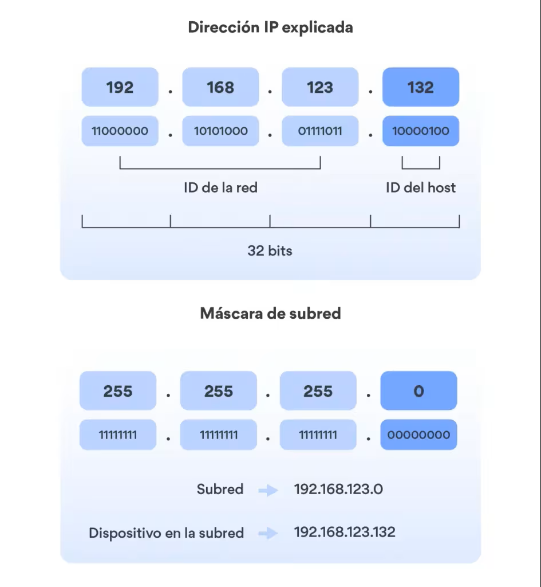
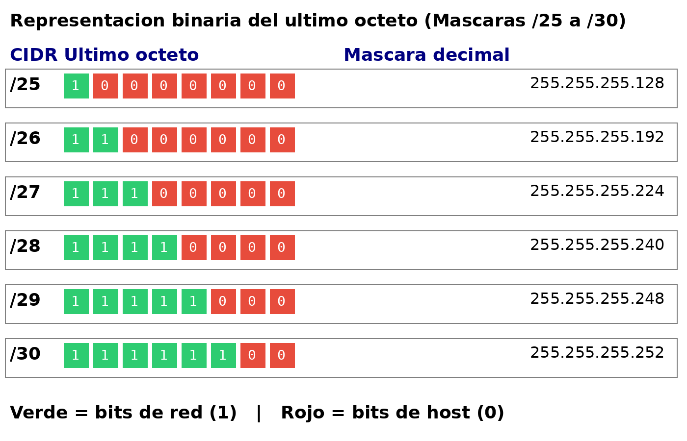
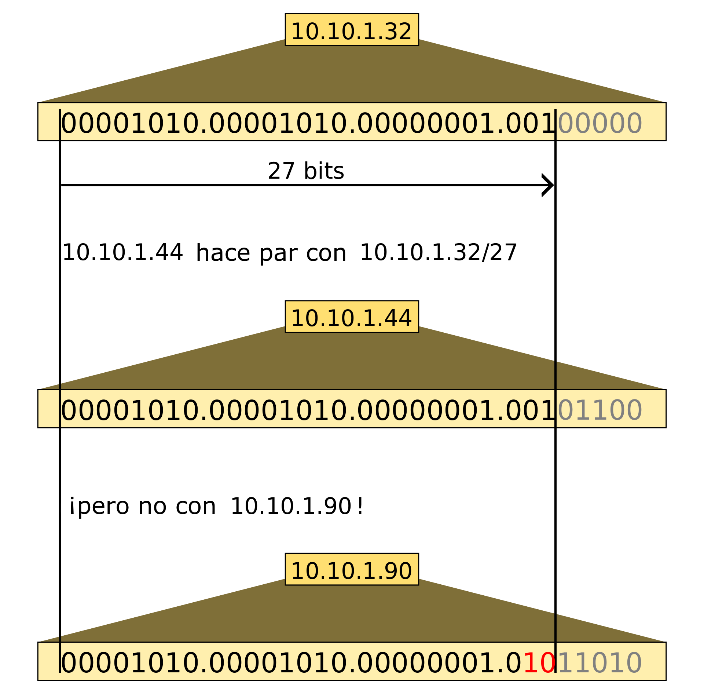

En el punto anterior vimos que una dirección IP tiene dos partes: la parte de red y la parte de host. Las clases de red definían esa división de forma rígida: en una clase A siempre los primeros 8 bits son la red, en una clase C siempre los primeros 24 bits. Pero como vimos, esto genera un desperdicio enorme de direcciones.

La **máscara de subred** es el mecanismo que nos permite definir exactamente dónde termina la parte de red y dónde empieza la parte de host, con total flexibilidad. Es uno de los conceptos más importantes de todo el tema, y entenderlo bien es imprescindible para poder diseñar y configurar redes correctamente.

## ¿Qué es la máscara de subred?

La **máscara de subred** es un número de 32 bits que se escribe igual que una dirección IP (cuatro octetos en decimal separados por puntos) y que indica, bit a bit, qué parte de la dirección IP corresponde a la red y qué parte al host.

La regla es sencilla:

- Los bits a **1** en la máscara → corresponden a la **parte de red**
- Los bits a **0** en la máscara → corresponden a la **parte de host**

Y hay una condición fundamental: **los unos siempre van antes que los ceros** — nunca hay ceros entre unos en una máscara válida.

<!-- IMG: diagrama mostrando una IP y su máscara en binario, con la parte de red en azul y host en naranja -->
<figure markdown="span" align="center">
  { width="80%" }
  <figcaption>La máscara de subred aplicada a una dirección IP: los bits a 1 identifican la red, los bits a 0 el host</figcaption>
</figure>

Veamos un ejemplo con la IP `192.168.1.100` y la máscara `255.255.255.0`:

```
IP:      11000000 . 10101000 . 00000001 . 01100100
Máscara: 11111111 . 11111111 . 11111111 . 00000000
         ────────────────────────────────────────
         [    parte de red (24 bits)    ] [host ]
```

Los primeros 24 bits (los tres primeros octetos) son la red: `192.168.1`. El último octeto es el host: `100`. Por tanto este equipo está en la red `192.168.1.0` y es el host número 100 de esa red.

## Notación CIDR

Escribir la máscara completa (`255.255.255.0`) es correcto pero engorroso. La **notación CIDR** (*Classless Inter-Domain Routing*) simplifica esto usando una barra seguida del número de bits a 1 de la máscara:

```
192.168.1.100 / 255.255.255.0  →  192.168.1.100/24
```

El `/24` indica que los primeros 24 bits son la red (todos a 1) y los 8 restantes son el host (todos a 0). Es exactamente la misma información, mucho más compacta.

La correspondencia entre la notación CIDR y la máscara decimal para los valores más habituales:

| Notación CIDR | Máscara decimal | Bits de red | Bits de host | Hosts utilizables |
|--------------|----------------|------------|-------------|------------------|
| /8 | 255.0.0.0 | 8 | 24 | 16.777.214 |
| /16 | 255.255.0.0 | 16 | 16 | 65.534 |
| /24 | 255.255.255.0 | 24 | 8 | 254 |
| /25 | 255.255.255.128 | 25 | 7 | 126 |
| /26 | 255.255.255.192 | 26 | 6 | 62 |
| /27 | 255.255.255.224 | 27 | 5 | 30 |
| /28 | 255.255.255.240 | 28 | 4 | 14 |
| /29 | 255.255.255.248 | 29 | 3 | 6 |
| /30 | 255.255.255.252 | 30 | 2 | 2 |

!!! tip "La fórmula de los hosts"
    El número de hosts utilizables siempre es **2ⁿ - 2**, donde n es el número de bits de host. Se restan 2 por la dirección de red (todos los bits de host a 0) y la dirección de broadcast (todos los bits de host a 1).

    Ejemplo con /24: 2⁸ - 2 = 256 - 2 = **254 hosts**.
    Ejemplo con /25: 2⁷ - 2 = 128 - 2 = **126 hosts**.

## Cómo calcular la máscara en binario

Para las máscaras que no terminan en un octeto completo (las que no son /8, /16, /24), necesitamos saber convertir el número de bits a la representación decimal.

La clave es recordar los valores posicionales de un octeto:

```
Posición:  7    6    5    4    3    2    1    0
Valor:    128   64   32   16    8    4    2    1
```

Para /25, los 25 bits son: los 24 primeros octetos completos (255.255.255) más 1 bit adicional en el cuarto octeto:

```
Cuarto octeto de /25:  1 0 0 0 0 0 0 0  =  128
Máscara /25:           255.255.255.128
```

Para /26, son 2 bits adicionales en el cuarto octeto:

```
Cuarto octeto de /26:  1 1 0 0 0 0 0 0  =  128 + 64 = 192
Máscara /26:           255.255.255.192
```

Para /27, son 3 bits:

```
Cuarto octeto de /27:  1 1 1 0 0 0 0 0  =  128 + 64 + 32 = 224
Máscara /27:           255.255.255.224
```

<!-- IMG: tabla visual de los últimos octetos de las máscaras /25 a /30 con los bits marcados -->
<figure markdown="span" align="center">
  { width="75%" }
  <figcaption>Representación binaria del último octeto para las máscaras /25 a /30</figcaption>
</figure>

## Elegir la máscara correcta según el número de equipos

Este es el concepto más importante de este punto y uno de los más relevantes para el diseño de redes reales: **la máscara debe ajustarse al número de equipos que necesitamos, no a la clase de la red**.

Un error muy habitual es usar siempre /24 porque es "la más común" o /8 porque se tiene una dirección de clase A. Esto puede desperdiciar miles o millones de direcciones innecesariamente.

### El proceso correcto para elegir la máscara

1. **Determina cuántos hosts necesitas** (equipos + servidores + impresoras + cualquier dispositivo con IP)
2. **Añade un margen de crecimiento** (normalmente un 20-30% adicional)
3. **Encuentra la potencia de 2 inmediatamente superior** al número total
4. **Esa potencia de 2 son los bits de host** → la máscara es /32 menos esos bits

!!! example "Ejemplo 1: una oficina con 50 equipos"
    Necesitamos alojar 50 equipos. Con margen del 20%: 50 × 1,2 = 60 equipos.

    Buscamos la potencia de 2 inmediatamente superior a 60:
    - 2⁵ = 32 → insuficiente
    - 2⁶ = 64 → suficiente (64 - 2 = 62 hosts utilizables ✓)

    Con 6 bits de host, la máscara es **/26** (255.255.255.192).
    Hosts disponibles: 62. Perfecto para 50-60 equipos.

!!! example "Ejemplo 2: una empresa con 300 equipos"
    300 equipos. Con margen del 20%: 360 equipos.

    Buscamos la potencia de 2 superior a 360:
    - 2⁸ = 256 → insuficiente
    - 2⁹ = 512 → suficiente (512 - 2 = 510 hosts utilizables ✓)

    Con 9 bits de host, la máscara es **/23** (255.255.254.0).
    Hosts disponibles: 510. Adecuado para una empresa de 300 equipos con margen de crecimiento.

!!! example "Ejemplo 3: el error clásico de usar /8 para 50 equipos"
    Imaginemos que tenemos asignada la red `10.0.0.0` (clase A) y necesitamos 50 equipos.

    Si usamos la máscara por defecto de clase A (/8):
    - Hosts disponibles: 16.777.214
    - Hosts usados: 50
    - **Desperdicio: 16.777.164 direcciones**

    La máscara correcta sería /26 (62 hosts), y la red sería `10.0.0.0/26`. Así reservamos solo el espacio que necesitamos y el resto de la red `10.0.0.0/8` puede subdividirse para otras subredes o departamentos.

### Tabla de referencia rápida

Esta tabla es muy útil para diseño de redes. Con ella puedes determinar rápidamente qué máscara necesitas según el número de equipos:

| Equipos necesarios | Máscara | CIDR | Hosts disponibles | Desperdicio máximo |
|-------------------|---------|------|------------------|--------------------|
| 1 - 2 | 255.255.255.252 | /30 | 2 | 0 |
| 3 - 6 | 255.255.255.248 | /29 | 6 | 3 |
| 7 - 14 | 255.255.255.240 | /28 | 14 | 7 |
| 15 - 30 | 255.255.255.224 | /27 | 30 | 15 |
| 31 - 62 | 255.255.255.192 | /26 | 62 | 31 |
| 63 - 126 | 255.255.255.128 | /25 | 126 | 63 |
| 127 - 254 | 255.255.255.0 | /24 | 254 | 127 |
| 255 - 510 | 255.255.254.0 | /23 | 510 | 255 |
| 511 - 1022 | 255.255.252.0 | /22 | 1022 | 511 |
| 1023 - 2046 | 255.255.248.0 | /21 | 2046 | 1023 |

## La operación AND: cómo la red detecta si un destino es local

Hay una operación matemática que usan los equipos para determinar si una dirección de destino está en su misma red o hay que enviar el paquete al router: la **operación AND bit a bit** entre la IP y la máscara.

```
IP del equipo:    192.168.1.100  →  11000000.10101000.00000001.01100100
Máscara /24:      255.255.255.0  →  11111111.11111111.11111111.00000000
AND resultado:    192.168.1.0    →  11000000.10101000.00000001.00000000
                                   ↑ Esta es la dirección de RED
```

- Si aplico el mismo AND a la IP de destino y obtengo el mismo resultado, el destino está en mi red → envío directamente. 

- Si el resultado es diferente, el destino está en otra red → envío al router (puerta de enlace).

<!-- IMG: diagrama mostrando la operación AND entre IP y máscara para determinar la dirección de red -->
<figure markdown="span" align="center">
  { width="75%" }
  <figcaption>Operación AND bit a bit: así determina un equipo si el destino está en su red o en otra</figcaption>
</figure>

!!! tip "No hace falta hacer el AND manualmente"
    Los equipos hacen esta operación automáticamente en microsegundos. Nosotros la entendemos para saber qué ocurre internamente, pero en la práctica usaremos herramientas como `ipcalc` para calcular direcciones de red, rangos y broadcasts.

---

## Actividad en clase

### 🖥️ Actividad conjunta: elige la máscara correcta

Para cada escenario, indica qué máscara (CIDR y decimal) usarías y cuántos hosts quedan disponibles. Justifica por qué no usas la máscara por defecto de la clase.

**Escenario 1:** Departamento de desarrollo con 12 programadores. Red: `192.168.10.0`

**Escenario 2:** Empresa mediana con 180 empleados y previsión de crecer hasta 220 en 2 años. Red: `172.20.0.0`

**Escenario 3:** Enlace punto a punto entre dos routers (solo necesitan 2 IPs). Red: `10.0.0.0`

**Escenario 4:** Red de servidores con 6 servidores físicos + 2 de reserva. Red: `192.168.100.0`

??? "Solución"

    **Escenario 1:** 
    
    - 12 programadores + margen → necesitamos ~15-16 hosts.
    - 2⁴ = 16 hosts totales → 14 utilizables → **/28** (255.255.255.240)
    - Red: `192.168.10.0/28`, hosts: `192.168.10.1` – `192.168.10.14`, broadcast: `192.168.10.15`
    - La máscara por defecto /24 daría 254 hosts → 240 desperdiciados innecesariamente.

    **Escenario 2:** 
    
    - Previsión de 220 equipos → necesitamos al menos 220 hosts.
    - 2⁷ = 128 → insuficiente. 2⁸ = 256 → 254 hosts → insuficiente también (220 < 254 pero sin margen)
    - 2⁹ = 512 → 510 hosts → suficiente con margen → **/23** (255.255.254.0)
    - Red: `172.20.0.0/23`, hosts: `172.20.0.1` – `172.20.1.254`, broadcast: `172.20.1.255`
    - La máscara por defecto /16 daría 65.534 hosts → enorme desperdicio.

    **Escenario 3:** 
    
    - Solo 2 IPs → 2 hosts → 2² = 4, menos 2 = 2 → **/30** (255.255.255.252)
    - Red: `10.0.0.0/30`, hosts: `10.0.0.1` y `10.0.0.2`, broadcast: `10.0.0.3`
    - La /30 es la máscara estándar para enlaces punto a punto entre routers.

    **Escenario 4:** 
    
    - 6 + 2 reserva = 8 servidores → 2³ = 8 hosts totales → 6 utilizables → insuficiente.
    - 2⁴ = 16 → 14 hosts utilizables → suficiente → **/28** (255.255.255.240)
    - Red: `192.168.100.0/28`, hosts: `192.168.100.1` – `192.168.100.14`
    - La /24 daría 254 hosts para solo 8 servidores → desperdicio injustificado.
