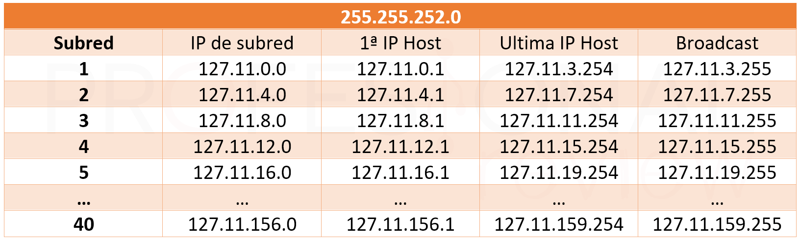
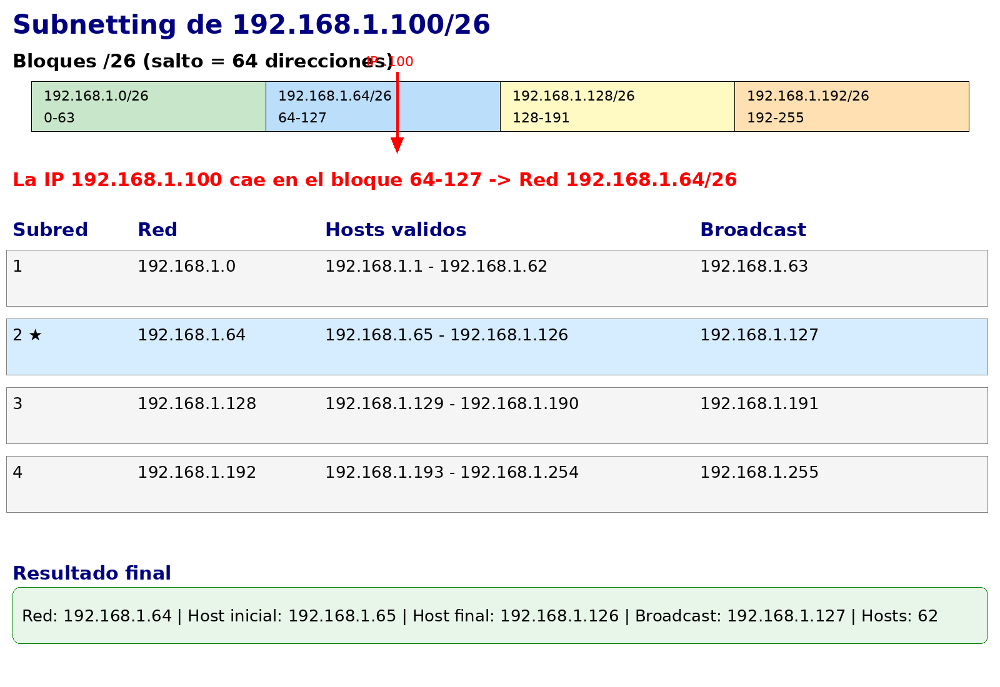
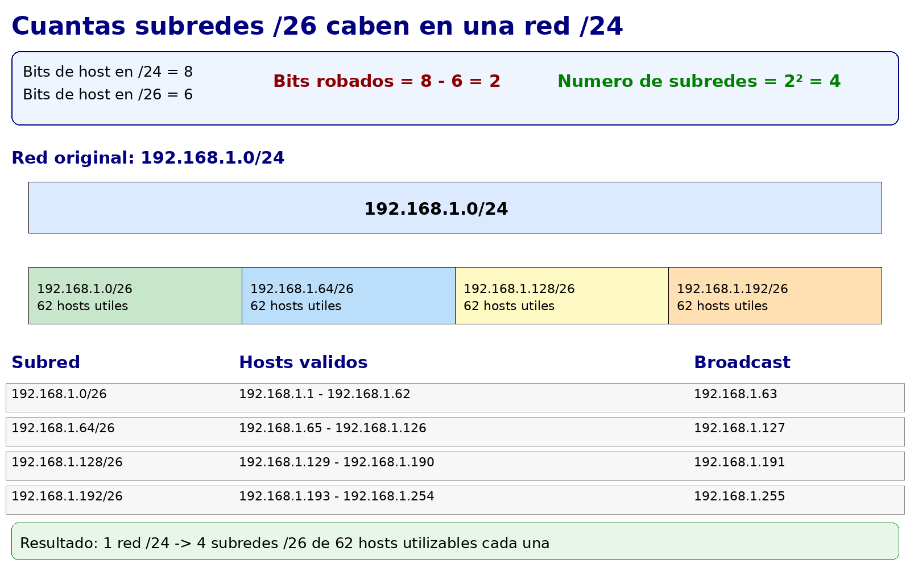

Ya sabemos qué es una máscara de subred y cómo elegirla según el número de equipos. Ahora vamos a aprender a **calcular todos los parámetros de una subred** a partir de una dirección IP y su máscara: la dirección de red, el rango de hosts válidos, la dirección de broadcast y el número de hosts utilizables.

Este es el cálculo que haremos constantemente al diseñar redes: cuando asignamos la red `192.168.10.0/26` a un departamento, necesitamos saber exactamente qué IPs podemos asignar a los equipos, cuál es la dirección de broadcast y cuántos equipos caben como máximo.

## Los cuatro valores fundamentales de una subred

Para cualquier subred, necesitamos calcular cuatro valores:

**1. Dirección de red**: la primera dirección del bloque. Todos los bits de host a 0. No se puede asignar a ningún dispositivo — identifica la red en sí.

**2. Primera dirección de host**: la dirección de red + 1. El primer dispositivo que podemos configurar.

**3. Última dirección de host**: la dirección de broadcast - 1. El último dispositivo que podemos configurar.

**4. Dirección de broadcast**: la última dirección del bloque. Todos los bits de host a 1. No se puede asignar a ningún dispositivo — se usa para enviar mensajes a todos los equipos de la red simultáneamente.

<!-- IMG: diagrama de un bloque de subred mostrando los 4 valores con colores distintos -->
<figure markdown="span" align="center">
  { width="90%" }
  <figcaption>Los cuatro valores fundamentales de cualquier subred: red, primer host, último host y broadcast</figcaption>
</figure>

## Método de cálculo paso a paso

El método más claro para calcular una subred es trabajar con el **tamaño del bloque**, que es simplemente el número total de direcciones del bloque (2ⁿ, donde n son los bits de host).

### Paso 1: Calcular el tamaño del bloque

El tamaño del bloque = **2^(bits de host)** = **2^(32 - prefijo CIDR)**

- Para **/24**: bits de host = 32 - 24 = 8 → tamaño = 2⁸ = **256 direcciones**
- Para **/26**: bits de host = 32 - 26 = 6 → tamaño = 2⁶ = **64 direcciones**
- Para **/28**: bits de host = 32 - 28 = 4 → tamaño = 2⁴ = **16 direcciones**

### Paso 2: Encontrar la dirección de red

La dirección de red es el inicio del bloque. Los bits de host son todos 0.

Para encontrarla rápidamente: el **octeto donde cambia la máscara** es el clave. La dirección de red en ese octeto es el múltiplo del tamaño de bloque más cercano por debajo de la IP dada.

### Paso 3: Calcular el broadcast

Broadcast = dirección de red + tamaño del bloque - 1

### Paso 4: Rango de hosts

- Primera IP de host = dirección de red + 1
- Última IP de host = broadcast - 1
- Número de hosts = tamaño del bloque - 2

---

## Ejemplos resueltos

### Ejemplo 1: `192.168.1.100/24`

**Paso 1:** Tamaño del bloque = 2^(32-24) = 2⁸ = 256

**Paso 2:** La máscara /24 afecta al cuarto octeto completamente. La dirección de red es `192.168.1.0` (todos los bits del cuarto octeto a 0).

**Paso 3:** Broadcast = `192.168.1.0` + 256 - 1 = `192.168.1.255`

**Paso 4:**
```
Dirección de red:      192.168.1.0
Primera IP de host:    192.168.1.1
Última IP de host:     192.168.1.254
Broadcast:             192.168.1.255
Hosts utilizables:     254
```

---

### Ejemplo 2: `192.168.1.100/26`

**Paso 1:** Tamaño del bloque = 2^(32-26) = 2⁶ = 64

**Paso 2:** La máscara /26 actúa sobre el cuarto octeto. Los bloques de 64 en el cuarto octeto empiezan en: 0, 64, 128, 192...

- La IP es `192.168.1.100` → el 100 está entre 64 y 128 → el bloque empieza en **64**.
- Dirección de red: `192.168.1.64`

**Paso 3:** Broadcast = `192.168.1.64` + 64 - 1 = `192.168.1.127`

**Paso 4:**
```
Dirección de red:      192.168.1.64
Primera IP de host:    192.168.1.65
Última IP de host:     192.168.1.126
Broadcast:             192.168.1.127
Hosts utilizables:     62
```

<!-- IMG: diagrama del bloque /26 mostrando los 64 bloques y dónde cae la IP 100 -->
<figure markdown="span" align="center">
  { width="75%" }
  <figcaption>La IP 192.168.1.100/26 pertenece al bloque que va de .64 a .127</figcaption>
</figure>

---

### Ejemplo 3: `172.16.5.200/25`

**Paso 1:** Tamaño del bloque = 2^(32-25) = 2⁷ = 128

**Paso 2:** Bloques de 128 en el cuarto octeto: 0, 128...

- La IP es `172.16.5.200` → el 200 está entre 128 y 256 → el bloque empieza en **128**.
- Dirección de red: `172.16.5.128`

**Paso 3:** Broadcast = `172.16.5.128` + 128 - 1 = `172.16.5.255`

**Paso 4:**
```
Dirección de red:      172.16.5.128
Primera IP de host:    172.16.5.129
Última IP de host:     172.16.5.254
Broadcast:             172.16.5.255
Hosts utilizables:     126
```

---

### Ejemplo 4: `10.0.50.130/23` (máscara en el tercer octeto)

Cuando la máscara no cae en un límite de octeto "limpio" como /8, /16, /24, el cálculo requiere prestar atención al octeto correcto.

**Paso 1:** Tamaño del bloque = 2^(32-23) = 2⁹ = 512

Con 512 direcciones y siendo el cuarto octeto de 256, el bloque se extiende por **dos octetos completos del cuarto**, lo que significa que el bloque actúa sobre el **tercer octeto** (en pasos de 2).

**Paso 2:** Bloques de 2 en el tercer octeto: 0, 2, 4, ..., 50, 52...

- La IP es `10.0.50.130` → el tercer octeto es 50, que es múltiplo de 2 → el bloque empieza en el tercer octeto = **50**.
- Dirección de red: `10.0.50.0`

**Paso 3:** Broadcast = `10.0.50.0` + 512 - 1:

- El bloque de 512 abarca `10.0.50.0` hasta `10.0.51.255`
- Broadcast: `10.0.51.255`

**Paso 4:**
```
Dirección de red:      10.0.50.0
Primera IP de host:    10.0.50.1
Última IP de host:     10.0.51.254
Broadcast:             10.0.51.255
Hosts utilizables:     510
```

!!! tip "Truco para /23, /22, /21..."
    Cuando la máscara actúa sobre el tercer octeto, el tamaño del bloque en ese octeto es:
    - /23 → bloques de 2 en el tercer octeto (512 IPs en total)
    - /22 → bloques de 4 en el tercer octeto (1024 IPs en total)
    - /21 → bloques de 8 en el tercer octeto (2048 IPs en total)

    La dirección de red siempre es el múltiplo del tamaño de bloque más cercano por debajo del valor del octeto.

---

## Cuántas subredes caben en una red mayor

Otro cálculo habitual es determinar cuántas subredes de un tamaño determinado caben dentro de una red mayor. La fórmula es sencilla:

**Número de subredes = 2^(bits de subred añadidos)**

Si partimos de una red /24 y la dividimos en subredes /26:

- Bits de host originales: 8 (para /24)
- Bits de host en la subred: 6 (para /26)
- Bits "robados" para hacer subredes: 8 - 6 = 2
- Número de subredes: 2² = **4 subredes /26**

<!-- IMG: diagrama mostrando una red /24 dividida en 4 subredes /26 -->
<figure markdown="span" align="center">
  { width="80%" }
  <figcaption>Una red /24 dividida en 4 subredes /26 de 62 hosts cada una</figcaption>
</figure>

!!! example "Ejemplo: dividir 192.168.1.0/24 en subredes /26"
    ```
    Subred 1:  192.168.1.0/26    hosts: .1 - .62    broadcast: .63
    Subred 2:  192.168.1.64/26   hosts: .65 - .126  broadcast: .127
    Subred 3:  192.168.1.128/26  hosts: .129 - .190 broadcast: .191
    Subred 4:  192.168.1.192/26  hosts: .193 - .254 broadcast: .255
    ```
    4 subredes × 62 hosts = 248 hosts utilizables (vs 254 con una sola /24).
    El pequeño "coste" de hacer subredes es perder 6 direcciones (4 de red + 4 de broadcast - 2 originales).

---

## Ejercicios de cálculo

### Ejercicio A

Calcula todos los parámetros de las siguientes subredes:

1. `192.168.5.75/27`
2. `10.10.10.10/8`
3. `172.16.100.200/20`
4. `192.168.1.50/30`

??? "Solución"

    **1. `192.168.5.75/27`**

    - Tamaño bloque: 2^(32-27) = 2⁵ = 32
    - Bloques de 32 en el 4º octeto: 0, 32, 64, 96... → 75 está entre 64 y 96 → empieza en 64
    ```
    Dirección de red:      192.168.5.64
    Primera IP de host:    192.168.5.65
    Última IP de host:     192.168.5.94
    Broadcast:             192.168.5.95
    Hosts utilizables:     30
    ```

    **2. `10.10.10.10/8`**

    - Tamaño bloque: 2^(32-8) = 2²⁴ = 16.777.216
    - La máscara /8 actúa sobre el primer octeto. Dirección de red: 10.0.0.0
    ```
    Dirección de red:      10.0.0.0
    Primera IP de host:    10.0.0.1
    Última IP de host:     10.255.255.254
    Broadcast:             10.255.255.255
    Hosts utilizables:     16.777.214
    ```

    **3. `172.16.100.200/20`**

    - Tamaño bloque: 2^(32-20) = 2¹² = 4096
    - Con 4096 IPs, el bloque actúa sobre el tercer octeto en pasos de 16 (4096 / 256 = 16)
    - Bloques de 16 en el 3º octeto: 0, 16, 32, ..., 96, 112... → 100 está entre 96 y 112 → empieza en 96
    ```
    Dirección de red:      172.16.96.0
    Primera IP de host:    172.16.96.1
    Última IP de host:     172.16.111.254
    Broadcast:             172.16.111.255
    Hosts utilizables:     4094
    ```

    **4. `192.168.1.50/30`**

    - Tamaño bloque: 2^(32-30) = 2² = 4
    - Bloques de 4 en el 4º octeto: 0, 4, 8, ..., 48, 52... → 50 está entre 48 y 52 → empieza en 48
    ```
    Dirección de red:      192.168.1.48
    Primera IP de host:    192.168.1.49
    Última IP de host:     192.168.1.50
    Broadcast:             192.168.1.51
    Hosts utilizables:     2
    ```
    Esta es una subred /30 típica para un enlace punto a punto entre dos routers.

### Ejercicio B

La empresa *TechSolutions S.L.* tiene asignada la red `192.168.50.0/24`. Necesita dividirla en subredes para sus departamentos:

- Desarrollo: 40 equipos
- Administración: 15 equipos
- Dirección: 5 equipos
- Servidores: 8 equipos

1. ¿Qué máscara usarías para cada departamento?
2. ¿Cabrían todas las subredes dentro de la red `192.168.50.0/24`?
3. Asigna una subred concreta a cada departamento sin solapamiento.

??? "Solución"

    **1. Máscara por departamento:**

    - Desarrollo (40 eq. + margen) → ~50 hosts → /26 (62 hosts) ✓
    - Administración (15 eq. + margen) → ~20 hosts → /27 (30 hosts) ✓
    - Dirección (5 eq. + margen) → ~8 hosts → /28 (14 hosts) ✓
    - Servidores (8 eq. + margen) → ~10 hosts → /28 (14 hosts) ✓

    **2. ¿Caben en /24?**

    - Desarrollo /26: 64 direcciones
    - Administración /27: 32 direcciones
    - Dirección /28: 16 direcciones
    - Servidores /28: 16 direcciones
    - Total: 64 + 32 + 16 + 16 = **128 direcciones** de las 256 disponibles en /24 ✓

    **3. Asignación sin solapamiento:**
    ```
    Desarrollo:      192.168.50.0/26   hosts: .1 - .62    broadcast: .63
    Administración:  192.168.50.64/27  hosts: .65 - .94   broadcast: .95
    Dirección:       192.168.50.96/28  hosts: .97 - .110  broadcast: .111
    Servidores:      192.168.50.112/28 hosts: .113 - .126 broadcast: .127
    Libre:           192.168.50.128 - 192.168.50.255 (128 dir. para futuras subredes)
    ```
