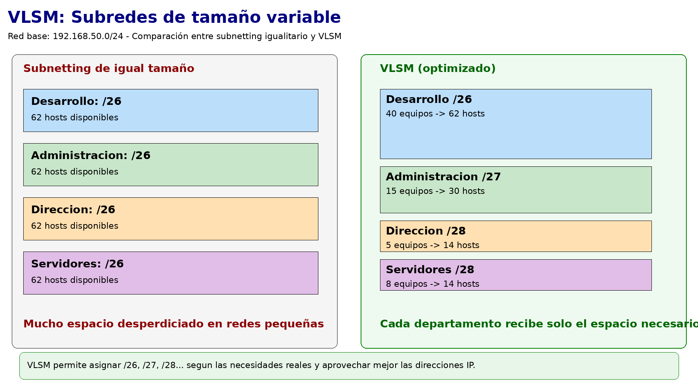
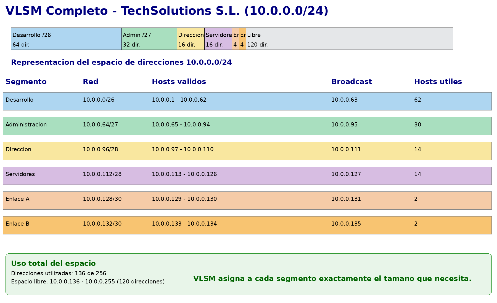

En el punto anterior aprendimos a dividir una red en subredes de **igual tamaño**. Si partíamos de una /24 y la dividíamos en /26, obteníamos 4 subredes idénticas de 62 hosts cada una. Esto funciona bien cuando todos los departamentos tienen necesidades similares, pero en la realidad raramente es así.

**VLSM** (*Variable Length Subnet Mask* — Máscara de Subred de Longitud Variable) es la técnica que permite dividir un espacio de red en subredes de **tamaños diferentes**, ajustando cada subred exactamente a las necesidades de cada segmento. Es la forma de hacer subnetting en el mundo real.

## El problema que resuelve VLSM

Volvamos al ejercicio B del punto anterior: TechSolutions S.L. con la red `192.168.50.0/24` y estos departamentos:

- Desarrollo: 40 equipos → necesita /26 (62 hosts)
- Administración: 15 equipos → necesita /27 (30 hosts)
- Dirección: 5 equipos → necesita /28 (14 hosts)
- Servidores: 8 equipos → necesita /28 (14 hosts)

Si en lugar de /24 hubiéramos tenido un espacio más limitado, o si además necesitáramos enlaces punto a punto entre routers (/30), el subnetting de igual tamaño desperdiciaría muchísimas direcciones. VLSM resuelve esto asignando a cada subred exactamente el tamaño que necesita.

<!-- IMG: diagrama comparativo de subnetting igual vs VLSM mostrando el ahorro de espacio -->
<figure markdown="span" align="center">
  { width="90%" }
  <figcaption>Subnetting de igual tamaño (izquierda) vs VLSM (derecha): VLSM aprovecha el espacio de direcciones de forma mucho más eficiente</figcaption>
</figure>

## El método VLSM: de mayor a menor

La regla fundamental de VLSM es siempre la misma: **primero las subredes más grandes, luego las más pequeñas**. Si empezamos por las pequeñas, puede que no quede espacio contiguo suficiente para las grandes.

### Proceso paso a paso

1. **Listar todas las subredes necesarias** ordenadas de mayor a menor número de hosts requeridos
2. **Asignar la máscara correcta** a cada una (la mínima que cubra los hosts necesarios)
3. **Asignar las subredes en orden**, empezando siempre desde donde terminó la anterior
4. **Verificar que no hay solapamiento** entre subredes

## Ejemplo completo resuelto

**Escenario:** La empresa TechSolutions S.L. tiene asignado el bloque `10.0.0.0/24` y necesita:

| Segmento | Equipos necesarios |
|----------|-------------------|
| Desarrollo | 50 equipos |
| Administración | 20 equipos |
| Dirección | 8 equipos |
| Servidores | 6 equipos |
| Enlace Router-Router A | 2 equipos |
| Enlace Router-Router B | 2 equipos |

**Paso 1 — Ordenar de mayor a menor y elegir máscara:**

| Segmento | Equipos | Hosts necesarios (con margen) | Máscara | Hosts disponibles |
|----------|---------|------------------------------|---------|------------------|
| Desarrollo | 50 | ~62 | /26 | 62 |
| Administración | 20 | ~30 | /27 | 30 |
| Dirección | 8 | ~14 | /28 | 14 |
| Servidores | 6 | ~14 | /28 | 14 |
| Enlace A | 2 | 2 | /30 | 2 |
| Enlace B | 2 | 2 | /30 | 2 |

**Paso 2 — Asignar subredes en orden:**

**Subred 1 — Desarrollo /26:**
- Empezamos en `10.0.0.0`
- Tamaño del bloque: 64
```
Red:        10.0.0.0/26
Hosts:      10.0.0.1 – 10.0.0.62
Broadcast:  10.0.0.63
```

**Subred 2 — Administración /27:**
- Empezamos donde terminó la anterior: `10.0.0.64`
- Tamaño del bloque: 32
```
Red:        10.0.0.64/27
Hosts:      10.0.0.65 – 10.0.0.94
Broadcast:  10.0.0.95
```

**Subred 3 — Dirección /28:**
- Empezamos en `10.0.0.96`
- Tamaño del bloque: 16
```
Red:        10.0.0.96/28
Hosts:      10.0.0.97 – 10.0.0.110
Broadcast:  10.0.0.111
```

**Subred 4 — Servidores /28:**
- Empezamos en `10.0.0.112`
- Tamaño del bloque: 16
```
Red:        10.0.0.112/28
Hosts:      10.0.0.113 – 10.0.0.126
Broadcast:  10.0.0.127
```

**Subred 5 — Enlace A /30:**
- Empezamos en `10.0.0.128`
- Tamaño del bloque: 4
```
Red:        10.0.0.128/30
Hosts:      10.0.0.129 – 10.0.0.130
Broadcast:  10.0.0.131
```

**Subred 6 — Enlace B /30:**
- Empezamos en `10.0.0.132`
- Tamaño del bloque: 4
```
Red:        10.0.0.132/30
Hosts:      10.0.0.133 – 10.0.0.134
Broadcast:  10.0.0.135
```

**Paso 3 — Verificar el uso total:**

```
Desarrollo:      10.0.0.0   – 10.0.0.63   (64 dir.)
Administración:  10.0.0.64  – 10.0.0.95   (32 dir.)
Dirección:       10.0.0.96  – 10.0.0.111  (16 dir.)
Servidores:      10.0.0.112 – 10.0.0.127  (16 dir.)
Enlace A:        10.0.0.128 – 10.0.0.131  ( 4 dir.)
Enlace B:        10.0.0.132 – 10.0.0.135  ( 4 dir.)
─────────────────────────────────────────────────────
Total usado:     136 de 256 direcciones disponibles
Libre:           10.0.0.136 – 10.0.0.255  (120 dir. para futuras subredes)
```

<!-- IMG: diagrama de bloques del espacio de red 10.0.0.0/24 mostrando cada subred como un bloque de diferente tamaño -->
<figure markdown="span" align="center">
  { width="95%" }
  <figcaption>Representación del espacio 10.0.0.0/24 con las 6 subredes VLSM asignadas. Cada bloque tiene el tamaño justo para su segmento</figcaption>
</figure>

!!! warning "Regla crítica: no solapar subredes"
    El error más habitual en VLSM es asignar subredes que se solapan. Dos subredes se solapan cuando comparten alguna dirección IP. Siempre verifica que la dirección de inicio de cada subred es igual a la dirección de broadcast de la anterior más 1.

    En el ejemplo:
    
    - Desarrollo termina en `.63` → Administración empieza en `.64` ✓
    - Administración termina en `.95` → Dirección empieza en `.96` ✓
    - Y así sucesivamente ✓

## Error típico: empezar por las subredes pequeñas

Veamos qué pasa si cometemos el error de asignar primero las subredes pequeñas:

```
Enlace A /30:    10.0.0.0  – 10.0.0.3   (4 dir.)
Enlace B /30:    10.0.0.4  – 10.0.0.7   (4 dir.)
Dirección /28:   10.0.0.8  – 10.0.0.23  (16 dir.)
Servidores /28:  10.0.0.24 – 10.0.0.39  (16 dir.)
Administración:  10.0.0.40 – 10.0.0.71  ← /27 necesita empezar en múltiplo de 32
```

El problema: una subred /27 debe empezar en un múltiplo de 32 (0, 32, 64, 96...). El 40 no es múltiplo de 32, así que no podemos simplemente "pegar" la subred ahí — habría que saltar hasta el 64, desperdiciando las direcciones 40-63. Esto complica el diseño y desperdicia espacio innecesariamente.

**Empezando siempre por las más grandes, los límites de bloque siempre cuadran.**

---

## Ejercicio VLSM

La empresa **DataCenter Pro** tiene asignado el bloque `172.16.10.0/24` y necesita los siguientes segmentos de red:

| Departamento | Equipos |
|-------------|---------|
| Producción | 100 equipos |
| Desarrollo | 45 equipos |
| QA (Testing) | 20 equipos |
| Administración | 10 equipos |
| Enlace WAN principal | 2 equipos |
| Enlace WAN backup | 2 equipos |

1. Ordena los segmentos de mayor a menor y asigna la máscara correcta a cada uno.
2. Asigna una subred concreta a cada segmento usando VLSM.
3. Verifica que no hay solapamiento y calcula el espacio libre restante.

??? "Solución"

    **1. Ordenados de mayor a menor con máscara:**

    | Segmento | Equipos | Máscara | Hosts disponibles |
    |----------|---------|---------|------------------|
    | Producción | 100 | /25 (126 hosts) | 126 |
    | Desarrollo | 45 | /26 (62 hosts) | 62 |
    | QA | 20 | /27 (30 hosts) | 30 |
    | Administración | 10 | /28 (14 hosts) | 14 |
    | Enlace WAN principal | 2 | /30 (2 hosts) | 2 |
    | Enlace WAN backup | 2 | /30 (2 hosts) | 2 |

    **2. Asignación VLSM:**

    ```
    Producción:    172.16.10.0/25    hosts: .1 – .126    broadcast: .127
    Desarrollo:    172.16.10.128/26  hosts: .129 – .190  broadcast: .191
    QA:            172.16.10.192/27  hosts: .193 – .222  broadcast: .223
    Administración:172.16.10.224/28  hosts: .225 – .238  broadcast: .239
    Enlace WAN A:  172.16.10.240/30  hosts: .241 – .242  broadcast: .243
    Enlace WAN B:  172.16.10.244/30  hosts: .245 – .246  broadcast: .247
    ```

    **3. Verificación:**
    ```
    Producción:    .0   – .127  (128 dir.)
    Desarrollo:    .128 – .191  ( 64 dir.)
    QA:            .192 – .223  ( 32 dir.)
    Administración:.224 – .239  ( 16 dir.)
    Enlace WAN A:  .240 – .243  (  4 dir.)
    Enlace WAN B:  .244 – .247  (  4 dir.)
    ─────────────────────────────────────
    Total usado:   248 de 256 direcciones
    Libre:         172.16.10.248 – 172.16.10.255 (8 direcciones)
    ```
    No hay solapamiento: cada subred empieza donde termina la anterior + 1 ✓
