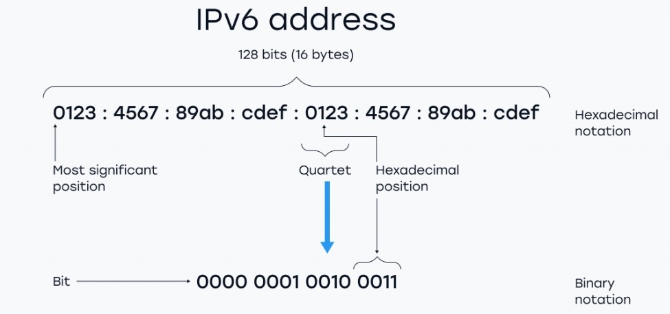
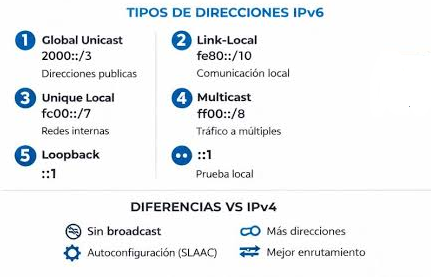
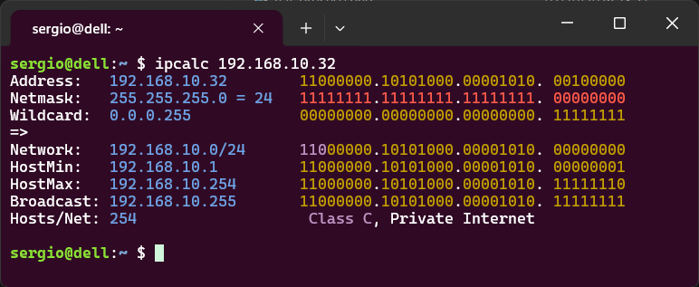

## IPv6: por qué existe y qué problema resuelve

Ya lo vimos al principio de la unidad: IPv4 tiene un espacio de **4.294.967.296** direcciones. Parecía más que suficiente en 1981, cuando se diseñó el protocolo. Nadie imaginó que décadas después habría miles de millones de smartphones, tablets, ordenadores, televisores, cámaras, coches conectados, sensores IoT y un largo etcétera, todos necesitando una dirección IP.

Las direcciones IPv4 públicas se **agotaron oficialmente** en 2011 a nivel global (IANA) y en 2019 en Europa (RIPE NCC). La solución temporal fue NAT — muchos dispositivos compartiendo una sola IP pública — pero no es una solución definitiva. La solución real es **IPv6**.

**IPv6** usa direcciones de **128 bits** en lugar de 32. Esto da un total de 2¹²⁸ = **340.282.366.920.938.463.463.374.607.431.768.211.456 direcciones** (aproximadamente 340 sextillones). Es un número tan grande que, en teoría, podríamos asignar miles de millones de IPs a cada átomo de la superficie de la Tierra. El agotamiento de IPv6 no es un problema previsible en ningún horizonte temporal realista.

## Formato de una dirección IPv6

Las direcciones IPv6 se escriben en **hexadecimal**, divididas en **8 grupos de 16 bits** separados por dos puntos:

```
2001:0db8:85a3:0000:0000:8a2e:0370:7334
```

Cada grupo se representa con **4 dígitos hexadecimales** (16 bits). Con 8 grupos de 16 bits tenemos los 128 bits totales.

<!-- IMG: diagrama de una dirección IPv6 con sus 8 grupos de 16 bits identificados -->
<figure markdown="span" align="center">
  { width="80%" }
  <figcaption>Estructura de una dirección IPv6: 128 bits organizados en 8 grupos de 4 dígitos hexadecimales</figcaption>
</figure>

### Reglas de simplificación

Las direcciones IPv6 pueden ser muy largas y difíciles de leer. Existen dos reglas para simplificarlas:

**Regla 1 — Omitir ceros iniciales en cada grupo:**

```
2001:0db8:0000:0042  →  2001:db8:0:42
     ↑ el 0 inicial se omite en cada grupo
```

**Regla 2 — Reemplazar uno o más grupos consecutivos de ceros con `::`**

Esta sustitución solo puede usarse **una vez** en la dirección (si se usara dos veces no se sabría cuántos grupos representa cada `::`)

```
2001:0db8:0000:0000:0000:0000:0370:7334
2001:db8::370:7334   ← aplicando ambas reglas
```

!!! example "Ejemplos de simplificación"
    ```
    Original:     2001:0db8:0000:0000:0000:0000:0000:0001
    Simplificado: 2001:db8::1

    Original:     fe80:0000:0000:0000:0202:b3ff:fe1e:8329
    Simplificado: fe80::202:b3ff:fe1e:8329

    Original:     0000:0000:0000:0000:0000:0000:0000:0001
    Simplificado: ::1   ← dirección de loopback IPv6 (equivalente a 127.0.0.1)
    ```

## Estructura de una dirección IPv6: prefijo y ID de interfaz

Al igual que en IPv4 hay parte de red y parte de host, en IPv6 hay:

- **Prefijo de red** (*network prefix*): los primeros 64 bits identifican la red. El prefijo más habitual es `/64`.
- **Identificador de interfaz** (*interface ID*): los últimos 64 bits identifican el dispositivo dentro de la red.

```
             2001:db8:abcd:0012 : 0000:0000:0000:0001
[── prefijo de red (64 bits) ──] [─── ID de interfaz (64 bits) ───]
```

Los 64 bits del ID de interfaz permiten **2⁶⁴ ≈ 18 trillones de dispositivos** en una sola subred. En IPv6, prácticamente todas las subredes usan /64 independientemente del número de equipos — el concepto de "ajustar la máscara al número de equipos" de IPv4 no aplica aquí.

## Tipos de direcciones IPv6

En IPv6 no existe el broadcast. En su lugar se usan tres tipos de dirección:

| Tipo | Descripción | Prefijo |
|------|-------------|---------|
| **Unicast** | Una dirección → un dispositivo | Varios |
| **Multicast** | Una dirección → un grupo de dispositivos | `FF00::/8` |
| **Anycast** | Una dirección → el dispositivo más cercano del grupo | Variable |

### Direcciones unicast más importantes

**Global Unicast**: equivalente a las IPs públicas de IPv4. Son enrutables en internet.

- Prefijo: `2000::/3` (empiezan por `2` o `3`)
- Ejemplo: `2001:db8::1`

**Link-Local**: equivalente a las IPs APIPA de IPv4. Se asignan automáticamente a cada interfaz y solo son válidas dentro del mismo enlace de red (no se enrutan).

- Prefijo: `FE80::/10` (siempre empiezan por `fe80`)
- Ejemplo: `fe80::1`
- Todo dispositivo con IPv6 tiene automáticamente una dirección link-local aunque no haya ningún servidor de configuración.

**Loopback**: equivalente a `127.0.0.1` de IPv4.

- Dirección: `::1`

**Unique Local**: equivalente a las IPs privadas de IPv4 (RFC 1918). No son enrutables en internet pero sí dentro de una organización.

- Prefijo: `FC00::/7` (empiezan por `fc` o `fd`)
- Ejemplo: `fd00::1`

<!-- IMG: tabla visual de tipos de IPv6 con sus prefijos y equivalente en IPv4 -->
<figure markdown="span" align="center">
  { width="95%" }
  <figcaption>Tipos principales de direcciones IPv6 y su equivalente en IPv4</figcaption>
</figure>

## Coexistencia IPv4 e IPv6: dual stack

La transición de IPv4 a IPv6 es gradual y llevará muchos años. Durante este período, la mayoría de dispositivos y redes funcionan en modo **dual stack**: tienen simultáneamente una dirección IPv4 y una dirección IPv6, y usan una u otra según el protocolo que soporte el destino.

Puedes ver esto en cualquier equipo moderno ejecutando `ipconfig` (Windows) o `ip a` (Linux): verás tanto la dirección IPv4 como la dirección IPv6 link-local (`fe80::...`) en cada interfaz de red.

!!! info "¿Cuándo usaremos IPv6 en este curso?"
    En las prácticas de este curso trabajaremos principalmente con IPv4, que sigue siendo el estándar dominante en redes locales. Sin embargo, al configurar Windows Server y Linux veremos que IPv6 está activo por defecto y aprenderemos a identificar sus direcciones. En UD05 y UD06 volveremos a esto.

---

## ipcalc: verificar cálculos de red

**ipcalc** es una herramienta de línea de comandos que calcula automáticamente todos los parámetros de una subred a partir de una dirección IP y su máscara. Es ideal para verificar nuestros cálculos manuales y para el trabajo diario de administración de redes.

### ipcalc en Linux

En distribuciones basadas en Debian/Ubuntu (incluyendo el Lliurex del aula):

```bash
# Instalar si no está disponible
sudo apt install ipcalc

# Uso básico
ipcalc 192.168.1.100/26
```

Salida:
```
Address:   192.168.1.100        11000000.10101000.00000001. 01100100
Netmask:   255.255.255.192 = 26 11111111.11111111.11111111. 11000000
Wildcard:  0.0.0.63             00000000.00000000.00000000. 00111111
=>
Network:   192.168.1.64/26      11000000.10101000.00000001. 01000000
HostMin:   192.168.1.65         11000000.10101000.00000001. 01000001
HostMax:   192.168.1.126        11000000.10101000.00000001. 01111110
Broadcast: 192.168.1.127        11000000.10101000.00000001. 01111111
Hosts/Net: 62                   Class C, Private Internet
```

ipcalc muestra exactamente los cuatro valores que calculamos a mano, además de la representación binaria de cada uno. Es una forma excelente de verificar que nuestros cálculos son correctos.

### ipcalc online

Si no tienes acceso a Linux, puedes usar versiones online:

- **[jodies.de/ipcalc](http://jodies.de/ipcalc)**: la versión online más clásica y completa
- **[subnet-calculator.com](https://www.subnet-calculator.com)**: interfaz visual con tabla de subredes
- **[cidr.xyz](https://cidr.xyz)**: visualización gráfica del bloque de red

### Otros comandos útiles para verificar la configuración de red

En Windows:
```cmd
ipconfig /all          # Ver IP, máscara, gateway y DNS de todas las interfaces
ipconfig /release      # Liberar la IP asignada por DHCP
ipconfig /renew        # Solicitar nueva IP al servidor DHCP
ping 8.8.8.8           # Comprobar conectividad con internet
tracert 8.8.8.8        # Ver la ruta hasta un destino
```

En Linux:
```bash
ip a                   # Ver IPs de todas las interfaces
ip r                   # Ver tabla de enrutamiento
ping 8.8.8.8           # Comprobar conectividad
traceroute 8.8.8.8     # Ver la ruta hasta un destino
ipcalc 10.0.0.0/23     # Calcular parámetros de una subred
```

<!-- IMG: captura de pantalla de ipcalc en terminal Linux mostrando el resultado para una subred /26 -->
<figure markdown="span" align="center">
  { width="75%" }
  <figcaption>ipcalc en terminal Linux: muestra todos los parámetros de la subred en decimal y binario</figcaption>
</figure>

---

## Actividad en clase

### 🖥️ Actividad conjunta: verificamos nuestros cálculos con ipcalc

**Duración:** 15 minutos
**Dinámica:** práctica en el equipo

1. Abre una terminal en Linux (o la web jodies.de/ipcalc si estás en Windows).

2. Verifica con ipcalc los resultados del **Ejercicio A del punto 4**:
    ```bash
    ipcalc 192.168.5.75/27
    ipcalc 10.10.10.10/8
    ipcalc 172.16.100.200/20
    ipcalc 192.168.1.50/30
    ```

3. Compara el resultado de ipcalc con tus cálculos manuales. ¿Coinciden?

4. Ejecuta en tu equipo:
    ```bash
    ip a        # en Linux
    ip -br a    # en Linux version abreveada
    ipconfig    # en Windows
    ```
    Identifica: ¿qué dirección IPv4 tiene tu equipo? ¿Cuál es la máscara? ¿Hay alguna dirección IPv6? ¿Reconoces el tipo (link-local, global...)?

5. Calcula manualmente a qué red pertenece tu equipo y verifica con ipcalc.
