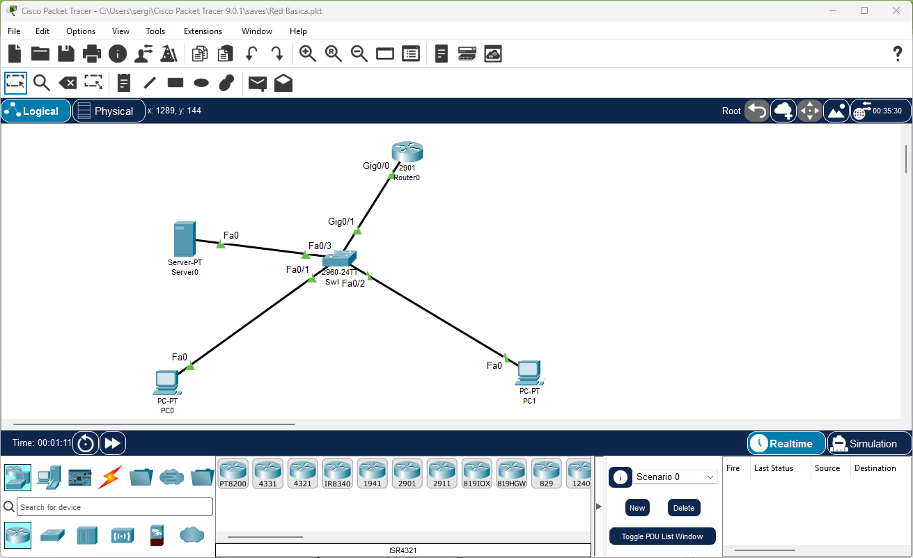
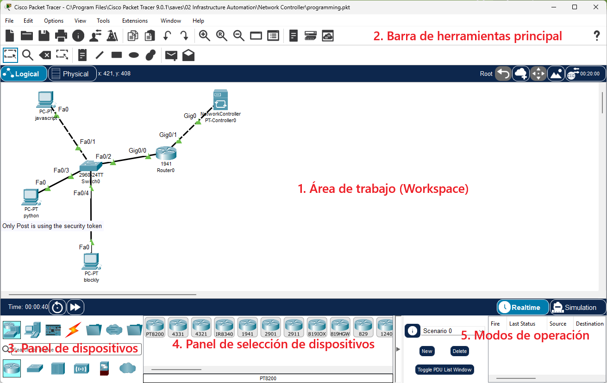
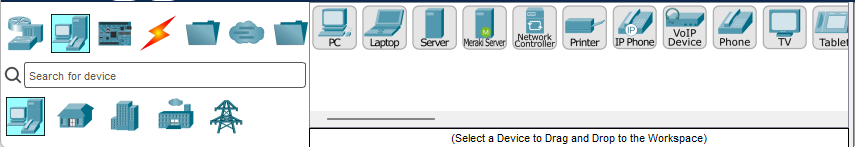
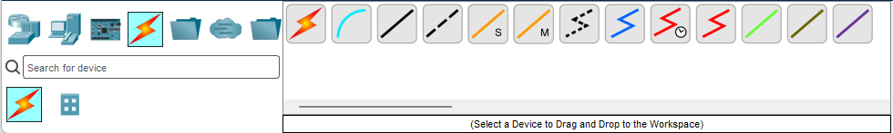
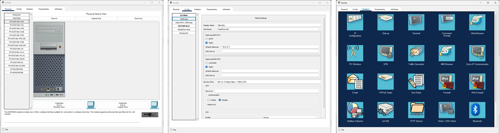

Hasta ahora hemos estudiado cómo funcionan las redes de forma teórica: tipos de red, topologías, medios de transmisión, dispositivos y direccionamiento IP. Ahora llega el momento de **poner en práctica** todo ese conocimiento montando redes reales de forma simulada.

**Cisco Packet Tracer** es un simulador de redes desarrollado por Cisco Systems que nos permite diseñar, configurar y verificar redes completas sin necesidad de hardware físico. Podemos añadir switches, routers, ordenadores, servidores y cables virtuales, configurar IPs, hacer ping entre equipos y ver cómo fluye el tráfico — todo desde el ordenador del aula.

Es la herramienta estándar en la enseñanza de redes a nivel mundial y, aunque simula principalmente dispositivos Cisco, los conceptos que aprenderemos (direccionamiento IP, subnetting, routing básico) son universales y aplicables a cualquier fabricante.

<!-- IMG: captura de pantalla de Packet Tracer con una red sencilla ya montada -->
<figure markdown="span" align="center">
  { width="90%" }
  <figcaption>Interfaz principal de Cisco Packet Tracer con una red de ejemplo</figcaption>
</figure>

## Instalación

Packet Tracer es **gratuito** pero requiere una cuenta en Cisco Networking Academy:

1. Accede a [netacad.com](https://www.netacad.com) y crea una cuenta gratuita con tu correo del centro.
2. Una vez registrado, ve a **Recursos → Descargar Packet Tracer**.
3. Descarga la versión para tu sistema operativo (Windows, Linux o macOS).
4. Instala y al abrir por primera vez inicia sesión con tu cuenta NetAcad.

!!! info "Versión del aula"
    En los equipos del aula ya está instalado Packet Tracer. Solo necesitas iniciar sesión con tu cuenta NetAcad la primera vez. Si no tienes cuenta, créala antes de la clase práctica.

## La interfaz de Packet Tracer

La interfaz de Packet Tracer se divide en varias zonas que conviene conocer desde el principio:

<!-- IMG: captura anotada de la interfaz de PT con las zonas numeradas -->
<figure markdown="span" align="center">
  { width="90%" }
  <figcaption>Zonas principales de la interfaz de Packet Tracer</figcaption>
</figure>

### 1. Área de trabajo (Workspace)

Es el espacio central donde diseñamos la red. Aquí arrastramos los dispositivos, los conectamos con cables y los organizamos visualmente. Tiene dos modos:

- **Modo Lógico** (*Logical*): vista del esquema lógico de la red — la que usaremos principalmente.
- **Modo Físico** (*Physical*): representación de los dispositivos en un espacio físico (edificio, ciudad...). Menos relevante para nuestro curso.

### 2. Barra de herramientas principal

En la parte superior, con las funciones habituales: nuevo, abrir, guardar, deshacer, rehacer. También incluye el zoom y la opción de añadir notas al esquema.

### 3. Panel de dispositivos (Device Type Box)

En la parte inferior izquierda. Aquí están todos los dispositivos disponibles organizados por categorías:

<!-- IMG: captura del panel de dispositivos con las categorías marcadas -->
<figure markdown="span" align="center">
  { width="80%" }
  <figcaption>Panel de dispositivos: categorías de hardware disponibles en Packet Tracer</figcaption>
</figure>

| Icono | Categoría | Dispositivos principales |
|-------|-----------|------------------------|
| 🖧 | **Routers** | Router-PT, 1941, 2901, 4321 |
| 🔀 | **Switches** | Switch-PT, 2960, 3560 |
| 🖥️ | **End Devices** | PC, laptop, servidor, smartphone, tablet |
| ☁️ | **Network Cloud** | Nube (para simular internet o WAN) |
| 📡 | **Wireless Devices** | Access Point, router inalámbrico |
| 🔌 | **Connections** | Tipos de cable para conectar dispositivos |
| 📦 | **IoT** | Sensores, actuadores, dispositivos IoT |

### 4. Panel de selección de dispositivos (Device-Specific Selection)

Al hacer clic en una categoría del panel inferior izquierdo, aquí aparecen los modelos concretos disponibles. Por ejemplo, al seleccionar Switches aparecen el Switch-PT genérico, el Cisco 2960, el 3560...

### 5. Modos de operación

En la esquina inferior derecha hay dos modos importantes:

- **Realtime** (tiempo real): la red funciona como una red real. Los pings y el tráfico ocurren en tiempo real.
- **Simulation** (simulación): podemos ver los paquetes moviéndose por la red paso a paso, lo que es muy útil para entender qué está pasando. Permite pausar y avanzar fotograma a fotograma.

## Tipos de cable en Packet Tracer

Elegir el cable correcto es fundamental. En Packet Tracer hay varios tipos:

<!-- IMG: panel de tipos de cable de PT con cada tipo identificado -->
<figure markdown="span" align="center">
  { width="80%" }
  <figcaption>Tipos de cable disponibles en Packet Tracer</figcaption>
</figure>

| Cable | Color | Cuándo usarlo |
|-------|-------|---------------|
| **Automatic** | Rayo Naranja | PT elige el cable correcto automáticamente ⭐ |
| **Console** | Azul celeste | Configuración de router/switch desde un PC por consola |
| **Copper Straight-Through** | Negro sólido | PC → Switch, Switch → Router (dispositivos diferentes) |
| **Copper Cross-Over** | Negro discontinuo | PC → PC, Switch → Switch (mismo tipo) |
| **Fiber** | Naranja | Conexiones de fibra óptica entre switches o routers |
| **Serial DCE/DTE** | Rojo reloj | Enlace WAN entre routers (simulación de conexión a operador) |

!!! tip "Uso de 'Automatic' al principio"
    El cable **Automatic** (rayo rojo) detecta automáticamente qué tipo de cable necesitas según los dispositivos que conectas. Es la opción más cómoda para empezar y evita el error de poner un cable cruzado donde debería ir uno directo. No obstante es bueno que selecciones el tipo de cabla para ser consciente de qué estas usando y no dejar que las cosas se hagan sin entener el porque.

## Indicadores de estado de los enlaces

Cuando conectamos dos dispositivos con un cable, aparecen dos puntos de colores en cada extremo del enlace que indican el estado de la conexión:

| Color | Significado |
|-------|-------------|
| 🟢 Verde | El enlace está activo y funcionando correctamente |
| 🔴 Rojo | El enlace está caído (dispositivo apagado, cable incorrecto, puerto bloqueado) |
| 🟠 Naranja | El enlace está en proceso de activarse (STP convergiendo, unos segundos) |

!!! warning "El naranja es normal al conectar switches"
    Al conectar switches en Packet Tracer, los enlaces pasan por el estado naranja durante unos segundos. Es el protocolo **STP** (*Spanning Tree Protocol*) convergiendo para evitar bucles en la red. Espera a que se pongan verdes antes de hacer pruebas de ping.

## Interactuar con los dispositivos

Para configurar un dispositivo, hacemos **doble clic** sobre él. Se abre una ventana con varias pestañas:

<!-- IMG: captura de la ventana de configuración de un PC en PT con las pestañas marcadas -->
<figure markdown="span" align="center">
  { width="95%" }
  <figcaption>Ventana de configuración de un PC en Packet Tracer: pestañas Physical, Config y Desktop</figcaption>
</figure>

**En un PC (End Device):**

- **Physical**: vista física del dispositivo. Permite añadir o quitar módulos (tarjetas de red, etc.).
- **Config**: configuración básica mediante formularios (IP, máscara, gateway, DNS). La forma más sencilla de configurar.
- **Desktop**: simula el escritorio del PC. Incluye herramientas muy útiles:
  - **IP Configuration**: asignar IP, máscara y gateway por formulario
  - **Command Prompt**: terminal para ejecutar `ping`, `ipconfig`, `tracert`...
  - **Web Browser**: navegador para probar servidores web simulados

**En un Switch o Router:**

- **Physical**: vista física
- **Config**: configuración básica
- **CLI**: interfaz de línea de comandos (Command Line Interface). Aquí se configura el dispositivo con comandos IOS de Cisco. Lo veremos en los puntos siguientes.

---

## Actividad en clase

### 🖥️ Actividad conjunta: exploramos Packet Tracer

**Duración:** 30 minutos
**Dinámica:** práctica guiada por el profesor

**Parte 1 — Familiarizarse con la interfaz (10 min):**

1. Abre Packet Tracer e inicia sesión con tu cuenta NetAcad.
2. Explora el panel de dispositivos: haz clic en cada categoría e identifica qué dispositivos hay disponibles.
3. Arrastra al área de trabajo: 2 PCs, 1 Switch y 1 Router. No los conectes todavía.
4. Haz doble clic en cada dispositivo y explora sus pestañas (Physical, Config, Desktop/CLI).
5. Borra el área de trabajo (Edit → Select All → Delete) y empieza de nuevo.

**Parte 2 — Primera conexión (20 min):**

1. Añade 2 PCs y 1 Switch al área de trabajo.
2. Conecta PC0 al Switch usando el cable **negro** o Cable Ethernet Directo ***(Copper Straight-Through)***.
3. Conecta PC1 al Switch usando el cable **negro**.
4. Observa los indicadores de enlace: ¿de qué color son? ¿Cambian con el tiempo?
5. Haz doble clic en PC0 → Desktop → IP Configuration y asigna:
    - IP Address: `192.168.1.10`
    - Subnet Mask: `255.255.255.0`
    - No pongas gateway todavía
6. Haz doble clic en PC1 → Desktop → IP Configuration y asigna:
    - IP Address: `192.168.1.20`
    - Subnet Mask: `255.255.255.0`
7. En PC0 → Desktop → Command Prompt, ejecuta:
    ```
    ping 192.168.1.20
    ```
8. ¿Funciona el ping? ¿Cuántos paquetes se envían y cuántos llegan?
9. Prueba el **modo Simulation**: haz el ping de nuevo y observa cómo se mueven los paquetes por la red fotograma a fotograma.

!!! tip "Guarda siempre tu trabajo"
    Packet Tracer guarda los proyectos con extensión `.pkt`. Guarda tu primer proyecto como `ud04_practica01.pkt` y súbelo a Aules cuando lo pidas el profesor.
