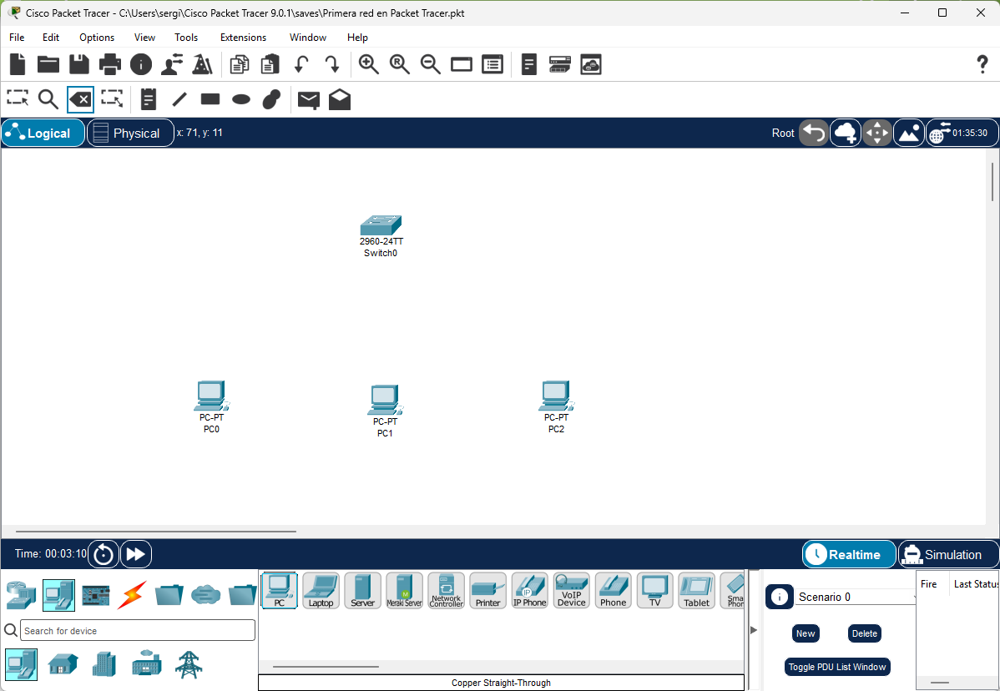
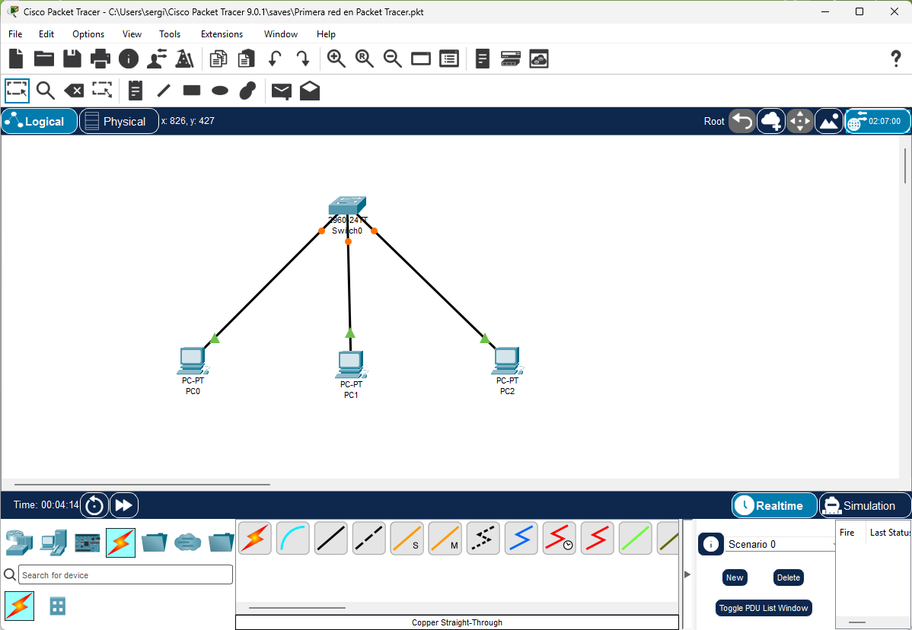
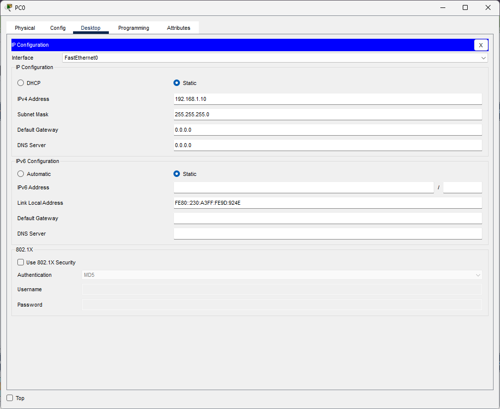
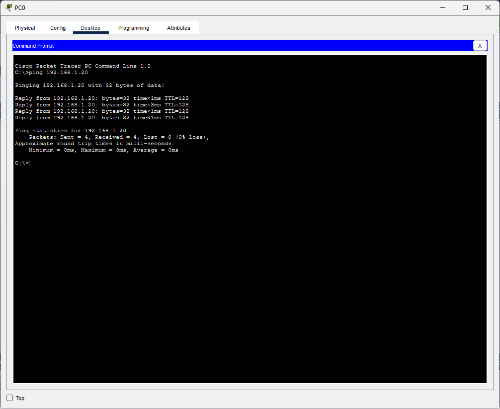
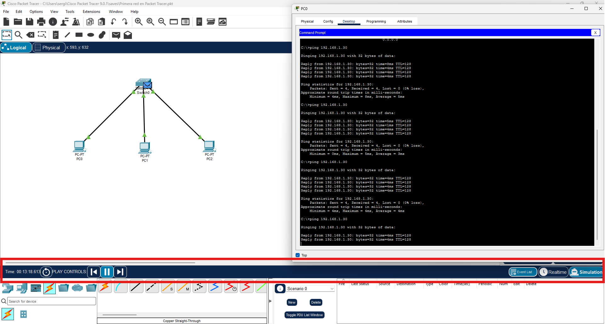

En el punto anterior nos familiarizamos con la interfaz de Packet Tracer. Ahora vamos a montar nuestra primera red completa y funcional: varios ordenadores conectados a un switch, con sus IPs correctamente configuradas y verificando que se comunican entre sí mediante ping.

Esta práctica puede parecer sencilla, pero es el fundamento de todo lo que haremos después. Si entendemos bien por qué funciona — y por qué falla cuando algo está mal — el resto de la unidad será mucho más fácil.

## ¿Qué vamos a montar?

Una red LAN simple con esta topología:

```
PC0 (192.168.1.10/24) ──┐
PC1 (192.168.1.20/24) ──┤── Switch ── (red 192.168.1.0/24)
PC2 (192.168.1.30/24) ──┘
```

Tres PCs conectados a un switch, todos en la misma red `192.168.1.0/24`. Cualquier PC debe poder hacer ping a cualquier otro.

## Paso a paso

### Paso 1 — Añadir los dispositivos

1. Abre Packet Tracer con un proyecto nuevo (**File → New**).
2. En el panel de dispositivos, selecciona la categoría **End Devices** y arrastra **3 PCs** al área de trabajo.
3. Selecciona la categoría **Switches** y arrastra **1 Switch** (modelo **2960**) al centro del área de trabajo.
4. Organiza los dispositivos visualmente: el switch en el centro y los PCs alrededor.

<!-- IMG: captura de PT con 3 PCs y 1 switch colocados en el área de trabajo sin conectar -->
<figure markdown="span" align="center">
  { width="75%" }
  <figcaption>Tres PCs y un switch colocados en el área de trabajo antes de conectarlos</figcaption>
</figure>

!!! tip "Renombrar los dispositivos"
    Haz doble clic sobre el nombre del dispositivo (debajo del icono) para cambiarlo. Renombrar los dispositivos con nombres descriptivos (PC-Sergio, PC-Ana, PC-Servidor) hace el esquema mucho más claro. En el proyecto de la empresa esto será imprescindible.

### Paso 2 — Conectar los dispositivos

1. En el panel de dispositivos, selecciona la categoría **Connections**.
2. Elige el cable **negro** (ethernet).
3. Haz clic en **PC0** — aparece una lista de interfaces disponibles. Selecciona **FastEthernet0**.
4. Haz clic en el **Switch** — selecciona cualquier puerto disponible (FastEthernet0/1, FastEthernet0/2...).
5. Repite el proceso para PC1 y PC2, usando puertos diferentes del switch.

<!-- IMG: captura de PT con los 3 PCs conectados al switch, enlaces en naranja/verde -->
<figure markdown="span" align="center">
  { width="75%" }
  <figcaption>Los tres PCs conectados al switch. Los indicadores en naranja indican que STP está convergiendo</figcaption>
</figure>

Espera unos segundos hasta que todos los indicadores estén en **verde**. Si alguno sigue en rojo, revisa que el cable esté bien conectado en ambos extremos.

### Paso 3 — Configurar las direcciones IP

Ahora asignamos una IP a cada PC. Hay dos formas de hacerlo en Packet Tracer:

**Método A — Por formulario (Config):**
1. Doble clic en PC0.
2. Pestaña **Config** → **FastEthernet0**.
3. Introduce la IP y la máscara.

**Método B — Por Desktop (más realista):**
1. Doble clic en PC0.
2. Pestaña **Desktop** → **IP Configuration**.
3. Selecciona **Static** e introduce los datos.

Usaremos el **Método B** porque simula mejor la configuración real de Windows.

**Configuración de cada PC:**

| Dispositivo | IP Address | Subnet Mask | Default Gateway |
|-------------|-----------|-------------|----------------|
| PC0 | 192.168.1.10 | 255.255.255.0 | (vacío por ahora) |
| PC1 | 192.168.1.20 | 255.255.255.0 | (vacío por ahora) |
| PC2 | 192.168.1.30 | 255.255.255.0 | (vacío por ahora) |

<!-- IMG: captura de la ventana IP Configuration de PC0 con los datos rellenos -->
<figure markdown="span" align="center">
  { width="60%" }
  <figcaption>Configuración de IP en PC0: IP estática, máscara /24, sin gateway todavía</figcaption>
</figure>

!!! info "¿Por qué no ponemos gateway todavía?"
    El **gateway** (puerta de enlace) es la dirección IP del router que nos permite salir a otras redes. Como todos los PCs están en la misma red (`192.168.1.0/24`), pueden comunicarse directamente entre ellos sin necesidad de router. El gateway solo es necesario cuando queremos llegar a una red diferente. Lo veremos en el punto 4.

### Paso 4 — Verificar la conectividad con ping

El comando `ping` envía paquetes ICMP a una dirección IP y espera respuesta. Es la herramienta de diagnóstico más básica y útil de las redes.

1. Doble clic en **PC0**.
2. Pestaña **Desktop** → **Command Prompt**.
3. Ejecuta:

```
ping 192.168.1.20
```

Si todo está bien, verás algo así:

<!-- IMG: captura de ping entre dos equios -->
<figure markdown="span" align="center">
  { width="70%" }
  <figcaption>Comprobación de conexión entre dos equipos: ping desde PC0 a PC1</figcaption>
</figure>

**4 paquetes enviados, 4 recibidos, 0 pérdidas** → la comunicación funciona perfectamente.

!!! warning "El primer ping puede fallar"
    Es normal que el primer paquete de un ping aparezca como "Request timeout". Esto ocurre porque el switch necesita aprender la dirección MAC del destino mediante ARP antes de poder enviar el paquete. A partir del segundo intento, la comunicación es directa. Si todos los paquetes fallan, hay un problema de configuración.

### Paso 5 — Verificar la configuración con ipconfig

Al igual que en Windows real, en Packet Tracer podemos usar `ipconfig` para ver la configuración de red del equipo:

```
C:\>ipconfig

FastEthernet0 Connection:(default port)

   Connection-specific DNS Suffix..:
   Link-local IPv6 Address.........: FE80::201:97FF:FE47:6B73
   IP Address......................: 192.168.1.10
   Subnet Mask.....................: 255.255.255.0
   Default Gateway.................:
```

Veremos la IP asignada, la máscara y que el gateway está vacío (como esperábamos).

## El modo Simulación: viendo los paquetes en movimiento

Una de las funciones más didácticas de Packet Tracer es el **modo Simulación**, que nos permite ver los paquetes moviéndose por la red paso a paso.

<!-- IMG: captura del modo simulación con un paquete ICMP visible en la red -->
<figure markdown="span" align="center">
  { width="80%" }
  <figcaption>Modo Simulación: los paquetes se visualizan como sobres moviéndose entre dispositivos</figcaption>
</figure>

**Cómo usarlo:**

1. Haz clic en el botón **Simulation** (reloj amarillo, esquina inferior derecha).
2. En PC0, abre el Command Prompt y ejecuta `ping 192.168.1.30`.
3. En el panel de simulación, haz clic en **Play** o usa el botón **Capture/Forward** para avanzar paso a paso.
4. Observa cómo los paquetes (representados como sobres de colores) viajan desde PC0 hasta el switch y desde el switch hasta PC2.
5. Haz clic sobre un paquete para ver su contenido: dirección IP origen y destino, dirección MAC, protocolo...

!!! tip "Filtra los protocolos en simulación"
    En el modo Simulación hay una opción **Edit Filters** que permite mostrar solo los protocolos que te interesan (ICMP para ping, ARP para resolución de MAC...). Si no filtras, verás muchos protocolos de fondo que pueden distraer.

## ¿Qué pasa si algo falla?

Si el ping no funciona, estas son las causas más habituales y cómo diagnosticarlas:

| Síntoma | Causa probable | Solución |
|---------|---------------|---------|
| `Request timeout` en todos los paquetes | IP mal configurada o máscara incorrecta | Verificar IP y máscara en ambos PCs |
| Indicador de enlace en rojo | Cable no conectado o puerto apagado | Reconectar el cable |
| Indicador de enlace en naranja permanente | Puerto del switch bloqueado por STP | Esperar unos segundos o usar PortFast |
| `Destination host unreachable` | Los PCs están en redes diferentes | Verificar que las IPs son de la misma red |

!!! example "Error clásico: IPs en redes distintas"
    Si PC0 tiene `192.168.1.10/24` y PC1 tiene `192.168.2.10/24`, aunque las IPs parezcan similares están en **redes diferentes** (192.168.1.x vs 192.168.2.x). El ping fallará con "Destination host unreachable" porque el equipo sabe que el destino no está en su red y necesita un router para llegar — que no tenemos todavía.

---

## Práctica para entregar

**Fichero:** `ud04_practica02.pkt`
**Entrega:** Aules

Monta la siguiente red en Packet Tracer y verifica que funciona correctamente:

**Red del departamento de Desarrollo — TechSolutions S.L.**

- 4 PCs conectados a 1 switch
- Red: `10.10.1.0/24`
- IPs de los PCs: `10.10.1.10`, `10.10.1.11`, `10.10.1.12`, `10.10.1.13`
- Máscara: `255.255.255.0`

**Lo que debes entregar:**

1. El fichero `.pkt` con la red montada y los dispositivos renombrados (PC-Dev1, PC-Dev2, PC-Dev3, PC-Dev4).
2. Una captura de pantalla del ping desde PC-Dev1 a PC-Dev4 mostrando 0% de pérdida.
3. Una captura del comando `ipconfig` en PC-Dev1 mostrando la IP correcta.

!!! info "Criterios de evaluación"
    - Red montada correctamente con los dispositivos renombrados (3 puntos)
    - Ping exitoso entre todos los PCs (4 puntos)
    - Captura de ipconfig correcta (3 puntos)
