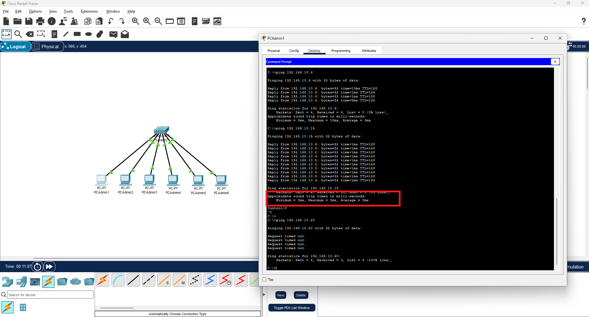
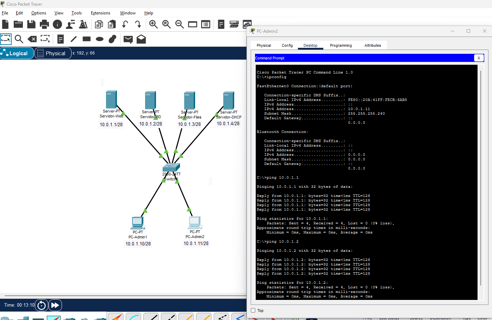

Ya sabemos montar una red sencilla y verificar su conectividad. Ahora vamos a practicar con escenarios más realistas que nos preparan para el proyecto final. Estos ejercicios combinan todo lo visto hasta ahora: subnetting, elección de máscara, configuración de IPs y verificación con ping.

En cada ejercicio el proceso es siempre el mismo:

1. **Analizar** los requisitos (cuántos equipos, qué red usar)
2. **Calcular** la máscara adecuada según el número de equipos
3. **Montar** la topología en Packet Tracer
4. **Configurar** las IPs de cada dispositivo
5. **Verificar** la conectividad con ping e ipconfig

## Ejercicio 1 — Red de un departamento pequeño

**Escenario:** El departamento de Administración de TechSolutions S.L. tiene 6 equipos que necesitan estar en red. Usaremos el bloque `192.168.10.0`.

**Paso 1 — Elegir la máscara:**

6 equipos → con margen → ~8 hosts → 2⁴ = 16 → 14 hosts utilizables → **/28** (255.255.255.240)

**Paso 2 — Calcular la subred:**

```
Red:            192.168.10.0/28
Primer host:    192.168.10.1
Último host:    192.168.10.14
Broadcast:      192.168.10.15
Hosts útiles:   14
```

**Paso 3 — Asignación de IPs:**

| Dispositivo | IP | Máscara |
|-------------|-----|---------|
| PC-Admin1 | 192.168.10.1 | 255.255.255.240 |
| PC-Admin2 | 192.168.10.2 | 255.255.255.240 |
| PC-Admin3 | 192.168.10.3 | 255.255.255.240 |
| PC-Admin4 | 192.168.10.4 | 255.255.255.240 |
| PC-Admin5 | 192.168.10.5 | 255.255.255.240 |
| PC-Admin6 | 192.168.10.6 | 255.255.255.240 |

**Monta esta red en Packet Tracer y verifica:**

- `ping` desde PC-Admin1 a PC-Admin6 → debe funcionar
- `ping 192.168.10.15` desde cualquier PC → debe fallar (es el broadcast, no un host)
- `ping 192.168.10.20` desde cualquier PC → debe fallar (fuera de la subred)

<!-- IMG: captura de PT con el ejercicio 1 montado y el ping funcionando -->
<figure markdown="span" align="center">
  { width="80%" }
  <figcaption>Red del departamento de Administración con 6 PCs y 1 switch</figcaption>
</figure>

!!! example "¿Por qué falla el ping a 192.168.10.15?"
    Porque `.15` es la dirección de **broadcast** de esta subred /28. Las direcciones de broadcast no se asignan a hosts y no responden a ping — están reservadas para enviar mensajes a todos los dispositivos de la red simultáneamente.

---

## Ejercicio 2 — Dos departamentos, una misma red física

**Escenario:** TechSolutions tiene Desarrollo (8 PCs) y Dirección (3 PCs) en la misma planta. Comparten el mismo switch pero queremos organizarlos en subredes separadas usando el bloque `172.16.0.0`.

**Paso 1 — Calcular subredes:**

- Desarrollo: 8 PCs → /28 (14 hosts) → `172.16.0.0/28` → hosts: `.1`–`.14`
- Dirección: 3 PCs → /29 (6 hosts) → `172.16.0.16/29` → hosts: `.17`–`.22`

**Paso 2 — Asignación:**

| Dispositivo | IP | Máscara | Subred |
|-------------|-----|---------|--------|
| PC-Dev1 | 172.16.0.1 | 255.255.255.240 | Desarrollo |
| PC-Dev2 | 172.16.0.2 | 255.255.255.240 | Desarrollo |
| PC-Dev3 | 172.16.0.3 | 255.255.255.240 | Desarrollo |
| PC-Dev4 | 172.16.0.4 | 255.255.255.240 | Desarrollo |
| PC-Dev5 | 172.16.0.5 | 255.255.255.240 | Desarrollo |
| PC-Dev6 | 172.16.0.6 | 255.255.255.240 | Desarrollo |
| PC-Dev7 | 172.16.0.7 | 255.255.255.240 | Desarrollo |
| PC-Dev8 | 172.16.0.8 | 255.255.255.240 | Desarrollo |
| PC-Dir1 | 172.16.0.17 | 255.255.255.248 | Dirección |
| PC-Dir2 | 172.16.0.18 | 255.255.255.248 | Dirección |
| PC-Dir3 | 172.16.0.19 | 255.255.255.248 | Dirección |

**Monta esta red y verifica:**

- Ping entre PC-Dev1 y PC-Dev8 → ✅ debe funcionar (misma subred)
- Ping entre PC-Dir1 y PC-Dir3 → ✅ debe funcionar (misma subred)
- Ping entre PC-Dev1 y PC-Dir1 → ❌ debe fallar (subredes distintas, no hay router)

!!! info "¿Por qué falla el ping entre subredes aunque estén en el mismo switch?"
    Aunque los dos grupos de PCs están físicamente conectados al mismo switch, sus IPs pertenecen a **redes lógicas diferentes**. El switch trabaja en capa 2 (MAC) y reenvía tramas, pero para comunicar redes distintas se necesita un dispositivo de capa 3: el **router**. Lo veremos en el punto 4.

---

## Ejercicio 3 — Red con servidor

**Escenario:** El departamento de Servidores tiene 4 servidores físicos y 2 PCs de administración. Red disponible: `10.0.1.0`. Necesitan todos estar en la misma subred.

**Paso 1 — Calcular:**

6 equipos → /28 (14 hosts útiles) → `10.0.1.0/28`

```
Red:        10.0.1.0/28
Hosts:      10.0.1.1 – 10.0.1.14
Broadcast:  10.0.1.15
```

**Paso 2 — Asignación (por convención, los servidores tienen IPs bajas y los PCs IPs más altas):**

| Dispositivo | Tipo | IP |
|-------------|------|----|
| Servidor-Web | Server | 10.0.1.1 |
| Servidor-BD | Server | 10.0.1.2 |
| Servidor-Files | Server | 10.0.1.3 |
| Servidor-DHCP | Server | 10.0.1.4 |
| PC-Admin1 | PC | 10.0.1.10 |
| PC-Admin2 | PC | 10.0.1.11 |

**En Packet Tracer:**

Para añadir un servidor: panel de dispositivos → **End Devices** → **Server**. Un servidor en PT tiene las mismas pestañas que un PC más la pestaña **Services** donde se pueden activar servicios (HTTP, DNS, DHCP...).

**Verifica:**

- Ping desde PC-Admin1 a Servidor-Web → ✅
- Ping desde Servidor-Web a Servidor-BD → ✅
- Ping desde PC-Admin1 a `10.0.1.15` → ❌ (broadcast)

<!-- IMG: captura del ejercicio 3 con servidores y PCs de administración -->
<figure markdown="span" align="center">
  { width="80%" }
  <figcaption>Red de servidores: 4 servidores y 2 PCs de administración en la misma subred /28</figcaption>
</figure>

---

## Ejercicio 4 — Detección y corrección de errores

**Escenario:** Te entregan un fichero `.pkt` con una red mal configurada. Tienes que identificar los errores y corregirlos.

La red debería tener 4 PCs en la red `192.168.5.0/26` pero hay varios problemas. Descarga el fichero de Aules (`ud04_red_errores.pkt`) y encuentra qué está mal.

**Posibles errores que puede haber (no todos están presentes):**

- IP de un PC fuera del rango de la subred
- Máscara incorrecta en algún PC
- IP duplicada (dos PCs con la misma IP)
- Cable desconectado o tipo de cable incorrecto
- IP de broadcast asignada a un host

**Proceso de diagnóstico:**

1. Revisa visualmente los indicadores de enlace — ¿hay alguno en rojo?
2. Haz `ipconfig` en cada PC y anota las IPs y máscaras.
3. Calcula manualmente el rango válido de la subred `/26`:
    - Red: `192.168.5.0`
    - Hosts válidos: `192.168.5.1` – `192.168.5.62`
    - Broadcast: `192.168.5.63`
4. Verifica si alguna IP está fuera de rango o si hay duplicadas.
5. Haz ping entre todos los pares de PCs y anota cuáles fallan.
6. Corrige los errores uno a uno y verifica después de cada corrección.

!!! tip "Metodología de diagnóstico"
    Siempre de lo más simple a lo más complejo: primero verifica los cables (capa física), después las IPs y máscaras (capa red), y finalmente la configuración lógica. El mismo proceso que seguiremos en redes reales con Windows Server.

---

## Práctica para entregar

**Fichero:** `ud04_practica03.pkt`
**Entrega:** Aules

Diseña y monta en Packet Tracer la siguiente red:

**Red de TechSolutions S.L. — Planta 1**

La planta 1 tiene dos departamentos que comparten el bloque de red `192.168.20.0/24`:

| Departamento | Equipos | Subred a usar |
|-------------|---------|---------------|
| Contabilidad | 10 PCs | Primera subred /27 del bloque |
| RRHH | 5 PCs | Segunda subred /27 del bloque |

**Requisitos:**

1. Calcula las dos subredes /27 dentro de `192.168.20.0/24` e indica: dirección de red, rango de hosts y broadcast de cada una.
2. Monta ambas subredes en Packet Tracer con un switch por departamento.
3. Asigna IPs a todos los PCs y renómbralos correctamente.
4. Verifica con ping:
    - Ping entre PCs del mismo departamento → debe funcionar ✅
    - Ping entre un PC de Contabilidad y uno de RRHH → debe fallar ❌ (sin router)
5. Adjunta capturas de pantalla de los pings de verificación.

**Documento Word/PDF con:**

- Tabla de subredes calculadas (red, primer host, último host, broadcast)
- Tabla de asignación de IPs a cada PC
- Capturas de los pings de verificación

!!! info "Criterios de evaluación"
    - Cálculo correcto de las dos subredes (3 puntos)
    - Red montada correctamente en PT con dispositivos renombrados (3 puntos)
    - Pings de verificación correctos (2 puntos)
    - Documento con tabla de subredes e IPs (2 puntos)
