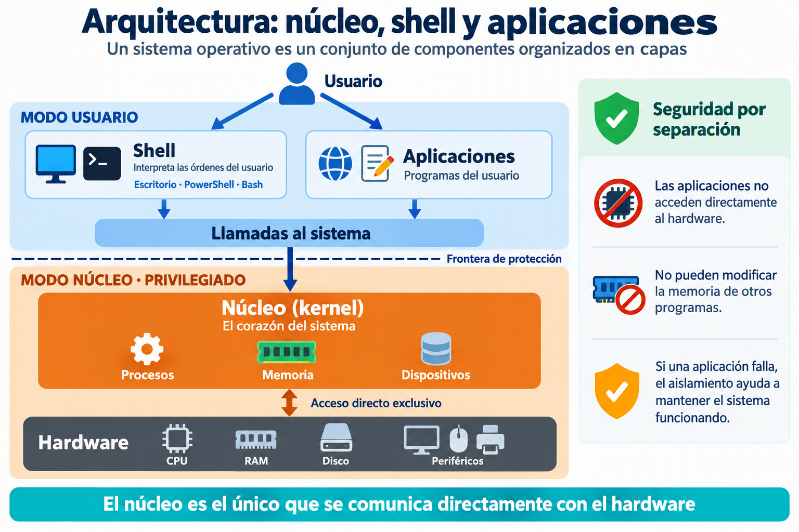
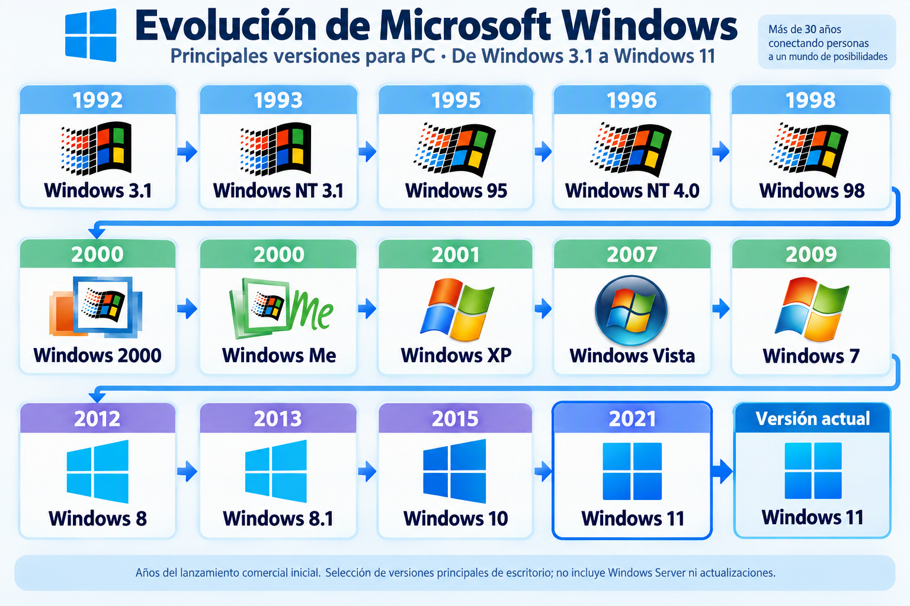
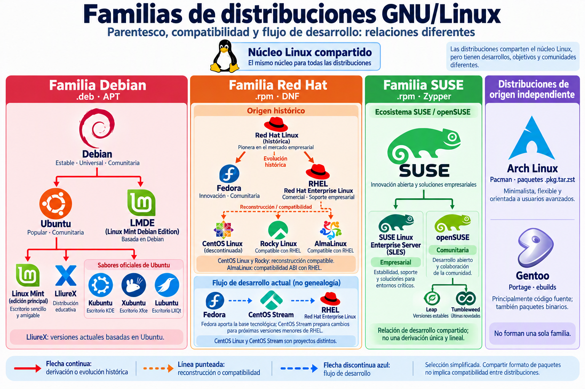

Cuando compramos un ordenador nuevo, el sistema operativo suele venir ya instalado y rara vez nos planteamos si es el adecuado. Un administrador de sistemas no tiene ese lujo: cada vez que monta un equipo, un servidor o una máquina virtual tiene que decidir **qué sistema operativo instalar, en qué versión y con qué licencia**. Elegir mal tiene consecuencias reales: aplicaciones que no funcionan, hardware que no da la talla, costes de licencias que nadie había previsto o un sistema sin soporte y sin parches de seguridad.

En este apartado vamos a ver qué hace un sistema operativo, cómo está organizado por dentro, qué tipos existen y cuáles son los más importantes hoy en día. Al final aprenderemos a **comparar y elegir** con criterios técnicos, que es exactamente lo que se pide en el módulo (RA2) y lo que haremos en las próximas unidades con Windows Server y Linux.

Como vimos en la UD01, el sistema operativo es la capa de software que se sitúa entre el hardware y las aplicaciones. Gestiona el hardware y ofrece una plataforma común sobre la que se ejecutan los programas.

## Funciones de un sistema operativo

Un sistema operativo hace por nosotros un montón de trabajo invisible. Sin él, cada programa tendría que saber manejar directamente el disco, la memoria o la tarjeta de red, y dos programas no podrían ejecutarse a la vez sin pisarse. Sus funciones principales son:

| Función | Qué hace | Ejemplo cotidiano |
|---------|----------|-------------------|
| **Gestión de procesos** | Decide qué programa usa la CPU y durante cuánto tiempo | Escuchar música mientras compilas código |
| **Gestión de memoria** | Reparte la RAM entre los programas y evita que invadan la memoria de otros | Abrir el IDE y el navegador a la vez |
| **Gestión de ficheros** | Organiza la información en el almacenamiento mediante un sistema de archivos | Guardar un documento en una carpeta |
| **Gestión de dispositivos** | Controla el hardware a través de drivers | Imprimir o conectar un pendrive |
| **Usuarios y seguridad** | Identifica a cada usuario y controla qué puede hacer | Iniciar sesión con contraseña |
| **Interfaz con el usuario** | Ofrece una forma de interactuar: gráfica (GUI) o por comandos (CLI) | Escritorio o terminal |

Estas funciones las veremos en detalle en las unidades siguientes: procesos y servicios, usuarios y permisos, y sistemas de archivos.

## Arquitectura: núcleo, shell y aplicaciones

Un sistema operativo no es un único programa sino un conjunto de componentes organizados en capas:

- **Núcleo (*kernel*)**: el corazón del sistema. Tiene acceso directo al hardware y se encarga de la gestión de procesos, memoria y dispositivos. Se ejecuta en un modo privilegiado al que las aplicaciones normales no pueden acceder.
- **Intérprete de comandos o *shell***: el programa que recibe las órdenes del usuario y se las pasa al núcleo. Puede ser gráfico (el escritorio) o de texto (PowerShell, Bash).
- **Aplicaciones**: los programas del usuario, que piden servicios al núcleo mediante llamadas al sistema.

<!-- IMG: diagrama en capas: hardware → núcleo → shell/servicios → aplicaciones, con la frontera modo núcleo / modo usuario -->
<figure markdown="span" align="center">
  { width="60%" }
  <figcaption>Arquitectura en capas de un sistema operativo: el núcleo es el único que habla directamente con el hardware</figcaption>
</figure>

La separación entre modo núcleo y modo usuario es una de las claves de la seguridad: si una aplicación falla, el sistema sigue funcionando, porque la aplicación no puede tocar directamente el hardware ni la memoria de otros programas.

### Tipos de núcleo

No todos los núcleos están diseñados igual:

| Tipo | Idea | Ejemplos |
|------|------|----------|
| **Monolítico** | Casi todo (procesos, memoria, drivers, sistemas de archivos) funciona dentro del núcleo. Rápido, pero un fallo en un driver puede afectar a todo | Linux |
| **Microkernel** | El núcleo es mínimo y el resto de servicios se ejecutan fuera de él. Más robusto, algo más lento | QNX, Minix |
| **Híbrido** | Combina ambos enfoques | Windows (familia NT), macOS (XNU) |

Linux es monolítico, pero **modular**: se pueden cargar y descargar módulos del núcleo (por ejemplo, drivers) sin reiniciar.

## Clasificación de los sistemas operativos

Un mismo sistema operativo se puede clasificar desde varios puntos de vista, y conviene conocerlos porque se usan constantemente en la documentación técnica:

- **Por número de usuarios**: *monousuario* (un solo usuario a la vez) o *multiusuario* (varios usuarios con sus propias cuentas y permisos; es el caso de Windows y Linux actuales).
- **Por número de tareas**: *monotarea* (una cosa cada vez, como el antiguo MS-DOS) o *multitarea* (varios procesos a la vez; todos los actuales).
- **Por finalidad o dispositivo**: escritorio, servidor, móvil, embebido.
- **Por licencia**: *libres* (se puede usar, estudiar, modificar y redistribuir) o *privativos* (el fabricante controla el código y las condiciones de uso). Lo veremos con detalle en el siguiente apartado.

## Sistemas operativos según el dispositivo

### Móviles

Los sistemas operativos móviles controlan teléfonos y tablets. Están muy orientados a la conectividad inalámbrica, el consumo de batería y las aplicaciones multimedia.

- **Android**: el más extendido del mundo. Está basado en el núcleo Linux y su código base es abierto (proyecto AOSP), aunque muchos servicios de Google que lo acompañan son propietarios.
- **iOS / iPadOS**: el sistema de Apple para iPhone y iPad. Es privativo y solo funciona en hardware de Apple.
- **HarmonyOS**: desarrollado por Huawei como alternativa propia a Android.

Otros sistemas que tuvieron su momento, como Windows Phone, BlackBerry OS o Symbian, han desaparecido del mercado.

!!! tip "¿Por qué le importa esto a un desarrollador DAM?"
    Si vais a desarrollar aplicaciones multiplataforma, trabajaréis para estos dos sistemas. Y un detalle práctico: para compilar y publicar aplicaciones iOS **es necesario un equipo con macOS**.

### Embebidos

Un sistema operativo embebido controla un dispositivo que realiza una función concreta: un router, una impresora, un cajero automático, un electrodoméstico inteligente o un sensor IoT. Suelen ser muy ligeros y, en muchos casos, deben responder en tiempos garantizados. A estos se les llama **sistemas operativos de tiempo real (RTOS)**.

Algunos ejemplos son **FreeRTOS** y **Zephyr** (libres), **VxWorks** y **QNX** (propietarios; VxWorks se usa en aviones y equipos industriales) y versiones reducidas de **Linux embebido**, que está presente en una enorme cantidad de routers y dispositivos de red.

### "En la nube"

Con frecuencia se habla de "sistemas operativos en la nube", pero conviene aclarar el concepto, porque se presta a confusión. **No existe un sistema operativo especial para la nube**: cuando contratamos un servidor en AWS, Azure o Google Cloud, lo que obtenemos es una **máquina virtual** en la que instalamos un Linux o un Windows Server normales. Es la misma virtualización que veremos en este tema, pero ejecutándose en los centros de datos del proveedor.

Lo que sí existe son sistemas pensados para trabajar principalmente a través del navegador y de servicios web, como **ChromeOS** (el sistema de los Chromebooks).

Los servicios en la nube se suelen clasificar en tres niveles según lo que gestiona el proveedor y lo que gestionamos nosotros:

| Nivel | Nombre | Qué nos da el proveedor | Ejemplo |
|-------|--------|------------------------|---------|
| **IaaS** | Infraestructura como servicio | Máquinas virtuales, red y almacenamiento. El sistema operativo lo instalamos y mantenemos nosotros | Amazon EC2, Azure Virtual Machines |
| **PaaS** | Plataforma como servicio | La plataforma ya preparada para desplegar nuestras aplicaciones | Google App Engine, Azure App Service |
| **SaaS** | Software como servicio | La aplicación completa lista para usar | Google Workspace, Microsoft 365 |

## Sistemas operativos para ordenadores

### Microsoft Windows

Windows es el sistema operativo de escritorio más usado en el mundo empresarial, y lo encontraremos en dos grandes variantes con propósitos muy distintos: la **versión cliente**, para los puestos de trabajo, y la **versión servidor**, para los servidores.

<!-- IMG: línea temporal de versiones de Windows de cliente (7, 8, 10, 11) y servidor (2012, 2016, 2019, 2022, 2025) -->
<figure markdown="span" align="center">
  { width="85%" }
  <figcaption>Versiones recientes de Windows, en su variante cliente y servidor</figcaption>
</figure>

#### Windows cliente

La versión actual es **Windows 11**. **Windows 10 dejó de recibir soporte estándar el 14 de octubre de 2025**, lo que significa que ya no recibe parches de seguridad de forma gratuita; un equipo con Windows 10 es un equipo que hay que migrar.

Windows 11 se ofrece en varias ediciones. Las que nos interesan son:

| Edición | Destinada a | Características destacadas |
|---------|-------------|---------------------------|
| **Home** | Uso doméstico | Lo básico. Sin funciones de administración empresarial |
| **Pro** | Profesionales y pequeñas empresas | Añade funciones de administración y seguridad |
| **Enterprise** | Grandes organizaciones | Se adquiere por licenciamiento por volumen. Funciones avanzadas de seguridad y gestión |
| **Education** | Centros educativos | Similar a Enterprise, con licencias específicas para educación |

La diferencia entre Home y Pro es mucho más importante de lo que parece, sobre todo para el trabajo que haremos en este módulo:

| Característica | Home | Pro |
|----------------|:----:|:---:|
| Unirse a un dominio de Active Directory | ❌ | ✅ |
| Directivas de grupo (`gpedit.msc`) | ❌ | ✅ |
| Aceptar conexiones de Escritorio remoto | ❌ | ✅ |
| Hyper-V (virtualización integrada) | ❌ | ✅ |
| Cifrado con BitLocker (gestión completa) | ❌ | ✅ |

!!! warning "Para entornos con dominio"
    En una empresa con un dominio de Active Directory, los equipos cliente tienen que **unirse al dominio** del servidor Windows y recibir directivas de grupo. Con Windows 11 Home esto es imposible, así que los clientes tienen que ser **Windows 11 Pro** (o Enterprise/Education).

##### Requisitos de Windows 11

Windows 11 es más exigente que sus predecesores, y no solo en potencia: exige **funciones de seguridad del hardware**. Si no se cumplen, el instalador se detiene con el aviso de que el equipo no puede ejecutar Windows 11.

| Componente | Requisito mínimo |
|------------|------------------|
| Procesador | 1 GHz o más, 2 o más núcleos, 64 bits compatible |
| Memoria RAM | 4 GB |
| Almacenamiento | 64 GB |
| Firmware | UEFI con Secure Boot |
| Seguridad | TPM 2.0 |
| Gráficos | Compatible con DirectX 12 |

Recordad el apartado de UEFI de la UD01: aquí es donde Secure Boot y el TPM dejan de ser un detalle y se convierten en condición de instalación. Al instalar Windows 11 en una máquina virtual tendremos que activar estas funciones en la configuración de la máquina.

#### Windows Server

**Windows Server** es la versión de Windows para servidores. Las versiones que más encontraremos son **Windows Server 2019, 2022 y 2025** (esta última publicada a finales de 2024). Es el sistema que usaremos en el proyecto para montar el dominio, los usuarios, las carpetas compartidas y las directivas.

Se instala de dos formas muy diferentes:

- **Con experiencia de escritorio** (*Desktop Experience*): trae la interfaz gráfica habitual de Windows. Es la que usaremos nosotros.
- **Server Core**: sin interfaz gráfica, se administra por línea de comandos o de forma remota. Consume menos recursos y presenta menos superficie de ataque.

Y se ofrece principalmente en dos ediciones: **Standard**, para entornos con poca virtualización, y **Datacenter**, con derechos de virtualización ilimitados y funciones avanzadas para centros de datos.

| Requisito mínimo | Windows Server 2025 |
|------------------|---------------------|
| Procesador | 1,4 GHz, 64 bits |
| Memoria RAM | 2 GB con experiencia de escritorio (512 MB en Server Core) |
| Almacenamiento | 32 GB |

Windows Server tiene un ciclo de vida largo: unos **10 años** de soporte (5 estándar + 5 extendido). Instalaremos y configuraremos Windows Server en la UD06.

### macOS

**macOS** es el sistema de Apple para sus ordenadores. Es privativo, **solo funciona en hardware de Apple** y está basado en tecnologías UNIX. Desde Apple Silicon (los chips M, que ya vimos en la UD01) funciona sobre arquitectura ARM. Desde macOS 26 (*Tahoe*, 2025) la numeración de versiones sigue el año.

Para un desarrollador tiene un interés especial: es el único entorno donde se puede desarrollar y publicar para iOS y macOS.

### GNU/Linux

Linux es, en realidad, **solo el núcleo** del sistema. Lo que llamamos "un Linux" es una **distribución**: el núcleo, junto con las herramientas GNU, un gestor de paquetes, un entorno de escritorio (opcional) y la configuración por defecto que decide el equipo que la mantiene. Por eso hablamos de **GNU/Linux** y de distribuciones.

Existen cientos de distribuciones, pero la mayoría pertenecen a unas pocas **familias**, que se distinguen sobre todo por el formato de paquetes y el gestor que usan:

```
Núcleo Linux
├── Familia Debian      (paquetes .deb, gestor apt)
│     ├── Debian
│     └── Ubuntu ── Linux Mint, Lliurex, Kubuntu, Xubuntu, Lubuntu...
├── Familia Red Hat     (paquetes .rpm, gestor dnf)
│     ├── RHEL (comercial)
│     ├── Fedora (comunitaria, banco de pruebas de RHEL)
│     └── Rocky Linux, AlmaLinux, CentOS Stream...
├── Familia SUSE        (paquetes .rpm, gestor zypper)
│     └── SLES (comercial), openSUSE
└── Independientes      (Arch Linux, Gentoo...)
```

<!-- IMG: árbol de distribuciones Linux con logotipos de las familias Debian, Red Hat y SUSE -->
<figure markdown="span" align="center">
  { width="75%" }
  <figcaption>Las grandes familias de distribuciones GNU/Linux</figcaption>
</figure>

Las que más nos interesan en este curso:

**Debian** es un proyecto comunitario, independiente de cualquier empresa, muy centrado en la **estabilidad**. Sus versiones llevan nombres de personajes de *Toy Story* y se publican en tres ramas: *stable* (la estable, para producción), *testing* (en pruebas) y *unstable* (desarrollo activo). La versión estable actual es Debian 13 «Trixie».

**Ubuntu**, mantenido por la empresa Canonical, se basa en Debian y busca un buen equilibrio entre estabilidad y facilidad de uso. Sigue un calendario muy regular:

- Cada **6 meses** sale una versión nueva, con numeración año.mes (por ejemplo, 24.10).
- Cada **2 años**, en abril, sale una versión **LTS** (*Long Term Support*) con soporte de **5 años**, ampliable hasta 10 con Ubuntu Pro. Son las recomendables para servidores y entornos que necesitan estabilidad: las versiones intermedias solo tienen 9 meses de soporte.
- Existen sabores según el escritorio: Ubuntu (GNOME), Kubuntu (KDE), Xubuntu (Xfce) o Lubuntu (LXQt), además de **Ubuntu Server**, sin entorno gráfico.

!!! info "Distribuciones comerciales y de comunidad"
    Fijaos en la pareja *RHEL / Fedora* o *SLES / openSUSE*: en cada familia hay una distribución **comercial** (con soporte de pago y certificaciones, pensada para empresas) y otra **comunitaria** (gratuita). Que el sistema sea libre no significa que no haya negocio alrededor: Red Hat, SUSE y Canonical viven de ofrecer soporte y servicios sobre software libre.

!!! example "¿Y CentOS?"
    CentOS fue durante años la alternativa gratuita a RHEL, muy usada en servidores. Red Hat dio por terminado CentOS Linux como clon de RHEL y hoy el relevo lo toman **Rocky Linux** y **AlmaLinux**. Es un buen ejemplo de por qué hay que comprobar siempre el estado de soporte de una distribución antes de instalarla.

### La familia BSD

**FreeBSD**, **OpenBSD** y **NetBSD** son sistemas libres de la familia UNIX, independientes de Linux y con otra licencia (BSD). Los encontraréis sobre todo en equipos de red y almacenamiento, como cortafuegos y NAS.

## La arquitectura del procesador también cuenta

En la UD01 vimos que existen dos grandes arquitecturas: **x86-64** (Intel y AMD) y **ARM**. El sistema operativo tiene que estar compilado para la arquitectura del equipo, y eso condiciona la elección:

| Sistema | x86-64 | ARM |
|---------|:------:|:---:|
| Windows 11 | ✅ | ✅ (con emulación para programas x86) |
| Windows Server | ✅ | Solo en entornos muy concretos |
| macOS | Solo Macs antiguos con Intel | ✅ (Apple Silicon) |
| Linux | ✅ | ✅ |

!!! warning "Un problema práctico para este curso"
    Los alumnos con un Mac con chip M o un portátil Windows con procesador Snapdragon tienen un equipo ARM. Según las notas de VirtualBox 7.1, **un equipo anfitrión ARM no puede ejecutar máquinas virtuales x86**, que es lo que necesitamos para Windows Server. Si tenéis un equipo así, avisad al profesor desde el primer día: usaremos los equipos del aula.

## Cómo elegir un sistema operativo

Elegir un sistema operativo es una decisión técnica que debe justificarse. No hay un "mejor" sistema operativo: hay uno **adecuado para un caso concreto**. Estos son los criterios que debemos valorar siempre:

1. **Para qué se va a usar**: puesto de trabajo, servidor de ficheros, servidor web, desarrollo, kiosco...
2. **Qué aplicaciones necesita**: si el software imprescindible solo existe para un sistema, la decisión ya está tomada.
3. **Qué hardware hay disponible**: los requisitos mínimos y recomendados del sistema.
4. **Cuánto cuesta**: licencias, y también el coste de soporte y administración.
5. **Cuánto tiempo tendrá soporte**: un sistema sin parches de seguridad es un riesgo.
6. **Cómo se administra**: si hay que integrarlo con un dominio, un sistema de gestión centralizada o herramientas que ya usa la empresa.
7. **Qué sabe hacer el equipo técnico**: la formación y la experiencia también cuentan.

### Requisitos de instalación

Antes de instalar, hay que comprobar los requisitos publicados por el fabricante. Atención a una diferencia importante: el **mínimo** es lo necesario para que el sistema *arranque*, no para que se pueda *trabajar* cómodamente.

| Sistema | RAM mínima | Disco | Observaciones |
|---------|:----------:|:-----:|---------------|
| Windows 11 | 4 GB | 64 GB | Exige UEFI, Secure Boot y TPM 2.0 |
| Windows Server 2025 | 2 GB (escritorio) | 32 GB | Server Core necesita menos |
| Ubuntu Desktop 26.04 LTS | **6 GB** | 25 GB | Primera LTS que sube el mínimo desde 4 GB |
| Ubuntu Server 26.04 LTS | desde 1,5 GB | unos 4-5 GB | Los requisitos dependen del uso |

!!! warning "Cuidado con Ubuntu 26.04 en máquinas virtuales"
    Ubuntu 26.04 LTS ha subido el mínimo de RAM del escritorio de 4 a 6 GB. Si asignáis 4 GB a una máquina virtual (como hacemos con Windows 11), Ubuntu 26.04 Desktop se instalará, pero funcionará mal. Tenedlo en cuenta al dimensionar las máquinas virtuales: **6 GB para Ubuntu Desktop 26.04**, o 4 GB para la versión Server.

### Ciclo de vida y soporte

Antes de instalar hay que mirar también **hasta cuándo habrá actualizaciones de seguridad**:

| Sistema | Soporte |
|---------|---------|
| Windows 10 | Terminó el 14 de octubre de 2025 |
| Windows Server | Aproximadamente 10 años (5 + 5) |
| Ubuntu LTS | 5 años (hasta 10 con Ubuntu Pro) |
| Ubuntu versiones intermedias | 9 meses |
| Debian estable | Unos 3 años de soporte normal, ampliables con el proyecto LTS |

!!! tip "Regla práctica"
    En servidores y entornos de producción usa siempre versiones con **soporte a largo plazo** (LTS en Ubuntu, la estable en Debian, o una versión vigente de Windows Server). Las versiones intermedias son para probar novedades, no para producción.

---

## Actividad en clase

### 🖥️ ¿Qué sistema operativo elegirías?

**Duración:** 20 minutos
**Dinámica:** por parejas + puesta en común

Para cada situación, indicad **qué sistema operativo y qué versión o edición** elegiríais, y justificad la decisión con al menos dos de los criterios vistos.

**Caso 1.** Un alumno de DAM quiere un portátil para desarrollar aplicaciones Java y Android, con 8 GB de RAM. También quiere jugar de vez en cuando.

**Caso 2.** La empresa TechSolutions necesita un servidor para gestionar los usuarios, las carpetas compartidas y las directivas de 14 equipos cliente con Windows 11.

**Caso 3.** Una pequeña empresa quiere un servidor para una aplicación web. Tienen presupuesto cero para licencias y quieren un sistema estable durante muchos años.

**Caso 4.** Un instituto tiene 10 ordenadores antiguos con 4 GB de RAM y quiere instalar Ubuntu 26.04 Desktop en todos ellos.

**Caso 5.** Una desarrolladora necesita compilar y publicar una aplicación para iPhone.

??? "Solución orientativa"

    **Caso 1.** Windows 11 (Home o Pro) o Ubuntu LTS. Android Studio y el entorno Java funcionan en ambos, así que la clave es el uso lúdico: Windows tiene más compatibilidad con videojuegos. Una opción equilibrada es **instalación dual**.

    **Caso 2.** **Windows Server 2025 Standard** con experiencia de escritorio, para montar Active Directory. Los clientes deben ser **Windows 11 Pro**, porque Home no se puede unir a un dominio.

    **Caso 3.** **Ubuntu Server LTS** o **Debian estable**: gratuitos, sin coste de licencias y con ciclos de soporte largos.

    **Caso 4.** Ubuntu 26.04 Desktop **no cumple** el mínimo de 6 GB. Alternativas: **Ubuntu 24.04 LTS** (mínimo de 4 GB, soporte hasta 2029), **Lubuntu** (escritorio ligero) o Ubuntu Server con un entorno de escritorio ligero.

    **Caso 5.** **macOS**, porque Xcode, la herramienta necesaria para compilar y publicar en iOS, solo existe para este sistema.
