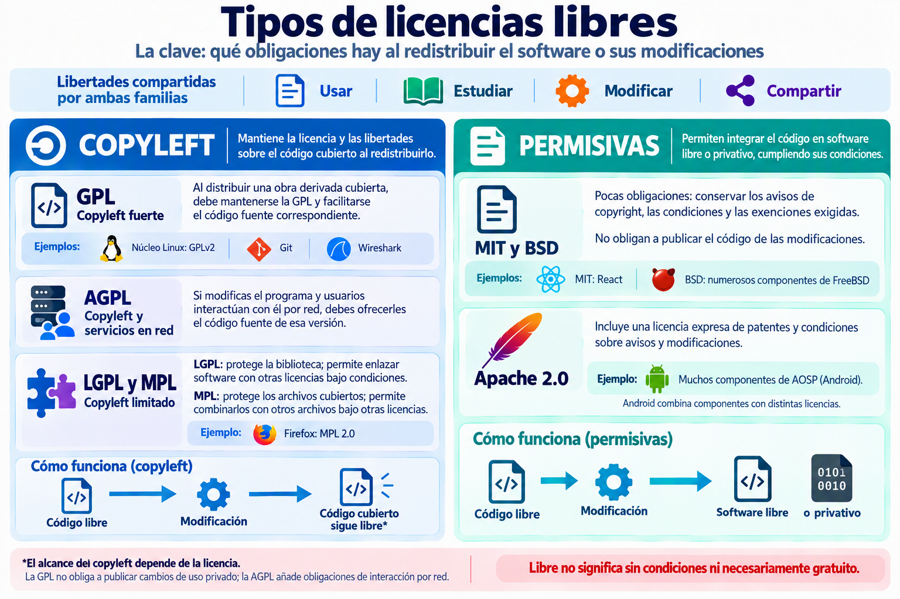
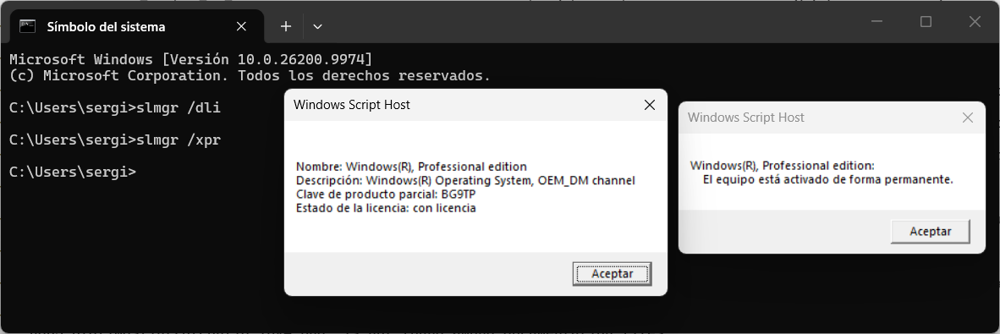

Cuando "compramos" un programa, en realidad no compramos el programa: compramos el **permiso para usarlo** bajo unas condiciones concretas. Ese permiso se llama **licencia**, y es el documento que dice qué podemos hacer con el software, qué no, en cuántos equipos, durante cuánto tiempo y quién responde si algo falla.

Parece un detalle legal sin importancia, pero es una de las decisiones más relevantes al montar un sistema informático. Instalar un sistema operativo sin la licencia adecuada puede acarrear problemas legales, y elegir un modelo de licencia equivocado puede disparar el presupuesto de una empresa o impedir que una aplicación se distribuya. Además, comparar sistemas operativos según sus **licencias de uso** es uno de los criterios que se evalúan en este módulo.

Y hay una razón más cercana: cada vez que instaláis un sistema operativo aparece una pantalla que dice "Acepto los términos de la licencia". En este apartado vamos a aprender qué estamos aceptando.

## El software como obra protegida

El software, igual que un libro o una canción, es una **obra protegida por derechos de autor**. En España y en la Unión Europea, el autor (o la empresa que lo desarrolla) tiene derechos exclusivos sobre su obra: decide quién puede copiarla, modificarla y distribuirla. Comprar una copia no transfiere esos derechos.

La **licencia** es el contrato mediante el cual el titular de los derechos concede al usuario algunos de ellos. En el software privativo ese contrato suele llamarse **EULA** (*End User License Agreement*, acuerdo de licencia de usuario final). Una licencia define normalmente:

| Elemento | Qué establece | Ejemplo |
|----------|---------------|---------|
| **Alcance de uso** | Para qué se puede usar | Solo uso personal, o también comercial |
| **Número de equipos o usuarios** | Cuántas instalaciones o personas | Un equipo, diez usuarios |
| **Duración** | Cuánto tiempo es válida | Perpetua, suscripción anual, 30 días de prueba |
| **Permiso de copia y modificación** | Si se puede copiar, modificar o redistribuir | Libre en el software libre, prohibido en el privativo |
| **Soporte y actualizaciones** | Qué ayuda y parches se incluyen | Actualizaciones de seguridad |
| **Garantías y responsabilidad** | Qué responde el fabricante si algo falla | Casi siempre muy limitadas |

!!! info "¿Qué pasa con la copia de seguridad?"
    La normativa europea permite al usuario legítimo de un programa hacer una **copia de seguridad** del mismo, aunque la licencia diga lo contrario. Esto no significa que se pueda instalar el programa en más equipos de los que permite la licencia.

## Software libre y software privativo

La primera gran clasificación se basa en **los derechos que se conceden al usuario**.

### Software privativo

El **software privativo** (o propietario) es aquel cuyo titular mantiene el control: normalmente **no se entrega el código fuente**, y la licencia prohíbe o limita copiar, modificar y redistribuir el programa. Es el caso de Windows, macOS o Microsoft Office.

### Software libre

El **software libre** es el que respeta cuatro libertades fundamentales del usuario, definidas por la *Free Software Foundation*:

1. **Libertad de ejecutar** el programa para cualquier propósito.
2. **Libertad de estudiar** cómo funciona y modificarlo, lo que exige tener acceso al **código fuente**.
3. **Libertad de redistribuir** copias.
4. **Libertad de distribuir versiones modificadas**, para que otros se beneficien de las mejoras.

Existe un término cercano, el **código abierto** (*open source*), promovido por la *Open Source Initiative*. En la práctica, casi todas las licencias libres son también de código abierto y se usan los dos términos como sinónimos, aunque el software libre pone el énfasis en la libertad del usuario y el código abierto en las ventajas técnicas del desarrollo abierto.

!!! warning "Libre no significa gratis, ni gratis significa libre"
    Esta es la confusión más habitual. Un programa puede ser **gratuito pero no libre** (no podemos ver ni modificar el código) o **libre pero de pago** (como las suscripciones de soporte a una distribución Linux empresarial).

    | | **Gratuito** | **De pago** |
    |--|--------------|-------------|
    | **Libre** | Ubuntu, VLC, LibreOffice | Suscripciones de soporte (SUSE, Red Hat) |
    | **Privativo** | Packet Tracer, Adobe Reader | Windows, Microsoft 365, Photoshop |

### Tipos de licencias libres

Dentro del software libre existe un amplio abanico de licencias. La diferencia fundamental es **qué obligaciones imponen cuando alguien redistribuye el programa o una versión modificada**. Se dividen en dos grandes familias:

**Licencias copyleft:** exigen que las obras derivadas se distribuyan **con la misma licencia**. Garantizan que el software siga siendo libre.

- **GPL** (*GNU General Public License*): el copyleft "fuerte". Es la licencia del núcleo Linux (versión 2) y de muchísimos programas, como Git o Wireshark.
- **AGPL**: como la GPL, pero extiende la obligación a los programas que se ofrecen como servicio a través de la red.
- **LGPL** y **MPL**: copyleft "débil". Permiten usar el programa o la biblioteca desde software que no es libre. La MPL es la licencia de LibreOffice y Firefox.

**Licencias permisivas:** imponen muy pocas obligaciones. Se puede usar, modificar y redistribuir el código, incluso dentro de software privativo, conservando el aviso de autoría.

- **MIT** y **BSD**: muy breves y sencillas. MIT es la elección habitual de muchos proyectos de JavaScript y Python.
- **Apache 2.0**: permisiva, con cláusulas adicionales sobre patentes. Es la licencia de Android (sus componentes de usuario), de Android Studio y de IntelliJ IDEA Community.

<!-- IMG: esquema comparativo licencias copyleft (GPL, LGPL, AGPL) frente a permisivas (MIT, BSD, Apache), con ejemplos de proyectos -->
<figure markdown="span" align="center">
  { width="75%" }
  <figcaption>Licencias libres: copyleft (el código derivado sigue siendo libre) y permisivas (el código derivado puede ser privativo)</figcaption>
</figure>

!!! example "Dos ejemplos para entender la diferencia"
    - Si modificas un programa con licencia **GPL** y lo distribuyes, tienes que distribuirlo también con licencia GPL y ofrecer el código fuente de tus cambios.
    - Si modificas un programa con licencia **MIT**, puedes distribuirlo como programa privativo, siempre que conserves el aviso de la licencia original.

## Software gratuito, de prueba y de pago

La segunda clasificación se basa en **el modelo comercial**: cuánto cuesta y cómo se paga.

| Modelo | Descripción | Ejemplos |
|--------|-------------|----------|
| **Freeware** | Gratuito, pero privativo: no se puede modificar ni redistribuir | Adobe Acrobat Reader, Packet Tracer |
| **Shareware / Trial** | Se puede probar gratis durante un tiempo o con funciones limitadas. Para seguir usándolo hay que pagar | WinRAR, versiones de evaluación |
| **Freemium** | Versión gratuita básica y funciones avanzadas de pago | Zoom, Dropbox |
| **Licencia perpetua** | Se paga una vez y se usa indefinidamente (las actualizaciones mayores pueden costar aparte) | Versiones clásicas de Office |
| **Suscripción** | Se paga periódicamente. Si se deja de pagar, se pierde el acceso | Microsoft 365, Adobe Creative Cloud |
| **Software como servicio (SaaS)** | No se instala: se usa en la nube y se paga por uso | Google Workspace |
| **Software de evaluación** | Versión completa con caducidad, pensada para probar el producto | Windows Server y Windows 11 Enterprise de evaluación |

## Cómo se cuenta una licencia

Otro aspecto importante es **qué se cuenta** al vender la licencia. El mismo programa puede venderse de formas distintas, y la diferencia en el precio final puede ser enorme.

| Modalidad | Se cuenta... | Ejemplo |
|-----------|--------------|---------|
| **Por equipo o dispositivo** | Cada máquina donde se instala | Windows en un PC |
| **Por usuario** | Cada persona, con independencia del número de equipos que use | Microsoft 365 |
| **Por núcleo** (*core*) | El número de núcleos del procesador del servidor | Windows Server |
| **Concurrente o flotante** | Los usuarios que usan el programa *a la vez* | Software de ingeniería y diseño |
| **De sitio (*site license*)** | Una licencia para toda la organización o centro | Licencias para centros educativos |

## Las licencias de Microsoft en la práctica

Como trabajaremos principalmente con Windows en el proyecto, vale la pena conocer cómo se comercializan sus licencias. Una misma versión de Windows puede adquirirse de varias formas:

| Tipo | Cómo se obtiene | Particularidades |
|------|-----------------|------------------|
| **OEM** | Viene preinstalada con un equipo nuevo | Queda vinculada a ese equipo y no puede pasar a otro |
| **Retail** (comercio) | Se compra por separado | Puede transferirse a otro equipo (de uno en uno) |
| **Volumen** | Contrato para organizaciones con muchos equipos | Se activa de forma centralizada; precios por volumen |
| **Académica** | Programas para centros educativos | Condiciones y precios específicos |
| **Evaluación** | Versión de prueba gratuita | Funciona un tiempo limitado, con fines de prueba |

Microsoft ofrece versiones de **evaluación** de Windows Server y Windows 11 Enterprise en su centro de evaluación, con una duración limitada (de 90 a 180 días según el producto). Son legales, completas y perfectas para prácticas como las de este módulo.

### Licenciar Windows Server

Windows Server tiene un esquema distinto al de Windows cliente, y es un buen ejemplo de licenciamiento "por núcleo":

- **Licencias de servidor, por núcleo.** Se licencian los núcleos del procesador del servidor, con un **mínimo de 8 por procesador y 16 por servidor**. Es decir, un servidor con un único procesador de 6 núcleos se licencia igualmente por 16.
- **Edición.** *Standard* permite ejecutar 2 máquinas virtuales por servidor licenciado; *Datacenter*, un número ilimitado.
- **Licencias de acceso de cliente (CAL).** Además de la licencia del servidor, **cada usuario o cada dispositivo** que accede a los servicios del servidor necesita una CAL. Hay CAL **por usuario** (la persona usa varios equipos) y **por dispositivo** (varios usuarios comparten un equipo).

!!! example "Ejemplo: una empresa con un servidor y 14 clientes"
    La empresa TechSolutions tiene un servidor Windows Server y 14 equipos cliente con Windows 11 Pro. Necesitaría:

    - 1 licencia de Windows Server (Standard) para 16 núcleos.
    - 14 CAL, por usuario o por dispositivo.
    - 14 licencias de Windows 11 Pro, normalmente OEM, incluidas con los equipos.

    El servicio de **Escritorio remoto** tiene además sus propias CAL. Para el cálculo de un caso real conviene consultar siempre a un distribuidor o a las condiciones vigentes de Microsoft, porque las normas de licenciamiento cambian con frecuencia.

### Activación y comprobación

Para demostrar que una instalación de Windows está licenciada se usa la **activación**: el sistema se valida online con una clave de producto o con una licencia digital vinculada al equipo. En organizaciones, las activaciones se gestionan de forma centralizada con servidores KMS o claves MAK.

Para comprobar el estado de la licencia de un equipo:

- En Windows 11: **Configuración → Sistema → Activación**.
- Por comandos (PowerShell o CMD como administrador):

```
slmgr /dli     ← información básica de la licencia
slmgr /xpr     ← fecha de caducidad de la activación
```

En una versión de evaluación, estos comandos muestran cuánto tiempo queda.

<!-- IMG: captura de Windows 11 con la pantalla Configuración → Sistema → Activación y la ventana de slmgr /dli -->
<figure markdown="span" align="center">
  { width="80%" }
  <figcaption>Comprobación del estado de activación de Windows desde la configuración y con slmgr</figcaption>
</figure>

En Linux no hay activación. La mayoría de distribuciones son libres y se instalan sin clave. En las distribuciones con soporte comercial, como Ubuntu Pro, lo que se contrata es el soporte, no el derecho de uso.

## Por qué no debemos usar software sin licencia

Instalar software sin licencia, ya sea por una copia pirata o por usar un programa de pago sin comprarlo, es una mala idea por varias razones que no son solo legales:

- **Riesgos legales.** Usar software sin licencia infringe los derechos de autor y puede suponer sanciones económicas e incluso responsabilidad penal en determinados supuestos. Las empresas pueden ser objeto de **auditorías de licencias**.
- **Riesgos de seguridad.** Los programas "crackeados" y los generadores de claves son una de las vías más habituales de entrada de **malware**.
- **Sin soporte ni actualizaciones.** El software sin licencia no recibe parches de forma fiable, y un sistema sin parches es un sistema vulnerable.
- **Imagen profesional.** En un entorno de trabajo, un técnico que instala software pirata compromete a su empresa.

Para el aprendizaje existen alternativas totalmente legales: software libre, versiones de evaluación y licencias educativas.

## Las licencias del software que usamos en el módulo

Es un buen ejercicio mirar el software de nuestro propio entorno de trabajo:

| Software | Licencia | Tipo |
|----------|----------|------|
| Ubuntu | Mayoritariamente GPL y otras licencias libres | Libre, gratuito |
| Windows 11 / Windows Server (evaluación) | Licencia privativa (EULA) con evaluación | Privativo, evaluación gratuita |
| VirtualBox (paquete base) | GPLv3 | Libre, gratuito |
| VirtualBox Extension Pack | PUEL (uso personal y educativo) | Privativo, gratuito para uso personal y educativo |
| Cisco Packet Tracer | Licencia de Cisco | Privativo, gratuito con cuenta NetAcad |
| draw.io | Apache 2.0 | Libre, gratuito |
| MkDocs | BSD | Libre, gratuito |
| Material for MkDocs | MIT | Libre, gratuito |
| Python | Licencia de la PSF (permisiva) | Libre, gratuito |

!!! warning "El caso de VirtualBox"
    VirtualBox es un ejemplo perfecto de licencias mezcladas: el programa base es libre (GPLv3), pero el **Extension Pack** tiene una licencia privativa propia, la PUEL (*Personal Use and Evaluation License*), que es gratuita para uso personal, de evaluación y educativo, pero **de pago en un uso comercial**. Según las notas de la versión 7.2, parte de lo que antes era exclusivo del Extension Pack ha pasado al paquete base, así que conviene comprobar qué se necesita realmente. Un administrador que lo instale en la empresa debe revisar siempre las condiciones de cada componente.

## Y cuando desarrollamos nosotros

Como futuros desarrolladores, también seremos **autores** de software y tendremos que elegir una licencia. Tres ideas básicas:

1. **Si no pones licencia, no es libre.** Un proyecto en GitHub sin licencia tiene por defecto *todos los derechos reservados*: nadie más puede legalmente usarlo ni modificarlo, aunque el código sea público.
2. **Revisa las licencias de las bibliotecas que uses.** Al incluir un componente con licencia GPL en una aplicación que se distribuye, la obligación de licencia copyleft puede afectar a toda la aplicación. Los detalles dependen de cómo se integre y se distribuya, así que hay que consultarlo antes.
3. **También el contenido tiene licencia.** Los documentos, imágenes y apuntes (como los de este curso) usan licencias específicas, como las **Creative Commons**. Estos apuntes están publicados bajo **CC BY-SA 4.0**: se pueden compartir y adaptar citando al autor, y las obras derivadas deben mantener la misma licencia.

Algunos ejemplos de licencias en herramientas de desarrollo: OpenJDK es GPLv2 con una excepción que permite usarlo en aplicaciones propias, MySQL es GPL con opción comercial de pago (licencia dual), PostgreSQL usa una licencia permisiva y Visual Studio Code tiene su código fuente con licencia MIT mientras que el producto de Microsoft se distribuye con una licencia propia.

---

## Actividad en clase

### 🖥️ Clasifica estos programas

**Duración:** 15 minutos
**Dinámica:** individual + corrección en grupo

Para cada programa, indica si es **libre o privativo** y si es **gratuito, de pago o por suscripción**. Después, comparad vuestras respuestas.

| Programa | ¿Libre o privativo? | ¿Gratuito, de pago o suscripción? |
|----------|---------------------|-----------------------------------|
| Ubuntu | | |
| Windows 11 Pro | | |
| VLC | | |
| WinRAR | | |
| Microsoft 365 | | |
| LibreOffice | | |
| Packet Tracer | | |
| Zoom | | |
| Adobe Acrobat Reader | | |
| Git | | |

??? "Solución"

    | Programa | ¿Libre o privativo? | ¿Gratuito, de pago o suscripción? |
    |----------|---------------------|-----------------------------------|
    | Ubuntu | Libre | Gratuito |
    | Windows 11 Pro | Privativo | De pago (licencia perpetua, normalmente OEM) |
    | VLC | Libre | Gratuito |
    | WinRAR | Privativo | Shareware: periodo de prueba y licencia de pago |
    | Microsoft 365 | Privativo | Suscripción |
    | LibreOffice | Libre | Gratuito |
    | Packet Tracer | Privativo | Gratuito (freeware, con cuenta NetAcad) |
    | Zoom | Privativo | Freemium |
    | Adobe Acrobat Reader | Privativo | Gratuito (freeware) |
    | Git | Libre | Gratuito |

### 🧮 Calcula las licencias de una empresa

**Duración:** 15 minutos
**Dinámica:** por parejas

Una pequeña empresa de desarrollo tiene **10 puestos** y quiere montar un servidor Windows Server con Active Directory. Cada empleado tiene su propio equipo con Windows 11 Pro. El servidor tiene un único procesador de 8 núcleos. No hay virtualización y tampoco quieren gastar en el sistema operativo de los equipos del aula de pruebas, que usan Ubuntu.

Indica qué licencias necesitan y cuáles no.

??? "Solución"

    - **Windows Server (Standard):** licencia para **16 núcleos**. Aunque el procesador tenga 8, el mínimo por servidor es 16 licencias de núcleo.
    - **CAL de Windows Server:** **10 CAL**, por dispositivo o por usuario. Como cada empleado usa un único equipo fijo, ambas opciones sirven.
    - **Windows 11 Pro:** 10 licencias (normalmente OEM, incluidas al comprar los equipos).
    - **Ubuntu:** ninguna licencia: es libre y gratuito. Solo se pagaría si quisieran soporte comercial.
    - **Para aprender o probar:** pueden usar las versiones de evaluación de Windows Server y Windows 11 de Microsoft sin coste y de forma legal.
