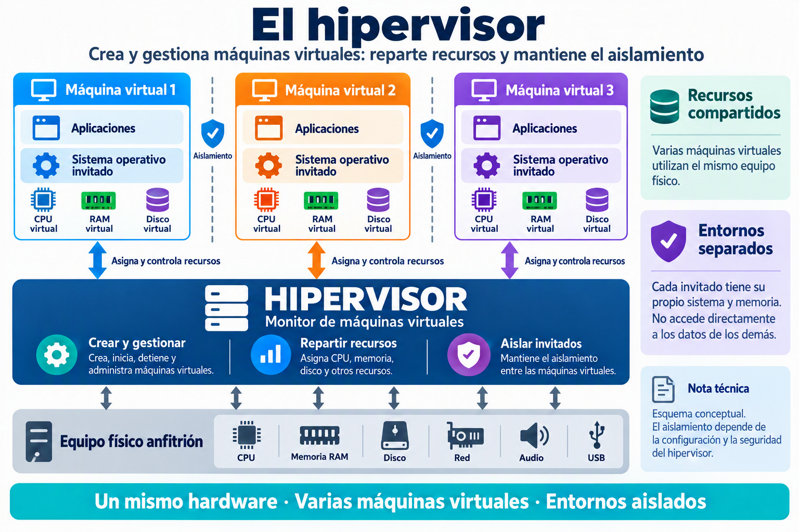
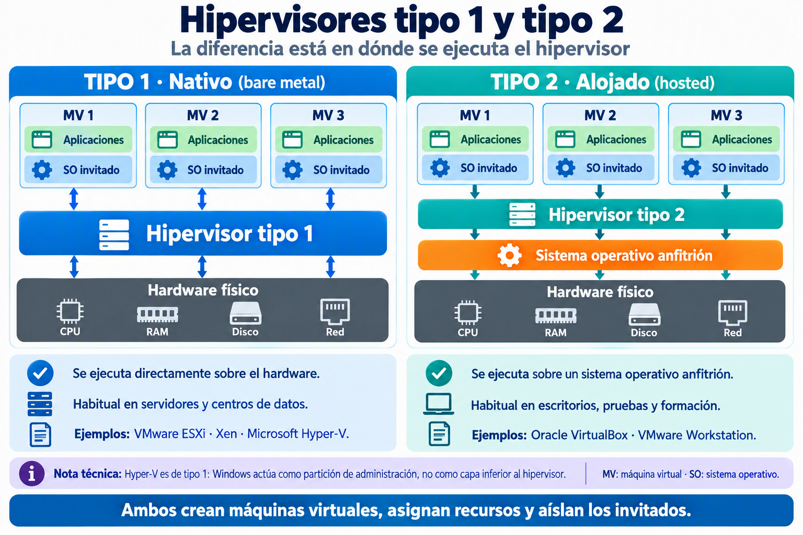
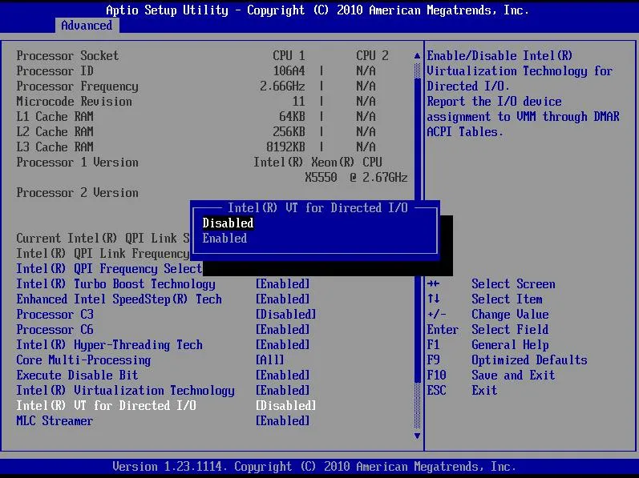
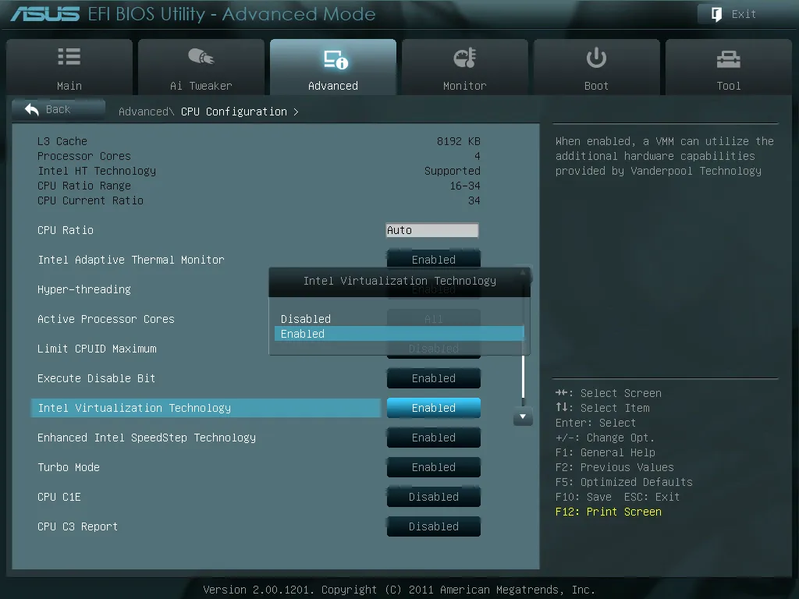

Imagina un edificio de pisos. En lugar de construir una casa independiente para cada familia, con su propio terreno, su propia instalación eléctrica y su propia acometida de agua, se construye **un único edificio** y se reparte entre varias viviendas independientes. Cada familia vive en su piso como si fuera su casa, con su puerta y su intimidad, pero todas comparten los cimientos, la estructura y los suministros.

La **virtualización** hace exactamente eso con los ordenadores: permite que **un único equipo físico se comporte como varios equipos independientes**, cada uno con su propio sistema operativo, sus propias aplicaciones y su propia configuración. Es la tecnología sobre la que funcionan los centros de datos, los servicios en la nube que vimos en el apartado 1 y, a partir de la próxima unidad, **todo el trabajo de este módulo**: instalaremos Windows Server, Windows 11 y Ubuntu sin necesidad de tener un ordenador físico para cada uno.

## Qué es la virtualización

**Virtualizar** es crear mediante software una versión virtual de un recurso que existe físicamente. Se puede virtualizar casi cualquier cosa:

- Un **disco duro virtual** representa un disco físico, y en realidad es un fichero.
- Una **CPU virtual** representa una parte del procesador real.
- Una **red virtual** reproduce el funcionamiento de switches y cables.
- Un **sistema operativo virtual** funciona como si estuviera instalado en un equipo propio.

Cuando se virtualiza un equipo completo, el resultado es una **máquina virtual** (MV o VM, *virtual machine*). Y detrás de una máquina virtual no hay nada misterioso: es básicamente **un conjunto de ficheros**, uno con la configuración del equipo (cuánta RAM, cuántas CPU, qué red...) y otro (o varios) con el contenido de sus discos virtuales. Esto tiene consecuencias muy prácticas que veremos más adelante: copiar una máquina virtual es copiar ficheros, y hacer una copia de seguridad también.

### Anfitrión e invitado

En la virtualización hay siempre dos papeles:

- El **anfitrión** (*host*) es el equipo físico real donde se ejecuta la virtualización. Pone el hardware.
- El **invitado** (*guest*) es cada máquina virtual que se ejecuta sobre el anfitrión. Cree que tiene su propio hardware, pero en realidad está usando una parte del hardware del anfitrión.

### El hipervisor

El programa que crea y gestiona las máquinas virtuales se llama **hipervisor** (o monitor de máquinas virtuales). Es el encargado de **repartir los recursos del anfitrión** entre los invitados: la CPU, la memoria RAM, el disco, la red y el resto de dispositivos (audio, USB...). También los **aísla**: una máquina virtual no puede ver ni tocar los datos de otra, aunque compartan el mismo equipo físico.

<!-- IMG: diagrama con el hardware en la base, el hipervisor encima y varias máquinas virtuales (cada una con su SO y aplicaciones) arriba -->
<figure markdown="span" align="center">
  { width="75%" }
  <figcaption>El hipervisor reparte los recursos del hardware entre las máquinas virtuales y las mantiene aisladas</figcaption>
</figure>

## Ventajas de la virtualización

La virtualización se ha generalizado porque ofrece ventajas muy importantes, tanto en empresas como en el trabajo de un desarrollador:

**Ahorro de costes y mejor aprovechamiento del hardware.** Un servidor físico dedicado a una sola tarea suele estar muy infrautilizado. Con virtualización se puede **consolidar**: varios servidores virtuales en un único equipo físico, con el consiguiente ahorro en equipos, energía, espacio y refrigeración.

!!! example "Ejemplo de consolidación"
    Una empresa tiene tres servidores físicos: uno de aplicaciones al 40 % de uso, uno de correo al 15 % y uno de almacenamiento al 30 %. Con virtualización puede migrarlos a **un único servidor físico** que trabajaría a algo menos del 85 % de su capacidad (45 % de ahorro en equipos, y en la práctica se deja margen para el propio hipervisor).

**Flexibilidad y rapidez.** Crear una máquina virtual nueva lleva minutos, no días de compra e instalación de hardware. Y si cambian las necesidades, se pueden ajustar sus recursos con facilidad.

**Aislamiento y entornos de prueba seguros.** Podemos probar un programa, un virus o una configuración arriesgada en una máquina virtual sin poner en peligro el equipo real. Si algo sale mal, se descarta la máquina y listo. Para un desarrollador es muy útil: se puede tener un entorno idéntico al de producción, o probar una aplicación en varios sistemas operativos sin cambiar de ordenador.

**Mejor recuperación ante problemas.** Gracias a las **instantáneas** (*snapshots*) se puede guardar el estado de una máquina virtual y volver a él si algo falla. Si una máquina se estropea, basta con restaurar sus ficheros o arrancar una copia. Y en entornos profesionales, las máquinas pueden **moverse en caliente** de un servidor físico a otro, sin apagarlas, para hacer mantenimiento.

**Compatibilidad entre sistemas.** Permite ejecutar programas que solo existen para otro sistema operativo, sin tener que instalarlo en el equipo real.

## Inconvenientes de la virtualización

La virtualización no es gratuita ni perfecta, y conviene conocer sus límites:

- **Menor rendimiento.** Una máquina virtual siempre es algo más lenta que el mismo sistema instalado directamente en el hardware, porque el hipervisor añade una capa intermedia.
- **Recursos reservados.** Al arrancar una máquina virtual, el anfitrión le reserva memoria RAM y otros recursos mientras esté en marcha, aunque la máquina no los esté usando. Si arrancamos demasiadas, el anfitrión se queda sin recursos.
- **Hardware compatible.** Hace falta un procesador con soporte de virtualización por hardware (lo vemos a continuación).
- **Un único punto de fallo.** Si el equipo anfitrión falla, **todas** las máquinas virtuales que alberga dejan de funcionar a la vez.
- **Más complejidad de administración.** Hay que gestionar el hipervisor, las máquinas, las redes virtuales y las copias de seguridad.
- **Licencias.** Cada máquina virtual con un sistema operativo privativo **necesita su propia licencia**, como vimos en el apartado anterior. Que sea virtual no significa que sea gratis.

## Tipos de virtualización

No todo lo que llamamos virtualización funciona de la misma forma. Según cómo trabaje el hipervisor, distinguimos varios tipos.

### Emulación

La **emulación** es un programa que **simula por software el funcionamiento de un hardware completo**, incluso con un procesador distinto al del equipo real. Por ejemplo, permite ejecutar un sistema para procesadores ARM en un PC con procesador Intel, o jugar a un videojuego de una consola antigua en un ordenador moderno.

Es muy flexible, pero **mucho más lenta**, porque cada instrucción del sistema simulado tiene que traducirse a mano. Un ejemplo es **QEMU**, que puede emular muchas arquitecturas.

### Virtualización nativa o completa

Es la más utilizada. Aquí la máquina virtual usa directamente el procesador del equipo real, sin traducir instrucciones, y por eso es **muy rápida**. La contrapartida es que el sistema invitado debe estar pensado para la **misma arquitectura** que el anfitrión (x86-64 en un anfitrión x86-64), algo que ya vimos en el apartado 1. Dentro de ella hay dos tipos de hipervisor, según dónde se ejecute:

**Hipervisor de tipo 1** (*bare-metal*, "sobre el metal"): el hipervisor se instala **directamente sobre el hardware**, sin sistema operativo intermedio. Es el más eficiente y el que se usa en centros de datos y servidores de producción.

**Hipervisor de tipo 2** (*hosted*, "alojado"): el hipervisor es **un programa más** que se ejecuta sobre un sistema operativo ya instalado, que es el anfitrión. Es más fácil de instalar y de usar, a costa de algo de rendimiento. Es el tipo que usaremos nosotros.


<!-- IMG: dos diagramas lado a lado: tipo 1 (hipervisor sobre el hardware) y tipo 2 (hipervisor sobre un sistema operativo anfitrión), correctamente etiquetados -->
<figure markdown="span" align="center">
  { width="75%" }
  <figcaption>Hipervisor tipo 1 (sobre el hardware) frente a tipo 2 (sobre un sistema operativo anfitrión)</figcaption>
</figure>

| | Tipo 1 | Tipo 2 |
|--|--------|--------|
| **Se instala sobre...** | El hardware | Un sistema operativo |
| **Rendimiento** | Muy alto | Algo menor |
| **Uso típico** | Servidores y centros de datos | Escritorio, formación y pruebas |
| **Ejemplos** | VMware ESXi, Proxmox VE, Xen, KVM (integrado en el núcleo Linux), Hyper-V | VirtualBox, VMware Workstation y Fusion, Parallels |

!!! warning "Hyper-V es de tipo 1, aunque lo veas en Windows"
    Microsoft **Hyper-V** es un hipervisor de tipo 1, aunque se active desde una instalación normal de Windows 11 Pro: en ese caso, Windows pasa a ejecutarse sobre el hipervisor, como una máquina más. Es una fuente de problemas con VirtualBox en Windows, que veremos en el apartado de requisitos.

### Contenedores

En los últimos años se ha extendido otra forma de aislar aplicaciones que a un desarrollador DAM le interesa especialmente: los **contenedores** (como los de **Docker**). Un contenedor **no incluye un sistema operativo completo**: comparte el núcleo del sistema anfitrión y solo empaqueta la aplicación con sus dependencias.

| | Máquina virtual | Contenedor |
|--|-----------------|------------|
| **Incluye un SO completo** | Sí | No, comparte el núcleo del anfitrión |
| **Tamaño** | Gigabytes | Megabytes |
| **Arranque** | Segundos o minutos | Segundos o menos |
| **Aislamiento** | Muy fuerte | Menor |
| **Se usa para...** | Ejecutar sistemas operativos completos | Empaquetar y desplegar aplicaciones |

No son una alternativa a las máquinas virtuales sino una herramienta complementaria. En este módulo trabajaremos con máquinas virtuales porque necesitamos **instalar y administrar sistemas operativos completos**.

### Otras virtualizaciones

El concepto no se limita a los ordenadores completos. También se virtualizan:

- **El almacenamiento**, agrupando discos físicos en un único espacio.
- **Las redes**, con switches y routers virtuales (que usaremos en VirtualBox).
- **Los escritorios**, para que los empleados trabajen desde cualquier sitio en un escritorio alojado en un servidor.
- **Las aplicaciones**, ejecutadas de forma aislada sin instalarse en el equipo.

## Requisitos para virtualizar

Antes de crear nuestra primera máquina virtual tenemos que comprobar que el equipo anfitrión es capaz de soportarla. Hay dos tipos de requisitos: los de **capacidad** del hardware y los de **recursos**.

### Soporte de virtualización por hardware

Los procesadores modernos incluyen **instrucciones especiales** que permiten al hipervisor ejecutar las máquinas virtuales de forma rápida y eficiente. En Intel se llaman **Intel VT-x** y en AMD, **AMD-V**. Asociada a ellas está la **paginación anidada** (SLAT), que acelera la gestión de memoria de las máquinas virtuales. Prácticamente cualquier procesador actual las incluye, pero a menudo vienen **desactivadas de fábrica** en la BIOS/UEFI.

### Cómo comprobar si está disponible

**En Windows.** Abre el **Administrador de tareas** (`Ctrl+Mayús+Esc`) → pestaña **Rendimiento** → **CPU**. En la parte inferior aparece el campo **Virtualización**, que debería decir *Habilitada*.

**En Linux.** Desde un terminal:

```bash
lscpu | grep -i virtualization
```

Si el procesador soporta virtualización y está activada, mostrará `VT-x` (Intel) o `AMD-V` (AMD). Otra comprobación equivalente cuenta cuántos núcleos tienen los indicadores `vmx` (Intel) o `svm` (AMD):

```bash
grep -E -c '(vmx|svm)' /proc/cpuinfo
```

Si el resultado es `0`, la virtualización no está soportada o **está desactivada en la BIOS/UEFI**.

!!! tip "Cuidado al copiar comandos"
    Si copias un comando desde una presentación o desde un documento, es muy habitual que las comillas simples se conviertan en "comillas tipográficas" (`‘ ’`), que el terminal no reconoce y provocan un error. Si un comando falla al pegarlo, comprueba primero las comillas.

### Activarla en la BIOS/UEFI

Si no está habilitada, hay que entrar en la BIOS/UEFI al arrancar el equipo (como vimos en la UD01) y activar la opción correspondiente. El nombre cambia según el fabricante y el procesador, y suele estar en el menú de configuración avanzada de la CPU:

| Procesador | Nombre habitual de la opción |
|------------|------------------------------|
| Intel | *Intel Virtualization Technology* (o *VT-x*) |
| AMD | *SVM Mode* (o *AMD-V*) |

<!-- IMG: captura de una UEFI moderna con la opción de virtualización activada (Intel y/o AMD) -->
<figure markdown="span" align="center">
  { width="45%" }
  { width="45%" }
  <figcaption>Opción de virtualización activada en la BIOS y en la UEFI: en Intel suele llamarse "Intel Virtualization Technology" y en AMD "SVM Mode"</figcaption>
</figure>

Si intentas arrancar una máquina virtual con la virtualización desactivada, VirtualBox muestra un error indicando que VT-x o AMD-V están desactivados en la BIOS.

### Problemas con Hyper-V y otros en Windows

Si el anfitrión es Windows, hay otro problema frecuente. Funciones como **Hyper-V**, la **Plataforma de máquina virtual**, **WSL 2** o la **integridad de memoria** (parte de la seguridad basada en virtualización) usan el hipervisor de Windows, y entran en conflicto con otros hipervisores. VirtualBox puede funcionar sobre el hipervisor de Windows, pero con **menos rendimiento**: lo notarás porque aparece un **icono de tortuga** en la barra de estado de la máquina virtual y todo va notablemente más lento.

Para resolverlo hay dos caminos: desactivar esas funciones de Windows (con el inconveniente de perder también lo que dependa de ellas, como WSL 2) o usar Hyper-V como hipervisor en lugar de VirtualBox.

### Recursos: dimensionar el anfitrión

Además de la capacidad, hay que mirar los **recursos**, porque las máquinas virtuales los **reservan** mientras están encendidas:

- **Memoria RAM.** Es el recurso más limitante. La suma de la RAM de todas las máquinas virtuales que se ejecutan a la vez, **más la RAM que necesita el propio anfitrión** (unos 4 GB), no puede superar la RAM física.
- **Procesador.** Se asignan a cada máquina virtual una o más CPU virtuales. Conviene no asignar más de las que tiene el equipo y dejar siempre recursos al anfitrión.
- **Disco.** Cada máquina ocupa varios gigabytes. Un **SSD** marca una gran diferencia en el rendimiento.
- **Red.** Para conectar las máquinas entre ellas y con el exterior, como veremos más adelante.

!!! example "Ejemplo de dimensionado"
    Tenemos un equipo anfitrión con **16 GB de RAM** y queremos ejecutar a la vez estas tres máquinas:

    - Windows Server con escritorio: 4 GB
    - Windows 11: 4 GB
    - Ubuntu Server: 2 GB

    ```
    Máquinas virtuales:  4 + 4 + 2 = 10 GB
    Anfitrión:                       4 GB
    ───────────────────────────────────
    Total necesario:                14 GB   (de 16 GB: cabe)
    ```

    Si en lugar de Ubuntu Server usáramos **Ubuntu Desktop 26.04** (6 GB mínimos, como vimos en el apartado 1), el total sería 4 + 4 + 6 + 4 = **18 GB**: no cabría en 16 GB. Por eso es importante dimensionar antes de empezar.

!!! warning "Equipos con procesador ARM"
    Como se comentó en el apartado 1, un equipo anfitrión con procesador ARM (Mac con chip M, portátiles con Snapdragon) puede tener problemas para ejecutar máquinas virtuales x86 con VirtualBox. Si tu equipo es así, consulta con el profesor.

---

## Actividad en clase

### 🖥️ Comprueba si tu equipo puede virtualizar

1. Comprueba si la virtualización está **habilitada** en tu equipo con el método que corresponda a tu sistema (Administrador de tareas en Windows, `lscpu` en Linux).
2. Anota cuántos **núcleos** y cuánta **RAM** tiene tu equipo.
3. Si tu equipo es un portátil o un sobremesa distinto al del aula, busca el nombre exacto que recibe la opción de virtualización en su BIOS/UEFI.

### 🧮 Clasifica y dimensiona

**Parte 1.** Indica si cada solución es **emulación**, **hipervisor de tipo 1** o **hipervisor de tipo 2**:

- VirtualBox
- Proxmox VE
- VMware ESXi
- QEMU ejecutando un sistema ARM en un PC Intel
- VMware Workstation
- Hyper-V

**Parte 2.** Un equipo anfitrión tiene 8 GB de RAM. ¿Puede ejecutar a la vez Windows Server (4 GB) y Windows 11 (4 GB)? ¿Y con 16 GB? Razona la respuesta.

??? "Solución"

    **Parte 1:**

    | Solución | Tipo |
    |----------|------|
    | VirtualBox | Tipo 2 |
    | Proxmox VE | Tipo 1 |
    | VMware ESXi | Tipo 1 |
    | QEMU ejecutando un sistema ARM en un PC Intel | Emulación (arquitectura distinta) |
    | VMware Workstation | Tipo 2 |
    | Hyper-V | Tipo 1 |

    **Parte 2.** Con **8 GB no**: 4 + 4 GB de las máquinas virtuales ya agotan toda la memoria y no queda nada para el anfitrión, que necesita unos 4 GB, así que el sistema empezaría a paginar y todo iría muy lento. Con **16 GB sí**: 4 + 4 + 4 = 12 GB, con un margen de 4 GB.
