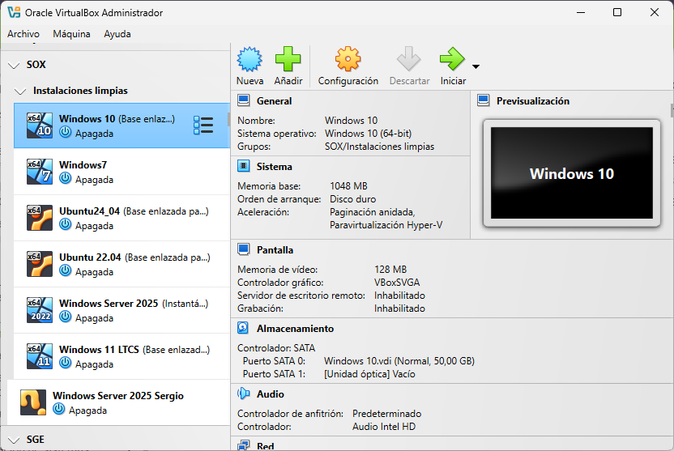
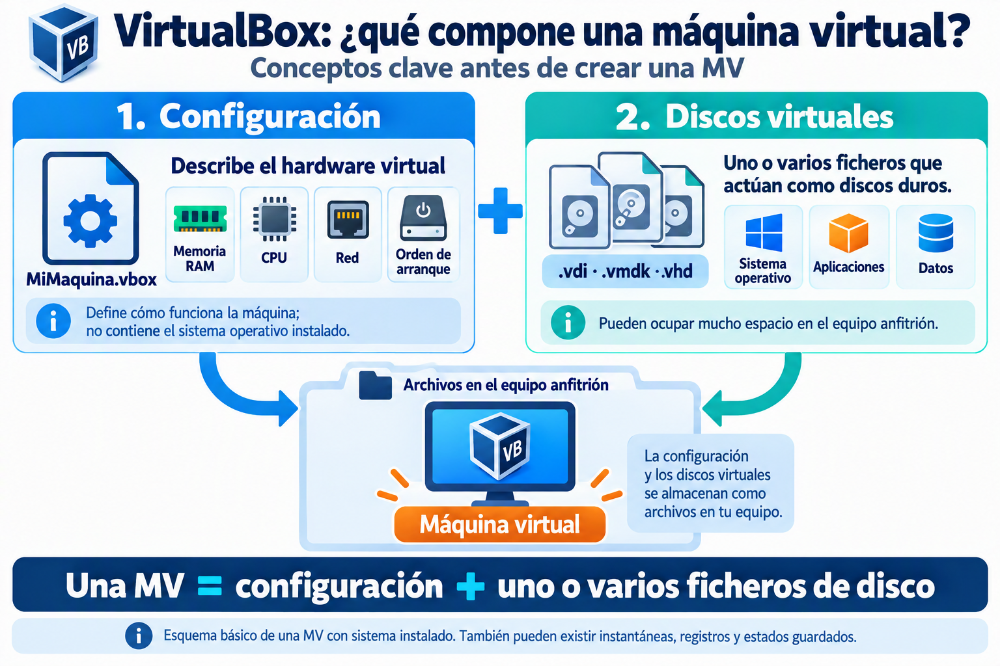
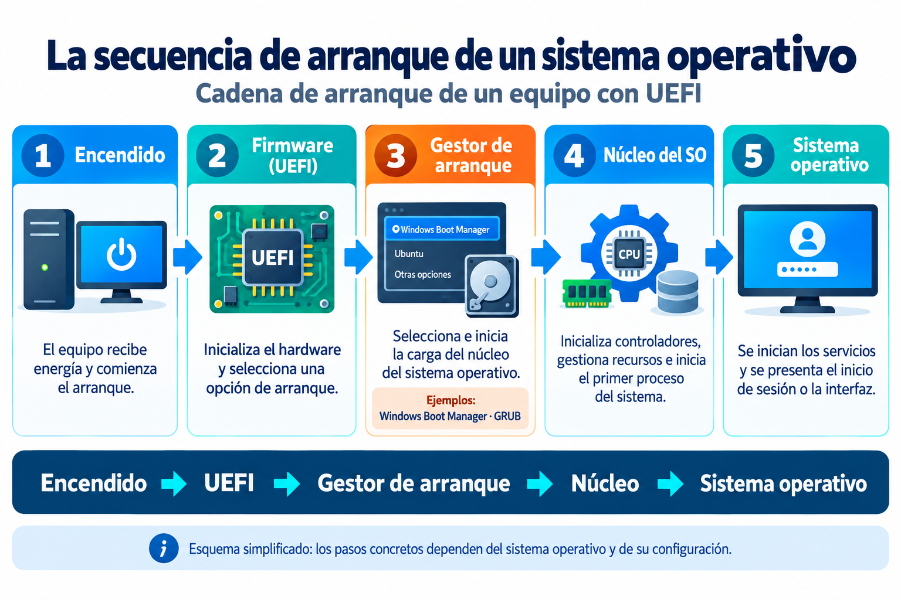

En el apartado anterior vimos **qué** es la virtualización y **qué necesita** tu equipo. Ahora toca ponerla en práctica con la herramienta que usaremos todo el curso: **Oracle VirtualBox**, un hipervisor de tipo 2 gratuito y multiplataforma.

Piensa en VirtualBox como en un taller donde construyes ordenadores a medida con piezas virtuales: eliges cuánta RAM, cuántos núcleos y qué disco tendrá, y después "enciendes" ese ordenador dentro de una ventana. Lo que decidas aquí condiciona todo lo que viene después, así que conviene hacerlo con criterio.

<figure markdown="span" align="center">
  { width="80%" }
  <figcaption>Ventana principal del Administrador de VirtualBox</figcaption>
</figure>

<!-- IMG: captura del Administrador de VirtualBox con 2-3 MV creadas -->

## Instalación de VirtualBox

### Antes de instalar

Comprueba lo visto en el apartado 3:

- [ ] La virtualización está activada en la BIOS/UEFI.
- [ ] Sabes cuánta RAM puedes asignar a una MV (RAM total menos ~4 GB de reserva).
- [ ] Hay espacio libre en disco: una MV de Windows 11 ocupa fácilmente **40-60 GB** reales.
- [ ] Conoces si tienes Hyper-V/WSL2 activos (pueden ralentizar VirtualBox).

### Instalación según el anfitrión

| Anfitrión | Cómo se instala |
|-----------|-----------------|
| **Windows** | Descargar el instalador desde [virtualbox.org](https://www.virtualbox.org/wiki/Downloads) y seguir el asistente. Acepta instalar los adaptadores de red virtuales (se corta la red unos segundos). |
| **Debian / Ubuntu** | Paquete `.deb` de la web oficial o repositorio de Oracle. El nombre del paquete depende de la versión (`virtualbox-7.x`). |
| **macOS** | Instalador `.dmg`. Fíjate en la arquitectura de tu equipo (ver aviso). |

!!! warning "Comprueba el paquete en Debian"
    No des por hecho que `apt install virtualbox` funcione en tu versión de Debian: la disponibilidad del paquete en los repositorios oficiales ha cambiado entre versiones. Consulta `apt search virtualbox` y, si no aparece, usa el `.deb` o el repositorio de Oracle. Verifícalo en vuestras máquinas del aula antes de la sesión.

!!! warning "Equipos con procesador ARM"
    VirtualBox 7.1 no ejecuta MV x86 sobre un anfitrión ARM. La 7.2 añade soporte para **ARM sobre ARM**, es decir, MV con sistemas ARM, no Windows x86 tradicional. Si tu portátil es ARM, consulta antes con el profesor.

En Linux, para poder usar los puertos USB y las carpetas compartidas, tu usuario debe pertenecer al grupo `vboxusers`:

```bash
sudo usermod -aG vboxusers $USER
```

Cierra sesión y vuelve a entrar para que el cambio tenga efecto.

### Extension Pack y Guest Additions: no son lo mismo

Se confunden muchísimo, así que fíjate bien:

| | Extension Pack | Guest Additions |
|---|----------------|-----------------|
| **Se instala en** | El **anfitrión** (host) | El **invitado** (guest) |
| **Qué aporta** | USB 2.0/3.0, cifrado de disco, otras funciones | Pantalla ajustable, portapapeles compartido, carpetas compartidas, mejor ratón |
| **Licencia** | **PUEL** (uso personal/educativo; restringido en empresa) | GPL |
| **¿Imprescindible?** | No para este curso | Muy recomendable |

!!! note "Licencias"
    Recuerda el caso del apartado 2: VirtualBox es GPL, pero el Extension Pack tiene licencia propia (PUEL). Para este módulo no lo necesitamos, así que no lo instalaremos salvo que la actividad lo pida.

## Conceptos clave antes de crear una MV

Una máquina virtual en VirtualBox son, en realidad, **dos cosas**:

1. Una **configuración** (fichero `.vbox`): RAM, CPU, red, orden de arranque...
2. Uno o varios **discos virtuales** (`.vdi`, `.vmdk`, `.vhd`): ficheros enormes que hacen de disco duro.

<figure markdown="span" align="center">
  { width="70%" }
  <figcaption>Una MV es una configuración más uno o varios ficheros de disco</figcaption>
</figure>

<!-- IMG: esquema con carpeta "VirtualBox VMs/NombreMV" y dentro .vbox y .vdi -->

!!! tip "Dónde se guardan"
    Por defecto, en `Carpeta personal/VirtualBox VMs`. Si el disco del sistema va justo de espacio, cambia la **carpeta predeterminada** en *Archivo → Preferencias → General* antes de crear nada. Mover una MV después es posible, pero más incómodo.

### Tipos de disco virtual

| Tipo de asignación | Qué hace | Cuándo usarlo |
|--------------------|----------|---------------|
| **Reservado dinámicamente** | El fichero crece según se usa | Lo normal: ahorra espacio |
| **Tamaño fijo** | Ocupa todo el espacio desde el principio | Algo más de rendimiento; solo si sobra disco |

El formato **VDI** es el nativo de VirtualBox; **VMDK** (VMware) y **VHD/VHDX** (Microsoft) permiten mover discos entre hipervisores.

## Crear tu primera MV: Windows 11

Windows 11 es un buen primer reto porque **exige** requisitos que cualquier sistema moderno debería cumplir.

### Requisitos mínimos de Windows 11

| Recurso | Mínimo de Microsoft | Recomendado para el aula |
|---------|---------------------|--------------------------|
| RAM | 4 GB | **4 GB** (8 GB si el anfitrión lo permite) |
| CPU | 2 núcleos | **2 vCPU** |
| Disco | 64 GB | **64 GB**, dinámico |
| Firmware | UEFI con Secure Boot | EFI activado |
| Seguridad | TPM 2.0 | TPM 2.0 activado |

!!! info "Por qué importan UEFI y TPM"
    - **UEFI** sustituye a la antigua BIOS: arranque más rápido, discos GPT de más de 2 TB y arranque seguro.
    - **Secure Boot** impide arrancar gestores de arranque no firmados.
    - **TPM 2.0** es un chip de seguridad que guarda claves (lo usa BitLocker, por ejemplo). VirtualBox puede **emular** uno.

### Paso a paso

<!-- IMG: una captura por cada paso -->

1. Pulsa **Nueva**. Pon nombre (p. ej. `W11-Cliente`) y selecciona la **ISO** de Windows 11.
2. Si VirtualBox detecta la ISO, **activará solo** EFI y TPM. Comprueba que el tipo es *Microsoft Windows* y la versión *Windows 11 (64-bit)*.
3. **Instalación desatendida**: usuario y contraseña, y clave de producto si la tienes. Te ahorra el asistente de Windows, pero **anota** el usuario y la contraseña que pongas.
4. **Hardware**: 4096 MB de RAM y 2 CPU. No pongas más RAM de la que puedas dedicar sin ahogar al anfitrión.
5. **Disco**: 64 GB, reservado dinámicamente.
6. Antes de arrancar, entra en *Configuración* y revisa:
    - *Sistema → Placa base*: **Habilitar EFI**, **Secure Boot** y **TPM 2.0**.
    - *Sistema → Procesador*: 2 CPU.
    - *Pantalla*: memoria de vídeo al máximo.
7. Arranca la MV y espera a que termine la instalación (varios reinicios).

!!! warning "Si el instalador dice «Este equipo no puede ejecutar Windows 11»"
    Casi siempre es EFI, TPM o RAM/CPU insuficientes. **Revisa la configuración antes de buscar trucos** que saltan los requisitos: en una instalación de empresa no tiene sentido saltarse las comprobaciones.

!!! tip "ISO de evaluación"
    Para el proyecto puedes usar ISO de evaluación de Microsoft (limitada en tiempo). Para la actividad vale cualquiera, pero no te dejes caducar una MV a medias.

### Después de la instalación

1. **Instala las Guest Additions**: *Dispositivos → Insertar imagen de CD de las Guest Additions*, ejecuta el instalador desde el explorador y reinicia.
2. Comprueba que la **resolución** se ajusta a la ventana y que el **portapapeles** compartido funciona (si lo has activado).
3. Ejecuta **Windows Update** y anota las actualizaciones instaladas (te servirá como evidencia en la actividad).
4. **Haz una instantánea** del sistema recién instalado y limpio. La usaremos en el apartado 6.

## Gestores de arranque

Hasta ahora has visto que "se enciende y aparece Windows". Entre medias ocurre algo importante: el firmware busca un **gestor de arranque** que sepa cargar el sistema operativo. Entenderlo es imprescindible para instalaciones con **varios sistemas** (*dual boot*) y para reparar un equipo que no arranca.

### La secuencia de arranque

```
Encendido → Firmware (UEFI) → Gestor de arranque → Núcleo del SO → Sistema operativo
```

<figure markdown="span" align="center">
  { width="80%" }
  <figcaption>Cadena de arranque de un equipo con UEFI</figcaption>
</figure>

<!-- IMG: esquema de la cadena de arranque -->

### Los gestores que verás en el curso

| Gestor | Sistema | Particularidades |
|--------|---------|------------------|
| **Windows Boot Manager** (`bootmgr`) | Windows | Configuración en el almacén BCD. Edita con `bcdedit`. |
| **GRUB 2** | Linux | Muestra un menú de sistemas. Configuración en `/etc/default/grub`; se regenera con `update-grub` (Debian/Ubuntu). |

### UEFI frente a BIOS clásica

| | BIOS (MBR) | UEFI (GPT) |
|---|-----------|-----------|
| Tabla de particiones | MBR (máx. 2 TB, 4 primarias) | GPT (prácticamente sin límite) |
| Dónde está el gestor | Primer sector del disco | **Partición ESP** (FAT32) |
| Arranque seguro | No | Sí (Secure Boot) |

La **ESP** (*EFI System Partition*) es una pequeña partición FAT32 donde viven los gestores de arranque de todos los sistemas instalados.

### Dual boot: dos sistemas en un mismo equipo

Cuando se instalan dos sistemas, **el orden importa**:

- Instalar **primero Windows y luego Linux**: GRUB detecta Windows y lo añade al menú. Es lo recomendable.
- Instalar **Windows después de Linux**: Windows sobrescribe el arranque y Linux "desaparece" del menú (no está borrado: hay que reparar GRUB).

!!! example "En el aula"
    Nosotros no haremos dual boot sobre equipos físicos. Practicaremos el mismo concepto en MV: una MV con **dos discos** o con dos sistemas en particiones separadas. El enfoque es idéntico y sin riesgo de romper un equipo real.

!!! tip "Orden de arranque en VirtualBox"
    En *Configuración → Sistema → Placa base* puedes cambiar el orden: **Óptica, Disco duro, Red**. Cuando la instalación termina, deja el **disco duro primero**, o la MV volverá a arrancar el instalador cada vez. Con EFI, pulsa **F2/Supr** al arrancar para entrar en el menú de firmware.

## Actividades en clase

### Actividad 1: Crea tu MV con Windows 11

Crea una MV Windows 11 con 4 GB de RAM, 2 vCPU y 64 GB de disco dinámico. Entrega capturas de:

1. Configuración de *Placa base* con EFI, Secure Boot y TPM activos.
2. Windows instalado con Guest Additions (resolución ajustada).
3. *Información del sistema* (`msinfo32`) mostrando el modo de BIOS (**UEFI**) y el **Arranque seguro**.
4. Resultado de Windows Update.

??? success "Solución orientativa"
    - En `msinfo32` aparecen *Modo de BIOS: UEFI* y *Estado de arranque seguro: Activado*.
    - Si ves *Heredado (Legacy)*, la MV se creó sin EFI: hay que crearla de nuevo, porque cambiar de BIOS a EFI con el SO ya instalado no funciona sin reinstalar.

### Actividad 2: Preguntas de análisis

1. ¿Qué diferencia hay entre instalar el *Extension Pack* y las *Guest Additions*?
2. Tu MV vuelve a mostrar el instalador tras terminar la instalación. ¿Qué ajuste revisas?
3. Una MV de 64 GB dinámicos, ¿cuánto ocupa justo tras crearla? ¿Y tras instalar Windows?
4. ¿Qué es la ESP y qué se guarda en ella?
5. Instalas Windows en un equipo que ya tenía Ubuntu y desaparece el menú de arranque. ¿Qué ha pasado?

??? success "Solución"
    1. El Extension Pack se instala en el **anfitrión** y añade funciones (USB 2/3, cifrado). Las Guest Additions se instalan en el **invitado** y mejoran pantalla, portapapeles y carpetas compartidas.
    2. El **orden de arranque**: hay que poner el disco duro antes que la unidad óptica (o quitar la ISO).
    3. Justo tras crearla, apenas unos KB/MB; tras instalar Windows, unos **20-30 GB** reales, y crece con el uso.
    4. La *EFI System Partition*, una partición FAT32 con los gestores de arranque de los sistemas instalados.
    5. Windows ha sobrescrito la entrada de arranque y GRUB ya no es el primero. Linux sigue instalado: se repara reinstalando GRUB desde un medio *live*.

## Resumen

- VirtualBox es un hipervisor tipo 2 gratuito; la MV son una **configuración** más sus **discos**.
- **Extension Pack** va en el anfitrión (licencia PUEL); **Guest Additions** van en el invitado.
- Windows 11 exige **UEFI, Secure Boot, TPM 2.0**, 4 GB de RAM y 64 GB de disco.
- Siempre: instalar Guest Additions, actualizar y hacer una **instantánea** limpia.
- El gestor de arranque (Boot Manager o GRUB) es el eslabón entre el firmware y el SO; en dual boot, **primero Windows, después Linux**.
