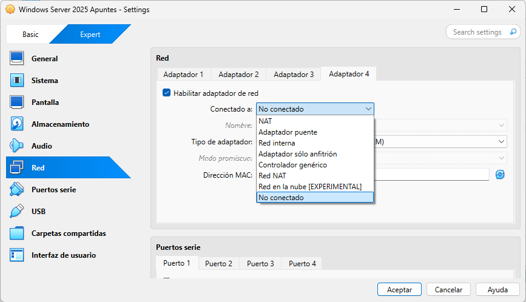
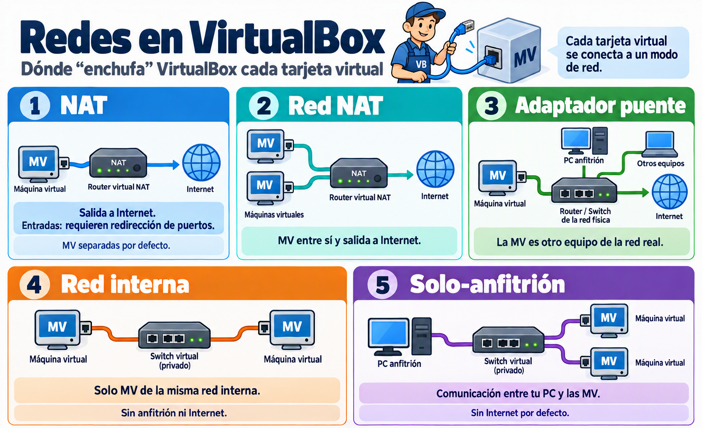
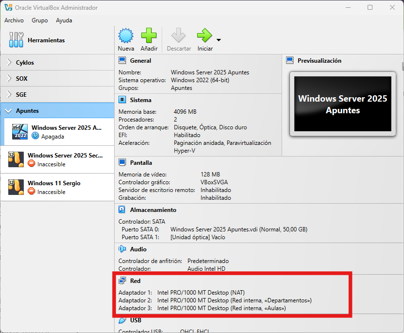

Una MV aislada sirve de poco: necesita descargar actualizaciones, hablar con otras MV o conectarse a tu equipo. VirtualBox decide **a qué red está conectada cada tarjeta virtual** mediante lo que llama *modos de red*. Elegir el modo correcto es la decisión más importante al preparar un laboratorio, y es donde más errores cometen los alumnos.

La analogía: cada MV tiene una **tarjeta de red virtual** y VirtualBox es el "técnico de cableado" que decide dónde enchufa el otro extremo del cable: a un router casero, a la red real, a un switch privado entre MV o a un cable directo con tu PC.

<figure markdown="span" align="center">
  { width="90%" }
  <figcaption>Selección de tipos de red en VirtualBox</figcaption>
</figure>

<!-- IMG: esquema de los 5 modos con host, MV, Internet -->

## Los modos de red

<figure markdown="span" align="center">
  { width="90%" }
  <figcaption>Dónde "enchufa" VirtualBox cada tarjeta según el modo</figcaption>
</figure>

### NAT

Modo **por defecto**. La MV queda detrás de un "router virtual" que comparte la IP del anfitrión, igual que los móviles de tu casa comparten la IP del router.

- La MV sale a Internet sin configurar nada.
- La MV **no es visible** desde fuera: ni desde el anfitrión ni desde otras MV.
- Cada MV con NAT está en su propia red privada aislada.

Valores habituales: IP `10.0.2.15`, puerta de enlace `10.0.2.2`, DNS `10.0.2.3`. Todas las MV en modo NAT tienen **la misma IP**, y no pasa nada porque no se ven entre sí.

!!! tip "Reenvío de puertos"
    Para entrar en una MV NAT hay que abrir un puerto: *Red → Avanzadas → Reenvío de puertos*. Por ejemplo, anfitrión `2222` → invitado `22` permite `ssh -p 2222 usuario@127.0.0.1`.

### Red NAT (*NAT Network*)

Como NAT, pero **varias MV comparten la misma red privada** y sí se ven entre ellas, además de salir a Internet. Hay que crearla antes en *Archivo → Herramientas → Administrador de red* (la ubicación del menú puede variar entre versiones).

### Adaptador puente (*Bridged*)

La MV se conecta **directamente a la red física** como un equipo más: tiene su propia IP del DHCP del router y es visible para todos.

- Visible desde el anfitrión, otras MV y el resto de la red.
- Tiene Internet.
- Posible problema en el aula: la red del centro puede **no dar IP a equipos desconocidos** o limitar un puerto a una sola MAC, y los adaptadores Wi-Fi a veces fallan.

!!! warning "Cuidado con el puente en redes ajenas"
    Un servidor DHCP de una MV con puente puede interferir con el DHCP real de la red del centro. Nunca actives DHCP en una MV conectada en puente sin permiso.

### Red interna

Una red **totalmente aislada** que solo existe entre las MV que tengan el mismo nombre de red (por defecto `intnet`).

- Las MV se ven **entre ellas**.
- **No** hay Internet ni acceso al anfitrión.
- No hay DHCP: hay que configurar IP a mano o montar un servidor DHCP en una MV.

Es el modo ideal para **simular una red de empresa** sin molestar a nadie.

### Solo anfitrión (*Host-only*)

Red privada entre el **anfitrión y las MV**. Útil para que tu PC administre las MV (SSH, escritorio remoto, navegador) sin exponerlas a la red real.

- Las MV se ven entre ellas y con el anfitrión.
- **Sin Internet** (salvo que se añada otra tarjeta).
- Rango habitual: `192.168.56.0/24`, con el anfitrión en `192.168.56.1`.

!!! warning "Cambios en la versión 7.x"
    La gestión de redes *solo anfitrión* ha cambiado entre versiones de VirtualBox, y en las más recientes puede configurarse de otra forma y en otro menú. Comprueba en la versión instalada del aula cómo se crea y qué rango usa por defecto.

## Tabla comparativa

| Modo | MV → Internet | MV ↔ MV | Anfitrión → MV | MV → Anfitrión | Usos |
|------|:---:|:---:|:---:|:---:|------|
| **NAT** | Sí | No | Solo con reenvío de puertos | Limitado (vía `10.0.2.2`) | Navegar, actualizar |
| **Red NAT** | Sí | Sí | Solo con reenvío de puertos | Limitado | Varias MV con Internet |
| **Puente** | Sí | Sí | Sí | Sí | MV como equipo real de la LAN |
| **Red interna** | No | Sí (mismo nombre) | No | No | Simular una red aislada |
| **Solo anfitrión** | No | Sí | Sí | Sí | Administrar MV desde tu PC |

!!! info "Cómo elegir rápido"
    - ¿Solo necesito Internet? → **NAT**.
    - ¿Varias MV que se vean y salgan a Internet? → **Red NAT**.
    - ¿Que la MV sea un equipo más de la red? → **Puente**.
    - ¿Red de empresa simulada y aislada? → **Red interna**.
    - ¿Acceder yo a la MV sin exponerla? → **Solo anfitrión**.

Mas info: [VirtualBox: Tipos de Redes](https://soloconlinux.org.es/virtualbox-tipos-de-redes/)

## Varias tarjetas por MV

Cada MV admite **varios adaptadores** (la interfaz gráfica muestra cuatro) y cada uno puede estar en un modo distinto. Esto permite montar escenarios reales:

| Adaptador | Modo | Para qué |
|-----------|------|----------|
| 1 | NAT o Puente | Salir a Internet |
| 2 | Red interna `red-A` | Conectar con una primera red interna |
| 3 | Red interna `red-B` | Conectar con una segunda red interna |

Es el patrón típico de un servidor que actúa como **router**: una tarjeta hacia Internet y otras dos hacia dos redes internas distintas (por ejemplo, `192.168.0.0/24` y `192.168.100.0/24`). En Packet Tracer no se puede reproducir con 3 tarjetas en un servidor; en VirtualBox **sí**.

<figure markdown="span" align="center">
  { width="90%" }
  <figcaption>Servidor Windows con tres adaptadores: uno hacia Internet y dos redes internas</figcaption>
</figure>

<!-- IMG: diagrama del servidor con las 3 NIC y los clientes en cada red interna -->

## Comprobar y diagnosticar

Dentro de la MV, tras cambiar el modo:

| Sistema | Ver configuración | Probar conectividad |
|---------|-------------------|---------------------|
| Windows | `ipconfig /all` | `ping 8.8.8.8`, `ping nombre.dominio` |
| Linux | `ip a`, `ip route` | `ping -c 4 8.8.8.8` |

Secuencia de diagnóstico, de lo cercano a lo lejano:

1. ¿Tengo IP? (si es `169.254.x.x` en Windows, no ha recibido DHCP).
2. ¿Llego a mi puerta de enlace?
3. ¿Llego a una IP de Internet (`8.8.8.8`)?
4. ¿Resuelvo nombres (DNS)?

!!! warning "El ping puede estar bloqueado"
    El firewall de Windows **bloquea por defecto el ping entrante** (ICMP). Si una MV Windows no responde al ping de otra, no significa que la red falle: revisa antes el firewall.

!!! warning "Cable desconectado"
    En *Red → Avanzadas* hay una casilla **Cable conectado**. Si está desmarcada, la MV no tendrá red aunque todo lo demás esté bien. Es un fallo muy habitual.

## Actividades en clase

### Actividad 1: Prueba los modos

Con la MV de Windows 11 (o una MV Linux ligera), comprueba y documenta con capturas lo siguiente para **NAT**, **Solo anfitrión** y **Red interna**:

1. IP y puerta de enlace que recibe.
2. Si llega a Internet.
3. Si hace ping al anfitrión y el anfitrión a ella.

Rellena una tabla como la de la teoría, pero con **tus resultados**.

??? success "Resultado esperable"
    - NAT: IP del tipo `10.0.2.x`, Internet sí, el anfitrión no la alcanza.
    - Solo anfitrión: IP en el rango de la red del anfitrión, sin Internet, ping bidireccional (si el firewall lo permite).
    - Red interna: sin IP (no hay DHCP), sin Internet.

### Actividad 2: Dos MV, una red

Con dos MV en **Red interna** con el mismo nombre, asigna IP estáticas del rango `192.168.0.0/24` y comprueba que se hacen ping. Luego cambia el nombre de red de una de ellas y comprueba qué ocurre.

??? success "Solución"
    Con el mismo nombre de red y IP del mismo rango, hay ping (si el firewall de Windows no lo bloquea). Al cambiar el nombre de red de una MV ya **no se ven**, aunque la IP sea correcta: están en "switches virtuales" distintos.

### Actividad 3: Elige el modo

¿Qué modo usarías en cada caso?

1. Una MV Linux que solo necesita actualizarse.
2. Servidor y 3 clientes que simulan la red de una empresa, sin salir a la red real.
3. Una MV con un servicio web al que accedes desde el navegador de tu PC, sin Internet.
4. Una MV que debe aparecer como equipo más del aula.

??? success "Solución"
    1. NAT. 2. Red interna. 3. Solo anfitrión. 4. Adaptador puente (si la red del centro lo permite).

## Resumen

- Cada tarjeta virtual tiene un **modo**; se puede usar uno distinto por adaptador.
- **NAT**: Internet, MV invisible. **Red NAT**: varias MV con Internet. **Puente**: equipo más de la LAN. **Red interna**: aislada entre MV. **Solo anfitrión**: MV y anfitrión.
- Un servidor con **tres adaptadores** permite simular un router entre varias redes.
- Diagnostica de cerca a lejos: IP, puerta de enlace, Internet, DNS; sin olvidar firewall y cable virtual.
