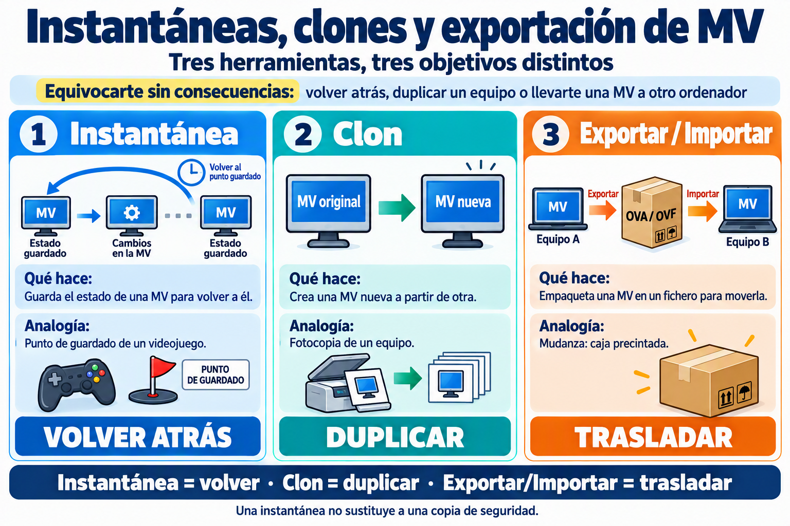
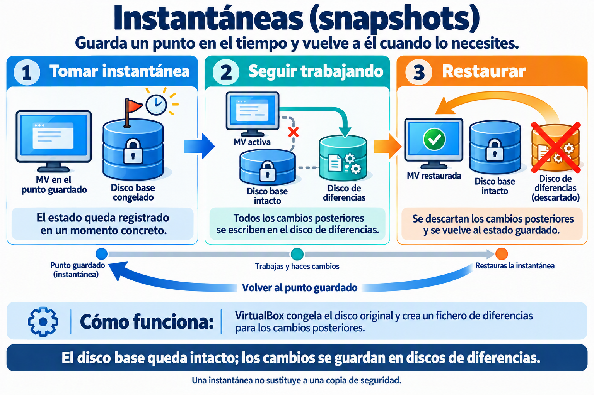

Una de las grandes ventajas de virtualizar es que puedes **equivocarte sin consecuencias**: volver atrás, duplicar un equipo en minutos o llevarte una MV a otro ordenador. VirtualBox ofrece tres herramientas para ello, y confundirlas es un clásico:

| Herramienta | Qué hace | Analogía |
|-------------|----------|----------|
| **Instantánea** | Guarda el estado de una MV para volver a él | Punto de guardado de un videojuego |
| **Clon** | Crea una MV nueva a partir de otra | Fotocopia de un equipo |
| **Exportar/Importar** | Empaqueta una MV en un fichero para moverla | Mudanza: caja precintada |

<figure markdown="span" align="center">
  { width="90%" }
  <figcaption>Tres herramientas, tres objetivos distintos</figcaption>
</figure>

<!-- IMG: esquema comparando las tres herramientas -->

## Instantáneas (*snapshots*)

Una instantánea registra el estado de la MV en un momento concreto. Después puedes **restaurarla** y volver exactamente a ese punto.

### Cómo funciona

Al tomar una instantánea, VirtualBox **congela** el disco original y crea un fichero de **diferencias** donde van todos los cambios posteriores. Restaurar es descartar esas diferencias.

<figure markdown="span" align="center">
  { width="80%" }
  <figcaption>El disco base queda intacto; los cambios se guardan en discos de diferencias</figcaption>
</figure>

<!-- IMG: cadena disco base -> snapshot 1 -> snapshot 2 -> estado actual -->

Si la MV está **encendida** al tomarla, también se guarda el contenido de la RAM, por lo que al restaurar vuelves al instante con los programas abiertos.

### Operaciones

| Operación | Efecto |
|-----------|--------|
| **Tomar** | Guarda el estado actual |
| **Restaurar** | Vuelve al estado guardado y **descarta** lo hecho desde entonces |
| **Eliminar** | Borra el punto de restauración y **fusiona** sus cambios con el siguiente. No deshace nada |

!!! warning "Eliminar no es deshacer"
    Un error muy común: borrar una instantánea **no** devuelve la MV a ese estado. Solo elimina el punto de guardado. Para volver atrás hay que **restaurar**.

!!! warning "Restaurar pierde el trabajo posterior"
    Al restaurar, VirtualBox ofrece guardar antes una instantánea del estado actual. Si dices que no, todo lo hecho desde la instantánea se pierde.

### Buenas prácticas

- Toma una instantánea **antes de cambios arriesgados**: instalar software dudoso, promover un controlador de dominio, tocar el registro.
- Pon **nombres y descripciones claros**: `W11 limpio + Guest Additions`, no `Instantánea 3`.
- No acumules cadenas largas: ocupan disco y **ralentizan** la MV.
- **Una instantánea no es una copia de seguridad.** Depende del disco base: si se pierde o se corrompe, se pierde todo.

!!! tip "Para el proyecto"
    Haz una instantánea **al terminar cada UD** del bloque Windows (instalación limpia, dominio creado, usuarios cargados...). Si algo se rompe, recuperas el punto anterior en segundos.

## Clones

Un clon es una **MV nueva e independiente** a partir de una existente. Sirve para montar rápido varios clientes iguales a partir de una plantilla.

### Tipos de clon

| Tipo | Cómo es | Ventaja | Inconveniente |
|------|---------|---------|---------------|
| **Completo** | Copia de todos los discos | Totalmente independiente | Ocupa más espacio y tarda más |
| **Enlazado** | Comparte el disco base con la original (solo guarda diferencias) | Rápido y ocupa muy poco | **Depende** de la MV original: si la borras o mueves, deja de funcionar |

En el aula, con poco espacio, el clon enlazado es tentador; para el proyecto es más seguro el **completo**.

### Política de direcciones MAC

Al clonar, VirtualBox pregunta qué hacer con las MAC:

- **Generar nuevas MAC** de todas las tarjetas (lo habitual): evita conflictos en la red.
- Mantener la MAC (solo si sabes lo que haces): dos equipos con la misma MAC en la misma red provocan fallos extraños.

### El problema de la identidad duplicada

Clonar copia **todo**, incluida la identidad del sistema. Dos máquinas idénticas en una red pueden dar problemas graves, y en un dominio de Active Directory son un desastre.

| Sistema | Qué se duplica | Qué hacer |
|---------|----------------|-----------|
| **Windows** | Nombre de equipo e identidad del sistema | Cambiar el nombre tras clonar; para plantillas reutilizables, generalizar con **Sysprep** |
| **Linux** | Nombre del equipo, `machine-id`, claves SSH del servidor | Cambiar el nombre (`hostnamectl set-hostname`) y regenerar `machine-id` y claves SSH |

!!! warning "Clonar Windows para unirlo a un dominio"
    Dos equipos con el **mismo nombre** en un dominio entran en conflicto, y un clon de un equipo **ya unido** comparte además su cuenta de equipo con el original. Lo correcto es **clonar antes de unir al dominio** y cambiar el nombre del clon. Para plantillas que se van a reutilizar mucho, se generaliza con **Sysprep**.

!!! tip "Plantilla maestra"
    Prepara una MV "limpia" (SO instalado, Guest Additions, actualizaciones), tómale una instantánea y **no la uses**: clónala siempre. Así ahorras horas de instalación.

## Exportar e importar (OVA/OVF)

*Archivo → Exportar servicio virtualizado* empaqueta la MV en un único fichero para llevarla a otro equipo o entregarla.

| Formato | Qué es |
|---------|--------|
| **OVF** | Estándar abierto: un descriptor XML más los discos por separado |
| **OVA** | Todo comprimido en un único fichero (el más cómodo) |

- Es **compatible** con otros hipervisores (VMware, por ejemplo), aunque conviene probarlo.
- El fichero es **grande** (decenas de GB en un Windows).
- Para importar: *Archivo → Importar servicio virtualizado*, y marca **Reinicializar la dirección MAC** si ya existe la original en tu red.

!!! example "Caso de uso"
    Montas una MV con el servidor ya configurado y se la entregas al profesor en un `.ova`: la importa y la tiene idéntica a la tuya, sin repetir la instalación.

## Línea de comandos: `VBoxManage`

Todo lo anterior se puede automatizar, y mucho más rápido si hay que gestionar muchas MV.

```bash
VBoxManage list vms                                   # listar MV
VBoxManage snapshot "W11-Cliente" take "limpio"       # tomar instantánea
VBoxManage snapshot "W11-Cliente" restore "limpio"    # restaurar
VBoxManage clonevm "W11-Cliente" --name "W11-Cli2" --register   # clonar
VBoxManage export "W11-Cliente" -o w11.ova            # exportar
```

!!! note "Sintaxis"
    En Windows, `VBoxManage` está en la carpeta de instalación de VirtualBox y puede no estar en el `PATH`. Las opciones pueden variar entre versiones: consulta `VBoxManage --help`.

## Actividades en clase

### Actividad 1: Instantánea y restauración

1. Toma una instantánea de tu MV Windows 11 limpia, con nombre y descripción.
2. Crea un fichero en el escritorio e instala algún programa.
3. Restaura la instantánea. ¿Qué ha pasado con el fichero y el programa?
4. Repite el proceso, pero ahora **elimina** la instantánea en lugar de restaurarla. ¿Qué ocurre ahora?

??? success "Solución"
    Al restaurar desaparecen el fichero y el programa (se descartan los cambios posteriores). Al eliminar la instantánea los cambios **se conservan**: solo se pierde el punto de restauración.

### Actividad 2: Clon y exportación

1. Crea un **clon completo** de tu MV con MAC nueva.
2. Arranca ambos clones con red interna y comprueba nombre de equipo e IP. ¿Hay conflicto?
3. Exporta una de las MV a `.ova` y anota el tamaño del fichero.

??? success "Solución"
    Ambos clones tienen el **mismo nombre de equipo**, aunque las MAC distintas eviten conflictos de red; hay que renombrar uno. El tamaño del OVA depende de lo que haya en el disco, no del tamaño máximo del disco virtual.

### Actividad 3: ¿Qué herramienta uso?

1. Voy a probar un programa desconocido y quiero poder deshacerlo.
2. Necesito 10 clientes iguales para una práctica.
3. Quiero llevarme la MV a casa en un pendrive.
4. Quiero una copia de seguridad segura de mi servidor.

??? success "Solución"
    1. Instantánea. 2. Clon (completo o enlazado, a partir de una plantilla). 3. Exportar a OVA. 4. **Exportar o copiar los ficheros de la MV a otro disco**: una instantánea no sirve como copia de seguridad.

## Cierre de la UD05

Con este apartado completas el bloque de virtualización. Ya sabes **qué es** y **qué necesita** (apartado 3), cómo **crear una MV** (4), cómo **conectarla** (5) y cómo **protegerla y reutilizarla** (6). Todo ello es la base de las UD06 a UD09, donde instalarás y configurarás Windows Server.

## Resumen

- **Instantánea**: punto de guardado; restaurar descarta lo posterior; eliminar no deshace.
- **Clon completo** = independiente; **enlazado** = depende de la original.
- Al clonar hay que tratar la **identidad** (nombre, SID, `machine-id`) y renovar MAC.
- **OVA/OVF** sirve para mover o entregar MV; una instantánea **no es una copia de seguridad**.
- `VBoxManage` automatiza todo desde consola.
