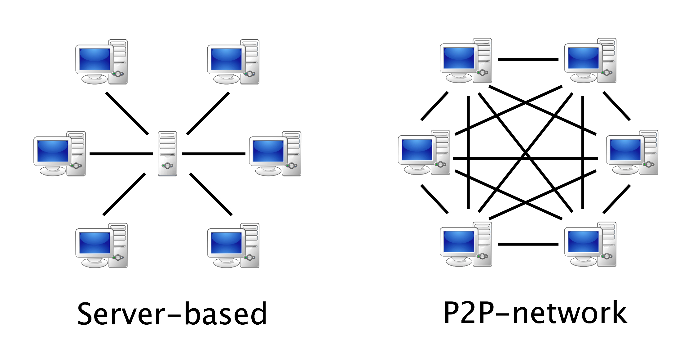
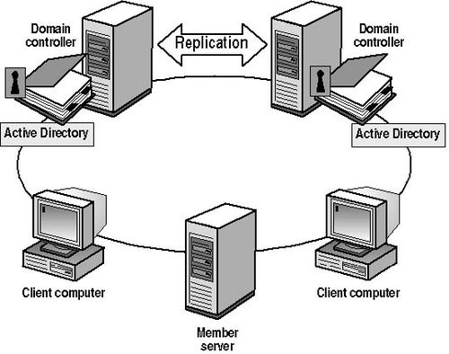

Imagina una comunidad de vecinos donde **cada piso guarda su propia lista de quién tiene llave del portal**. Si llega un inquilino nuevo, hay que avisar piso por piso. Si se va, hay que acordarse de borrarlo de todas las listas. Ahora imagina que existe **una portería con un único registro**: das de alta al inquilino una vez y puede entrar donde le corresponda.

Eso es, en pocas palabras, la diferencia entre un **grupo de trabajo** y un **dominio**. Y el servidor Windows es la portería.

<figure markdown="span" align="center">
  { width="60%" }
  <figcaption>Cada equipo con su lista de usuarios, frente a un registro central en el servidor</figcaption>
</figure>

## Grupo de trabajo frente a dominio

| | Grupo de trabajo (peer to peer) | Dominio (cliente/servidor) |
|---|---|---|
| **Quién guarda los usuarios** | Cada equipo, los suyos | El servidor, una sola vez para toda la red |
| **Alta de un usuario nuevo** | Hay que crearlo en cada equipo | Se crea una vez y vale en todos |
| **Control y seguridad** | Cada equipo se administra por separado | Políticas y permisos centralizados |
| **Coste y complejidad** | Casi nulos | Requiere servidor, licencias y administrador |
| **Cuándo es adecuado** | Pocos equipos y pocas necesidades | Cuando hace falta controlar quién accede a qué |

!!! tip "Cómo decidir"
    Lo que decide no es una cifra mágica de equipos, sino la **necesidad de gestión**. Si hay que controlar accesos, aplicar la misma configuración a todos o recuperar una cuenta olvidada sin pasar equipo por equipo, hace falta un dominio. Para compartir una impresora entre tres portátiles, no.

!!! example "Ejemplo"
    En una empresa como **TechSolutions S.L.**, con varios departamentos y decenas de usuarios, dar de alta a un empleado en grupo de trabajo supone crear su cuenta en cada equipo que pueda usar. Con un dominio, se crea **una vez** en el servidor.

## Qué es el servidor y qué hace

Un **servidor** es un equipo (físico o virtual) que ofrece servicios a otros equipos, llamados **clientes**. Lo que lo convierte en servidor no es el hardware, sino los **roles** que tiene instalados.

- **Rol**: función principal del servidor (por ejemplo, ser controlador de dominio).
- **Característica**: complemento que añade capacidades (por ejemplo, la copia de seguridad).

Los roles más habituales en una red Windows son:

| Rol | Qué hace |
|-----|----------|
| **Servicios de dominio de Active Directory (AD DS)** | Guarda el directorio de usuarios, equipos y grupos |
| **Servidor DNS** | Traduce nombres a direcciones IP |
| **Servidor DHCP** | Reparte direcciones IP |
| **Servicios de archivos** | Comparte carpetas con permisos |
| **Servicios de impresión** | Comparte impresoras |
| **Acceso remoto (RRAS)** | Enruta el tráfico entre redes y ofrece VPN |

!!! note "Servidor dedicado"
    En un entorno real, un controlador de dominio no suele hacer nada más, porque si falla se queda toda la red sin autenticación. En un laboratorio se agrupan varios roles en una sola máquina por falta de recursos, pero **no es lo recomendable**.

## Active Directory en una frase

**Active Directory (AD)** es el servicio de Microsoft que guarda, en una base de datos organizada, todo lo que existe en la red: **usuarios, equipos, grupos, recursos compartidos y políticas**. El servidor que lo guarda y responde a los inicios de sesión se llama **controlador de dominio (DC)**.

Gracias a esto, el usuario inicia sesión **una sola vez** y accede a los recursos para los que tiene permiso.

<figure markdown="span" align="center">
  { width="50%" }
  <figcaption>Modelo de dominio en Windows Server</figcaption>
</figure>

## Windows Server: versión y ediciones

Windows Server se publica en versiones sucesivas (2016, 2019, 2022, 2025…). Estos apuntes usan **Windows Server 2025**, publicado en noviembre de 2024. Cualquier versión reciente funciona de forma muy parecida.

Para aprender no hace falta licencia: Microsoft ofrece una **ISO de evaluación** que se puede usar durante unos **180 días** sin activar.

### Standard y Datacenter

Son las dos ediciones que importan en una pyme o en un centro:

| | Standard | Datacenter |
|---|----------|------------|
| **Pensada para** | Empresas pequeñas y medianas | Entornos muy virtualizados o con alta disponibilidad |
| **Máquinas virtuales con Windows Server incluidas** | Hasta 2 | Ilimitadas |
| **Precio** | Menor | Considerablemente mayor |

!!! info "Otras ediciones"
    Existen más (Essentials, versiones para Azure, etc.), pero quedan fuera del alcance. Para un laboratorio, **Standard** es suficiente.

### Con o sin entorno gráfico

Al instalar hay que elegir entre dos modos, y **no se puede cambiar después**:

| | Desktop Experience | Server Core |
|---|--------------------|-------------|
| **Interfaz** | Gráfica, como un Windows normal | Solo consola |
| **Recursos** | Más RAM y disco | Menos |
| **Superficie de ataque** | Mayor | Menor |
| **Se administra** | En el propio servidor o en remoto | Casi siempre en remoto |

En un laboratorio es habitual **Desktop Experience**, para poder trabajar en el propio servidor. En un entorno profesional, Server Core es muy habitual.

### Licencias, a vista de pájaro

- El **servidor** se licencia **por núcleos** del procesador.
- Además hace falta una **CAL** (*Client Access License*) por cada **usuario** o **dispositivo** que accede al servidor.

!!! warning "Una CAL no es un límite de conexiones simultáneas"
    Se cuenta por usuarios o dispositivos con derecho de acceso, no por conexiones a la vez.

Los detalles de licenciamiento se tratan en la UD05.

## El cliente también cuenta: Windows 11 Pro

Para formar parte de un dominio, el equipo cliente tiene que usar una edición compatible.

!!! danger "Windows 11 Home no se puede unir a un dominio"
    Solo **Pro, Enterprise y Education**. Para comprobar la edición instalada: *Configuración → Sistema → Información*.

## Ideas que conviene tener claras

- Un **dominio no es una red física**: es una agrupación lógica de usuarios, equipos y recursos. Puede haber equipos en la misma red que no pertenezcan al dominio.
- Un **controlador de dominio** no es «un servidor cualquiera»: si se apaga o se estropea, nadie puede iniciar sesión en el dominio.
- Un **rol** se instala; una **edición** se licencia. No se confunden.
- Un **cliente Home** no entra en un dominio, por mucho que la red esté bien.

!!! tip "¿Se te ha olvidado cómo se configura una red?"
    Antes de configurar un servidor repasa el **[Apéndice A: Recordatorio de red](06_09_recordatorio_red.md)**: dirección IP, máscara, puerta de enlace y DNS.

## Resumen

- Grupo de trabajo = cada equipo con sus usuarios. Dominio = usuarios y políticas centralizados en el servidor.
- El servidor se define por sus **roles**; el que guarda el directorio es el **controlador de dominio**.
- Standard y Datacenter se distinguen sobre todo por la virtualización incluida; Desktop Experience y Server Core, por la interfaz.
- El cliente debe ser **Windows 11 Pro** (o Enterprise/Education) para unirse a un dominio.
