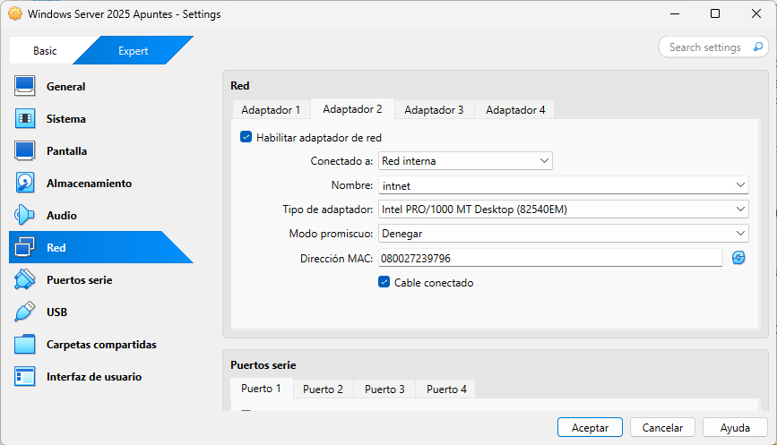
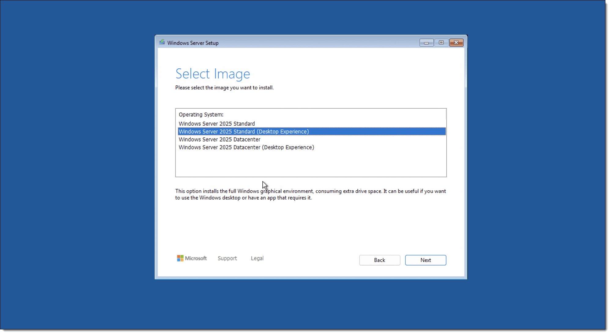
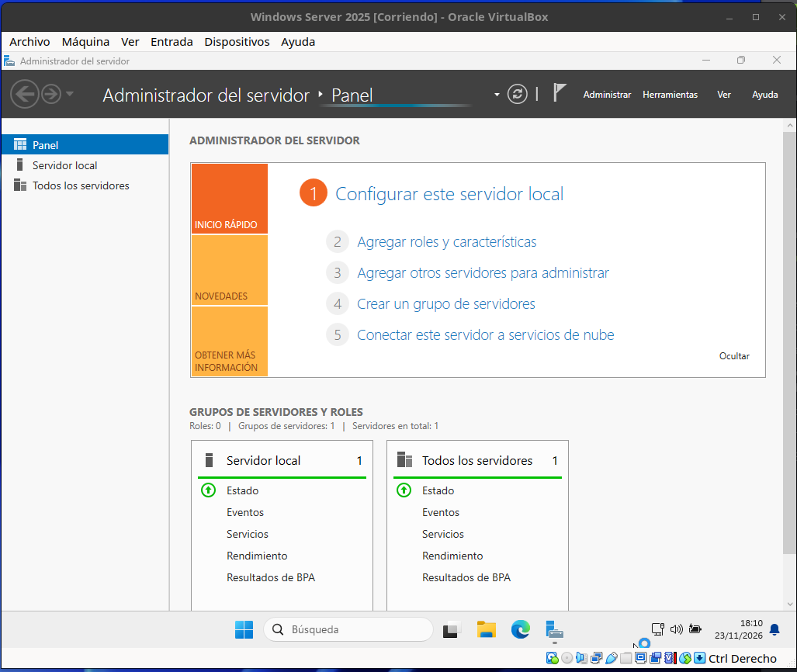
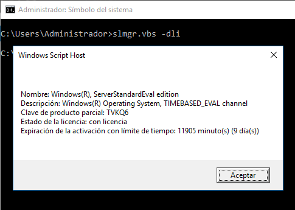
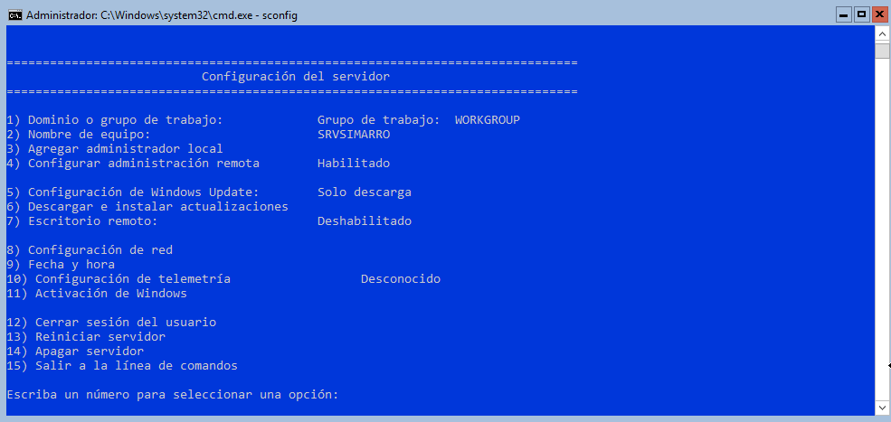

Instalar un servidor se parece mucho a instalar Windows en un PC, pero con tres diferencias que importan: se instala **una vez y debe durar años**, reinstalarlo tiene consecuencias para toda la red, y hay que decidir **qué modo** (con o sin interfaz gráfica) antes de empezar, porque no se puede cambiar después. Por eso conviene **preparar bien la máquina antes de instalar**.

Este apartado describe la secuencia completa, con el motivo de cada decisión. Se explica con una máquina virtual en VirtualBox, pero el proceso es el mismo en un servidor físico, salvo en la preparación del hardware.

## Antes de empezar

### La ISO de evaluación

Microsoft ofrece Windows Server 2025 en su **Centro de evaluación** para probarlo sin licencia durante unos 180 días:

> [Descargar Windows Server 2025 (Centro de evaluación de Microsoft)](https://www.microsoft.com/es-es/evalcenter/download-windows-server-2025)

El formulario pide datos de registro. Elige **ISO** y, si te deja elegir, el idioma **español**.

!!! tip "Elige el idioma con cuidado"
    Los nombres de menús, carpetas y roles cambian entre español e inglés. Mantén el mismo idioma en servidor y clientes para no perderte.

### Recursos del equipo

| Recurso | Mínimo oficial (aprox.) | Recomendado para laboratorio |
|---------|-------------------------|------------------------------|
| RAM | ~2 GB con Desktop Experience | **4 GB** |
| CPU | 1 núcleo | **2 vCPU** |
| Disco | ~32 GB | **60 GB** (dinámico, si es virtual) |

!!! note "Verifica los mínimos"
    Los requisitos oficiales se actualizan: consúltalos en la documentación de Microsoft. Para un controlador de dominio con interfaz gráfica, 4 GB es un valor cómodo.

!!! warning "Haz bien la cuenta de RAM"
    Si el laboratorio es virtual, suma la RAM de todas las MV que vayan a estar encendidas a la vez **más una reserva de unos 4 GB para el anfitrión**. Revisa el dimensionado visto en la UD05.

## Crear la máquina virtual

Si instalas en VirtualBox, esta es la secuencia:

<!-- IMG NUEVA: una captura por paso, en ./imgs/instalacion/ -->

1. Pulsa **Nueva**, escribe un **nombre** para la MV y selecciona la **ISO**.
2. **Tipo:** *Microsoft Windows*. **Versión:** *Windows 2025 (64-bit)* si aparece; si no, *Windows 2022 (64-bit)*.
3. Marca **Omitir instalación desatendida**. Así se ve el instalador real, que es lo que se encuentra en un servidor de verdad.
4. **Hardware:** RAM y CPU según la tabla anterior. Marca **Habilitar EFI**.
5. **Disco:** 60 GB, reservado dinámicamente.
6. Pulsa **Finalizar**, pero **no arranques todavía**.

### Adaptadores de red

El número y el modo de los adaptadores dependen del **papel que tendrá el servidor**. Decídelo antes de arrancar:

| Papel del servidor | Adaptadores | Modos habituales |
|--------------------|:-----------:|------------------|
| Servidor de una sola red (dominio, archivos…) | 1 | Red interna, o NAT si necesita Internet |
| Servidor que da Internet a una red interna (router) | 2 | Uno hacia Internet (NAT o puente) y otro en red interna |
| Servidor que conecta varias redes internas | 3 o más | Uno hacia Internet y uno en red interna por cada red |

<figure markdown="span" align="center">
  { width="70%" }
  <figcaption>Configuración de los adaptadores de red en VirtualBox</figcaption>
</figure>

<!-- IMG NUEVA: vbox_adaptadores.png — Configuración > Red con los adaptadores de la MV -->

!!! tip "Apunta las MAC"
    En *Avanzadas* de cada adaptador aparece su **dirección MAC**. Dentro de Windows las tarjetas se llamarán *Ethernet*, *Ethernet 2*, etc., y es fácil confundir cuál es cuál. La MAC es la forma segura de distinguirlas al configurarlas.

!!! warning "Los nombres de las redes internas deben coincidir"
    El nombre de una red interna distingue mayúsculas de minúsculas y debe escribirse **igual** en todas las MV que se conecten a ella. Si no, no se verán.

### Orden de arranque

En *Sistema → Placa base* comprueba que el orden es **Óptica, Disco duro**. Así la MV arranca desde la ISO la primera vez y desde el disco las siguientes.

## Instalar Windows Server 2025

Arranca la MV. Si aparece el mensaje *«Press any key to boot from CD or DVD»*, **pulsa una tecla** rápidamente.

### Paso a paso

1. **Idioma, formato y teclado.** Elige el idioma y el teclado que realmente usas. Un teclado mal elegido es la causa más habitual de contraseñas que luego «no funcionan».
2. Pulsa **Instalar**.
3. **Clave de producto.** La ISO de evaluación no pide clave. Si la pidiera, elige *No tengo clave de producto*.
4. **Edición.** Aquí está la decisión importante:

<figure markdown="span" align="center">
  { width="70%" }
  <figcaption>Selección de la edición de Windows Server 2025 durante la instalación</figcaption>
</figure>

!!! danger "Cuidado con Server Core"
    La lista muestra la misma edición **dos veces**: una **sin** interfaz gráfica (*Server Core*) y otra con «**Desktop Experience**» (en español, «Experiencia de escritorio»). En las versiones recientes, **la opción sin ese sufijo es Server Core**. Si eliges mal, tendrás que reinstalar, porque no se puede cambiar después. Para trabajar con interfaz gráfica, elige **Standard con Desktop Experience**.

5. **Licencia.** Acepta los términos.
6. **Tipo de instalación.** Elige **Personalizada: instalar solo Windows**. La opción *Actualización* solo sirve si ya hay un Windows Server instalado.
7. **Disco.** Selecciona el disco (*Espacio sin asignar*) y pulsa **Siguiente**. El instalador crea las particiones necesarias (con EFI, tabla GPT).
8. Espera: copia de archivos, instalación y varios reinicios (entre 10 y 30 minutos según el equipo).
9. **Contraseña del Administrador.** Se pide al terminar. Debe cumplir la **complejidad** (mayúsculas, minúsculas, números y símbolos).

!!! warning "Anota y custodia la contraseña"
    Si la pierdes, recuperar el acceso a un servidor es complicado. Guárdala en un sitio seguro, **pero no en el documento de instalación** (apartado de documentación).

10. **Primer inicio de sesión.** Windows pide pulsar **Ctrl + Alt + Supr**. En VirtualBox no sirve el teclado normal: usa el menú **Entrada → Teclado → Insertar Ctrl-Alt-Supr**.

<figure markdown="span" align="center">
  { width="80%" }
  <figcaption>Al iniciar sesión se abre el Administrador del servidor</figcaption>
</figure>

<!-- IMG NUEVA: administrador_servidor_inicio.png — Administrador del servidor recién arrancado -->

Si ves el **Administrador del servidor**, la instalación ha terminado.

### Quitar la ISO

Cuando termine, expulsa la ISO desde *Dispositivos → Unidades ópticas → Quitar disco*. Si no, en algún reinicio puede volver a aparecer el instalador.

## Después de instalar

### Guest Additions (si es una MV)

*Dispositivos → Insertar imagen de CD de las Guest Additions*, ejecuta el instalador desde el Explorador y **reinicia**. Mejora la pantalla, el ratón y el portapapeles.

### Comprobar que todo está bien

| Qué | Cómo | Qué debe verse |
|-----|------|----------------|
| **Versión y edición** | `winver` | Windows Server 2025 |
| **Dispositivos** | *Administrador de dispositivos* | Sin signos de exclamación amarillos |
| **Errores del sistema** | *Visor de eventos → Registros de Windows → Sistema* | Sin errores graves repetidos |
| **Tarjetas de red** | *Panel de control → Redes → Cambiar configuración del adaptador* | Tantas como adaptadores configurados |
| **Periodo de evaluación** | `slmgr /dli` | Tiempo de evaluación restante |

<figure markdown="span" align="center">
  { width="70%" }
  <figcaption>Información de la licencia: tiempo de evaluación restante</figcaption>
</figure>

!!! info "Cuando se acabe el periodo de evaluación"
    El comando `slmgr /rearm` permite ampliar el periodo, pero el número de veces es limitado. Úsalo solo cuando se acerque la fecha de caducidad y reinicia después.

### Instantánea: el punto de seguridad

Con el servidor recién instalado y limpio, apaga la MV y haz una **instantánea** (por ejemplo, *«Windows Server 2025 recién instalado»*). Si algo se rompe más adelante, se vuelve a este punto en segundos sin reinstalar.

## Errores típicos

| Síntoma | Causa probable | Solución |
|---------|----------------|----------|
| Al arrancar solo aparece una consola negra con un menú numerado | Se instaló **Server Core** | Reinstalar eligiendo *Desktop Experience* |
| Vuelve a salir el instalador tras reiniciar | La ISO sigue montada o el orden de arranque es incorrecto | Quitar la ISO y poner el disco duro primero |
| *«Windows no se puede instalar en este disco»* | Desajuste EFI/BIOS con el tipo de partición | Comprobar que **EFI está habilitado** en la MV |
| La contraseña «no funciona» al iniciar sesión | Teclado distinto al elegido durante la instalación | Comprobar el idioma del teclado, usar el botón de ver contraseña |
| La MV va muy lenta | Poca RAM o recursos mal repartidos | Revisar RAM asignada y la reserva del anfitrión |
| No hay tarjetas de red | Adaptadores desactivados en VirtualBox | Revisar *Red → Cable conectado* |

<figure markdown="span" align="center">
  { width="70%" }
  <figcaption>Si ves esto al iniciar, se ha instalado Server Core: la herramienta sconfig sustituye al escritorio</figcaption>
</figure>

## Lista de comprobación

- [ ] La máquina tiene RAM, CPU y disco suficientes, y **EFI** habilitado.
- [ ] Los adaptadores de red corresponden al papel del servidor.
- [ ] Windows Server arranca **con Desktop Experience** y muestra el Administrador del servidor.
- [ ] Las Guest Additions están instaladas (si es una MV).
- [ ] Hay una **instantánea** del estado limpio.

## Con PowerShell (opcional)

??? note "Para alumnado más avanzado"
    Todo esto se puede comprobar desde la consola. **No es necesario para seguir el módulo.**

    | Tarea | Comando |
    |-------|---------|
    | Ver edición instalada | `Get-ComputerInfo -Property WindowsProductName, WindowsEditionId` |
    | Ver si es Core o Desktop Experience | `(Get-ItemProperty 'HKLM:\SOFTWARE\Microsoft\Windows NT\CurrentVersion').InstallationType` |
    | Listar las tarjetas con su MAC | `Get-NetAdapter \| Format-Table Name, MacAddress, Status` |

    **Pregunta de lectura:** el segundo comando devuelve `Server` o `Server Core`. ¿Cuál esperarías en una instalación con Desktop Experience y por qué?

## Resumen

- Se prepara la máquina **antes** de instalar: recursos, EFI y adaptadores de red según el papel del servidor.
- Al instalar hay que elegir la opción **Desktop Experience**; la que no lo indica es Server Core.
- Después se quita la ISO, se instalan las Guest Additions y se comprueban dispositivos, eventos y licencia.
- **Siempre una instantánea del estado limpio** antes de seguir.
