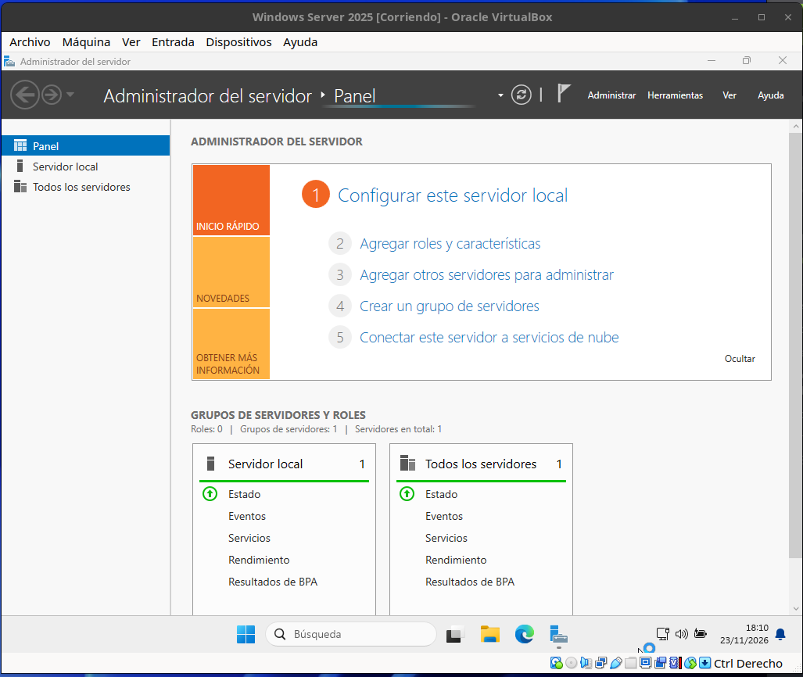
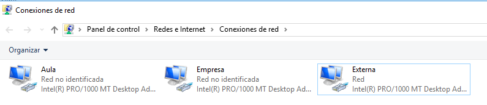
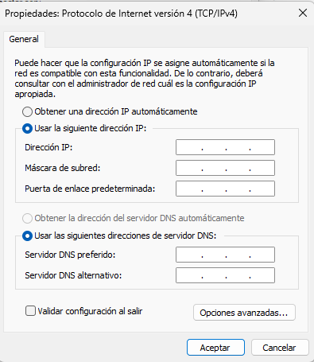
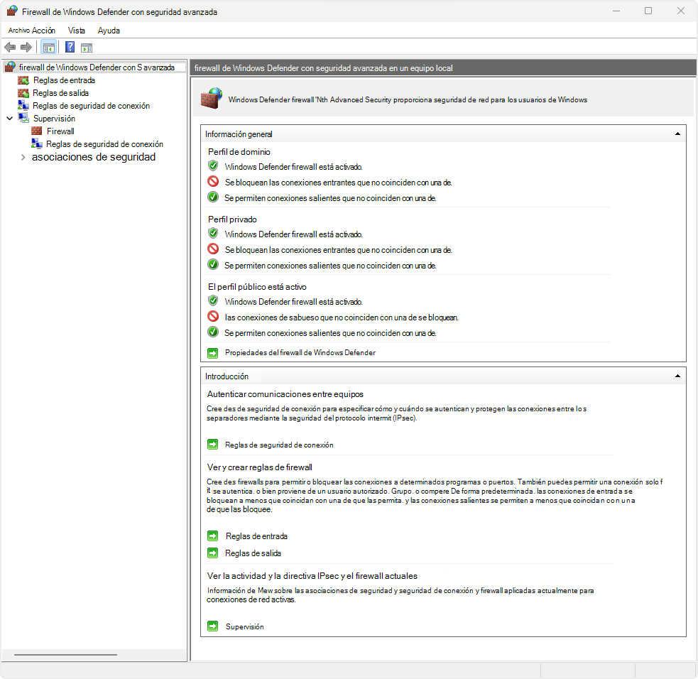
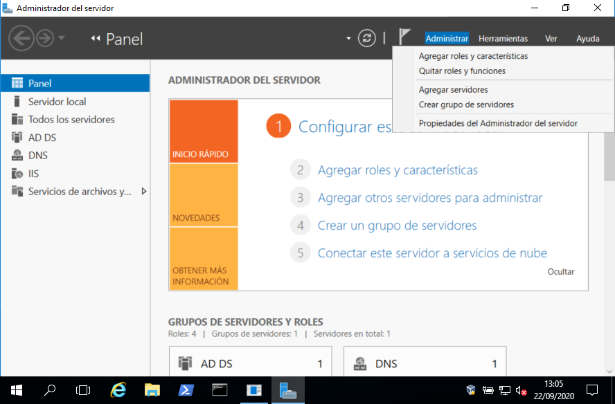
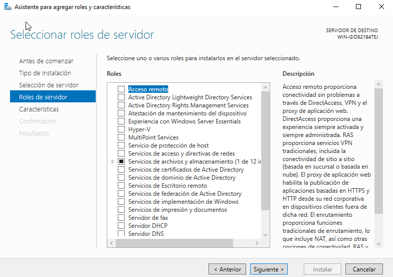

Un servidor recién instalado se comporta como cualquier Windows: todavía no sirve nada a nadie. Antes de convertirlo en controlador de dominio, servidor de archivos o lo que toque, hay que dejarlo con una **configuración base ordenada**: un nombre definitivo, una red bien configurada, el firewall en su sitio, la hora correcta y las actualizaciones bajo control.

Todo esto se hace desde un mismo sitio, el **Administrador del servidor**, en el apartado **Servidor local**. El orden importa: algunas decisiones (el nombre, la red) son muy incómodas de cambiar cuando el servidor ya tiene roles instalados, y la más delicada, **el nombre del equipo, debe fijarse antes de crear un dominio**.

## El Administrador del servidor

Se abre solo al iniciar sesión. Desde **Servidor local** se ven y se modifican las propiedades principales del equipo.

<figure markdown="span" align="center">
  { width="80%" }
  <figcaption>Administrador del servidor: propiedades del servidor local</figcaption>
</figure>

Los valores que vamos a tocar en este apartado aparecen como enlaces azules: **nombre del equipo**, **Ethernet**, **Firewall**, **Zona horaria**, **Windows Update**.

## Nombre del equipo

Es el nombre con el que el servidor se identificará en la red y, más adelante, en el dominio.

Reglas del nombre:

- **Máximo 15 caracteres** (por compatibilidad con NetBIOS).
- Solo **letras, números y guiones**. Sin espacios ni acentos.
- Debe ser **único** en la red.
- Conviene que **diga algo**: rol y número, por ejemplo `SRV01` o `DC01`.

**Pasos**

1. *Administrador del servidor → Servidor local → Nombre de equipo*.
2. Pulsa **Cambiar…** y escribe el nuevo nombre.
3. Acepta y **reinicia**.

<!-- IMG NUEVA: cambiar_nombre_equipo.png — ventana Cambiar nombre o dominio del equipo -->

!!! warning "Cámbialo ahora, no después"
    Renombrar un controlador de dominio ya promocionado es posible pero delicado. Si el servidor va a ser DC, **elige el nombre definitivo antes de instalar Active Directory**.

## Configuración de red

Un servidor debe tener una **dirección IP estática**: otros equipos lo buscan siempre en la misma dirección, y si cambiara, dejarían de encontrarlo.

Para recordar qué significa cada parámetro, consulta el **[Apéndice A: Recordatorio de red](06_09_recordatorio_red.md)**.

### Dónde se configura

*Servidor local → Ethernet* (o desde el Panel de control: *Redes e Internet → Centro de redes → Cambiar configuración del adaptador*).

<figure markdown="span" align="center">
  { width="80%" }
  <figcaption>Panel de control: conexiones de red</figcaption>
</figure>

Sobre el adaptador: clic derecho → **Propiedades** → **Protocolo de Internet versión 4 (TCP/IPv4)** → **Propiedades**.

<figure markdown="span" align="center">
  { width="70%" }
  <figcaption>Propiedades de TCP/IPv4: dirección IP, máscara, puerta de enlace y DNS</figcaption>
</figure>

### Qué poner en cada campo

| Parámetro | Qué indica | Regla práctica |
|-----------|------------|----------------|
| **Dirección IP** | Identidad del servidor en esa red | Fija, dentro del rango de la red |
| **Máscara de subred** | Qué parte de la IP es la red | La misma que el resto de equipos de esa red |
| **Puerta de enlace** | Por dónde se sale a otras redes | Solo en el adaptador que da salida fuera de la red |
| **Servidor DNS** | Quién resuelve los nombres | Depende del rol (ver más abajo) |

!!! danger "Una sola puerta de enlace"
    Si el servidor tiene **varios adaptadores**, **solo uno** debe llevar puerta de enlace: el que da salida hacia fuera (Internet u otra red). Con dos puertas de enlace el servidor no sabe por dónde enviar los paquetes y la conectividad se vuelve errática.

!!! warning "El DNS cambia con el rol"
    - **Antes** de ser controlador de dominio, puede apuntar a un DNS externo, para poder descargar actualizaciones.
    - **Cuando sea controlador de dominio**, su DNS debe ser **él mismo**. Lo veremos en el apartado del dominio.
    - Los **clientes del dominio** deben usar siempre como DNS al controlador de dominio, no uno público.

### Varios adaptadores: identificarlos y nombrarlos

Windows nombra las tarjetas por orden: *Ethernet*, *Ethernet 2*, *Ethernet 3*… sin indicar a qué red está conectada cada una. En un servidor con varias tarjetas conviene:

1. **Identificar** cada adaptador por su dirección MAC (*Ethernet → Estado → Detalles* o `ipconfig /all`).
2. **Renombrarlo** con algo descriptivo (clic derecho → *Cambiar nombre*): `Internet`, `LAN-oficina`, etc.

!!! tip "Nombrar bien ahorra errores"
    Cuando un servidor tiene tres tarjetas, «Ethernet 2» no significa nada. Un nombre claro evita configurar la IP en la tarjeta equivocada.

### IPv6

Si no se usa IPv6 en la red, es frecuente desmarcarlo en las propiedades del adaptador para simplificar el laboratorio.

!!! note "Precaución"
    Microsoft no recomienda deshabilitar IPv6 en equipos de producción, porque algunos componentes del sistema dependen de él. En un laboratorio no suele dar problemas, pero en un entorno real conviene consultar la documentación antes de hacerlo.

### Comprobar la configuración

Con una ventana de símbolo del sistema:

| Comando | Qué comprueba |
|---------|---------------|
| `ipconfig /all` | IP, máscara, puerta de enlace, DNS y MAC de cada adaptador |
| `ping <puerta de enlace>` | Que llegas a tu router o red de salida |
| `ping 8.8.8.8` | Que sales a Internet por IP |
| `ping www.google.com` | Que además el DNS funciona |
| `route print` | La tabla de rutas del servidor |

Interpreta el resultado **de cerca a lejos**: si falla el ping a la puerta de enlace, no tiene sentido probar Internet.

## Firewall de Windows

El firewall viene **activado** y bloquea por defecto el tráfico entrante no solicitado, **incluido el ping** (ICMP). Por eso un servidor recién instalado «no responde al ping» aunque la red esté bien: no está estropeado, está protegido.

<figure markdown="span" align="center">
  { width="70%" }
  <figcaption>Firewall de Windows Defender con seguridad avanzada</figcaption>
</figure>

!!! danger "No lo desactives"
    Es tentador apagar el firewall para que «todo funcione». Un servidor con el firewall apagado queda expuesto. Lo correcto es **abrir solo lo que hace falta**.

### Permitir el ping (ICMP)

Windows ya trae una regla predefinida, desactivada por defecto. Solo hay que **habilitarla**:

1. Abre **Firewall de Windows Defender con seguridad avanzada** (búscalo desde el menú Inicio).
2. Entra en **Reglas de entrada**.
3. Busca **Compartir archivos e impresoras (petición eco: ICMPv4 de entrada)**.
4. Clic derecho → **Habilitar regla**.

<!-- IMG NUEVA: regla_icmp_habilitar.png — reglas de entrada con la regla de eco ICMPv4 habilitada -->

!!! note "Una regla por perfil"
    Hay una regla por cada **perfil de red** (dominio, privado, público). Habilita la que corresponda al perfil de la red de tu servidor. Cuando el servidor pase a formar parte de un dominio, la red pasará a perfil **Dominio**.

??? info "Alternativa: crear una regla propia"
    Si no encuentras la regla predefinida, o quieres restringirla a ciertas direcciones:

    1. *Reglas de entrada → Nueva regla…*
    2. **Personalizada** → todos los programas → protocolo **ICMPv4**.
    3. Elige el ámbito (cualquier IP, o un rango concreto).
    4. **Permitir la conexión**, selecciona los perfiles y ponle un nombre.

!!! tip "Hazlo en todos los equipos Windows"
    La misma regla hay que habilitarla en los **clientes**: si no, el servidor no podrá hacer ping a ellos aunque ellos sí puedan hacerlo al servidor.

## Hora y zona horaria

Parece un detalle menor, pero en un dominio **la hora es crítica**: la autenticación (Kerberos) falla si el reloj de un equipo se desvía más de unos **5 minutos** del controlador de dominio.

1. *Servidor local → Zona horaria* → **Cambiar zona horaria**.
2. Selecciona la zona correcta.
3. Verifica la hora.

En una MV, la hora puede desviarse por la suspensión o las instantáneas. Comprueba el estado con:

```
w32tm /query /status
```

## Actualizaciones

Mantener un servidor actualizado es esencial para la seguridad, pero con una diferencia respecto a un equipo cliente: **un servidor no se puede reiniciar cuando le apetece al sistema**, porque da servicio a otros equipos.

| Estrategia | Ventaja | Riesgo |
|------------|---------|--------|
| **Instalación automática** | Siempre al día | Reinicios inesperados; una actualización problemática afecta a todo |
| **Descargar y avisar** | Tú eliges cuándo instalar | Hay que acordarse de hacerlo |
| **Pausar o manual** | Control total | Se acumulan vulnerabilidades |

En un entorno profesional se suelen instalar **en una ventana de mantenimiento**, con una copia o instantánea previa. En un laboratorio con muchos equipos descargando a la vez, puede interesar limitar o pausar las descargas para no saturar la red.

<!-- IMG NUEVA: windows_update_pausa.png — pantalla de Windows Update del servidor -->

!!! warning "Antes de actualizar, instantánea"
    Si el servidor es una MV, haz una instantánea antes de aplicar actualizaciones importantes.

## Roles y características

Hasta ahora el servidor es un Windows con nombre y red. Lo que lo convierte en **servidor de algo** son los roles y las características.

- **Rol**: servicio principal (dominio, DNS, DHCP, archivos…).
- **Característica**: complemento (copia de seguridad, cifrado…).

### Cómo instalarlos

1. *Administrador del servidor → Administrar → Agregar roles y características*.

<figure markdown="span" align="center">
  { width="70%" }
  <figcaption>Menú Administrar → Agregar roles y características</figcaption>
</figure>

2. Selecciona **Instalación basada en características o en roles**.
3. Elige el **servidor de destino** (el local).
4. Marca el **rol** que quieres instalar y acepta las **características adicionales** que pida.
5. Revisa y pulsa **Instalar**. Reinicia si lo pide.

<figure markdown="span" align="center">
  { width="70%" }
  <figcaption>Asistente para la instalación de roles y características</figcaption>
</figure>

!!! info "Instalar el rol no es configurarlo"
    En muchos roles, la instalación solo copia los componentes. Después hay que **configurarlo** con un asistente posterior (por ejemplo, promocionar el servidor a controlador de dominio). Lo veremos rol por rol.

## Errores típicos

| Síntoma | Causa probable | Solución |
|---------|----------------|----------|
| El servidor no responde al ping | Firewall: regla ICMP deshabilitada | Habilitar la regla de eco de ICMPv4 |
| Se llega a la red local pero no a Internet | Falta puerta de enlace o está en el adaptador equivocado | Revisar `ipconfig /all` y la tabla de rutas |
| Conectividad errática con varias tarjetas | Más de una puerta de enlace | Dejarla solo en el adaptador de salida |
| Se llega a Internet por IP pero no por nombre | DNS incorrecto | Revisar el servidor DNS del adaptador |
| Se configuró la IP en la tarjeta equivocada | Adaptadores sin identificar | Comprobar por MAC y renombrar |
| Fallos de autenticación en el dominio | Hora desajustada | Corregir zona horaria y sincronizar |
| No deja poner el nombre | Más de 15 caracteres o caracteres no válidos | Ajustar el nombre |

## Lista de comprobación

- [ ] El servidor tiene un **nombre definitivo** de máximo 15 caracteres.
- [ ] Cada adaptador tiene **IP estática** y el nombre descriptivo.
- [ ] Solo el adaptador de salida tiene **puerta de enlace**.
- [ ] `ping` funciona hasta la puerta de enlace, a una IP de Internet y a un nombre.
- [ ] El **firewall sigue activado** y la regla de eco ICMPv4 está habilitada.
- [ ] **Zona horaria** y hora correctas.
- [ ] Sabes cómo **instalar un rol** desde el Administrador del servidor.

## Con PowerShell (opcional)

??? note "Para alumnado más avanzado"
    Todo lo anterior se puede hacer desde la consola. **No es necesario para seguir el módulo.**

    | Tarea | Comando |
    |-------|---------|
    | Cambiar el nombre y reiniciar | `Rename-Computer -NewName "SRV01" -Restart` |
    | Renombrar un adaptador | `Rename-NetAdapter -Name "Ethernet" -NewName "Internet"` |
    | Desactivar DHCP en el adaptador | `Set-NetIPInterface -InterfaceAlias "Internet" -Dhcp Disabled` |
    | Asignar IP, máscara y puerta de enlace | `New-NetIPAddress -InterfaceAlias "Internet" -IPAddress 192.168.1.10 -PrefixLength 24 -DefaultGateway 192.168.1.1` |
    | Asignar DNS | `Set-DnsClientServerAddress -InterfaceAlias "Internet" -ServerAddresses 192.168.1.1` |
    | Ver los adaptadores y su MAC | `Get-NetAdapter` |
    | Habilitar el ping | `Enable-NetFirewallRule -DisplayName "File and Printer Sharing (Echo Request - ICMPv4-In)"` |
    | Cambiar la zona horaria | `Set-TimeZone -Id "Romance Standard Time"` |
    | Ver los roles disponibles | `Get-WindowsFeature` |
    | Instalar un rol | `Install-WindowsFeature -Name <rol> -IncludeManagementTools` |

    **Preguntas de lectura**

    1. ¿Por qué hay que desactivar DHCP antes de asignar una IP estática?
    2. ¿Qué diferencia hay entre `-PrefixLength 24` y la máscara `255.255.255.0`?
    3. El nombre de la regla de firewall aparece en inglés. ¿Qué pasaría si el servidor estuviera en español?

    !!! note "Nombre de la regla"
        `DisplayName` depende del idioma del sistema. Si falla, lista las reglas con `Get-NetFirewallRule` y busca la de ICMPv4.

## Resumen

- La configuración base se hace desde el **Administrador del servidor → Servidor local**.
- El **nombre** se fija antes de crear el dominio; la **IP** es estática; solo una **puerta de enlace**.
- El **firewall se queda activado**: se habilita solo la regla del ping.
- La **hora** importa en un dominio, y las **actualizaciones** se instalan de forma controlada.
- Los **roles** son lo que hace de un Windows un servidor: se instalan desde el asistente, y luego se configuran.
