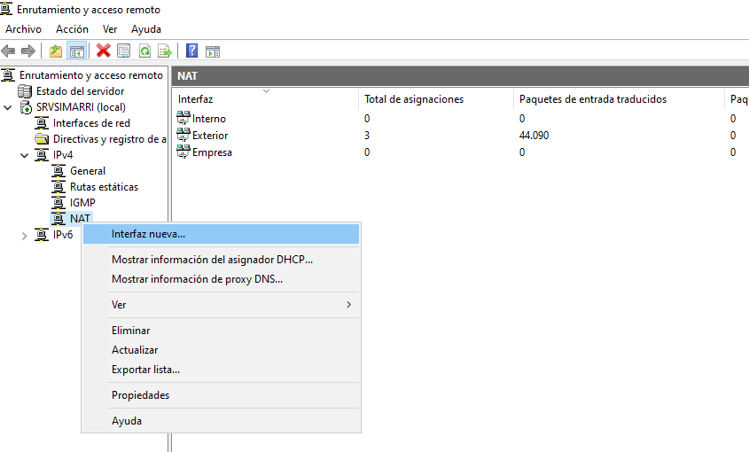

Imagina un edificio donde ningún vecino tiene línea directa con el exterior: **solo el portero sale a la calle**. Cuando un vecino quiere algo de fuera, se lo pide al portero, el portero va, lo trae y se lo entrega. Desde fuera, nadie sabe que hay vecinos: solo ven al portero.

Un servidor Windows con **dos o más tarjetas de red** puede hacer exactamente de portero: recibe el tráfico de los equipos de una red interna, lo envía hacia Internet con **su propia dirección** y devuelve las respuestas a quien las pidió. A esto se le llama **enrutar con NAT**.

!!! info "¿Por qué hacerlo con un servidor?"
    En una red real esta función la hace un **router o firewall dedicado**. Convertir un Windows Server en router es habitual en **laboratorios**, redes muy pequeñas o para aprender cómo funciona el proceso, pero no es lo normal en producción.

## Conceptos mínimos

| Concepto | Qué hace | Por qué hace falta |
|----------|----------|--------------------|
| **Enrutar** | Pasar paquetes de una red a otra | Una tarjeta no «sabe» reenviar tráfico de otra si no se activa |
| **NAT** (*Network Address Translation*) | Sustituir la IP privada de origen por la IP de la tarjeta externa | Las IP privadas no se enrutan por Internet (ver UD03) |
| **Puerta de enlace del cliente** | A quién envía el cliente lo que no es de su red | Debe ser la IP **interna** del servidor |

El recorrido de un paquete es este:

```
Cliente (red interna)  →  Servidor (tarjeta interna)  →  Servidor (tarjeta externa)  →  Internet
 IP origen privada         recibe y reenvía               NAT: cambia la IP origen        responde al servidor
```

Cuando llega la respuesta, el servidor recuerda quién la pidió y se la entrega al cliente correcto.

## Requisitos previos

Antes de activar el enrutamiento comprueba lo hecho en el apartado anterior:

- [ ] La tarjeta **externa** tiene IP, máscara, **puerta de enlace** y DNS, y **el propio servidor sale a Internet** (`ping 8.8.8.8`).
- [ ] La tarjeta (o tarjetas) **interna** tiene una IP fija de su red y **sin puerta de enlace**.
- [ ] Los adaptadores tienen **nombres descriptivos**, para no confundir cuál es el externo.

!!! warning "Si el servidor no sale a Internet, los clientes tampoco"
    El servidor solo reenvía lo que él mismo puede alcanzar. Comprueba primero su propia conectividad.

## Instalar el servicio de enrutamiento

El enrutamiento forma parte del rol **Acceso remoto**.

1. *Administrador del servidor → Administrar → Agregar roles y características* (el proceso es el del apartado anterior).
2. Marca el rol **Acceso remoto**.
3. En **Servicios de rol**, marca **Enrutamiento**. El asistente añadirá **DirectAccess y VPN (RAS)** como dependencia: acéptalo.
4. Completa el asistente e instala.

<!-- IMG NUEVA: rol_acceso_remoto.png — selección de servicios de rol de Acceso remoto -->

!!! note "Instalar no es configurar"
    Hasta aquí solo se han copiado los componentes. El enrutamiento todavía no está activo.

## Configurar y habilitar el enrutamiento con NAT

1. *Administrador del servidor → Herramientas → **Enrutamiento y acceso remoto***.

<figure markdown="span" align="center">
  { width="70%" }
  <figcaption>Consola de Enrutamiento y acceso remoto</figcaption>
</figure>

2. Clic derecho sobre el nombre del servidor → **Configurar y habilitar Enrutamiento y acceso remoto**.
3. En el asistente, elige **Traducción de direcciones de red (NAT)**.
4. Selecciona **Usar esta interfaz pública para conectarse a Internet** y marca la **tarjeta externa**.
5. Cuando el asistente avise de que no hay servicios DNS ni DHCP configurados, elige **configurarlos más tarde**: los instalaremos aparte.
6. Finaliza. El servicio arranca y el icono del servidor pasa a **verde**.

<!-- IMG NUEVA: rras_asistente_nat.png — pantalla del asistente con la interfaz pública seleccionada -->

!!! danger "Cuidado: no elijas la interfaz equivocada"
    Si marcas como pública la tarjeta interna, el NAT funcionará al revés y los clientes no saldrán. Es el error más común, y la razón de dar nombres claros a los adaptadores.

### Si hay más de una red interna

El asistente solo permite configurar **una** tarjeta interna. Para añadir el resto:

1. En la consola, despliega **servidor → IPv4 → NAT**.
2. Clic derecho en **NAT → Nueva interfaz…**
3. Selecciona la tarjeta interna adicional.
4. Marca **Interfaz privada conectada a la red privada**.

<!-- IMG NUEVA: rras_nueva_interfaz_nat.png — ventana de nueva interfaz NAT -->

!!! info "Entre redes internas no hace falta NAT"
    Con el enrutamiento activo, el servidor ya comunica entre sí las redes internas a las que está conectado. El NAT solo se aplica en la tarjeta **pública**, hacia el exterior.

## Configurar los clientes

Para que un cliente use el servidor como salida, en sus propiedades de IPv4 hay que indicar:

| Parámetro | Valor |
|-----------|-------|
| **IP** | Una IP libre del rango de la red interna del cliente |
| **Máscara** | La de esa red |
| **Puerta de enlace** | La **IP interna del servidor** en esa red |
| **DNS** | De momento, un DNS público; cuando exista un controlador de dominio, la IP del controlador |

!!! tip "Una puerta de enlace por red"
    Cada red interna tiene como puerta de enlace la IP que el servidor tiene **en esa red**, no la de otra tarjeta.

## Verificar que funciona

Se comprueba **de cerca a lejos**, desde un cliente:

| Prueba | Qué demuestra |
|--------|---------------|
| `ping <IP interna del servidor>` | El cliente llega al servidor |
| `ping 8.8.8.8` | El servidor reenvía y hace NAT |
| `ping www.google.com` | Además el DNS responde |
| `tracert 8.8.8.8` | El **primer salto** es la IP interna del servidor |

El primer salto de `tracert` es la prueba definitiva de que el tráfico pasa por el servidor.

!!! warning "El firewall del servidor"
    Si el cliente no puede hacer `ping` al servidor, revisa antes que la regla de eco ICMPv4 esté habilitada en el servidor (apartado anterior).

## Errores típicos

| Síntoma | Causa probable | Solución |
|---------|----------------|----------|
| El cliente no llega ni al servidor | IP o máscara mal configuradas, o redes internas con nombres distintos | Revisar IP y nombre de la red interna |
| El cliente llega al servidor pero no a Internet | Puerta de enlace del cliente incorrecta | Debe ser la IP interna del servidor |
| El servidor sí sale, el cliente no | NAT con la interfaz pública mal elegida o enrutamiento sin activar | Revisar la consola de Enrutamiento y acceso remoto |
| `ping 8.8.8.8` va, pero no los nombres | DNS del cliente incorrecto | Poner un DNS válido |
| Funciona, pero tras reiniciar no | Servicio no iniciado | Revisar que el servicio *Enrutamiento y acceso remoto* arranca automáticamente |
| Una red interna sale y otra no | Esa tarjeta no se añadió como interfaz privada | Añadirla en IPv4 → NAT |

## Lista de comprobación

- [ ] El servidor tiene la tarjeta **externa** con puerta de enlace y la(s) **interna(s)** sin ella.
- [ ] El rol **Acceso remoto → Enrutamiento** está instalado.
- [ ] En la consola, la **interfaz pública** es la externa y las internas están como **privadas**.
- [ ] Los clientes tienen como **puerta de enlace** la IP interna del servidor.
- [ ] `tracert` desde un cliente muestra al servidor como primer salto.

## Con PowerShell (opcional)

??? note "Para alumnado más avanzado"
    La **instalación** del servicio se puede hacer por consola. **No es necesario para seguir el módulo.**

    | Tarea | Comando |
    |-------|---------|
    | Instalar el rol y la herramienta de enrutamiento | `Install-WindowsFeature RemoteAccess, Routing -IncludeManagementTools` |
    | Habilitar el enrutamiento (sin VPN) | `Install-RemoteAccess -VpnType RoutingOnly` |
    | Ver el estado | `Get-RemoteAccess` |

    **Pregunta de lectura:** ¿qué diferencia hay entre *instalar un rol* y *habilitar el servicio*?

    !!! note "La configuración del NAT"
        La parte del NAT (qué interfaz es pública y cuáles privadas) se hace en la consola gráfica en estos apuntes. Su equivalente por línea de comandos usa herramientas más antiguas (`netsh`) y queda fuera de este módulo. Verifica los nombres de los cmdlets en tu versión de Windows Server, que han cambiado entre versiones.

## Resumen

- Un servidor con varias tarjetas puede **enrutar** el tráfico entre redes y hacer **NAT** hacia Internet.
- Se instala con el rol **Acceso remoto → Enrutamiento** y se activa en la consola de **Enrutamiento y acceso remoto**.
- Hay que indicar cuál es la **interfaz pública** y cuáles son **privadas**.
- Los clientes usan como **puerta de enlace** la IP interna del servidor.
- Se verifica **de cerca a lejos**, y `tracert` confirma que el tráfico pasa por el servidor.
