Un disco recién añadido a un servidor es como un **terreno sin urbanizar**: tiene espacio, pero no se puede construir nada hasta que se marcan las parcelas y se les asigna un uso. Preparar un disco consiste justo en eso: **inicializarlo** (decidir cómo se numeran las parcelas), **crear volúmenes** (las parcelas) y **darles formato** (urbanizarlas para poder guardar archivos).

En un servidor esto es especialmente importante porque los datos de los usuarios, las bases de datos o las copias de seguridad **no deberían vivir en el mismo disco que el sistema operativo**.

!!! tip "¿Por qué un disco de datos aparte?"
    - Si hay que **reinstalar el sistema**, los datos no se tocan.
    - Se pueden aplicar **copias de seguridad, cuotas y permisos** por separado.
    - Si el disco del sistema se llena, el servidor deja de funcionar; si se llena el de datos, solo falla el servicio que lo usa.

## Conceptos mínimos

### Disco, tabla de particiones y volumen

| Concepto | Qué es |
|----------|--------|
| **Disco** | El dispositivo (físico o virtual) |
| **Tabla de particiones** | El «plano» del disco: dónde empieza y acaba cada parcela |
| **Volumen** (partición) | Una parcela con su sistema de archivos y, normalmente, una letra de unidad |
| **Sistema de archivos** | Cómo se organizan los datos dentro del volumen (NTFS, ReFS…) |

### MBR y GPT

| | MBR | GPT |
|---|-----|-----|
| **Tamaño máximo de disco** | 2 TB | Prácticamente sin límite |
| **Particiones** | 4 primarias (o 3 + 1 extendida) | Hasta 128 en Windows |
| **Arranque** | BIOS clásica | UEFI |
| **Uso recomendado** | Equipos antiguos | **Cualquier equipo actual** |

Para discos de datos nuevos, **GPT**.

### NTFS y ReFS

- **NTFS** es el sistema de archivos habitual de Windows: permisos, cifrado, compresión, cuotas. Es la opción general para datos de usuarios.
- **ReFS** está orientado a resiliencia y a grandes volúmenes (por ejemplo, almacenamiento de máquinas virtuales). No admite algunas funciones de NTFS.

En este módulo usaremos **NTFS**.

!!! note "Verifica las limitaciones de ReFS"
    Qué funciones de NTFS no admite ReFS varía entre versiones de Windows Server. Consulta la documentación de Microsoft antes de elegirlo para un caso real.

## Añadir un disco (si es una MV)

En VirtualBox, con la MV **apagada**:

1. *Configuración → Almacenamiento*.
2. Sobre el controlador SATA, pulsa **Añadir disco duro**.
3. **Crear** un disco nuevo (VDI, reservado dinámicamente) del tamaño deseado.
4. Acepta y arranca la MV.

<!-- IMG NUEVA: vbox_nuevo_disco.png — Configuración > Almacenamiento con el disco añadido -->

## Preparar un disco

Todo se hace desde la herramienta **Administración de discos** (clic derecho en Inicio → *Administración de discos*, o `diskmgmt.msc`).

<figure markdown="span" align="center">
  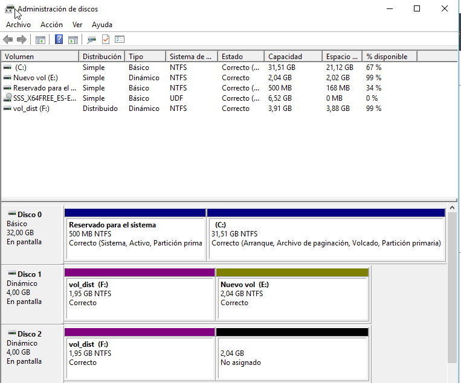{ width="80%" }
  <figcaption>Administración de discos: cada disco con sus volúmenes</figcaption>
</figure>

### 1. Inicializar

Al abrirla con un disco nuevo, aparece una ventana para **inicializarlo**. Elige **GPT** y acepta.

<figure markdown="span" align="center">
  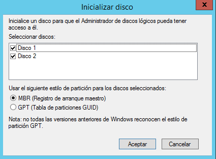{ width="50%" }
  <figcaption>Inicializar disco: elegir MBR o GPT</figcaption>
</figure>

!!! warning "Si no aparece la ventana"
    Haz clic derecho sobre el disco (en la parte izquierda, donde pone «Disco 1») → **Inicializar disco**. Si el disco aparece **«Sin conexión»**, clic derecho → **En línea** primero.

### 2. Crear un volumen simple

Clic derecho en el **espacio sin asignar** del disco → **Nuevo volumen simple**. Se abre un asistente:

<figure markdown="span" align="center">
  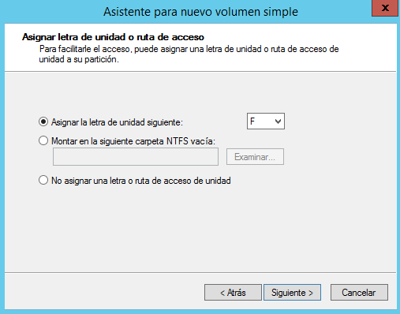{ width="50%" }
  <figcaption>Asistente para nuevo volumen simple</figcaption>
</figure>

1. **Tamaño.** Por defecto ocupa todo el espacio libre; puedes indicar menos si quieres crear varios.
2. **Letra de unidad** o **carpeta de montaje**. Windows permite acceder a un volumen por una letra (`E:`) o «montándolo» en una carpeta vacía de otro volumen, como en Linux.

<figure markdown="span" align="center">
  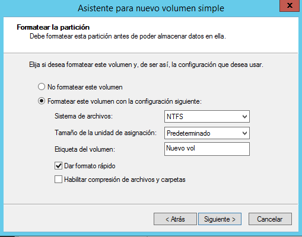{ width="50%" }
  <figcaption>Asignación de letra de unidad o carpeta</figcaption>
</figure>

3. **Formato.** Sistema de archivos **NTFS**, tamaño de unidad de asignación **predeterminado**, una **etiqueta** descriptiva (por ejemplo, `Datos`) y **formato rápido** marcado.
4. Revisa el resumen y pulsa **Finalizar**.

!!! tip "Pon etiquetas claras"
    Con más de un disco, «Nuevo vol (E:)» no dice nada. `Datos`, `Copias` o `Usuarios` sí.

### 3. Modificar un volumen existente

Desde el menú contextual de un volumen puedes:

| Acción | Cuándo |
|--------|--------|
| **Cambiar letra o ruta** | Para ordenar las unidades |
| **Extender volumen** | Cuando se queda corto y hay espacio sin asignar **contiguo, a su derecha** |
| **Reducir volumen** | Para liberar espacio y crear otro volumen |
| **Dar formato** | Para borrar todo su contenido |
| **Eliminar volumen** | Para devolver el espacio como «sin asignar» (borra los datos) |

!!! danger "Dar formato o eliminar destruye los datos"
    Antes de tocar un volumen con información, asegúrate de que hay copia.

## RAID: qué es y para qué sirve

**RAID** (*Redundant Array of Independent Disks*) combina varios discos para conseguir **más velocidad**, **más seguridad** o ambas cosas. Estos son los niveles que hay que conocer:

### Niveles principales

| Nivel | Idea | Discos mínimos | Si falla un disco | Capacidad útil |
|-------|------|:--------------:|-------------------|----------------|
| **RAID 0** (seccionado) | Reparte los datos entre discos | 2 | **Se pierde todo** | 100 % |
| **RAID 1** (reflejado) | Copia idéntica en dos discos | 2 | El sistema sigue funcionando | 50 % |
| **RAID 5** (paridad) | Reparte datos y paridad entre discos | 3 | El sistema sigue y puede reconstruir | (n−1)/n |

<figure markdown="span" align="center">
  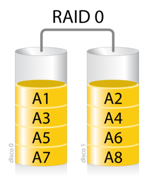{ width="50%" }
  <figcaption>RAID 0: los datos se reparten entre dos discos</figcaption>
</figure>

<figure markdown="span" align="center">
  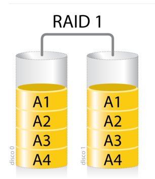{ width="50%" }
  <figcaption>RAID 1: cada dato se escribe en los dos discos</figcaption>
</figure>

<figure markdown="span" align="center">
  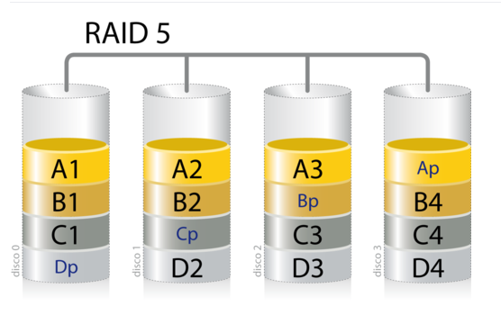{ width="50%" }
  <figcaption>RAID 5: los datos y la paridad se reparten entre tres discos o más</figcaption>
</figure>

!!! danger "RAID no es una copia de seguridad"
    RAID protege frente a la **avería de un disco**, no frente a un borrado accidental, un virus o un fallo del sistema: si se borra un archivo, se borra en todos los discos a la vez. Las copias de seguridad son aparte.

### Cómo se implementa

Hay tres formas, con diferencias reales de rendimiento y fiabilidad:

| Tipo | Quién hace el trabajo | Características |
|------|-----------------------|-----------------|
| **Por hardware** | Una **controladora RAID** dedicada, con su procesador y caché | Mejor rendimiento y fiabilidad; es lo habitual en servidores de producción |
| **De firmware («BIOS RAID»)** | El firmware de la placa, apoyado en un controlador del SO | Más barato; depende del controlador y suele considerarse inferior al RAID por hardware |
| **Por software** | El propio sistema operativo | Flexible y barato; consume CPU y depende de que el SO funcione |

## Ampliación: volúmenes dinámicos

??? note "Volúmenes dinámicos de Windows (RAID por software)"
    Windows Server permite crear volúmenes RAID por software convirtiendo los discos de **básicos** a **dinámicos**. Es lo que se hacía tradicionalmente y sirve para entender cómo funciona, aunque Microsoft recomienda hoy **Espacios de almacenamiento (Storage Spaces)** para estas funciones.

    | Tipo de volumen | Equivale a | Discos mínimos |
    |-----------------|-----------|:--------------:|
    | **Distribuido** | Suma el espacio de varios discos | 2 |
    | **Seccionado** | RAID 0 | 2 |
    | **Reflejado** | RAID 1 | 2 |
    | **RAID-5** | RAID 5 | 3 |

    **Cómo se convierte un disco:** clic derecho sobre el disco → **Convertir en disco dinámico**.

    <figure markdown="span" align="center">
      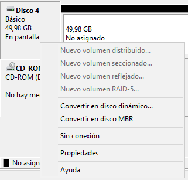{ width="50%" }
      <figcaption>Convertir un disco básico en dinámico</figcaption>
    </figure>

    Con los discos dinámicos, desde el menú contextual aparecen **Nuevo volumen distribuido**, **seccionado**, **reflejado** (*Agregar reflejo*) y **RAID-5**.

    <figure markdown="span" align="center">
      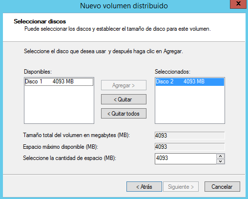{ width="50%" }
      <figcaption>Asistente para nuevo volumen distribuido: seleccionar discos y espacio de cada uno</figcaption>
    </figure>

    <figure markdown="span" align="center">
      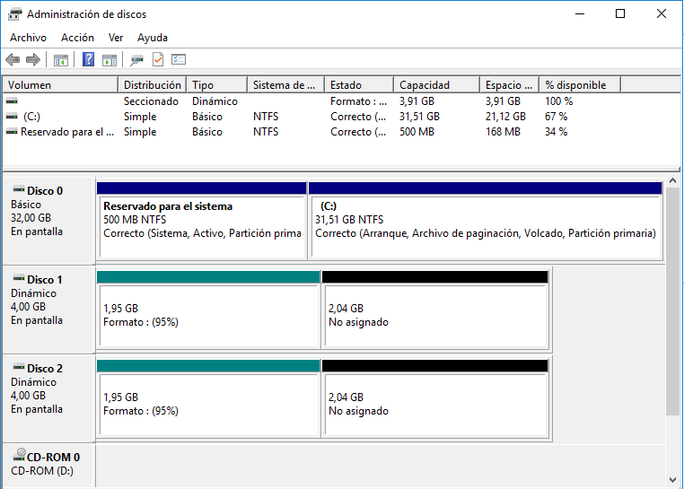{ width="70%" }
      <figcaption>Administración de discos: volumen seccionado (RAID 0)</figcaption>
    </figure>

    <figure markdown="span" align="center">
      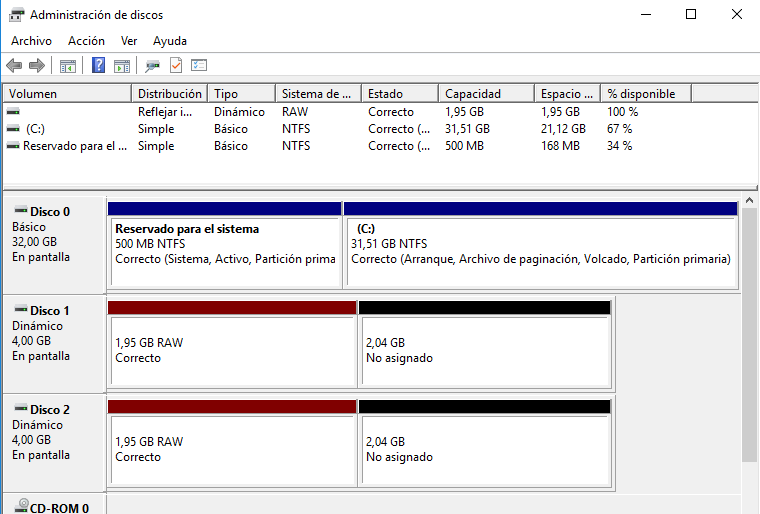{ width="70%" }
      <figcaption>Administración de discos: volumen reflejado (RAID 1)</figcaption>
    </figure>

    <figure markdown="span" align="center">
      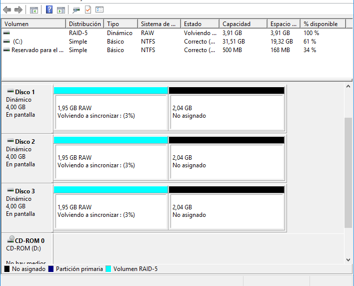{ width="70%" }
      <figcaption>Administración de discos: volumen RAID-5</figcaption>
    </figure>

    **Limitaciones**

    - Un volumen distribuido, seccionado, reflejado o RAID-5 **solo existe en discos dinámicos**: al crearlo, Windows convierte los discos.
    - Un disco dinámico **no se reconoce en otros sistemas operativos** (otro Windows con las herramientas adecuadas sí, pero no un Linux).
    - **Volver de dinámico a básico** exige **eliminar todos los volúmenes**, así que se pierden los datos.
    - **RAID 0 no tiene tolerancia a fallos**: si falla un disco, se pierde todo el volumen.

    !!! note "Verifica el estado actual"
        La recomendación de Microsoft sobre discos dinámicos y Storage Spaces puede cambiar entre versiones. Consulta la documentación de Windows Server 2025.

## Errores típicos

| Síntoma | Causa probable | Solución |
|---------|----------------|----------|
| El disco nuevo no aparece | No se ha añadido a la MV, o no se ha reiniciado | Revisar la configuración de almacenamiento |
| Aparece «Sin conexión» | El disco está desconectado lógicamente | Clic derecho → **En línea** |
| Aparece «No inicializado» | Disco nuevo sin tabla de particiones | **Inicializar disco** (GPT) |
| **Extender volumen** está en gris | No hay espacio sin asignar contiguo a la derecha | Reducir o eliminar el volumen siguiente, o crear otro volumen |
| La letra elegida ya está en uso | Otra unidad la tiene (incluida la del lector óptico) | Elegir otra letra |
| El volumen aparece como «RAW» | Sin formato | Dar formato (¡destruye datos!) |
| El volumen ocupa menos que el disco | Solo se usó parte del espacio | Extender o crear otro volumen |

## Lista de comprobación

- [ ] Sabes **añadir** un disco a la MV y que aparezca en Administración de discos.
- [ ] Has **inicializado** el disco como **GPT**.
- [ ] Has creado un **volumen simple NTFS** con etiqueta y letra, y puedes crear una carpeta dentro.
- [ ] Sabes explicar la diferencia entre **RAID 0, 1 y 5** y por qué **RAID no es una copia de seguridad**.

## Con PowerShell y DiskPart (opcional)

??? note "Para alumnado más avanzado"
    Todo se puede hacer desde la consola. **No es necesario para seguir el módulo.**

    | Tarea | PowerShell |
    |-------|------------|
    | Ver los discos | `Get-Disk` |
    | Poner un disco en línea | `Set-Disk -Number 1 -IsOffline $false` |
    | Inicializar como GPT | `Initialize-Disk -Number 1 -PartitionStyle GPT` |
    | Crear una partición que ocupa todo el disco | `New-Partition -DiskNumber 1 -UseMaximumSize -AssignDriveLetter` |
    | Dar formato NTFS con etiqueta | `Format-Volume -DriveLetter E -FileSystem NTFS -NewFileSystemLabel "Datos"` |

    También existe la herramienta clásica **`diskpart`**, de línea de comandos, que funciona dentro de su propio intérprete.

    **Preguntas de lectura**

    1. ¿Qué pasaría si en `Initialize-Disk` olvidas el número de disco y lo ejecutas sobre el disco del sistema?
    2. ¿Por qué `Format-Volume` necesita la letra de unidad y no el número de disco?

## Resumen

- Preparar un disco es **inicializarlo** (GPT), **crear volúmenes** y **darles formato** (NTFS).
- Los datos de un servidor van en un **disco aparte** del sistema operativo.
- Extender un volumen solo es posible con **espacio libre contiguo a su derecha**.
- **RAID 0** da velocidad sin protección, **RAID 1** copia, **RAID 5** reparte con paridad. **RAID no sustituye a una copia de seguridad.**
- Los **volúmenes dinámicos** son la forma clásica de hacer RAID por software en Windows, pero hoy Microsoft recomienda Storage Spaces.
