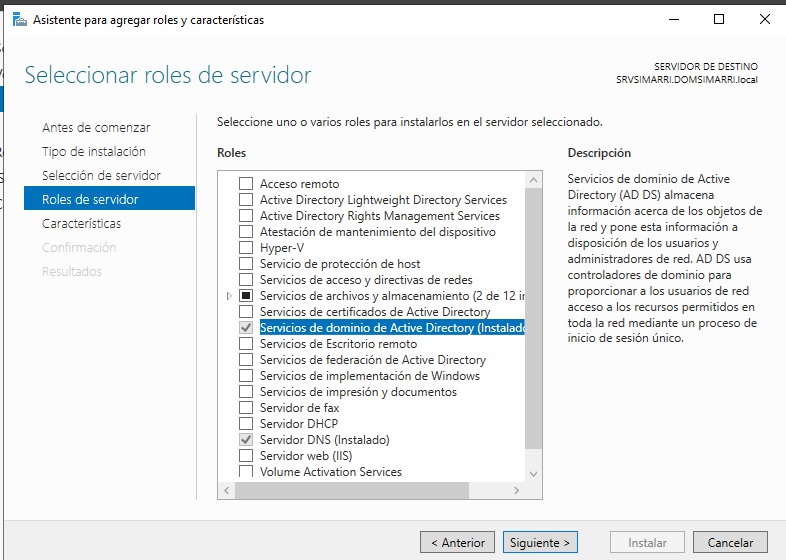
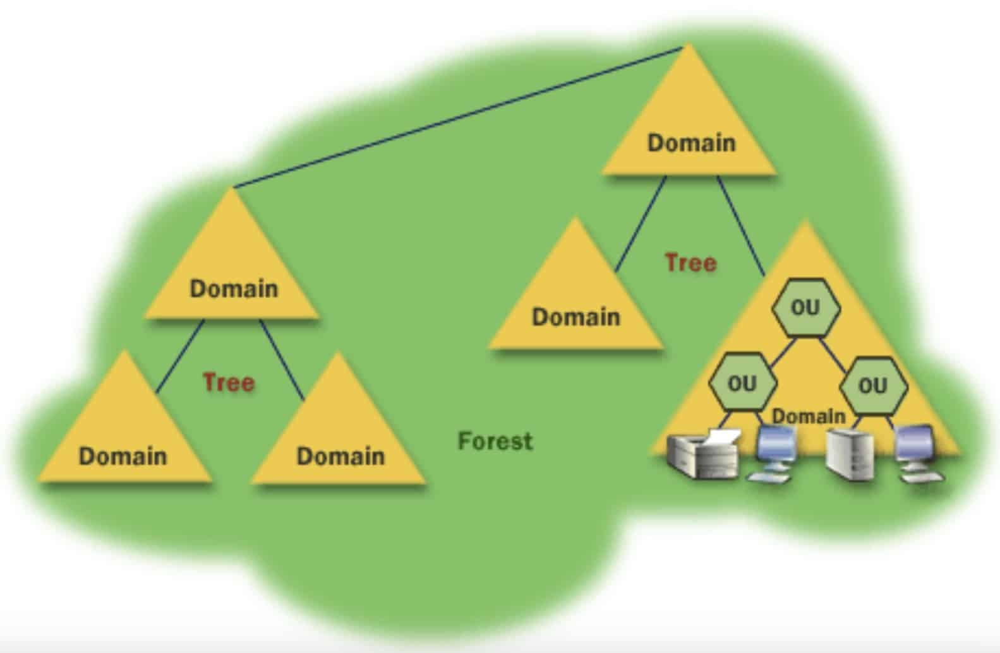
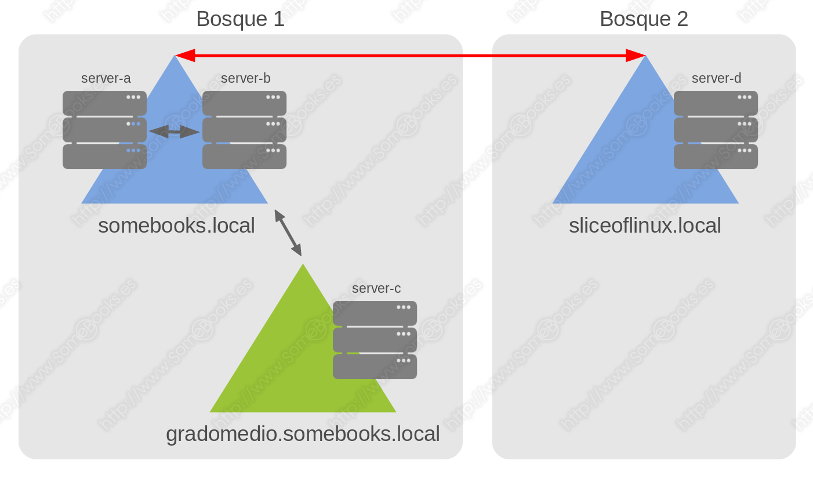

El servidor ya tiene nombre, red y salida a Internet. Falta lo que lo convierte en el **centro de la red**: crear el **dominio**. Es el momento en el que pasamos de «un Windows con muchas cosas instaladas» a **un servidor que decide quién entra en la red y con qué permisos**.

Convertir un servidor en controlador de dominio es un proceso en **dos fases**:

1. **Instalar el rol** Servicios de dominio de Active Directory (AD DS): copia los componentes, pero no cambia nada.
2. **Promocionar** el servidor a controlador de dominio: es el paso que crea el dominio, y reinicia el servidor.

!!! warning "Es un cambio profundo"
    Tras la promoción, el servidor deja de tener usuarios locales y su cuenta de Administrador se convierte en la del dominio. **Haz una instantánea antes**.

## Conceptos mínimos

| Concepto | Qué es |
|----------|--------|
| **Dominio** | Agrupación lógica de usuarios, equipos y recursos con una administración común |
| **Controlador de dominio (DC)** | Servidor que guarda el directorio y atiende los inicios de sesión |
| **Directorio** | Base de datos de objetos: usuarios, equipos, grupos, políticas… |
| **Bosque** | El conjunto de dominios que comparten directorio; el primero que se crea es la «raíz» |
| **DNS** | Servicio de nombres. Active Directory **lo necesita**: los clientes encuentran al controlador de dominio preguntando al DNS |

!!! info "¿Por qué Active Directory depende del DNS?"
    Cuando un cliente quiere iniciar sesión, **pregunta al DNS dónde está el controlador de dominio**. Si el DNS no responde bien, el dominio «no existe» para él. Por eso casi todos los problemas de dominio son, en realidad, problemas de DNS.

### Nombre del dominio

Cada dominio tiene dos nombres:

| Nombre | Ejemplo | Para qué |
|--------|---------|----------|
| **DNS** (completo) | `techsolutions.lan` | El principal; sigue la notación de DNS, con al menos dos partes |
| **NetBIOS** (corto) | `TECHSOLUTIONS` | Compatibilidad; es el que se escribe en `DOMINIO\usuario` (máximo 15 caracteres) |

!!! warning "Elegir bien el nombre"
    - **Evita `.local`**: se reserva para otros usos (mDNS) y puede dar conflictos.
    - En una empresa real se suele usar un **subdominio de un dominio propio registrado** (por ejemplo, `ad.empresa.com`).
    - En un laboratorio vale un sufijo que no exista en Internet, como `.lan`.
    - **El nombre no se puede cambiar fácilmente después**: pénsalo antes.

## Antes de promocionar: lista de comprobación

- [ ] El servidor tiene su **nombre definitivo** (apartado de configuración básica).
- [ ] Tiene **IP estática** y se ha comprobado la red.
- [ ] La **hora y zona horaria** son correctas.
- [ ] La contraseña del **Administrador local** cumple la complejidad, porque pasará a ser la del dominio.
- [ ] Hay una **instantánea** del servidor.

## Instalar el rol AD DS

1. *Administrador del servidor → Administrar → Agregar roles y características*.
2. Instalación basada en roles o características, servidor local.
3. Marca **Servicios de dominio de Active Directory** y acepta las características que pida.
4. **Instalar**.

<figure markdown="span" align="center">
  { width="80%" }
  <figcaption>Selección del rol Servicios de dominio de Active Directory</figcaption>
</figure>

Al terminar, en el Administrador del servidor aparece un **triángulo amarillo** en la bandera de notificaciones: es el aviso de que falta la configuración posterior.

## Promocionar a controlador de dominio

1. Clic en la **bandera amarilla → Promover este servidor a controlador de dominio**.
2. **Configuración de implementación:** elige **Agregar un nuevo bosque** (porque aún no existe ningún dominio) y escribe el **nombre de dominio raíz**.

<!-- IMG NUEVA: promocion_nuevo_bosque.png — Configuración de implementación -->

3. **Opciones del controlador de dominio:**
    - **Nivel funcional** del bosque y del dominio: en un entorno nuevo, el más alto compatible con todos los DC (en nuestro caso, Windows Server 2025).
    - Marca **Servidor DNS** y **Catálogo global**.
    - Establece la **contraseña del modo de restauración de servicios de directorio (DSRM)**.

!!! info "¿Qué es la contraseña DSRM?"
    Es una contraseña de emergencia para arrancar el controlador de dominio en modo de reparación. Es **distinta** de la del Administrador del dominio. Guárdala en un sitio seguro: si la pierdes, no podrás reparar el directorio.

<!-- IMG NUEVA: promocion_opciones_dc.png — Opciones del controlador de dominio -->

4. **Opciones de DNS:** puede aparecer el aviso *«No se puede crear una delegación para este servidor DNS»*. En un dominio nuevo **es normal e inofensivo**: no hay un DNS superior al que delegar.
5. **Nombre NetBIOS:** acepta el que propone o modifícalo.
6. **Rutas:** carpeta de la base de datos, de los registros y de SYSVOL. En una instalación básica se dejan las que propone. En servidores con varios discos se pueden separar por rendimiento.
7. **Revisar opciones** y **comprobación de requisitos previos**: debe terminar con *«Se han superado todas las comprobaciones»*. Los avisos amarillos suelen ser tolerables; un **error rojo** impide continuar.
8. **Instalar.** El servidor se reinicia automáticamente.

## Después de la promoción

Al volver a iniciar sesión, el usuario es del dominio: `TECHSOLUTIONS\Administrador`. La contraseña es la que tenía el Administrador local.

### Ajustes imprescindibles de DNS

1. **El DNS del propio servidor debe ser él mismo.** En las propiedades IPv4 del adaptador, pon como servidor DNS **su propia IP**.
2. **Reenviadores.** El servidor DNS conoce los nombres del dominio, pero no los de Internet. Para que resuelva ambos:
    - *Administrador del servidor → Herramientas → **DNS***.
    - Clic derecho en el servidor → **Propiedades → Reenviadores → Editar**.
    - Añade un DNS externo (por ejemplo, el del proveedor o `8.8.8.8`).

!!! tip "Resultado"
    Los clientes usarán **solo** al controlador de dominio como DNS: resuelve los nombres internos él mismo y reenvía los de Internet.

<!-- IMG NUEVA: dns_reenviadores.png — Propiedades del servidor DNS, pestaña Reenviadores -->

### Herramientas nuevas

En *Herramientas* del Administrador del servidor aparecen ahora, entre otras:

| Herramienta | Para qué |
|-------------|----------|
| **Usuarios y equipos de Active Directory** | Crear y gestionar usuarios, grupos, equipos y unidades organizativas |
| **DNS** | Administrar zonas y registros |
| **Sitios y servicios de Active Directory** | Replicación entre ubicaciones |
| **Administración de directivas de grupo** | Crear y aplicar directivas |

### Comprobar que el dominio funciona

| Comprobación | Cómo | Qué debe verse |
|--------------|------|----------------|
| **Usuario actual** | `whoami` | `techsolutions\administrador` |
| **Resolución del dominio** | `nslookup techsolutions.lan` | La IP del controlador de dominio |
| **Salud del controlador** | `dcdiag /q` | Sin salida: solo muestra los fallos |
| **Zona DNS** | *Herramientas → DNS → Zonas de búsqueda directa* | Existe la zona con el nombre del dominio |

## Siguiente paso: unir equipos al dominio

Con el dominio creado, el siguiente paso es que los equipos cliente se unan a él. Se explica en el apartado siguiente, **Unir un equipo Windows 11 a un dominio**.

!!! warning "Instantáneas del controlador de dominio"
    Con **un solo** controlador de dominio, restaurar una instantánea funciona. Con **varios** puede romper la replicación. En un laboratorio con un único DC no es un problema, pero conviene saberlo.

## Ampliación: árboles, bosques y confianzas

??? note "Estructuras de dominios más complejas"
    Un dominio puede tener **subdominios** (`ventas.techsolutions.lan`). El dominio principal y sus subdominios forman un **árbol**. Varios árboles independientes forman un **bosque**.

    <figure markdown="span" align="center">
      { width="70%" }
      <figcaption>Árbol y bosque de Active Directory</figcaption>
    </figure>

    Para que los usuarios de un dominio accedan a recursos de otro se establecen **relaciones de confianza**:

    | Tipo | Entre qué |
    |------|-----------|
    | **Transitivas** | Dominios del mismo bosque (automáticas) |
    | **Externas** | Dominios de bosques distintos |
    | **De bosque** | Dos bosques completos |
    | **De reino** | Un dominio de Windows y un dominio Kerberos que no es de Windows |

    <figure markdown="span" align="center">
      { width="70%" }
      <figcaption>Relaciones de confianza entre dominios</figcaption>
    </figure>

    En este módulo trabajamos con **un único dominio**, que es lo más habitual en una pyme.

## Errores típicos

| Síntoma | Causa probable | Solución |
|---------|----------------|----------|
| La promoción falla en los requisitos previos | Contraseña del administrador local débil o nombre no válido | Cambiar la contraseña o el nombre |
| Aviso de delegación DNS | Normal en un dominio nuevo | Ignorarlo |
| Los clientes no salen a Internet tras crear el dominio | Falta el **reenviador** en el DNS | Añadir un reenviador |

## Lista de comprobación

- [ ] El servidor es **controlador de dominio** y entras con `DOMINIO\Administrador`.
- [ ] El DNS del servidor es **él mismo** y tiene **reenviadores**.
- [ ] `nslookup` del dominio devuelve la IP del controlador.
- [ ] Hay una **instantánea** del dominio recién creado.

## Con PowerShell (opcional)

??? note "Para alumnado más avanzado"
    Todo el proceso se puede hacer por consola. **No es necesario para seguir el módulo.**

    | Tarea | Comando |
    |-------|---------|
    | Instalar el rol AD DS | `Install-WindowsFeature AD-Domain-Services -IncludeManagementTools` |
    | Crear el bosque y el dominio | `Install-ADDSForest -DomainName "techsolutions.lan" -DomainNetbiosName "TECHSOLUTIONS" -InstallDns` |
    | Ver los datos del dominio | `Get-ADDomain` |
    | Ver los controladores | `Get-ADDomainController` |
    | Degradar un controlador | `Uninstall-ADDSDomainController` |

    Si no se indica `-SafeModeAdministratorPassword`, el comando **pide la contraseña DSRM por pantalla**, sin dejarla escrita.

    **Preguntas de lectura**

    1. ¿Por qué no es buena idea escribir la contraseña DSRM dentro de un script?
    2. ¿Qué dos parámetros del comando de creación del bosque corresponden a los dos nombres del dominio?

    !!! note "Niveles funcionales"
        Para fijarlos por comando hay que usar los parámetros `-ForestMode` y `-DomainMode` con el valor de la versión elegida. Consulta los valores exactos con `Get-Help Install-ADDSForest -Parameter ForestMode`.

## Resumen

- Crear un dominio son **dos fases**: instalar el rol AD DS y **promocionar** el servidor.
- Active Directory **depende del DNS**: casi todos los problemas de dominio son de DNS.
- Tras la promoción: el servidor usa **su propia IP como DNS** y se configura un **reenviador** para Internet.
- Los clientes se unen al dominio en el apartado siguiente: necesitan **Windows 11 Pro/Enterprise/Education** y **DNS = controlador**.
