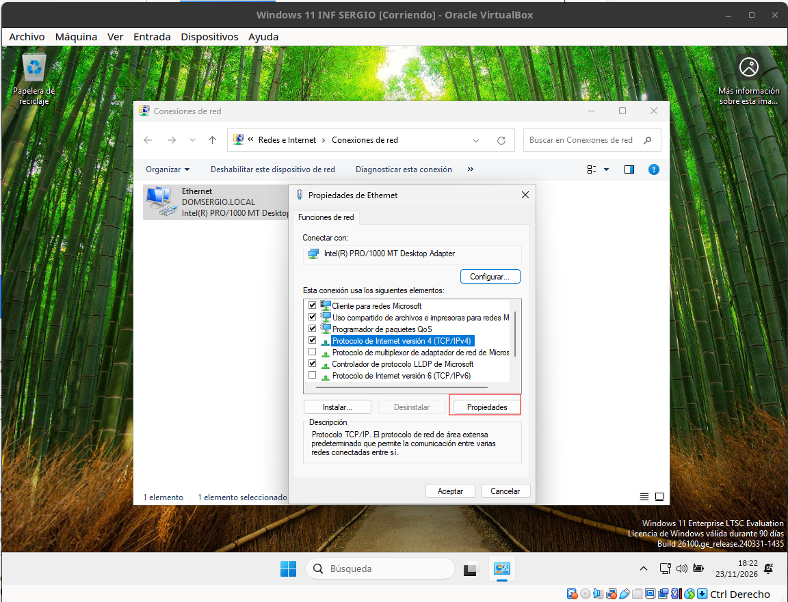
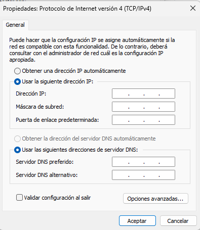

Hasta ahora, cuando alguien iniciaba sesión en un equipo, **el propio equipo** comprobaba su usuario y su contraseña. Unir un equipo a un dominio cambia quién decide: a partir de ese momento **el controlador de dominio** valida las cuentas del dominio. El equipo pasa a ser «socio del club»: tiene un carnet (su cuenta de equipo en Active Directory) y acepta las normas del club.

Unir un equipo parece un solo paso, pero casi todos los fallos vienen de **lo que hay que preparar antes**. Este apartado sigue siempre la misma secuencia:

1. Conectar el cliente a la red correcta.
2. Configurar su red, **con el DNS apuntando al controlador**.
3. Verificar la conectividad.
4. Ponerle nombre.
5. Unirlo al dominio y verificar.
6. Iniciar sesión y distinguir **cuenta del equipo** de **cuenta del dominio**.

## Requisitos previos

- [ ] El cliente tiene instalado **Windows 11 Pro, Enterprise o Education**. **Home no puede unirse.**
- [ ] El servidor ya es **controlador de dominio** y su DNS funciona.
- [ ] La regla de eco ICMPv4 está habilitada **en el servidor**.
- [ ] La **hora** del cliente es correcta.

Para comprobar la edición: *Configuración → Sistema → Información*.

## 1. Red en VirtualBox

El cliente debe estar en la **misma red** que el servidor. Con la MV apagada:

1. *Configuración → Red → Adaptador 1*.
2. **Conectado a: Red interna**.
3. **Nombre:** el mismo que tiene el adaptador interno del servidor (se distingue entre mayúsculas y minúsculas).
4. Comprueba que **Cable conectado** está marcado.

<!-- IMG NUEVA: cliente_vbox_red_interna.png — Configuración > Red del cliente -->

!!! warning "Un solo adaptador"
    Si el servidor hace de router (apartado anterior), el cliente solo necesita **un adaptador**, en la red interna. Si además dejas uno en NAT, el cliente tendrá **dos puertas de enlace** y la conectividad será errática.

Los modos de red se explican con detalle en la UD05.

## 2. Red en Windows

Dentro del cliente: *Windows + R* → `ncpa.cpl` → clic derecho sobre el adaptador → **Propiedades → Protocolo de Internet versión 4 (TCP/IPv4) → Propiedades**.

<figure markdown="span" align="center">
  { width="70%" }
  <figcaption>Conexiones de red: se elige el adaptador y se abren sus propiedades</figcaption>
</figure>

<figure markdown="span" align="center">
  { width="70%" }
  <figcaption>Propiedades de TCP/IPv4 del cliente</figcaption>
</figure>

| Parámetro | Valor |
|-----------|-------|
| **IP** | Una libre del rango de la red del servidor |
| **Máscara** | La misma que el servidor |
| **Puerta de enlace** | La IP del servidor en esa red (si hace de router) |
| **DNS preferido** | **La IP del controlador de dominio** |

!!! danger "El DNS es lo que hace posible unirse"
    El cliente encuentra el dominio **preguntando al DNS**. Si el DNS es el router o uno público, **no sabrá dónde está el controlador** y la unión fallará, aunque todo lo demás esté perfecto.

Para repasar qué es cada parámetro, consulta el **[Apéndice A: Recordatorio de red](06_09_recordatorio_red.md)**.

## 3. Verificar la conectividad

Desde una ventana de símbolo del sistema del **cliente**:

| Comprobación | Comando | Qué debe pasar |
|--------------|---------|----------------|
| **IP recibida** | `ipconfig /all` | IP, máscara, puerta de enlace y DNS correctos |
| **Llegada al servidor** | `ping <IP del servidor>` | Responde |
| **Resolución del dominio** | `nslookup techsolutions.lan` | Devuelve la IP del controlador |
| **Resolución por nombre** | `ping techsolutions.lan` | Responde con la IP del controlador |

!!! tip "El ping solo prueba la red; el nslookup prueba el dominio"
    Si el `ping` por IP funciona pero `nslookup` del dominio falla, el problema es el **DNS**. Es el caso más frecuente.

!!! note "`Servidor: UnKnown` en el nslookup"
    Es normal si el DNS no tiene zona de búsqueda inversa. Lo importante es que **la dirección del dominio sea la del controlador**.

### El ping solo en un sentido

Es habitual que el cliente llegue al servidor, pero el servidor **no** llegue al cliente. No es una avería:

- El **servidor** tiene habilitada la regla de eco, así que contesta.
- El **cliente** Windows 11 la tiene **desactivada por defecto**, así que no contesta.

Para una unión al dominio basta con que **el cliente llegue al servidor**. Si quieres ping en ambos sentidos, habilita la regla de eco ICMPv4 también en el cliente (apartado de configuración básica).

## 4. Poner nombre al equipo

Windows asigna un nombre aleatorio (del tipo `DESKTOP-4F8K2LQ`). Antes de unirlo, **elige un nombre propio**:

- Máximo **15 caracteres**, solo letras, números y guiones.
- **Único** en el dominio.
- Que **identifique** el equipo (por ejemplo, el puesto o el usuario).

**Pasos:** *Configuración → Sistema → Información → Cambiar el nombre de este equipo*, o desde `sysdm.cpl`. **Reinicia.**

En los ejemplos de este apartado el cliente se llama **`PCDEMO`**.

<!-- IMG NUEVA: cliente_cambiar_nombre.png — Cambiar nombre del equipo -->

## 5. Unir al dominio

1. *Windows + R* → `sysdm.cpl`.
2. Pestaña **Nombre de equipo → Cambiar…**
3. En **Miembro de**, selecciona **Dominio** y escribe el nombre DNS: `techsolutions.lan`.
4. Aparece una ventana pidiendo **credenciales**: escribe una cuenta del dominio con permiso para unir equipos, con el dominio por delante: `TECHSOLUTIONS\Administrador`.
5. Debe aparecer **«Bienvenido al dominio techsolutions.lan»**.
6. **Reinicia.**

<!-- IMG NUEVA: cliente_unir_dominio.png — ventana Cambiar nombre o dominio del equipo -->

Veamos el proceso en el siguiente vídeo:

<div style="position: relative; width: 70%; padding-bottom: 39.375%; margin: 0 auto;">
  <iframe src="https://www.youtube-nocookie.com/embed/LxbwB-8b-wg"
          style="position: absolute; top: 0; left: 0; width: 100%; height: 100%;"
          frameborder="0"
          allow="accelerometer; autoplay; clipboard-write; encrypted-media; gyroscope; picture-in-picture"
          allowfullscreen
          title="Unir un equipo cliente a un dominio">
  </iframe>
</div>

??? info "Otra forma: desde Configuración"
    *Configuración → Cuentas → Acceso a trabajo o escuela → Conectar → Unir este dispositivo a un dominio de Active Directory local.* Es el mismo proceso con otra interfaz.

## 6. Verificar que se ha unido

### En el cliente

| Qué | Cómo | Resultado |
|-----|------|-----------|
| **Dominio del equipo** | `sysdm.cpl` o *Configuración → Sistema → Información* | Aparece `techsolutions.lan` |
| **Dominio de la sesión** | `echo %USERDOMAIN%` | El nombre NetBIOS del dominio, tras iniciar sesión con una cuenta del dominio |
| **Quién ha validado el inicio de sesión** | `echo %LOGONSERVER%` | El nombre del controlador de dominio |

### En el servidor

| Qué | Cómo | Resultado |
|-----|------|-----------|
| **Cuenta del equipo** | *Usuarios y equipos de Active Directory → Computers* | Aparece `PCDEMO` |
| **Registro DNS** | *Herramientas → DNS → zona del dominio* | Aparece un registro de host (A) para `PCDEMO` |

!!! tip "Si el registro DNS no aparece"
    En el cliente, ejecuta `ipconfig /registerdns` y actualiza la vista del DNS.

## 7. Iniciar sesión: cuenta del equipo o del dominio

Tras el reinicio, en la pantalla de inicio de sesión hay que elegir **Otro usuario**. Aquí aparece la confusión más habitual, porque en el equipo existen **dos tipos de cuentas**:

| Tipo | Quién la guarda | Quién valida la contraseña |
|------|-----------------|----------------------------|
| **Cuenta local** | El propio equipo | El propio equipo |
| **Cuenta de dominio** | El controlador de dominio | El controlador de dominio |

Y **pueden llamarse igual**. El ejemplo clásico:

| Lo que escribes | Qué cuenta es | Se valida en |
|-----------------|---------------|--------------|
| `PCDEMO\Administrador` o `.\Administrador` | **Administrador local** del equipo | El propio equipo |
| `TECHSOLUTIONS\Administrador` | **Administrador del dominio** | El controlador de dominio |
| `Administrador@techsolutions.lan` | **Administrador del dominio** (otro formato) | El controlador de dominio |
| `Administrador` (sin nada más) | **Ambiguo** | Depende del contexto |

!!! danger "Al escribir solo el nombre, cambias el significado"
    Si escribes solo `Administrador`, no le estás diciendo a Windows **de quién** es esa cuenta, y suele interpretarla como la cuenta **del propio equipo**. Para entrar con una cuenta del dominio hay que indicarlo siempre: **`DOMINIO\usuario`** o **`usuario@dominio`**. Para una cuenta local, **`NOMBREEQUIPO\usuario`** o **`.\usuario`**.

!!! note "El texto «Iniciar sesión en:»"
    Bajo el cuadro de usuario Windows puede mostrar *«Iniciar sesión en: …»*, indicando a qué se refiere un usuario sin prefijo. Es un indicador útil, pero **no te fíes de él: escribe siempre el prefijo**.

<!-- IMG NUEVA: cliente_login_otro_usuario.png — pantalla de inicio de sesión con DOMINIO\usuario -->

### Demostración: comprobar con qué cuenta has entrado

Inicia sesión con cada una y ejecuta en el símbolo del sistema:

| Comando | Cuenta local | Cuenta de dominio |
|---------|--------------|-------------------|
| `whoami` | `pcdemo\administrador` | `techsolutions\administrador` |
| `echo %USERDOMAIN%` | `PCDEMO` | `TECHSOLUTIONS` |
| `echo %LOGONSERVER%` | `\\PCDEMO` | `\\` + nombre del controlador |

Además, cada cuenta tiene **su propio perfil**: al iniciar sesión por primera vez con la cuenta de dominio se crea una carpeta nueva en `C:\Users`. Si ya existía una con el mismo nombre (la de la cuenta local), el perfil del dominio puede aparecer con el **nombre del dominio como sufijo**, algo como `Administrador.TECHSOLUTIONS`.

??? warning "Preparar la demostración: el Administrador local de Windows 11 está desactivado"
    En un cliente Windows 11, la cuenta integrada **Administrador está desactivada** por defecto. Para poder enseñar el contraste con `DOMINIO\Administrador`, el profesor puede **activarla solo para la demostración**, desde un símbolo del sistema **como administrador**:

    ```
    net user administrador /active:yes
    net user administrador *
    ```

    El segundo comando pide la contraseña (sin mostrarla). **Al terminar, desactívala de nuevo:**

    ```
    net user administrador /active:no
    ```

    En un equipo real esta cuenta se deja **desactivada**: es un blanco habitual de ataques. Si prefieres no activarla, el contraste también se puede hacer con el usuario local creado durante la instalación de Windows (por ejemplo, `PCDEMO\alumno`).

## 8. Qué cambia al estar en un dominio

| Qué | Cómo queda |
|-----|-----------|
| **Cuentas locales** | **Siguen existiendo**: se puede iniciar sesión con ellas aunque el controlador esté apagado |
| **Cuentas del dominio** | Los usuarios del dominio pueden iniciar sesión en el equipo |
| **Administradores** | Los administradores del dominio se convierten en **administradores locales** del equipo |
| **Controlador apagado** | Los usuarios que ya habían entrado antes pueden hacerlo con credenciales en caché; los nuevos, no |
| **Políticas** | El equipo empieza a recibir las directivas de grupo del dominio (UD siguientes) |

??? info "¿Quién puede unir equipos al dominio?"
    Los administradores del dominio, sí. Pero por defecto **un usuario normal del dominio puede unir hasta 10 equipos**. Es una configuración que conviene restringir en un entorno real. Verifica el valor en la documentación de Microsoft para tu versión.

## 9. Salir del dominio

1. *Windows + R* → `sysdm.cpl` → **Cambiar…**
2. Selecciona **Grupo de trabajo**, escribe un nombre y acepta.
3. Pide credenciales y **reinicia**.
4. Hace falta conocer la **contraseña de un administrador local** del equipo, porque con la cuenta del dominio ya no se podrá entrar.

!!! warning "La cuenta del equipo no desaparece"
    En el servidor, el objeto del equipo **sigue en Active Directory**, deshabilitado. Si el equipo no va a volver, bórralo en *Usuarios y equipos de Active Directory*.

### Clones e instantáneas

- **Clona el cliente antes de unirlo.** Un clon de un equipo ya unido tiene la misma identidad que el original, y dos equipos con el mismo nombre en un dominio entran en conflicto.
- Si restauras una **instantánea de un cliente ya unido** puede aparecer *«La relación de confianza entre esta estación de trabajo y el dominio principal ha fallado»*, porque la contraseña interna del equipo ha retrocedido. Se soluciona saliendo del dominio y volviendo a unirlo.

## Errores típicos

| Síntoma | Causa probable | Solución |
|---------|----------------|----------|
| *«No se pudo contactar con un controlador de dominio»* | DNS del cliente incorrecto | Poner la IP del controlador como DNS |
| `nslookup` del dominio falla pero el `ping` por IP funciona | DNS | Revisar el DNS del cliente y que el servicio DNS del servidor esté activo |
| No hay `ping` al servidor | Red interna con nombre distinto, IP de otro rango o regla ICMP deshabilitada | Revisar red de VirtualBox, IP y firewall del servidor |
| No aparece la opción de dominio | Windows 11 Home | Usar Pro, Enterprise o Education |
| La unión falla con credenciales correctas | Hora desajustada | Corregir hora y zona horaria |
| *«La cuenta ya existe»* o conflicto de nombre | Otro equipo con el mismo nombre | Cambiar el nombre del cliente |
| No se puede iniciar sesión con el usuario del dominio | Se ha escrito sin prefijo y se interpreta como cuenta local | Usar `DOMINIO\usuario` o `usuario@dominio` |
| Entra, pero con un perfil vacío distinto del esperado | Es el perfil de la cuenta del dominio, otro distinto del local | Es normal: cada cuenta tiene el suyo |
| *«La relación de confianza… ha fallado»* | Instantánea restaurada | Salir del dominio y volver a unir |

## Lista de comprobación

- [ ] El cliente es **Windows 11 Pro** (o Enterprise/Education).
- [ ] Está en la **misma red interna** que el servidor, con **un solo adaptador**.
- [ ] Su **DNS es la IP del controlador de dominio**.
- [ ] `ping` al servidor y `nslookup` del dominio funcionan.
- [ ] Tiene **nombre propio** y se ha reiniciado.
- [ ] Se ha **unido al dominio** y aparece en *Computers* y en el DNS del servidor.
- [ ] Sabes entrar con **`DOMINIO\usuario`** y con **`NOMBREEQUIPO\usuario`**, y distinguir una de otra con `whoami`.

## Con PowerShell (opcional)

??? note "Para alumnado más avanzado"
    Todo el proceso se puede hacer desde la consola. **No es necesario para seguir el módulo.**

    | Tarea | Comando |
    |-------|---------|
    | Cambiar el nombre | `Rename-Computer -NewName "PCDEMO" -Restart` |
    | Poner el DNS | `Set-DnsClientServerAddress -InterfaceAlias "Ethernet" -ServerAddresses 192.168.1.10` |
    | Unir al dominio | `Add-Computer -DomainName "techsolutions.lan" -Credential "TECHSOLUTIONS\Administrador" -Restart` |
    | Ver el dominio del equipo | `(Get-CimInstance Win32_ComputerSystem).Domain` |
    | Salir del dominio | `Remove-Computer -WorkgroupName "WORKGROUP" -Restart` |

    **Preguntas de lectura**

    1. ¿Por qué `Add-Computer` necesita `-Credential`?
    2. ¿Qué devolvería el cuarto comando en un equipo que no está en ningún dominio?
    3. ¿Qué pasaría si ejecutas `Remove-Computer` sin conocer la contraseña de un administrador local?

## Resumen

- Unir un equipo al dominio hace que **el controlador valide las cuentas del dominio**.
- La secuencia es: **red → DNS apuntando al controlador → verificar → nombre → unir → verificar**.
- El **DNS** del cliente debe ser el controlador: es la causa de casi todos los fallos.
- En el equipo conviven **cuentas locales** y **cuentas de dominio**, y pueden llamarse igual.
- Para entrar con una cuenta del dominio hay que escribir **`DOMINIO\usuario`** o **`usuario@dominio`**; sin prefijo, Windows suele entender una cuenta local.
- Con `whoami`, `%USERDOMAIN%` y `%LOGONSERVER%` se comprueba con qué cuenta se ha entrado.
