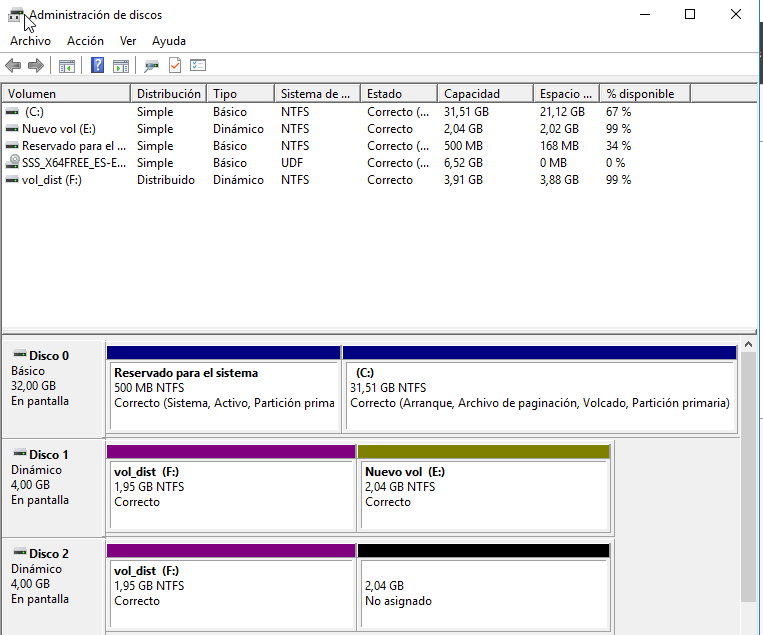

Imagina que heredas un servidor que otro técnico dejó funcionando hace dos años. No está, no contesta al teléfono y algo ha dejado de funcionar. ¿Cómo se llama el equipo? ¿Qué roles tiene? ¿Qué IP debería tener cada tarjeta? ¿Qué se cambió la última vez? Sin documentación, hay que **descubrirlo todo a base de pruebas**, con el servicio caído y los usuarios esperando.

Documentar no es un trámite que se hace «al final si hay tiempo»: es **parte del trabajo del administrador**. Un servidor sin documentar es una deuda técnica que alguien pagará, normalmente en el peor momento.

!!! tip "Regla de oro"
    La documentación se escribe **mientras se trabaja**, no después. Lo que no se anota en el momento, se olvida o se anota mal.

## ¿Para qué sirve?

| Para… | Ejemplo |
|-------|---------|
| **Mantener** el servidor | Saber qué roles y configuración tiene antes de tocarlo |
| **Reparar** en una avería | Reconstruir la configuración en un equipo nuevo |
| **Traspasar** el trabajo | Que otra persona pueda administrarlo sin ti |
| **Auditar** | Demostrar qué se hizo, cuándo y por qué |
| **Aprender de los errores** | Las incidencias anteriores evitan repetirlas |

## Qué hay que documentar

Se organiza por bloques. No hace falta que cada servidor tenga todos, pero conviene repasarlos todos.

| Bloque | Qué se anota |
|--------|--------------|
| **Identificación** | Nombre del equipo, rol, ubicación (sala, rack o plataforma de virtualización), responsable, fecha de instalación |
| **Hardware o máquina virtual** | Procesador, RAM, discos, tarjetas de red con su **MAC** |
| **Sistema operativo** | Versión, edición, modo (Desktop Experience o Core), tipo de licencia y estado de activación |
| **Discos y volúmenes** | Cada volumen: letra, etiqueta, tamaño, sistema de archivos y para qué se usa |
| **Red** | Por cada adaptador: nombre, IP, máscara, puerta de enlace, DNS y a qué red está conectado; rutas y NAT si enruta |
| **Roles y software** | Roles instalados y software adicional, con versión y fecha |
| **Dominio** | Nombre DNS y NetBIOS, nivel funcional, controladores, ubicación de la base de datos |
| **Seguridad** | Estado del firewall y reglas añadidas, antivirus, cuentas administrativas |
| **Mantenimiento** | Actualizaciones aplicadas, copias de seguridad y su frecuencia, instantáneas |
| **Clientes** | Equipos que dependen del servidor: nombre, IP, sistema operativo, usuario habitual |
| **Cambios e incidencias** | Registro cronológico (ver más abajo) |

### Lo que NO debe ir en la documentación

!!! danger "Nunca contraseñas ni claves"
    - **Contraseñas** de administrador, DSRM o cuentas de servicio.
    - **Claves privadas** y certificados.
    - **Claves de producto completas**.

    Lo que sí se documenta es **dónde se custodian** (un gestor de contraseñas, una caja fuerte) y **quién tiene acceso**. Un documento técnico circula, se copia y se envía; una contraseña dentro de él deja de ser secreta.

## Cómo obtener los datos

No hace falta escribirlos de memoria: el propio sistema los da.

| Dato | Herramienta |
|------|-------------|
| Versión y edición | `winver` |
| Resumen del sistema (SO, hardware, parches) | `systeminfo` |
| Detalle del hardware | *Información del sistema* (`msinfo32`) |
| Adaptadores, IP y MAC | `ipconfig /all` |
| Tabla de rutas | `route print` |
| Discos y volúmenes | *Administración de discos* |
| Licencia | `slmgr /dli` |
| Roles instalados | *Administrador del servidor → Panel* |
| Actualizaciones instaladas | *Configuración → Windows Update → Historial de actualizaciones* |
| Errores del sistema | *Visor de eventos* |

!!! tip "Guarda la salida en un fichero"
    Una redirección convierte la pantalla en evidencia:

    ```
    systeminfo > sistema.txt
    ipconfig /all > red.txt
    ```

    Los ficheros se crean en la carpeta actual y se pueden adjuntar a la documentación.

## Evidencias: las capturas de pantalla

Una afirmación sin prueba es solo una opinión. Las **capturas** demuestran que algo está configurado como se dice. Para que sirvan:

- Que se vea el **nombre del equipo** (en el título de la ventana o en una esquina).
- Que se vea la **fecha y la hora** si es relevante.
- **Recorta** lo que importa, pero sin perder el contexto.
- Pon un **pie descriptivo**: qué se ve y por qué es relevante.
- **Nombra los ficheros** de forma ordenada: `srv01_red_adaptadores.png`, no `Captura de pantalla (3).png`.
- No incluyas datos sensibles (contraseñas visibles, claves).

<figure markdown="span" align="center">
  { width="80%" }
  <figcaption>Ejemplo de evidencia: Administración de discos con los volúmenes y sus etiquetas visibles</figcaption>
</figure>

## Estructura recomendada del documento

Una estructura fija ahorra decidir cada vez qué incluir:

1. **Portada y control de versiones** (autor, fecha, versión).
2. **Descripción general**: para qué sirve el servidor.
3. **Ficha técnica**: hardware, sistema operativo, discos.
4. **Configuración de red**: tabla de adaptadores y diagrama.
5. **Roles y servicios instalados.**
6. **Configuración del dominio** (si aplica).
7. **Seguridad y copias de seguridad.**
8. **Clientes conectados.**
9. **Registro de cambios e incidencias.**
10. **Anexos**: capturas y salidas de comandos.

### Ejemplo de ficha de red

| Adaptador | Conectado a | IP | Máscara | Puerta de enlace | DNS |
|-----------|-------------|----|---------|------------------|-----|
| `Internet` | Salida a Internet | 192.168.1.10 | 255.255.255.0 | 192.168.1.1 | 192.168.1.1 |
| `LAN-oficina` | Red interna | 10.0.0.1 | 255.255.255.0 | – | 10.0.0.1 |

!!! note "Datos de ejemplo"
    Los valores son ilustrativos. Lo importante es la estructura: **cada adaptador, a qué red va y con qué parámetros**.

### El diagrama de red

Un dibujo explica en segundos lo que una tabla tarda minutos. Debe mostrar:

- Los **dispositivos** (servidor, switches, routers, clientes) con formas distintas.
- Las **conexiones**.
- Las **direcciones IP** y el nombre de cada equipo.
- Cuál es la **puerta de enlace** y quién ofrece el **DNS**.

Se puede hacer con **draw.io**, **Lucidchart** o, en último caso, papel y lápiz. Si necesitas repasar los parámetros, consulta el **[Apéndice A: Recordatorio de red](06_09_recordatorio_red.md)**.

## Registro de cambios e incidencias

El estado actual es solo una foto. Lo que da valor es el **historial**: qué cambió, cuándo y por qué.

### Registro de cambios

| Fecha | Cambio | Motivo | Quién | Resultado |
|-------|--------|--------|-------|-----------|
| 12/09 | Añadido disco de datos de 100 GB | El volumen de usuarios estaba lleno | Ana | Correcto |
| 20/09 | Instaladas actualizaciones de septiembre | Mantenimiento mensual | Luis | Correcto, tras reinicio |

### Registro de incidencias

Cada incidencia merece una entrada con cuatro datos: **síntoma, causa, solución y cómo evitarla**.

| Campo | Ejemplo |
|-------|---------|
| **Fecha** | 25/09 |
| **Síntoma** | Un cliente no podía unirse al dominio de TechSolutions |
| **Causa** | Su DNS apuntaba al router y no al controlador de dominio |
| **Solución** | Cambiar el DNS del cliente a la IP del controlador |
| **Prevención** | Incluir la comprobación del DNS en la lista de alta de equipos |

!!! tip "Las incidencias son oro"
    Una incidencia bien documentada se convierte en la solución de la siguiente. Con el tiempo, el registro de incidencias vale más que cualquier manual.

## Copia del sistema recién instalado

Cuando el servidor está instalado, configurado y documentado, es el momento de guardar una **copia del estado limpio**:

- En una **máquina virtual**: una **instantánea** y, si hace falta moverla, una **exportación** a OVA (UD05).
- En un **servidor físico**: una **imagen del sistema** con las herramientas de copia de seguridad.

Esa copia es el «punto cero» al que volver si algo sale mal. Tiene que **documentarse también**: qué es, cuándo se hizo y dónde está.

## Mantenerla viva

Una documentación desactualizada es **peor que ninguna**, porque lleva a decisiones equivocadas con apariencia de fiabilidad.

- **Actualízala con cada cambio**, en el momento.
- Lleva un **control de versiones**: fecha, autor y qué cambió.
- Guárdala en un sitio **accesible para quien la necesite** y **protegido** para quien no.
- Fija una **revisión periódica**.

## Errores típicos

| Fallo | Consecuencia | Cómo evitarlo |
|-------|--------------|---------------|
| Documentar al final de memoria | Datos incompletos o incorrectos | Anotar mientras se hace |
| Incluir contraseñas | Fallo de seguridad al compartir el documento | Documentar dónde se custodian |
| Capturas sin contexto | No se sabe de qué equipo ni de cuándo son | Nombre del equipo visible y pie descriptivo |
| Describir lo que «debería» ser, no lo que es | El documento no coincide con la realidad | Copiar los datos del propio sistema |
| No registrar los cambios | No se sabe por qué algo es como es | Registro de cambios con motivo |
| Documento desactualizado | Decisiones equivocadas | Versionar y revisar |

## Lista de comprobación

- [ ] El documento tiene **identificación, hardware, sistema operativo, discos, red, roles y dominio**.
- [ ] Los datos se han tomado **del propio sistema**, no de memoria.
- [ ] **No** hay contraseñas, claves privadas ni claves de producto.
- [ ] Las capturas tienen el **nombre del equipo**, un **pie** y un **nombre de fichero ordenado**.
- [ ] Hay un **diagrama de red** con IP, puerta de enlace y DNS.
- [ ] Existe un **registro de cambios e incidencias**.
- [ ] Se ha guardado una **copia del estado limpio** y está documentada.

> [Descargar documento de ejemplo](files/Documentacion_Equipo_ISCA.docx)

## Con PowerShell (opcional)

??? note "Para alumnado más avanzado"
    PowerShell permite recoger datos de forma ordenada y exportarlos. **No es necesario para seguir el módulo.**

    | Dato | Comando |
    |------|---------|
    | Resumen del sistema | `Get-ComputerInfo` |
    | Configuración de red | `Get-NetIPConfiguration` |
    | Discos y volúmenes | `Get-Volume` |
    | Roles y características instaladas | `Get-WindowsFeature \| Where-Object Installed` |
    | Actualizaciones instaladas | `Get-HotFix` |
    | Guardar una salida en un fichero | `Get-HotFix \| Out-File actualizaciones.txt` |

    **Preguntas de lectura**

    1. ¿Qué ventaja tiene sacar los datos de un comando frente a escribirlos a mano?
    2. ¿Por qué `Get-WindowsFeature` se filtra con `Where-Object Installed`?

## Resumen

- Documentar es parte del trabajo de administrar: se hace **mientras se trabaja**.
- Se documenta **qué hay** (ficha técnica), **cómo está conectado** (red y diagrama) y **qué ha pasado** (cambios e incidencias).
- **Nunca** van contraseñas ni claves: solo dónde se custodian.
- Las **capturas** son evidencias: con nombre del equipo, pie descriptivo y nombre de fichero ordenado.
- Una documentación **desactualizada** es peor que ninguna.
