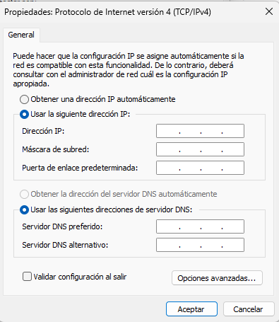
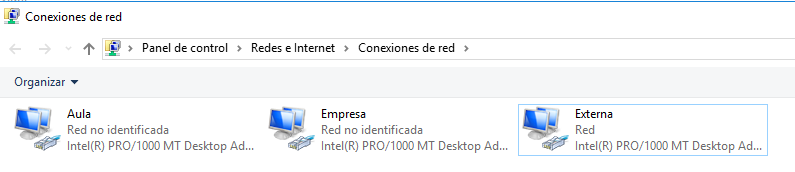

Una cosa es entender la red en clase y otra muy distinta **configurarla en una máquina real** cuando algo no responde. Este apéndice es una **hoja de consulta** para cuando eso pasa: qué significa cada parámetro, dónde se configura en Windows y cómo comprobar, paso a paso, dónde está el fallo.

## Los cuatro parámetros

Para hablar con otros equipos, cada dispositivo necesita cuatro datos. Si uno falla, la red falla de una forma muy concreta.

<figure markdown="span" align="center">
  { width="70%" }
  <figcaption>Configuración IPv4 de un equipo Windows</figcaption>
</figure>

| Parámetro | Qué es | Analogía | Si está mal |
|-----------|--------|----------|-------------|
| **Dirección IP** | Identificador del equipo en la red | La dirección postal de tu casa | No te encuentran, o chocas con otro equipo |
| **Máscara de subred** | Qué parte de la IP es «la calle» (red) y cuál «el número» (equipo) | Saber qué direcciones son de tu calle | Ves a equipos que no son de tu red, o no ves a los que sí |
| **Puerta de enlace** | Por dónde se sale a otras redes | La salida del edificio hacia la calle | Funciona la red local, pero no sales fuera |
| **Servidor DNS** | Quién traduce nombres a IP | La guía telefónica | Llegas por IP pero no por nombre |

### Dirección IP

Es única dentro de su red. En redes locales se usan **IP privadas**, que no se enrutan por Internet:

| Bloque privado | Rango |
|----------------|-------|
| `10.0.0.0/8` | de `10.0.0.0` a `10.255.255.255` |
| `172.16.0.0/12` | de `172.16.0.0` a `172.31.255.255` |
| `192.168.0.0/16` | de `192.168.0.0` a `192.168.255.255` |

### Máscara de subred

Decide **quién está en tu misma red**. La más habitual en redes pequeñas es `255.255.255.0` (también escrita `/24`), que permite hasta **254 equipos** en la misma red.

| Equipo A | Equipo B | Máscara | ¿Misma red? |
|----------|----------|---------|:-----------:|
| `192.168.1.10` | `192.168.1.20` | `255.255.255.0` | Sí. Se hablan directamente |
| `192.168.1.10` | `192.168.2.10` | `255.255.255.0` | **No.** Necesitan un router entre ellos |

!!! danger "La máscara debe coincidir"
    Dos equipos de la misma red con **máscaras distintas** calculan de forma diferente quién es vecino, y se producen fallos difíciles de explicar.

### Puerta de enlace

Es la IP del dispositivo, normalmente un router, al que el equipo envía **todo lo que no es de su red**. Debe estar **en la misma red** que el equipo.

!!! tip "Sin puerta de enlace, sin salida"
    Dejar la puerta de enlace **en blanco** impide al equipo comunicarse fuera de su red. Se usa a propósito en equipos que no deben salir a Internet, pero ten en cuenta que **también** impide alcanzar otras redes internas.

### Servidor DNS

Traduce nombres (`www.ejemplo.com`, `servidor01`) a direcciones IP. Quién sea el DNS **cambia según el entorno**:

- **Red doméstica o equipo suelto:** el router o un DNS público (por ejemplo, el de Google, `8.8.8.8`).
- **Equipo de un dominio:** **siempre el controlador de dominio**. Un DNS público no sabe nada de los nombres internos y el equipo no encontrará el dominio.

## Dónde se configura en Windows

1. *Windows + R* → `ncpa.cpl`.
2. Clic derecho sobre el adaptador → **Propiedades**.
3. **Protocolo de Internet versión 4 (TCP/IPv4) → Propiedades**.

<figure markdown="span" align="center">
  { width="70%" }
  <figcaption>Conexiones de red</figcaption>
</figure>

Hay dos modos:

| Modo | Cómo funciona | Cuándo usarlo |
|------|---------------|---------------|
| **Automático (DHCP)** | Un servidor reparte la configuración | Equipos cliente |
| **Manual (IP estática)** | Tú indicas los cuatro valores | **Servidores**, routers e impresoras de red |

!!! info "Por qué los servidores llevan IP fija"
    Otros equipos buscan al servidor siempre en la misma dirección. Si cambiara, dejarían de encontrarlo.

## Ver la configuración actual

Desde un símbolo del sistema:

| Comando | Para qué |
|---------|----------|
| `ipconfig` | Resumen de IP, máscara y puerta de enlace |
| `ipconfig /all` | Todo: DNS, MAC, si hay DHCP, etc. |
| `ipconfig /release` y `ipconfig /renew` | Soltar y pedir de nuevo la configuración por DHCP |
| `route print` | Tabla de rutas del equipo |

!!! warning "La dirección `169.254.x.x`"
    Si un equipo con DHCP muestra una IP que empieza por `169.254`, **no ha recibido configuración**: se ha asignado una por su cuenta. Revisa la conexión y el servidor DHCP.

## Probar paso a paso

Cuando algo falla, hay que comprobar **de cerca a lejos**. Cada prueba descarta una causa.

| # | Prueba | Qué descarta si funciona | Si falla, mira… |
|:-:|--------|--------------------------|-----------------|
| 1 | `ping 127.0.0.1` | La pila de red del propio equipo | Es muy raro: problema del sistema |
| 2 | `ping <mi propia IP>` | Que la IP esté bien asignada | `ipconfig /all` |
| 3 | `ping <puerta de enlace>` | Cable, red virtual y red local | Cable, adaptador de VirtualBox, IP y máscara |
| 4 | `ping 8.8.8.8` | Que se sale a Internet por IP | Puerta de enlace y enrutamiento |
| 5 | `ping www.google.com` | Que el DNS resuelve | Servidor DNS |
| 6 | `nslookup <nombre>` | Qué responde exactamente el DNS | Servidor DNS configurado |
| 7 | `tracert 8.8.8.8` | Por qué saltos pasa el tráfico | Dónde se corta el camino |

!!! note "El firewall también «responde»"
    Un equipo con el firewall de Windows activo **no contesta al ping** por defecto, aunque la red esté perfecta. Antes de dar la red por rota, comprueba que la regla de eco ICMPv4 está habilitada en el equipo de destino.

## Red sin dominio y red con dominio

Los cuatro parámetros son los mismos; lo que cambia es **quién es el DNS** y **de dónde salen los usuarios**.

### Red doméstica (sin dominio)

| Parámetro | Valor de ejemplo | Explicación |
|-----------|------------------|-------------|
| IP | `192.168.1.10` | Única para cada equipo |
| Máscara | `255.255.255.0` | Define quién es de la misma red |
| Puerta de enlace | `192.168.1.1` | El router |
| DNS | `8.8.8.8` o el router | Resuelve nombres de Internet |

Cada equipo gestiona **sus propios usuarios**.

### Red con dominio

| Parámetro | Valor de ejemplo | Explicación |
|-----------|------------------|-------------|
| IP | `192.168.1.50` | Única para cada equipo |
| Máscara | `255.255.255.0` | La misma que el resto |
| Puerta de enlace | `192.168.1.1` | El dispositivo que enruta fuera de la red |
| **DNS** | `192.168.1.10` | **El controlador de dominio**, que conoce los nombres internos |

Los usuarios los gestiona **el controlador de dominio**.

!!! danger "La regla del DNS en un dominio"
    Un equipo de dominio con un DNS público **no encuentra el dominio**. El controlador de dominio resuelve los nombres internos y reenvía los de Internet.

## Errores de configuración más frecuentes

| Síntoma | Causa probable |
|---------|----------------|
| Mensaje de «conflicto de dirección IP» | Otro equipo tiene la misma IP |
| Se ve la red local pero no Internet | Falta la puerta de enlace, o está mal |
| Se llega a Internet por IP, pero no por nombre | DNS incorrecto |
| No se ve a ciertos equipos de «mi» red | Máscaras distintas o IP de otro rango |
| IP `169.254.x.x` | No hay DHCP o no responde |
| El equipo no encuentra el dominio | DNS apuntando a un servidor público |
| Conectividad errática con varias tarjetas | Más de una puerta de enlace |
| Falla todo después de cambiar de red virtual en VirtualBox | Adaptador en otro modo o con otro nombre de red |

## Planificar el direccionamiento

Antes de configurar equipos, conviene **reservar rangos** para que la red esté ordenada. Una pauta habitual en una red `/24`:

| Rango | Uso |
|-------|-----|
| `.1` a `.20` | Infraestructura (router, servidores, switches) |
| `.21` a `.199` | Equipos de usuario |
| `.200` a `.254` | Periféricos (impresoras, etc.) |

Y para cada dispositivo, apuntar los cuatro datos en una tabla:

| Dispositivo | IP | Máscara | Puerta de enlace | DNS |
|-------------|----|---------|------------------|-----|
| | | | | |
| | | | | |
| | | | | |

!!! tip "Dibuja la red"
    Un diagrama (con **draw.io**, por ejemplo) con cada equipo, su IP y quién es la puerta de enlace evita muchos errores. Cómo documentarlo está en el apartado de documentación de la UD06.

## Lista de comprobación antes de configurar un equipo

- [ ] ¿A **qué red** va conectado (físicamente o en VirtualBox)?
- [ ] ¿Qué **IP** libre le corresponde, dentro del rango?
- [ ] ¿Cuál es la **máscara** de esa red?
- [ ] ¿Cuál es la **puerta de enlace**, o no debe tener?
- [ ] ¿Quién es su **DNS**? ¿Es un equipo de dominio?
- [ ] Después de configurar: ¿he hecho las pruebas **de cerca a lejos**?

## Resumen

- Cuatro parámetros: **IP, máscara, puerta de enlace y DNS**. Cada uno tiene su síntoma cuando falla.
- Los **servidores** llevan IP estática; los clientes, normalmente DHCP.
- En un **dominio**, el DNS de los equipos es **el controlador de dominio**.
- Se diagnostica **de cerca a lejos**: el equipo, la puerta de enlace, Internet por IP, Internet por nombre.
- La **IP `169.254.x.x`** significa que no ha llegado la configuración automática.
- El **firewall** también puede hacer que un equipo «no responda» sin que la red esté rota.
